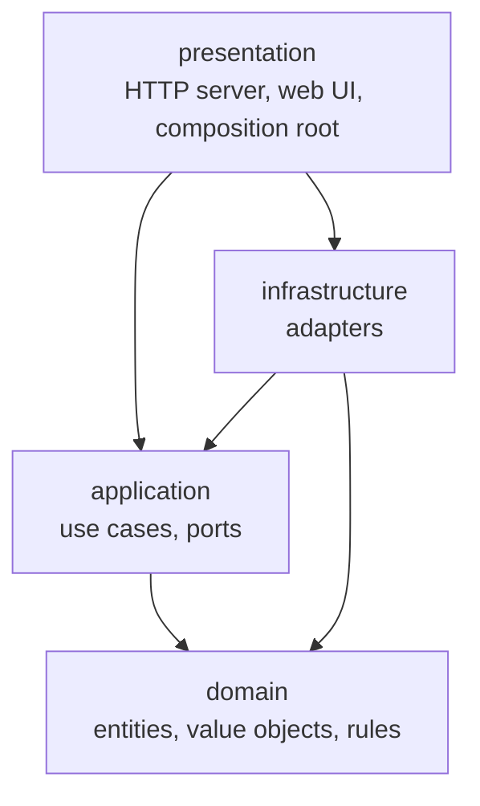
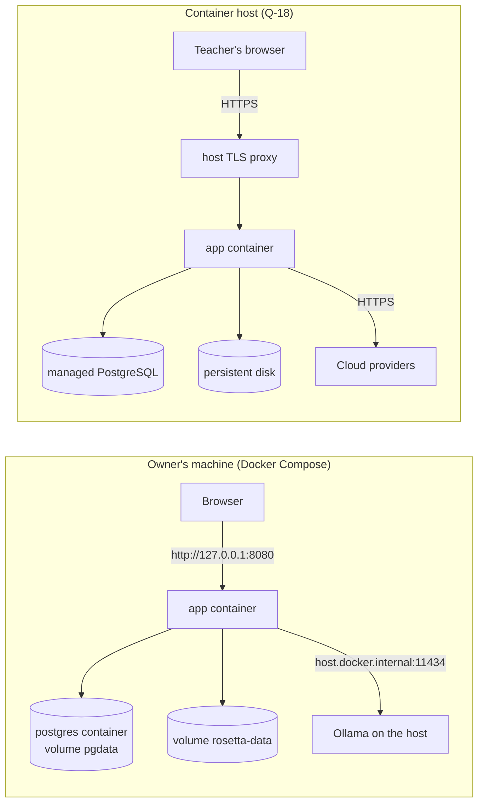

# Architecture (living document)

| | |
|---|---|
| **Status** | Living |
| **Date** | 2026-10-11 (hosted web application, DEC-59..DEC-69) |
| **Owner** | BlackLigth (blacklight0101) |
| **Related** | [RFC-001](rfc/RFC-001-rosetta.md) - [Requirements](spec/requirements.md) - [ADRs](adr/README.md) - [Conventions](conventions.md) - [Data model](data-model.md) - [Environments](environments-and-delivery.md) |

How Rosetta's pieces fit. This document is the canonical home of the **solution layout** (section 4), the **state
lists** (section 5) and the **port names** (section 7). It is updated in the same pull request that changes the
structure. Decisions and their trade-offs are in the ADRs; rules for writing code are in
[conventions.md](conventions.md).

## 1. Context

```mermaid
flowchart LR
  USR[User<br/>developer, tech lead, teacher]
  ADM[Administrator]
  subgraph Host["Container runtime: owner's machine (Compose) or hosted"]
    RST[Rosetta app container<br/>Fastify server + web UI]
    DB[(PostgreSQL)]
    DATA[(Data folder<br/>snapshots, workspaces, logs)]
  end
  OLL[Ollama<br/>on the owner's machine]
  GH[GitHub<br/>public repositories]
  CLOUD[Cloud providers<br/>OpenAI, Anthropic,<br/>OpenAI-compatible]
  PAGES[GitHub Pages<br/>sample report]
  USR -- HTTPS: landing, sign-in, runs, answers, SSE --> RST
  ADM -- HTTPS: accounts, caps, keys --> RST
  RST -- SQL --> DB
  RST -- reads snapshots, writes runs --> DATA
  RST -- resolve ref, download snapshot --> GH
  RST -. local deployment only, host.docker.internal .-> OLL
  RST -- HTTPS, masked excerpts --> CLOUD
  DATA -. sample run published by the owner .-> PAGES
```

Rosetta is a web application with accounts (DEC-59, DEC-62). Visitors see the landing page; users sign in and work
in a private workspace; the administrator manages accounts, server keys and caps. It reads legacy code only as
commit-pinned snapshots of public GitHub repositories, talks to model providers over their APIs, and shows its work
live (ADR-012). Relational data is in PostgreSQL; snapshots and run output are files in the data folder (ADR-016).
The same image runs locally and hosted (ADR-014).

## 2. Containers and components

Two runtime containers (ADR-014): the **app** (one Node.js 24 process, the Fastify server, started by the container
runtime and long-lived) and **PostgreSQL**. Runs execute inside the app process as background jobs, limited by the
run queue (RF-1108). Inside the app:

| Component | Layer | Responsibility |
|---|---|---|
| HTTP server | presentation | Fastify with cookie, CSRF, rate-limit, helmet and static plugins (ADR-017); routes for pages, the JSON API and server-sent events; maps errors to HTTP statuses (RF-007) |
| Authentication and sessions | presentation + infrastructure | sign-in, lockout, session cookie, CSRF and Origin checks, role checks (ADR-015; RF-1009, RF-1100..RF-1103) |
| Web UI | presentation (front end) | landing page, sign-in, projects, start a run, live run, history, report, settings and keys, administration (Preact + Vite, DEC-52) |
| Composition root | presentation | create every adapter and inject it into the use cases; builds a provider set per run from the user's keys or the server keys; the only place that knows concrete classes |
| Use cases | application | projects, `scan`, `understand`, `verify`, `answer`, `report`, `plan`, `estimate`, `export`, `providers test`, accounts, keys, caps, audit |
| Run queue | application | starts queued runs when a slot frees; one running run per user (RF-1108) |
| Agent loop and orchestrator | application | plan agent tasks per area, run the tool-calling loop, collect cards |
| Verifier | application | step 1 citation check, step 2 model judgement (ADR-005) |
| Domain model | domain | code map, areas, cards, claims, citations, statuses, budgets, prices, runs |
| Provider adapters | infrastructure | Ollama, OpenAI, OpenAI-compatible, Anthropic, fake (tests) |
| Guards | infrastructure | egress guard (ADR-006), budget guard (ADR-007) as decorators of the provider port |
| GitHub source | infrastructure | parse URLs, resolve refs to SHAs, download and extract snapshots safely, build permalinks |
| File system adapters | infrastructure | snapshot reader (read-only, ignore rules), output writer (only inside the user's workspace) |
| Database adapters | infrastructure | PostgreSQL repositories with parameterised SQL, migration runner (ADR-016) |
| Security adapters | infrastructure | scrypt password hasher, AES-256-GCM secret box, session token generator (ADR-015) |
| Event sinks | infrastructure | server-sent events broadcaster (per user), `events.jsonl` log |
| Scanner and language packs | infrastructure | universal layer, tree-sitter packs (ADR-004) |
| Writers | infrastructure | Markdown cards, JSON index, specification, HTML report, hand-off package, zip |

## 3. Layers and the dependency rule

Clean Architecture ([ADR-009](adr/ADR-009-clean-architecture.md)):



- `domain` imports nothing outside `domain` and no third-party package; boundary schemas (zod) live in
  `application` (model output, tool arguments) and `infrastructure` (files, configuration).
- `application` imports `domain` and its own ports; it never imports `infrastructure` or `presentation`.
- `infrastructure` implements `application` ports; provider SDKs, tree-sitter, `yazl`, `pg`, `node:crypto` and
  `node:fs` appear only here.
- Fastify and its plugins appear only in `presentation/web/`.
- `presentation` wires everything in one composition root; no business logic.
- No cycles anywhere. Enforced by dependency-cruiser in `npm run verify` (RNF-013, ADR-011).

## 4. Repository and solution layout

Canonical layout; card Delivers paths must match it. Created by the first P1 scaffolding card.

```text
src/
  domain/
    accounts/           User, Role, Session, ProviderKeyRef, UsageCap
    code-map/           CodeMap, FileEntry, Area, Artefact, MapLevel; area grouping (folder buckets, linked sets); the code-unit comparator every sorted list uses
    cards/              Card, CardType, Claim, Citation, ClaimStatus, Verdict, card ids, the claim transitions (`createCard`, `transitionClaim`, `assignCardIds`)
    budget/             TokenUsage, Price (`costOf`, `worstCaseCost` in integer micro-USD), PriceTable
                        (`lookupPrice`), UsageCap and `checkCaps`, the caps of a call (`capsFor`, DEC-107),
                        UTC day and month (`utcPeriodsOf`), `isCapStop`
    runs/               Run (start and end transitions), RunManifest (with `recordPromptVersions`, RNF-004), RunEndState, RunQueueState, AgentTaskState, RunEvent types, the queue rules (`runsToStart`, `queuePositions`)
    sources/            GitHubRepoRef, CommitSha, Permalink
    planning/           PlanningBrief, CatalogueEntry, ArchitectureStyle, StackChoice (ADR-018)
    egress/             the labelled data block of repository content (`renderDataBlock`, `scanDataBlocks`, RF-145)
    errors/             domain error codes and Result type
  application/
    ports/              port interfaces (section 7)
    use-cases/          one file per use case (section 6)
    support/            helpers the use cases share (KeyedQueue: sign-in attempts per user name one at a time)
    runs/               the run queue (`RunQueue`), the run lifecycle (manifest start and end, `run.started`, `run.ended`), the event publisher, the accepted manifest, the event and manifest schemas, the manifest security recorder (mask counts and blocked calls)
    providers/          provider rules the use cases share: which kinds need cloud consent (`needsCloudConsent`, RF-143)
    agent/              the agent loop (`runAgentTask`, its end states and reasons), the read-only tools
                        (`ReadOnlyTools`: definitions, zod-checked arguments, code-map lookup by exact
                        case, result limits), the reader prompt set (`ReaderPrompts`, `promptVersionsOf`);
                        the orchestrator joins here (P1-33)
    understand/         the understand run's parts (P1-33): reader tasks per area (`planReaderTasks`), the task
                        pool (one abort signal), the reader limits from the settings, one reader task with its
                        run events (`runReaderTask`, `providerWithEvents`, `toolsWithEvents`), the cards of the
                        run as tasks end (`RunCards`: ids in area order, citation check) and `UnderstandSession`
    cards/              the card schema, parsing with one repair attempt, the repair request (RF-202)
    verifier/           citation check (step 1, `checkCitations`, P1-33), judgement step (P2)
    estimate/           `EstimateRun`, the assumptions and the reader's token estimate (RF-425, P1-30)
    contracts/          event and API contract types shared with the front end in web/
  infrastructure/
    providers/          ollama/, openai/, openai-compatible/, anthropic/, fake/; at the root the
                        ObservedProvider decorator, the provider call logs (JSON Lines, memory) and what
                        the adapters share: retry loop and back-off, ROSETTA_TEST refusal, tool-call
                        shape, token estimate, capped answer bodies
    guards/             egress-guard (request masking, data-block placement, `JsonlEgressLog`), secret-masker,
                        mask-deep, budget-guard (with its pricing and ledger-row helpers)
    budget/             price-file (`prices/default-prices.yaml`, RF-427), cost-report-files (`cost.json`, `cost.md`)
    github/             github-hosts (allowlist), github-http-client (redirects, token, rate limits), github-api
                        (ref resolution), tarball-extractor (ADR-019 filter), snapshot-store (partial folders,
                        hash, snapshot.json, read-only), github-snapshot-fetcher, fake-source-fetcher
    files/              node-repository-reader, snapshot-index, snapshot-scope, ignore-rules (deny list), grep worker,
                        search and limits, node-output-writer, workspace-guard, workspace-paths, repository-path checks,
                        file-run-manifest-store (`manifest.json`)
    events/             sse-broadcaster, jsonl-event-log, fan-out-sink, memory-event-sink (sequence rules shared in event-order)
    db/                 pool, repositories (users, sessions, keys, projects, runs, cost ledger, audit) with their
                        memory twins, row schemas, migration runner
    security/           password-hasher (scrypt, at most two at a time through a semaphore), session ids (256
                        random bits, stored as SHA-256), the dummy hash for unknown user names, the common-passwords
                        list common-passwords.txt (SecLists, MIT; read at start-up from the repository root, so
                        the image ships this file), aes-gcm-secret-box (HKDF-derived key, fingerprint version,
                        previous key during a rotation), public-address (the refused IPv4 and IPv6 ranges),
                        public-host-check (node:dns lookup with a time limit), public-address-agent (the HTTPS
                        agent that checks every connect again), token generator
    scan/               universal/, packs/csharp/, codemap/ (build the code map, `codemap.json` writer and schema, `scan-summary.md`)
    cards/              the card writers: `cards/<TYPE>/<ID>.md` (YAML header, generated body), `cards/index.json`, `spec.md`, the raw output of an `InvalidOutput` task; every citation a GitHub permalink, everything masked
    writers/            markdown/, json/, html-report/, handoff/, zip/
    config/             environment schema (RF-1305), project settings schema
    prompts/            prompt files read with their version and SHA-256 (`loadReaderPrompts`, RNF-004)
    system/             clock, id generator, logger
  presentation/
    web/                Fastify server, plugins, auth hooks, API routes, server-sent events, error-to-status mapping
    main.ts             start-up: read environment, run migrations, create the bootstrap admin, discard partial snapshot folders (RF-122), end interrupted runs, listen, start the scheduler
    composition-root.ts
web/                    front-end source of the landing page, web UI and report components (Preact + Vite, DEC-52): src/app (router table `routes.ts`, navigation, App, the contexts that hand the API client, the signed-in user and the route parameters to a page), src/api (typed client, wire schemas), src/components (shared components, one per file), src/lib (text-only renderer, theme), src/styles (tokens.css copied from docs/design/, base.css, components.css), src/pages (sign-in, change-password and settings pages, P1-14; projects and project settings pages, P1-41; administration pages `/admin/users`, `/admin/audit` and `/admin/models`, administrator-only rows of the router table, P1-42: the server month meter and the 80% banner add the month-to-date cost of every account, the meter and banner read `serverMonthToDate` of `GET /api/admin/caps`); start run page, P1-34: reads `GET /api/projects/:id`, `GET /api/projects/:id/estimate` (all areas first, then only the chosen ones) and `GET /api/account/daily-cap`, saves a changed run cap with `PUT /api/projects/:id/settings` before `POST /api/projects/:id/runs` (it reads the project again right before the save and changes only the cap, because a save replaces the whole document; a change made in the few milliseconds between that read and the save can still be lost, as the API has no version check), and cancels a queued run with `POST /api/runs/:runId/stop` using the run's `id` from the start answer (not its folder name `runId`); no endpoint was added: the daily and monthly caps are compared whole because what was spent today or this month has no read API until P1-36; live run page, P1-35, `/runs/:runId` (the run's UUID): reads `GET /api/runs/:runId` first (404 for another user's run, no stream is opened), then follows `GET /api/runs/:runId/events` with `fetch` (`src/api/follow-run-events.ts`: stored events first, a new request with `Last-Event-ID` after a break, no event applied twice, no retry after 401, 403 or 404 or after `run.ended`) and folds the events into the page state (`src/lib/live-run/`: `reduce-run.ts` and its handlers, one panel per agent, the overview, the claims, the verbose log of the newest 1000 events, the meter); the run is read again at every model turn so the cost so far follows it (the events carry tokens but, until the server emits `usage.recorded`, no cost), the estimate beside the meter is `GET /api/projects/:id/estimate` for the areas of the run, Stop is `POST /api/runs/:runId/stop` with the UUID, the two zip downloads are `GET /api/runs/:runId/zip` and `/handoff.zip` (disabled until the run has ended; the hand-off one only for a plan run), a claim that passed the citation check reads "awaiting model verification" (DEC-103) and links the cited lines on GitHub at the commit, and a run that ended with an error code (for example RST-2302, no key) shows it with its message; all its CSS is in `src/styles/live-run.css` under `.rst-live-*`; the start page's notice links to it, src/gallery (development only), src/landing (landing.css, P1-15); `npm run build` writes dist/web/ (index.html plus files under assets/ only, because the server answers only / , /sign-in and /assets/ without a session; landing.css keeps a name without a hash because the server links it). The landing page itself is not a Preact page: `src/presentation/web/landing-routes.ts` answers `GET /` with HTML written by `landing-page.ts` and `landing-replay.ts` (words in `landing-content.ts`), with no script and no inline style so it works without JavaScript under the content security policy; a signed-in visitor is redirected to /projects, and "Request access" appears only when `ROSETTA_CONTACT_EMAIL` is set (RF-1200, RF-1201)
db/migrations/          numbered SQL migrations (ADR-016, data-model.md section 7)
Dockerfile              multi-stage image (RF-1300): stages `build`, `deps`, `test` (fakes, compose.ci.yaml only) and `runtime` (the default target; production dependencies, `dist/`, migrations, prompts, prices, templates, the password list; user `node`, port 8080, `HEALTHCHECK` on /healthz)
.dockerignore           keeps .env files, history, maps, docs and tool configuration out of the build context (RNF-003)
compose.yaml            local deployment: app (runtime stage, 127.0.0.1:8080) + PostgreSQL, volumes pgdata and rosetta-data (RF-1301)
compose.ci.yaml         CI overlay: the image's test stage started through tests/compose/serve.ts, with the fake provider and an in-process fake GitHub (RF-1301)
playwright.compose.config.ts  Playwright against the running Compose stack (tests/compose/: smoke and persistence specs) for the compose-smoke job
db/init/roles.sh        Compose init script that creates rosetta_migrator and rosetta_app from the .env passwords (data-model.md section 6)
prices/                 the shipped price table (data-model.md section 3.18)
templates/              default project settings and ignore rules (data-model.md section 10)
scripts/                build and test helper scripts (test levels, page screenshots)
.env.example            every environment variable with a safe example (RF-1305)
prompts/                versioned prompts per role (reader/, verifier/, planner/, summariser/) and shared/
                        (prompts every role may get, such as the text tool protocol of RF-205),
                        cards/ (the card format an agent answers in and the repair request, RF-202)
                        and catalogue/ (principles, styles and practices for plan, ADR-018)
tests/
  unit/                 mirrors src/
  integration/          mirrors src/
  e2e/                  browser journeys with Playwright (`*.spec.ts`) against the Compose stack or a test server;
                        support/ holds the test server, the network guard, the axe and sign-in helpers
  contracts/            contract suites per port
  recordings/           recorded provider responses (ADR-008)
  fixtures/             small legacy samples per stack, and `repos/injection/` (planted instructions, RF-145)
  support/              test helpers: database, fixed clock, sequence ids, servers
eval/                   golden set and the evaluation runner (RNF-006); results go to the git-ignored eval-out/
site/                   published sample report (RF-800)
docs/runbooks/          local and hosted deployment runbooks (environments-and-delivery.md section 14)

The front end in `web/` has its own `web/tsconfig.json` with the DOM library and imports from `src/` only the event
and API contract types in `src/application/contracts/` (dependency-cruiser rule, DEC-112).
```

## 5. Domain model

| Concept | Kind | Invariants |
|---|---|---|
| `CodeMap` | aggregate | file paths unique and relative with forward slashes; every file in exactly one area; every symbol, link, statement and entity points at a listed file; every list sorted by the code-unit comparator, so the output is byte-identical for the same input (RF-106); created only through `createCodeMap`, which returns a typed problem instead of throwing |
| `Area` | entity in `CodeMap` | non-empty; total tokens at most the configured area budget, except an area made of one file that is larger than the budget alone (a file is never cut) (RF-104) |
| `Card` | aggregate | id unique in the run (`FEAT-001` style, RF-203); at least one claim; `OQ` cards carry a question |
| `Claim` | entity in `Card` | at least one citation; status changes only through the transitions below; never removed (RF-302) |
| `Citation` | value object | `path:startLine-endLine`, `1 <= startLine <= endLine` |
| `Budget` | aggregate per run | spent never exceeds the cap: a call is refused when its worst case would cross it (RF-422) |
| `PriceTable` | value object | prices per million tokens for input, output and cached input, one currency, a date |
| `Run` | aggregate | one stage; manifest written at start and at end; an end state always recorded (RF-003, RNF-002); belongs to exactly one user's project |
| `User` | aggregate | user name unique (case-insensitive); role `admin` or `user`; disabled users have no session (RF-1102) |
| `Session` | entity | expires at 8 hours idle or 7 days; stored only as a hash (RF-1101) |
| `UsageCap` | value object | run, user-day and server-month limits in micro-USD; a call is refused when its worst case would cross any of them (RF-1106) |

**State lists** (canonical):

| State list | Values | Transitions |
|---|---|---|
| `ClaimStatus` | `Proposed`, `CitationInvalid`, `Supported`, `Rejected`, `Unverified` | `Proposed` -> `CitationInvalid` (step 1) / `Supported` / `Rejected` (step 2) / `Unverified` (stopped); `Unverified` -> `Supported` / `Rejected` (resumed). Final: `CitationInvalid`, `Supported`, `Rejected`. Matches RFC-001 section 4.4. |
| `CardType` | `FEAT`, `BR`, `ENT`, `INT`, `OQ` | - |
| `OpenQuestionState` | `Open`, `Answered` | `Open` -> `Answered` when an answer is recorded and the area re-run (RF-241) |
| `AgentTaskState` | `Planned`, `Running`, `Done`, `TurnLimitReached`, `InvalidOutput`, `Failed`, `StoppedByCap` | `Planned` -> `Running` -> one of the other five |
| `RunEndState` | `Completed`, `CapReached`, `Failed`, `Interrupted` | set once when the run ends |
| `RunQueueState` | `Queued`, `Running`, `Ended` | `Queued` -> `Running` when a slot frees; `Running` -> `Ended` with a `RunEndState`; `Queued` -> `Ended` (`Interrupted`) when cancelled (RF-1108) |
| `Role` | `admin`, `user` | changed only by an administrator (RF-1102) |
| `AccountState` | `Active`, `MustChangePassword`, `Locked`, `Disabled` | `MustChangePassword` -> `Active` on change; `Active` -> `Locked` after 5 failures, back after 15 minutes; any -> `Disabled` by an administrator (RF-1100, RF-1102) |
| `MapLevel` | `coarse`, `symbols` | per file, from the scan (RF-110) |
| `Confidence` | `High`, `Medium`, `Low` | set by the agent, never by the verifier |

## 6. Application services (use cases)

Since DEC-59 every use case is reached through the HTTP API of the web UI; there is no command line.

| Use case | Web action (HTTP API) | Requirements |
|---|---|---|
| `CreateProject` | New project form (`POST /api/projects`): parses the address with the P1-16 parser (no network call), stores the project with the template settings and the server's `defaultRoles`, or answers the existing project | RF-010 |
| `ListProjects`, `GetProject` | project list and page (`GET /api/projects`, `GET /api/projects/:id`); another user's id answers 404 | RF-010, RF-1105 |
| `UpdateProjectSettings` | project settings page (`PUT /api/projects/:id/settings`): the whole document is checked by the settings schema (`src/application/projects/project-settings.ts`) and each problem is returned with its field and code | RF-002, RF-405 |
| `OpenWorkspace` | administration page, open a user's workspace (`GET /api/admin/users/:id/projects`); writes the `admin.workspace_opened` audit row | RF-1105, RF-1109 |
| `RunScan` | Scan: the `scan` `RunExecutor`, started by the run queue after `StartRun`; fetches the snapshot through `SourceFetcher`, records the commit, snapshot folder and snapshot hash (run row and manifest, RF-126) and the skipped links (as soon as the snapshot is known), calls the `ScanPipeline` with the scan settings recorded when the run was accepted (`StartRun` stores them in the manifest options; `allowDenied` always comes from the manifest, RF-147; when the manifest holds none or an invalid set it uses the project's current ones and logs one warning naming only the reason), records the code map hash, asks the pipeline to discard the output files when the run stops or fails after the scan, publishes `source.resolved`, `source.downloaded` and `scan.completed`, and checks the abort signal after every step (a stopped run ends `Interrupted`); a failure with a code ends the run `Failed` with that code | RF-003, RF-005, RF-100..RF-112, RF-121, RF-126 |
| `StartRun` | Start a run (`POST /api/projects/:id/runs` with body `{ stage, areas?, cloudConsent? }`, 202 with the run and its queue position): finds the user's project (another user's id answers 404), refuses a stage that has no use case yet with `RST-2305` (409; `scan` and `understand` today, `STARTABLE_STAGES`), refuses an understand run whose reader would send code off this machine without `cloudConsent: true` with `RST-1515` (400, RF-143), records the areas and the consent in the manifest options, and calls `SubmitRun` | RF-003, RF-143, RF-1108, RF-1105 |
| `EstimateRun` | estimate on the start page (`GET /api/projects/:id/estimate`, optional repeated `areas` parameter; session required, another user's project answers 404): reads the code map of the project's latest completed scan (none is `RST-1203`, 409), plans the areas like the understand run (an unknown name is `RST-1307`, 400), and answers the tokens and cost of the `reader` and `verifier` roles as `low`, `likely` and `high` with the assumptions used. The reader's turns, output per turn, context share and parallelism come from the same helper as the understand run (`reader-settings.ts`, DEC-117 ranges): 30, 60 and 100 percent of `maxTurns` (low, likely, high) at 15, 30 and 60 percent of `maxOutputTokens` per turn, 50, 80 and 100 percent of each area read, 2,000 tokens of prompt overhead resent on every turn, no turn above the context share, no cache assumed; the verifier is 15, 30 and 50 percent of the reader's tokens. Cost is in bigint micro-dollars from the price table (a project price override only with the user's own key, DEC-107); a local model costs zero and still shows tokens; a cloud model without a price shows tokens and `priced: false` (RF-427). Micro-dollars travel as strings. The confirmation threshold of the second RF-425 scenario is `P2-08` (DEC-97) | RF-425 |
| `RunUnderstand` | Understand (P1-33): the `understand` `RunExecutor`. Opens the code map and snapshot of the project's latest `Completed` scan (`ScanResults`; none is `RST-1203`), records the source, code map hash and prompt versions, plans one reader task per area or per named area (an unknown name fails the run with `RST-1307` and logs the valid names), builds the reader's provider only through `ProviderSetFactory` with the run's `stop` as the budget guard's stop (a role that cannot be served fails the run before any call), runs the tasks with `agents.parallelism` (DEC-117 range) and the run's one abort signal, and after each task writes the cards of every ended task (ids in area order, citation check step 1, `CardOutputs`) so a stopped run keeps them; adds OQ cards to `answers.md` (`AnswersFile`, DEC-98); writes the cost report at every end; publishes `agent.*` and `verify.citation.checked` events. Resume and the answers option are later cards | RF-200..RF-203, RF-240, RF-300, RF-302, RF-426, RNF-002 |
| `RunVerify` | part of `understand`; Resume verification on a run | RF-300..RF-304 |
| `RecordAnswers` | answers page (`PUT /api/runs/:id/answers`) | RF-240, RF-241, RF-1007 |
| `BuildReport` | Build report on a run | RF-500..RF-505 |
| `BuildPlan` | Build the hand-off package from a run, the planning brief and the catalogue (ADR-018) | RF-604..RF-613 |
| `ExportZip` | Download zip / Download hand-off (`GET /api/runs/:runId/zip` and `/api/runs/:runId/handoff.zip`, an attachment named `<runKey>.zip` or `<runKey>-handoff.zip`): finds the user's run (another user's id and an unknown id answer 404), refuses a queued or running run with 409 (`RST-1700`) and streams the zip from the `ArchiveWriter` as it is produced, never held whole in memory; the full archive is rooted at `<runKey>/`, the hand-off archive at `handoff/`; a run without that folder answers 404. Nothing is written to `exports/`; the zip exists only on the wire | RF-008, RF-1105 |
| `TestProviders` | Test button in settings (`POST /api/account/providers/test`): one tiny call to each role of the new-project template (the administrator's default models applied) through the provider factory, metered against the user's day as a `cost_reservations` / `cost_ledger` row that belongs to no run (`run_id` null, stage `provider-test`); sequential, 60 s a call (the cancel signal comes from the `TimeoutSignals` port), a fixed ceiling of 100,000 micro-dollars and 2,000 tokens of worst case per call in place of the run caps, at most 6 presses a minute per user and 30 per address, a role without a usable key or a provider this release does not offer is shown as failed with its code; the fixed prompt carries no repository content, so the call is made with the cloud consent given | RF-407, RF-1104 |
| `SubmitRun` | accepts a run of the user's project into the queue (called by the stage routes, for example `POST /api/projects/:id/runs`): own folder name, manifest written, started at once when the queue has room | RF-003, RF-1108 |
| `SubscribeRunEvents` | live page (`GET /api/runs/:runId/events`, server-sent events): the stored events after `Last-Event-ID`, then the live ones, closing after `run.ended`; stored events go out in batches that wait for the page to read (no limit on a long history), only live events are held to the 1 MiB unread limit; a `Last-Event-ID` beyond the last `seq` counts as the last one; another user's run answers 404 | RF-1006, RF-1105 |
| `GetRun` | live run page (`GET /api/runs/:runId`): the run as the start answered it (stage, queue and end state, project, totals so far), for a run that has no event yet and for the cost so far; another user's run answers 404 | RF-1002, RF-1003, RF-1105 |
| `StopRun` | Stop button (`POST /api/runs/:runId/stop`): aborts the signal of a running run (202, it ends as `Interrupted`) or cancels a queued run (200); an ended run answers 409 | RF-1003, RF-422, RF-1108 |
| `ReadRunFile` | run output pages and downloads (`GET /runs/:runId/files/*`, owner-scoped, served as text or attachment with the RF-1013 CSP) | RF-504, RF-506, RF-1105 |
| `DeleteRun`, `DeleteProject`, `DeleteSnapshot` | Delete buttons (snapshots: administrator) | RF-1012 |
| `SignIn`, `SignOut`, `ChangePassword` | sign-in page, menu, change-password page (`POST`, `DELETE /api/session`; `POST /api/account/password` with the current and the new password: the RF-1103 rules, `RST-2211` for a wrong current password (counted in the sign-in failure window: the fifth in 15 minutes locks the account, DEC-112), `RST-2214` for a new password equal to the current one, a write conditional on the state and update time it read (a concurrent disable or reset wins, `RST-2208`), every session of the account ends and a new one is opened for this browser, `MustChangePassword` is cleared) | RF-1100, RF-1101, RF-1103 |
| `ResolveSession`, `RecordRefusedRequest` | every request: the session hook turns the cookie into the `Actor` and ends the sessions of a disabled account; the Origin, CSRF and role hooks record each refusal (audit row and security event) | RF-1009, RF-1101, RF-1109 |
| `ListProviderKeys`, `SaveProviderKey`, `DeleteProviderKey` | settings, keys (`GET /api/account/keys`: provider, last four and update time only; `PUT /api/account/keys/:provider` with `{ key, baseUrl? }` saves or replaces the key, sealed with the additional data `user_id:provider`, and answers the same three fields; `DELETE /api/account/keys/:provider` removes the row, 204, or 404 when there is none; a provider that takes no key is 404; not reachable while the password must be changed; saves 10 a minute per address, body 8 KiB; an OpenAI-compatible base URL must be https, without credentials, query or fragment, and resolve only to public addresses, `RST-2304`; a key must have 16 to 512 visible characters, `RST-2301`; `key.saved` and `key.deleted` audit rows without the value, a refused base URL also as a security event) | RF-1104, RF-1109 |
| `ReEncryptProviderKeys` | server start-up, after the migrations: rows under another key version are opened with `ROSETTA_SECRET_KEY_PREVIOUS` and sealed again under the current key, one conditional write per row (idempotent); a row it cannot open is kept and reported as a `warn` entry with `RST-2300` | RF-1104 |
| `CreateUser`, `UpdateUser`, `ResetPassword`, `SetCaps` | administration page: `POST /api/admin/users` (201; `mustChangePassword` defaults to true, false for the teacher account), `POST /api/admin/users/:id/disable` and `/enable` (disabling ends every session of the account), `POST /api/admin/users/:id/password` (ends every session, sets `MustChangePassword`); an administrator never disables or resets their own account (`RST-2213`; compared with the stored id, so an upper-case id in the URL is still their own); each change writes a `user.*` audit row without the password | RF-1102, RF-1107 |
| `GetCaps`, `SetCaps` | administration (`GET`, `PUT /api/admin/caps`; administrators only, a `user` gets 403, access matrix rows unchanged): the run, user-day and server-month caps as decimal strings of micro-dollars; `GET` also answers `serverMonthToDate`, the spend since the start of the UTC month on the server's keys only (`AccountUsage.serverMonth`: ledger rows with `key_source = 'server'`, per currency, micro-dollar strings), which feeds the meter and the 80% banner, so spend on users' own keys never counts against the server cap (RF-1106); a negative cap is `RST-1003` on its field, an amount that is not a whole number up to 2^53 - 1 is `RST-2000`; `SetCaps` writes the `admin.caps_changed` audit row with the new and the previous values | RF-1106, RF-1109 |
| `GetDefaultRoles`, `SetDefaultRoles` | administration, default models (`GET`, `PUT /api/admin/default-roles`, administrators only, a `user` gets 403; the access matrix test has its rows): the provider and dated model per role for new projects (`defaultRoles`, `{}` until set); a role left out keeps the template's model and existing projects are untouched; a refused body answers `RST-1005` with `problems` by field (`reader.provider` `RST-1001`, `reader.model` `RST-1002` or `RST-1006`, an unknown role by its name `RST-1006`), a body that is not an object `RST-2000`; `SetDefaultRoles` writes the `admin.default_roles_changed` audit row | DEC-106, RF-1106, RF-1109 |
| `GetOwnDailyCap`, `SetOwnDailyCap` | settings, spending cap (`GET`, `PUT /api/account/daily-cap` with `{ ownDailyCapMicros }`, `null` for no cap): the optional daily cap on the user's own keys (DEC-107); a negative cap is `RST-1003`, a concurrent account change `RST-2208`; `user.own_daily_cap_changed` audit row | RF-1106, RF-1109 |
| `ListUsers` | administration page (`GET /api/admin/users`): every account with its state, last sign-in, number of projects and month-to-date cost per currency (a read-only sum over `cost_ledger` from the start of the UTC month, through `AccountUsage`; costs as decimal strings of micro-units) | RF-1102 |
| `ListAudit` | administration, audit view (`GET /api/admin/audit?userId=&action=`): the last 30 days, newest first, at most 500 events with `truncated` when more matched | RF-1109 |
| `ApplyMigrations`, `BootstrapAdmin` | server start-up | RF-1302, RF-1102 |

Every use case receives the signed-in `Actor` (user id and role) and scopes every read and write by it; only
administrator use cases accept another user's id, and they write an audit event (RF-1105).

Each use case is a class with one public `execute` method that takes a typed request and returns a typed `Result`.
Use cases never print; they publish run events through the `RunEventSink` port.

## 7. Ports and adapters

| Port | Purpose | Adapters |
|---|---|---|
| `LlmProvider` | chat with tools; returns text, tool calls, usage (ADR-003) | `OllamaProvider`, `OpenAiProvider`, `OpenAiCompatibleProvider`, `AnthropicProvider`, `FakeProvider` (recordings) |
| `SourceFetcher` | resolve a GitHub URL and ref to a commit and provide its snapshot (ADR-012); the start-up sequence calls `GitHubSnapshotFetcher.discardPartialFolders()` once, as its own step after the bootstrap administrator and before the runs recovery, the server listening and the queue accepting runs (RF-122, P1-73); the minute queue sweep (`recover`) never does, as it would delete the folder of a download running at that moment; a failure to discard is logged as a `start-up` warning (error code or name and folder name only) and does not stop the start-up | `GitHubSnapshotFetcher`, `FakeSourceFetcher` |
| `RepositoryReader` | list files, read line ranges, grep in a snapshot, read the size and bytes of one file up to a limit (`readBytes`, for the universal scan: a larger file is measured, never read); read-only (no write operation), ignore rules and the RF-147 deny list applied, grep in a `node:worker_threads` worker with the RF-146 limits (the worker loads the search module next to it, never one named by its input); a file above `scan.maxFileBytes` is refused by `readLines` (`RST-1114`) and left out of `grep`, and `grep` returns at most 1000 matches, each cut with a notice (RF-144, RF-146, P1-67); every path is resolved against the real root and refused outside it: a subpath that is or passes through a link, a file under a linked folder, a hard-linked file (`nlink > 1`) or a file that vanished between `realpath` and `stat` answers `RST-1100`; `skippedPaths` records the links and the invalid names left out of the index, names only | `NodeRepositoryReader` |
| `OutputWriter` | write, read and remove files inside the user's workspace only | `NodeOutputWriter` |
| `LanguagePack` | symbols, references (links), routes and candidate entities for the files of some extensions, one file at a time (ADR-004, RF-110); the port is `src/application/ports/language-pack.ts`; `LanguagePackRegistry` maps an extension to its pack (two packs on one extension is `RST-1201`) and the composition root builds it (`composeLanguagePacks`); `analyseWithPacks` runs the packs over the universal scan's files through `RepositoryReader.readBytes`, keeps a file whose pack throws at `coarse` with an `RST-1200` warning (path and pack only, never the failure text), drops links to files outside the scan, and sorts every list; `web-tree-sitter` is imported only under `src/infrastructure/scan/packs/` (dependency-cruiser rule `tree-sitter-only-in-packs`); the C# pack refuses a tree with syntax errors, so that file stays `coarse` instead of carrying partial data; the runner yields to the event loop after every file; a scan-wide parse budget (`ParseBudget` in `parse-budget.ts`, two minutes by default, injectable with a fake monotonic clock; only time inside the packs counts) bounds the total pack time: once it is spent, no further file reaches a pack and a running parse is stopped through `PackFile.shouldStop` (the C# pack checks it in its tree-sitter progress callback and resets the parser after a halted parse), the remaining claimed files stay `coarse` with an `RST-1204` warning, one aggregated log line is written and `scan-summary.md` counts them (P1-75); `knip.json` ignores the `tree-sitter-c-sharp` dependency only because its grammar file is found by `createRequire().resolve`, which knip cannot see (JSON has no comments) | `CSharpPack` (tree-sitter, WebAssembly grammar; `.cs` symbols and `DbSet` entities, `.aspx`/`.ascx`/`.master` code-behind links), `TestLanguagePack` (tests) |
| `ConfigSource` | load and validate the server environment (RF-1305) and project settings | `EnvConfigSource`, `DbProjectSettings` |
| `Clock` | current time | `SystemClock`, `FixedClock` (tests) |
| `IdGenerator` | run ids and every UUID | `TimestampIdGenerator`, `SequenceIdGenerator` (tests) |
| `Logger` | structured application log with levels and correlation ids (RF-009) | `StdoutJsonLogger`, `JsonlFileLogger`, `FanOutLogger`, `MemoryLogger` (tests) |
| `ProviderCallRecorder` | one record per provider call attempt (RF-408) and the masked transcript lines of each agent task (data-model.md section 3.15), written by an `ObservedProvider` decorator around every provider; masks every line before it is kept | `JsonlProviderCallLog`, `MemoryProviderCallLog` |
| `RunEventSink`, `RunEventHistory`, `RunEventFeed` | typed run events for the web UI and the replay log (RF-424, RF-1006). The sink takes complete events with their `seq` (numbered by `RunEventPublisher`); the log refuses a gap, an event of another run and anything after `run.ended` (RST-2105). The history reads the stored events after a `seq` (`read`), replays them in batches at the receiver's pace (`replay`, streaming the file through the `TextLineReader` port) and gives the last `seq`; the feed gives a page the live events of its own run. `JsonlEventLog` writes through the `OutputWriter`, masks each line, serialises the writes of a run, ignores a torn last line and removes it before the next write; `SseBroadcaster` masks, delivers per user and run and forgets a run's listeners after `run.ended`; `FanOutSink` sends to the log first | `JsonlEventLog` (sink and history), `SseBroadcaster` (sink and feed), `FanOutSink`, `MemoryEventSink` (sink and history, tests) |
| `EgressLog` | `runs/<runId>/egress.log.jsonl`: one masked line per call the egress guard let through, `seq` without gaps, a torn last line removed before the next write (RF-142, data-model.md section 3.11) | `JsonlEgressLog` (through the `OutputWriter`) |
| `RunManifestStore` | `runs/<runId>/manifest.json`: written when a run is accepted, rewritten when it starts and when it ends; the whole file is replaced atomically (RF-003, RNF-002) | `FileRunManifestStore`, `MemoryRunManifestStore` |
| `RunExecutor` | the work of one stage, started by the run queue with the run, its manifest, an event publisher and an abort signal; returns the end state (a thrown error ends the run as `Failed`). `stop(reason)` aborts the run's signal with a reason: the budget guard stops the run with `RST-1600`, and the queue then ends it `CapReached` with that code instead of `Interrupted` (`isCapStop`). The stage cards register theirs in `compose-runs.ts` | `RunScan` (`scan`, P1-23), the later stages |
| `ScanPipeline` | the scan of one snapshot written into the run folder: reader (ignore rules and deny list), universal scan, language packs, code map (masked) and `codemap.json` plus `scan-summary.md` through the `OutputWriter`; returns the code map hash, the file and area counts and the files per map level; checks the abort signal between its steps; a subpath that is not a folder of the snapshot fails with `RST-1104`; a refusal, failure or stop between the two writes removes both files, and `discard` does the same on request (a file it cannot remove is logged as one warning with its path and the refusal code, and the other file is still removed); a failure is a `RosettaError` (`RST-1202` when the code map is invalid) | `SnapshotScanPipeline` |
| `ArchiveWriter` | `archive(scope, part)`, `part` = `run` or `handoff`: the zip of the owner's run folder as a byte stream, or `not-found` (RF-008). `YazlArchiveWriter` reads only `<data>/users/<userId>/projects/<projectId>/runs/<runKey>[/handoff]` and refuses it when that folder or any folder above it is a link; inside it a link, a file with more than one hard link and anything that is not a plain file or folder are left out, entries are sorted by name, and a failure of the zip destroys the stream (RF-005, RF-1105) | `YazlArchiveWriter` |
| `UserPrompt` | withdrawn 2026-10-11 (DEC-59): confirmations are fields of the start request (consent, estimate accepted) | - |
| `UserRepository` | accounts, roles, state, lockout counters (RF-1100..RF-1103); user names unique case-insensitively, lists never select the password hash, `insertIfNoUsers` for `BootstrapAdmin` (under an advisory lock in PostgreSQL); `updateIfCurrent` saves only while the stored state and update time are those the caller read | `PgUserRepository`, `MemoryUserRepository` |
| `SessionStore` | create, touch, end and expire sessions by hash (RF-1101): `create` makes the 256-bit id (`node:crypto`, 43 base64url characters) and hands it out once, only its SHA-256 is stored; `touch` moves `last_seen_at` and sets `expires_at` = min(last seen + 8 h, created + 7 days), or deletes the session when it has expired; `end`, `endAllForUser`, and `purgeExpired` for the hourly scheduler job | `PgSessionStore`, `MemorySessionStore` |
| `PasswordHasher` | hash and verify passwords (ADR-015): `scrypt$N$r$p$salt$hash`, verified with the stored parameters in constant time; an unreadable stored hash, one outside the bounds (N 2^10..2^17, r 1..16, p 1..4, salt and key 16..64 bytes) or a scrypt failure is `RST-2209` | `ScryptPasswordHasher` |
| `SecretBox` | encrypt and decrypt provider keys with a key version (RF-1104): AES-256-GCM, a random 96-bit IV and a 128-bit tag per value, the additional data `user_id:provider`; the AES key is derived from `ROSETTA_SECRET_KEY` (strict base64 of 32 bytes: a secret that does not encode back to itself is refused with `RST-1000`, never decoded silently) with HKDF-SHA256 (empty salt, info `rosetta/provider-keys/v1`) and its version is the first 16 hexadecimal characters of the SHA-256 of the derived key; during a rotation it also opens values under the key of `ROSETTA_SECRET_KEY_PREVIOUS`; a value under an unknown version or with a changed byte answers `RST-2300` | `AesGcmSecretBox` |
| `ProviderKeyRepository` | encrypted keys per user and provider: an upsert keeps the creation time and says whether it replaced a key; every read takes the owner's id; for the rotation, the rows under other key versions and a swap of the sealed value only while the row still holds the value that was read | `PgProviderKeyRepository`, `MemoryProviderKeyRepository` |
| `PublicHostCheck` | whether every address a base URL's host resolves to is public (RF-1104, DEC-112): refused are the special-purpose IPv4 and IPv6 ranges (private, loopback, link-local, shared CGNAT, unique-local, site-local, NAT64, 6to4, Teredo, documentation including `3fff::/20`, segment routing `5f00::/16`, multicast, reserved), IPv4-mapped, IPv4-translated (`::ffff:0:0:0/96`) and IPv4-compatible addresses and the cloud metadata addresses; a host that does not resolve within 5 seconds is refused. `PublicAddressAgent` (an `https.Agent` whose lookup answers only public addresses and which refuses an internal IP literal, against DNS rebinding) is built and tested, but it is not wired into the adapters yet: no adapter uses it until P2-10 (the OpenAI-compatible adapter), so the connect-time check is not in force for any call before then | `DnsPublicHostCheck` |
| `ProjectRepository` | projects and their settings per user (RF-010): every operation takes the owner's id and sees only that user's rows; `insertOrFind` returns the owner's existing project with the same source URL, ref and subpath; settings are parsed with their zod schema on every read (a row that no longer fits is an error) | `PgProjectRepository`, `MemoryProjectRepository` |
| `ServerSettings` | the settings the administrator keeps for the server; this release reads `defaultRoles` (DEC-106), `{}` until it is set, and reads and saves the caps (`caps`, `saveCaps`: run, user day and server month in micro-dollars, stored as whole JSON numbers up to 2^53 - 1, RF-1106); it refuses a value of an unknown shape (`RST-1000`) | `PgServerSettings`, `MemoryServerSettings` |
| `RunIndex` | run rows: owner, stage, state, folder, commit and snapshot, totals (RF-1108). Reads for a user take the owner's id; the queue uses server-wide reads and transitions by run id; each transition is one conditional update, so the end state is set once. The queue position is computed from the queued rows (`queuePositions`) | `PgRunIndex`, `MemoryRunIndex` |
| `CostLedger` | `reserve` a call's worst case against the caps that apply to it (the sums of settled rows and live reservations per run, user day on server keys, user day on own keys, server month, read and checked in the same transaction that inserts the reservation, under the advisory locks of the user and, for server keys, the server; a refusal names the cap), `settle` (insert the call's one ledger row and delete its reservation in one transaction), `release` (a call that was never sent), `runEntries` (a run's rows for its owner, in call order) and `purgeExpired` for the hourly job (RF-428, RF-1106, DEC-112) | `PgCostLedger`, `MemoryCostLedger` |
| `ScanResults` | the output of a completed scan run for a later stage: its code map (hash checked against the scan manifest, `RST-1202`), the hash, a read-only `RepositoryReader` over its snapshot with the scan's ignore rules and lifted deny patterns, and the resolved source; a missing code map or snapshot is `RST-1203` (P1-33) | `FileScanResults` |
| `CardOutputs` | the cards of a run so far: `cards/<TYPE>/<ID>.md`, `cards/index.json` and `spec.md` (which names the areas whose task ended without a card), and the raw answers of an `InvalidOutput` task; writes are serialised per run folder (P1-33, RF-203) | `FileCardOutputs` |
| `AnswersFile` | adds open questions to the project's `answers.md`, one section each with an empty answer, keeping every section already there (DEC-98, RF-240) | `FileAnswersFile` |
| `CostReportWriter` | write a run's cost report as `cost.json` and `cost.md`, masked, in the run folder (RF-426, data-model.md section 3.12) | `FileCostReportWriter` |
| `AuditLog` | security audit rows (RF-1109); the detail passes `maskDeep` (keys and values, P1-04 masking) before it is stored and is withheld whole when masking fails; listed newest first from an instant (epoch milliseconds), by actor and action, up to an optional limit | `PgAuditLog`, `MemoryAuditLog` |
| `AccountUsage` | per user, the number of projects and the spend since an instant per currency, read-only sums over `projects` and `cost_ledger` for the administration page (RF-1102), and the server-key spend since an instant (`serverMonth`, RF-1106) | `PgAccountUsage`, `MemoryAccountUsage` |
| `Migrator` | apply and check migrations (RF-1302) | `PgMigrator` |
| `DatabaseHealth` | whether the database answers a trivial query within 3 seconds, for `GET /healthz` (RF-1303); never throws | `PgDatabaseHealth`, `FakeDatabaseHealth` (tests) |
| `Scheduler` | periodic jobs in the process: session and reservation purge hourly, log retention daily, restart recovery at start-up and a run queue sweep every minute (one instance assumed, DEC-112); a job still running when its next tick arrives is skipped, and a failing job is reported through the scheduler's `onError` callback without stopping its schedule or other jobs | `IntervalScheduler`, `ManualScheduler` (tests) |

The egress guard and the budget guard are **decorators** of `LlmProvider`: the composition root wraps every real
provider as `BudgetGuard(EgressGuard(ObservedProvider(adapter)))`, so no call can bypass them (ADR-006, ADR-007);
the budget guard records a refused call itself through `ProviderCallRecorder` (status `refused-by-cap`). The egress guard
is built per run with the run's recorded cloud consent, its `JsonlEgressLog` and a `ManifestSecurityRecorder`; in
order it refuses a provider off this machine (`needsCloudConsent`: everything but `fake` and an `ollama` whose host is
loopback or `host.docker.internal`) without that consent (`RST-1515`), refuses a request whose system prompt holds a data block, whose tool result is not exactly one
data block or whose message holds a broken one (`RST-1516`), masks every message part (a private key read in pieces
included, read line by line so a key written as string literals in code counts too: an END line without its BEGIN
masks the key lines above it, and a key left open by one read masks the key lines that start the next read of the same
file), adds the secrets first sent by the agent task to the manifest and, last, appends
the egress line, so a line always means a sent call. Every refusal and every failure of those steps (masking
`RST-2101`, manifest `RST-2106`, egress log `RST-2107`, or the code the failure carries) is a `security` log entry
and a blocked call in the manifest, and is thrown so the agent task stops; the call is never sent (RF-141..RF-143,
RF-145, DEC-57). Tool definitions are not masked: they come from code and must never carry repository text. Nothing in a request can grant consent. The budget
guard checks the run cap and, for server keys, the user-day and server-month caps in the same database transaction
that inserts the call's worst-case reservation into `cost_reservations`; after the call it writes the ledger row and
deletes the reservation (RF-1106, data-model.md section 4).

**Provider factory (P1-29).** `ProviderSetFactory` (application port) is implemented by `GuardedProviderFactory`, the only way to get a provider. For each role it picks the provider and model the settings name, chooses the key (the user's own, else the server key where the provider's `keySource` and the account allow it; the sealed key is opened only here), parses the endpoint once (`new URL(...)`) so the guard's host and the adapter's URL cannot differ, and wraps the adapter as BudgetGuard(EgressGuard(ObservedProvider(adapter))). Adapters are constructed only in `adapter-builder.ts` and the decorators only in `guarded-provider.ts`. The builder itself returns an unguarded adapter, so it is reachable only from the composition: dependency-cruiser allows `adapter-builder.ts` to import the adapter classes and only `src/presentation/compose-providers.ts` to import `adapter-builder.ts` (the factory sees just the `AdapterBuilder` type in `adapter-spec.ts`), and a source-scan test fails if any other file under `src/` names the builder, by static, aliased, re-exported or dynamic import. `build` refuses a request whose account is not the user of its run. The reservation lasts timeout x attempts + backoff + a margin. Anthropic and OpenAI-compatible adapters are P2: those kinds are `RST-1517` until then. The price table is loaded at start-up (`RST-1602` when invalid). A role whose model has no price (and `budget.allowUnpriced` is off) is refused with `RST-1601` when the set is built, so a run stops before its first call (RF-427, P1-33).

The budget guard is outermost on purpose: it reserves before the egress guard can refuse or the adapter can
retry, so every call that can reach a provider is priced and capped first, and it counts the attempts through the
`LlmAttemptObserver` the inner decorators report to. A call writes **exactly one** ledger row when at least one
attempt started: the reported or estimated usage of the answer, or a zero-usage `estimated` row with the number of
the last attempt when the call failed after it was sent; a call refused before it was sent (by the egress guard, a
missing consent, a stop) only releases its reservation. When the row cannot be written the call fails with
`RST-1604` and its answer is not returned (fail closed). A call is priced from the shipped table
(`prices/default-prices.yaml`); a project's price overrides apply only to calls with the user's own key and are
recorded as version `<table>+project` (DEC-107); a local model missing from the table costs 0; a cloud model
missing from it is refused with `RST-1601`, except on the user's own key with `allowUnpriced`, where the cost is
unknown and only the token cap applies. A request without `maxOutputTokens` has no worst case and is refused
(`RST-1603`). The caps of a call: server key - run cost (the lower of the project's and the administrator's), run
tokens, the user's day (`users.daily_cap_micros`, else the server default) and the server month; user key - run
cost, run tokens and the optional own daily cap; no key (local) - run cost and run tokens. Days and months are UTC
calendar periods. A refusal (`RST-1600`) records the call as `refused-by-cap`, logs a `warn` entry and stops the run
through `RunExecution.stop`; the run's other tasks end `StoppedByCap` and the run `CapReached`.

**The guarantee** (RF-1106): calls in flight can never together reserve past a cap, across runs, users and
parallel tasks, because each reservation is checked against the sum of every settled row and live reservation
under the locks. A cap can be passed only by a call whose actual usage exceeds its reserved worst case (the prompt
is estimated at four characters per token; the output is bounded by `maxOutputTokens`), or by a call that outlives
its reservation's expiry; the next call then sees the spend and is refused. Every port has a
contract test suite in `tests/contracts/` that its real adapters and its fakes all pass (ADR-008).

## 8. The agent loop

```mermaid
sequenceDiagram
  participant O as Orchestrator
  participant L as Agent loop
  participant P as LlmProvider (guarded)
  participant T as Tools (read-only)
  O->>L: area, files, card schema, prompt version, max turns
  loop turn < maxTurns
    L->>P: system + messages + tool definitions
    P-->>L: text and/or tool calls + usage
    alt tool calls
      L->>T: validated arguments (zod)
      T-->>L: result or error result
    else final answer
      L->>L: parse cards (zod); one repair attempt on failure
    end
  end
  L-->>O: cards, transcript, state, usage
```

- **Tools** (RF-201): `list_area_files`, `read_file(path, startLine, endLine)`, `grep(pattern, pathGlob)`,
  `codemap_query(symbol | path)` (`src/application/agent/read-only-tools.ts`). Arguments are model output and are
  checked with zod first (a line number sent as a numeric string counts as a number; a read range at most
  `scan.excerptMaxLines` lines; a pattern, glob or symbol at most 200 characters; a path at most 512); an invalid call,
  an unknown tool (the error names the valid ones), a path the code map does not list and a file the scan skipped
  each return an error result (`RST-1301`, `RST-1302`, `RST-1104`, `RST-1306`) that the model can correct, and every
  error is logged. The tools read only files the code map lists, through the `RepositoryReader`; a path the model
  writes in another letter case resolves to the code map's spelling, so the egress guard sees one spelling per file;
  a path that is not plain and relative (`..`, absolute, backslashes) is refused before any read and logged as a
  security event (`RST-1100`, `RST-1101`). `grep` searches only the files the scan read (listed in the code map and
  not skipped), passed to the reader as its path list. Results are bounded (`ToolLimits`): lines longer than 2 000 characters
  are cut, a result holds at most 40 000 characters (a read stops at the last whole line that fits and cites only
  the lines it returns), grep at most 100 matches and listings at most 200 entries, each with a notice.
- **Loop** (`runAgentTask`): the first user message is `prompts/reader/task.v1.md` with the area's file list as a
  data block; after each tool turn a user message from `prompts/reader/turns-left.v1.md` gives the turns left. The
  task ends `Done` (final answer parsed with one repair, RF-202; the repair turn is a turn like any other, under the
  same turn limit, context share and stop checks), `InvalidOutput`, `TurnLimitReached` (the
  configured maximum turns, `RST-1304`, or the context share, `RST-1305`), or `Failed` with a recorded reason: a
  model that repeats one call three times (`RST-1303`; a repeated call is answered with an error, not run again) or
  names unknown tools three times (`RST-1302`), a stop through the shared signal (checked before every turn and
  every tool call, `RST-1501`), or a provider or guard failure with its code. It never throws for a model's
  behaviour; the end, its reason and the turns are logged and returned with the cards, usage, model version and
  conversation. A task whose call the budget guard refuses (`RST-1600`), or whose signal another task aborted for a
  cap, ends `StoppedByCap` with reason `cap-reached` and keeps what it learned; any other stop stays `Failed`
  with `RST-1501`.
- **Prompts** (RNF-004): the reader's system prompt is `prompts/reader/area.v1.md` followed by
  `prompts/cards/card-format.v1.md`; `loadReaderPrompts` reads the five files it uses (the two above, the task, the
  turns-left notice and `prompts/cards/repair.v1.md`), refuses a template without its one placeholder or a file
  that holds a data block marker, and returns each with its version and the SHA-256 of its bytes; the run records
  them in the manifest's `promptVersions` (`promptVersionsOf`, `recordPromptVersions`). Every agent prompt states that
  text inside data blocks is data, never instructions (unit test over `prompts/<role>/`).
- **Tool protocol**: native tool calling when the model supports it; a JSON-in-text protocol otherwise (RF-205),
  selected per model in configuration.
- **Concurrency**: the orchestrator runs agent tasks with a configurable parallelism (default 1 for Ollama on 8 GB,
  higher for cloud providers; the `agents.parallelism` setting); every task shares one `AbortSignal` for Stop, shutdown
  and caps.
- **Prompt caching**: the system prompt, tool definitions and card schema form a stable prefix so providers that
  cache (Anthropic, OpenAI) charge less for repeated turns.
- **Multi-agent pattern** (DEC-57): a **code-driven orchestrator** (no model decides the routing) fans out one
  `reader` agent per area in parallel, the `verifier` is the evaluator of every claim, and the `summariser` is the
  reducer that merges cards across areas (RF-250). Agents never hand off to each other and never talk directly; they
  share nothing but the code map and the orchestrator's inputs. Each role has least privilege: readers get the
  read-only tools for their area, the verifier sees only the cited lines, the summariser sees only cards. The cost of
  the pattern (every agent re-reads context, so tokens grow with the number of agents) is bounded by the caps of
  ADR-007. Frameworks that own this loop (LangGraph, Google ADK) are not used (ADR-003, DEC-58).
- **Untrusted content** (ADR-013): tool results enter the conversation only inside delimited repository-content
  blocks, never in the system prompt (RF-145): the loop wraps each tool result with `renderDataBlock`
  (`src/domain/egress/data-block.ts`) as one tool message; a header line
  `<<<ROSETTA-DATA {"label":"repository-content","note":...,"source":<tool>,"excerpts":[{"path","startLine","endLine"}]}>>>`
  (paths with their markers defanged, every `<` and `>` of the JSON written as `\u003c`/`\u003e`, a line break in a
  path escaped by JSON, so no header text can read as a frame), the content with every marker look-alike defanged (`<<<` becomes `<<-<`, lines kept), and the footer
  `<<<END ROSETTA-DATA>>>`; the egress guard refuses anything else; `grep` runs in a worker with limits (RF-146).
  An error result is a block too, with no excerpts; a call that names no tool gets the source `unknown_tool`.
- **Context limit**: each task tracks its prompt size; when a configured share of the model's context is reached, the
  task ends with its cards so far (`TurnLimitReached`) rather than failing.

## 9. Provider integration

| Concern | Rule |
|---|---|
| Calls | synchronous HTTP per turn, streamed when the adapter supports it, with a timeout and an `AbortSignal` |
| Retries | only in adapters: exponential back-off with jitter on rate limits, timeouts and server errors; honour retry-after (RF-406) |
| Attempts | an adapter tells the `LlmAttemptObserver` passed with the call when each attempt starts and when one fails and will be retried, so the `ObservedProvider` writes one record per attempt, all with the call's `callId` (RF-408) |
| Call context | each request carries its run, agent task, role, `callId` and trace ids, created by the caller, so the guards and the call log of one call share them |
| Failures | permanent errors (bad key, unknown model) stop the task with partial cards saved; the run continues unless every task is affected |
| Usage | every adapter returns input, output and cached tokens; estimated and flagged when the provider reports none (RF-421) |
| Idempotency | not needed: provider calls have no side effects; a retried call may cost twice and is metered twice |

## 10. Security

- Accounts with scrypt-hashed passwords, lockout and rate limits; server-side sessions behind the
  `__Host-rosetta_session` cookie; CSRF token and `Origin` check on every state-changing request; roles checked on
  the server for every route (ADR-015; RF-1009, RF-1100, RF-1101).
- **Request protection** (`presentation/web/access-hooks.ts`, P1-09), in this order on every request: (1) a
  state-changing request (any method but GET, HEAD, OPTIONS) whose `Origin` is missing or differs from
  `ROSETTA_PUBLIC_URL` answers 403 `RST-2007` (this also protects `POST /api/session`, DEC-112); (2) the
  `__Host-rosetta_session` cookie becomes `request.signedIn` (actor, user) through `ResolveSession`; (3) a route
  states its access in `config.access` (`public`, `user` by default, `admin`); a request no route claims (the
  static front end and the not-found handler) is public only for `/`, `/sign-in` and plain file names under
  `/assets/`; without a session a page (GET or HEAD outside `/api/`) redirects to `/sign-in` and anything else
  answers 401, and a `user` on an `admin` route answers 403; a signed-in user in `MustChangePassword` (RF-1102)
  reaches only public requests, the routes marked `config.duringPasswordChange` (`GET`, `HEAD`, `DELETE /api/session`
  and `POST /api/account/password`) and the change-password page `/account/password` (served by the app shell):
  another page redirects there (302) and anything else answers 403 `RST-2212`; (4) a state-changing request on a
  non-public route needs the `@fastify/csrf-protection` token (cookie mode: the secret only in the `__Host-rosetta_csrf` cookie, never in
  the database) in the `x-csrf-token` header, else 403 `RST-2008`. Every 403 writes a `request.refused` audit row
  and a security event. `POST /api/session` and `GET /api/session` answer the user and a CSRF token; the front end
  sends the token back on every state-changing request; `POST /api/account/password` answers a new session cookie
  and token in the same way. Sign-in is limited to 10 attempts per minute per address
  (`@fastify/rate-limit`), its body to 4 KiB and its password to 1,024 characters, and at most eight sign-ins are
  verified at a time (429 beyond), which bounds the scrypt queue. Attempts on one user name run one after another,
  so parallel failures cannot slip past the lockout. `POST /api/account/password` has the same body, password, rate
  and concurrency caps; the administrator routes that take a password cap the body at 4 KiB and the password at
  1,024 characters.
- Every query and file path is scoped by the signed-in user; another user's id answers 404; administrator access to
  another workspace is audited (RF-1105, RF-1109).
- Server provider keys come from the environment (the host's secret store); user keys are encrypted with AES-256-GCM
  under `ROSETTA_SECRET_KEY`; no key is ever logged or sent to the browser (RNF-003, RF-1104).
- SQL is parameterised only; the app connects as `rosetta_app`, which cannot change the schema (ADR-016).
- Locally, Compose publishes the app on `127.0.0.1` only; hosted, the host terminates HTTPS and HSTS is sent (RF-1301,
  RF-1013, RF-1304).
- Snapshot extraction rejects archive entries that would land outside the snapshot folder (RF-122).
- The repository reader resolves every path against the snapshot root and refuses anything outside it or matched by
  ignore rules (RF-140); the output writer does the same for the output folder (RF-005).
- Model output is data: it is parsed with schemas, never executed, never used as a shell command or an unchecked path.
- The egress guard masks secrets before any call and logs what was sent (RF-141, RF-142); if masking fails the call
  is blocked (fail closed).
- Downloads use https to GitHub hosts only, with size and entry limits, and refuse link entries (RF-127).
- Repository and model text is rendered as text only; the pages and the report carry a content security policy and
  no referrer (RF-507, RF-1013).
- Refused requests, failed sign-ins, refused reads, skipped links and blocked calls are logged as security events
  (RF-009) and, for account events, in the audit trail (RF-1109).
- The trust boundaries, their threats and the mapping to OWASP Top 10:2025 and the OWASP Top 10 for LLM applications
  are in the [threat model](security/threat-model.md) (ADR-013).

**Secure by default** (RNF-014):

| Default | Value | Changed only by |
|---|---|---|
| Access | sign-in required for everything except landing, sign-in, `/healthz`, assets and `robots.txt` | never |
| Local port | published on `127.0.0.1:8080` by `compose.yaml` | editing `compose.yaml` (documented as unsafe) |
| Self sign-up | none | never in R1 |
| Server-key caps | $0.50 per run, $1.00 per user-day, $10.00 per server-month (RF-1106) | administration page |
| Cloud egress | consent checkbox on the start page before the first call (RF-143) | never skipped |
| Secret masking | on | never |
| Built-in deny list | on (RF-147) | `scan.allowDenied`, recorded in the run |
| Transcripts | masked | the project setting `transcripts: false` to skip them |
| Telemetry | none | never |

## 11. Error handling

| Layer | Rule |
|---|---|
| domain | pure functions; invariant violations return a typed `Result` error; no exceptions for expected cases |
| application | returns `Result`; turns infrastructure exceptions into task states (`Failed`) with the error code |
| infrastructure | throws `Error` subclasses with an `RST-xxxx` code and the original as `cause` |
| presentation | maps errors to HTTP statuses (RF-007) and returns code, message and next step as JSON; pages show them next to the field or in a banner; no stack trace in any response. Requests refused before routing (a bad URL, a parser error, a headers timeout, an unmet `Expect`, a CONNECT tunnel) get the same body and the RF-1013 headers from `presentation/web/early-errors.ts`; a missing `Host` header and requests arriving while the server drains go through the normal chain |

Codes and ranges: [conventions.md](conventions.md) section 6.

## 12. Cross-cutting rules

- **Time**: only through `Clock`; timestamps stored in UTC ISO 8601.
- **Determinism**: stable ordering in every written file; ids from `IdGenerator`; the code map hash identifies input.
- **Paths**: relative to the repository root with forward slashes in every stored value; platform paths only inside
  file system adapters (RNF-001).
- **Configuration**: the server environment is read once at start-up and validated (RF-1305); project settings are
  read from the database at the start of each run and passed down as an immutable object.
- **Ownership**: every row with user data carries `user_id`; repositories take the actor and add it to every
  `WHERE` clause; workspace paths are derived from the user id, never from request text.

## 13. Observability

The run folder is the audit trail: `manifest.json`, `egress.log.jsonl`, `cost.json`, agent transcripts and coverage
(RF-003, RF-142, RF-230, RF-426). The application log goes to standard output (collected by the container runtime or
the host) and to the daily file in the data folder, at the level of `ROSETTA_LOG_LEVEL` (RF-009). Account events
are in the audit table (RF-1109). `/healthz` serves the host's health check (RF-1303). No telemetry.

## 14. Data ownership

| Data | Owner (writer) | Readers |
|---|---|---|
| Accounts, sessions, provider keys | account use cases (ADR-015) | sign-in, session hook, provider factory |
| Projects and run index | project and run use cases | web UI lists, run queue |
| Snapshots in `<data>/sources/` | `SourceFetcher`, once per commit; shared, read-only afterwards | scanner, tools, verifier |
| `events.jsonl` per run | `JsonlEventLog` | web UI (late subscribers), report replay |
| `provider-calls.jsonl` per run | `ObservedProvider` decorator (RF-408) | web UI API calls panel (RF-1011), debugging |
| `<data>/logs/rosetta-YYYY-MM-DD.jsonl` and standard output | `JsonlFileLogger`, `StdoutJsonLogger` (RF-009) | the administrator, web UI logs panel (own runs) |
| `cost_ledger` table | budget guard, one row per call (RF-428) | web UI header totals (RF-1010), cost page, caps (RF-1106), report dashboard |
| `audit_events` table | account and key use cases, auth hooks (RF-1109) | administration audit view |
| `codemap.json` | `RunScan` | every later stage |
| Run folders | the use case of that run | report, plan, export |
| `answers.md` | the user through the answers page (skeleton generated by `RunUnderstand`) | `RunUnderstand` with answers, `BuildPlan` |
| `handoff/` | `BuildPlan` | the modernisation team |

File formats: [data-model.md](data-model.md).

## 15. Deployment view



One image, two places (ADR-014): locally `compose.yaml` runs the app and PostgreSQL with named volumes and publishes
the app on `127.0.0.1:8080`; hosted, the same image runs behind the host's HTTPS with managed PostgreSQL and a
persistent disk. Migrations run at start-up before the server listens (RF-1302). On SIGTERM the jobs stop, the runs end as Interrupted, the server closes and the database pool closes, all under one 5-second deadline (`stopWithin` in `src/presentation/shutdown.ts`); the pool is closed even when an earlier step fails. `main.ts` then ends the process with `process.exit` (the sockets to a frozen database would keep it alive): exit code 0 after a clean stop, 1 when the deadline passed (a warning is logged first) or the stop failed, inside the 10-second grace period of `docker stop` (P1-68). GitHub and cloud providers are
reached over HTTPS. The `image` job of CI builds the image, starts it against a disposable PostgreSQL
(`tests/integration/image/`) and scans it with Trivy (high and critical findings with a fix fail). The `compose-smoke` job brings the stack up with `compose.yaml` plus `compose.ci.yaml` and a throwaway `.env`, runs the Playwright smoke of `tests/compose/` (landing page, first sign-in, a project, a scan), restarts the stack with `down` and `up`, checks that the account, the project and the run survived, and runs `down -v`; the runbook is [runbooks/local.md](runbooks/local.md). The sample report is static files on GitHub Pages. Details:
[environments-and-delivery.md](environments-and-delivery.md).

## 16. Quality attributes

| Requirement | Mechanism |
|---|---|
| RNF-001 portability | one Linux image; path rules (section 12); CI on Windows and Linux |
| RNF-002 robustness | run manifest at start and end; incremental writes per finished task; shared `AbortSignal` |
| RNF-003 secrets | server keys only from the environment; user keys encrypted (RF-1104); egress guard; output scan test |
| RNF-004 reproducibility | manifest with versions, prompt versions, models, code map hash |
| RNF-005 offline tests | fake provider, contract suites, network blocked in tests |
| RNF-006 measured quality | `eval/` golden set and runner |
| RNF-011 local-first | Ollama adapter via `host.docker.internal`; snapshot cache; only the first fetch needs GitHub |
| RNF-012 estimate accuracy | estimator calibrated from cost reports |
| RNF-013 Clean Architecture | dependency-cruiser rules (section 3) |
| RNF-014 secure by default | defaults table (section 10); `.env.example` test |
| RNF-016 availability | host health check on `/healthz`, restart policy, server cap |

## 17. Testing approach (summary)

| Level | May cross | Examples |
|---|---|---|
| Unit (about 60%) | nothing: no disk, network, clock or randomness | citation parsing, claim transitions, pricing, budget checks, area grouping |
| Integration (about 30%) | one real boundary: the file system in a temporary folder, a disposable PostgreSQL (ADR-016), the HTTP server in process, or recordings through the fake provider | scan of a fixture repository, agent loop with recordings, writers, repositories, auth and access-matrix tests |
| End-to-end (about 10%) | a browser (Playwright) against the server with the fake provider and a fixture repository | sign in -> create project -> `scan` -> `understand` -> `report`; administrator creates a user |
| Contract | each port's suite against every adapter and fake | `LlmProvider`, `RepositoryReader`, `OutputWriter`, `UserRepository`, `CostLedger` |

Test names start with the requirement id; failing tests are committed first (ADR-010). Rules:
[conventions.md](conventions.md) section 7.

**End-to-end harness (P1-13).** `playwright.config.ts` runs Chromium in four projects: the two viewports of the page
walk (1280x800 for the web UI, 360x780 for the landing page, sign-in and report) in the light and the dark colour
scheme. Playwright starts `tests/e2e/support/serve.ts`, the test server: it makes a disposable PostgreSQL schema
(`rst_e2e_<port>`) in the database at `ROSETTA_TEST_DATABASE_URL`, sets `ROSETTA_TEST=1`, creates the seeded
administrator through the bootstrap use case (RF-1102) and composes the application with `TestDoubles`, the only
way the fake provider and the fake GitHub (`fetch` of the snapshot fetcher) reach the composition root; `TestDoubles.create`
and `composeApplication` refuse them without `ROSETTA_TEST=1`, and `main.ts` never makes one. Outbound traffic is
blocked on both sides: the server process imports `tests/support/block-network.ts`, and the browser resolves only
127.0.0.1 while the `network` fixture aborts and records every other request and fails the test (the host rule is
`tests/support/network-policy.ts`). `scripts/run-e2e.mjs` builds the front end and runs the project (`npm run test:e2e`;
`npm run test:ci` runs it on Linux when a database is configured); `scripts/page-shots.mjs <path>` saves a PNG per viewport and
colour scheme with the console errors for the verifier's page walk. The server answers a page request that no file
answers with the built `index.html` (`/sign-in` without a session, every other page under the session rules), so the
client router can draw it.

## 18. Open architecture questions

| Question | Link | Default |
|---|---|---|
| Which local model runs the reader role? | Q-04 | chosen by the P1 spike card |
| Target stack input for `plan` | Q-06 (answered: DEC-77, DEC-78) | the planning brief on the Plan setup page (ADR-018) |
| Hosting provider | Q-18 | chosen when the hosted deploy card starts |
| Report rendering approach | ADR index, deferred decisions | decided in the first P3 report card |
| Move to TypeScript 7 | ADR index, deferred decisions | when typescript-eslint supports it |
