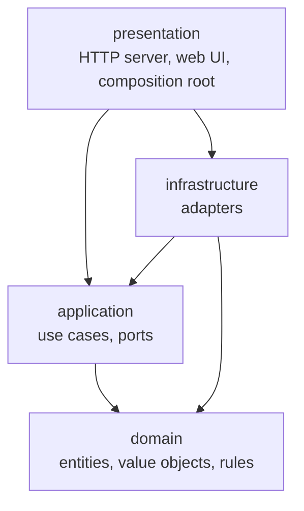
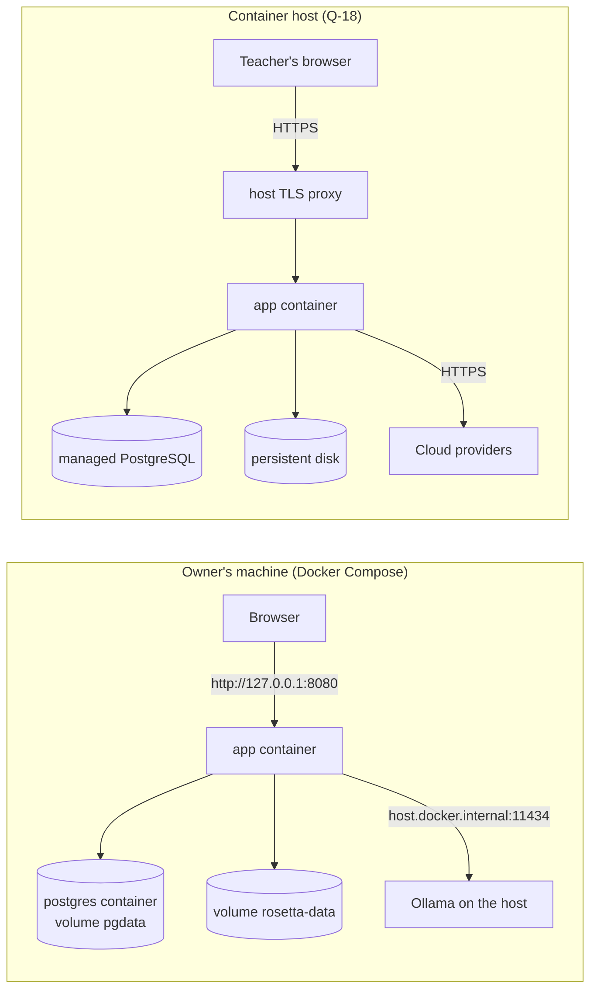

# Architecture (living document)

|             |                                                                                                                                                                                                               |
| ----------- | ------------------------------------------------------------------------------------------------------------------------------------------------------------------------------------------------------------- |
| **Status**  | Living                                                                                                                                                                                                        |
| **Date**    | 2026-10-11 (hosted web application, DEC-59..DEC-69)                                                                                                                                                           |
| **Owner**   | BlackLigth (blacklight0101)                                                                                                                                                                                   |
| **Related** | [RFC-001](rfc/RFC-001-rosetta.md) - [Requirements](spec/requirements.md) - [ADRs](adr/README.md) - [Conventions](conventions.md) - [Data model](data-model.md) - [Environments](environments-and-delivery.md) |

How Rosetta's pieces fit. This document is the canonical home of the **solution layout** (section 4), the **state
lists** (section 5) and the **port names** (section 7). It is updated in the same pull request that changes the
structure. Decisions and their trade-offs are in the ADRs; rules for writing code are in
[conventions.md](conventions.md).

## 1. Context

```mermaid
flowchart LR
  USR[User<br/>developer, tech lead, teacher]
  ADM[Administrator]
  subgraph Host["Container runtime: owner's machine (Compose) or hosted"]
    RST[Rosetta app container<br/>Fastify server + web UI]
    DB[(PostgreSQL)]
    DATA[(Data folder<br/>snapshots, workspaces, logs)]
  end
  OLL[Ollama<br/>on the owner's machine]
  GH[GitHub<br/>public repositories]
  CLOUD[Cloud providers<br/>OpenAI, Anthropic,<br/>OpenAI-compatible]
  PAGES[GitHub Pages<br/>sample report]
  USR -- HTTPS: landing, sign-in, runs, answers, SSE --> RST
  ADM -- HTTPS: accounts, caps, keys --> RST
  RST -- SQL --> DB
  RST -- reads snapshots, writes runs --> DATA
  RST -- resolve ref, download snapshot --> GH
  RST -. local deployment only, host.docker.internal .-> OLL
  RST -- HTTPS, masked excerpts --> CLOUD
  DATA -. sample run published by the owner .-> PAGES
```

Rosetta is a web application with accounts (DEC-59, DEC-62). Visitors see the landing page; users sign in and work
in a private workspace; the administrator manages accounts, server keys and caps. It reads legacy code only as
commit-pinned snapshots of public GitHub repositories, talks to model providers over their APIs, and shows its work
live (ADR-012). Relational data is in PostgreSQL; snapshots and run output are files in the data folder (ADR-016).
The same image runs locally and hosted (ADR-014).

## 2. Containers and components

Two runtime containers (ADR-014): the **app** (one Node.js 24 process, the Fastify server, started by the container
runtime and long-lived) and **PostgreSQL**. Runs execute inside the app process as background jobs, limited by the
run queue (RF-1108). Inside the app:

| Component                   | Layer                         | Responsibility                                                                                                                                                           |
| --------------------------- | ----------------------------- | ------------------------------------------------------------------------------------------------------------------------------------------------------------------------ |
| HTTP server                 | presentation                  | Fastify with cookie, CSRF, rate-limit, helmet and static plugins (ADR-017); routes for pages, the JSON API and server-sent events; maps errors to HTTP statuses (RF-007) |
| Authentication and sessions | presentation + infrastructure | sign-in, lockout, session cookie, CSRF and Origin checks, role checks (ADR-015; RF-1009, RF-1100..RF-1103)                                                               |
| Web UI                      | presentation (front end)      | landing page, sign-in, projects, start a run, live run, history, report, settings and keys, administration (Preact + Vite, DEC-52)                                       |
| Composition root            | presentation                  | create every adapter and inject it into the use cases; builds a provider set per run from the user's keys or the server keys; the only place that knows concrete classes |
| Use cases                   | application                   | projects, `scan`, `understand`, `verify`, `answer`, `report`, `plan`, `estimate`, `export`, `providers test`, accounts, keys, caps, audit                                |
| Run queue                   | application                   | starts queued runs when a slot frees; one running run per user (RF-1108)                                                                                                 |
| Agent loop and orchestrator | application                   | plan agent tasks per area, run the tool-calling loop, collect cards                                                                                                      |
| Verifier                    | application                   | step 1 citation check, step 2 model judgement (ADR-005)                                                                                                                  |
| Domain model                | domain                        | code map, areas, cards, claims, citations, statuses, budgets, prices, runs                                                                                               |
| Provider adapters           | infrastructure                | Ollama, OpenAI, OpenAI-compatible, Anthropic, fake (tests)                                                                                                               |
| Guards                      | infrastructure                | egress guard (ADR-006), budget guard (ADR-007) as decorators of the provider port                                                                                        |
| GitHub source               | infrastructure                | parse URLs, resolve refs to SHAs, download and extract snapshots safely, build permalinks                                                                                |
| File system adapters        | infrastructure                | snapshot reader (read-only, ignore rules), output writer (only inside the user's workspace)                                                                              |
| Database adapters           | infrastructure                | PostgreSQL repositories with parameterised SQL, migration runner (ADR-016)                                                                                               |
| Security adapters           | infrastructure                | scrypt password hasher, AES-256-GCM secret box, session token generator (ADR-015)                                                                                        |
| Event sinks                 | infrastructure                | server-sent events broadcaster (per user), `events.jsonl` log                                                                                                            |
| Scanner and language packs  | infrastructure                | universal layer, tree-sitter packs (ADR-004)                                                                                                                             |
| Writers                     | infrastructure                | Markdown cards, JSON index, specification, HTML report, hand-off package, zip                                                                                            |

## 3. Layers and the dependency rule

Clean Architecture ([ADR-009](adr/ADR-009-clean-architecture.md)):



- `domain` imports nothing outside `domain` and no third-party package; boundary schemas (zod) live in
  `application` (model output, tool arguments) and `infrastructure` (files, configuration).
- `application` imports `domain` and its own ports; it never imports `infrastructure` or `presentation`.
- `infrastructure` implements `application` ports; provider SDKs, tree-sitter, `yazl`, `pg`, `node:crypto` and
  `node:fs` appear only here.
- Fastify and its plugins appear only in `presentation/web/`.
- `presentation` wires everything in one composition root; no business logic.
- No cycles anywhere. Enforced by dependency-cruiser in `npm run verify` (RNF-013, ADR-011).

## 4. Repository and solution layout

Canonical layout; card Delivers paths must match it. Created by the first P1 scaffolding card.

```text
src/
  domain/
    accounts/           User, Role, Session, ProviderKeyRef, UsageCap
    code-map/           CodeMap, FileEntry, Area, Artefact, MapLevel; area grouping (folder buckets, linked sets); the code-unit comparator every sorted list uses
    cards/              Card, CardType, Claim, Citation, ClaimStatus, Verdict, card ids, the claim transitions (`createCard`, `transitionClaim`, `assignCardIds`)
    budget/             TokenUsage, Price (`costOf`, `worstCaseCost` in integer micro-USD), PriceTable
                        (`lookupPrice`), UsageCap and `checkCaps`, the caps of a call (`capsFor`, DEC-107),
                        UTC day and month (`utcPeriodsOf`), `isCapStop`
    runs/               Run (start and end transitions), RunManifest (with `recordPromptVersions`, RNF-004), RunEndState, RunQueueState, AgentTaskState, RunEvent types, the queue rules (`runsToStart`, `queuePositions`)
    sources/            GitHubRepoRef, CommitSha, Permalink
    planning/           PlanningBrief, CatalogueEntry, ArchitectureStyle, StackChoice (ADR-018); the catalogue
                        rules (`catalogueProblems`, `defaultPrinciples`, RF-606); the options of Plan setup (`buildPlanOptions`: two
                        styles with trade-offs and evidence, two options per layer, RF-608, RF-609), the legacy stack of a code
                        map (`legacyStackOf`) and the verified cards (`verifiedCards`)
    egress/             the labelled data block of repository content (`renderDataBlock`, `scanDataBlocks`, RF-145)
    diagrams/           Mermaid text generated from verified cards (DEC-134, RF-508): the one label escaping
                        function (`mermaidLabel`), the FLOW sequence diagram (`flowSequenceDiagram`, RF-260),
                        the SCRN screen map (`screenMapDiagram`, RF-261) and the ER diagram of the data model
                        (`entityDiagram`, RF-262) with its model built from the ENT cards (`entityModelOf`: entities only, no
                        relation or cardinality is invented, P2-22); ids generated, never taken from the code
    eval/               the quality measures of an evaluation (citation validity, claim match and score, structure score, verifier agreement, estimate accuracy, spread, ratio) and the golden set
    observability/      call statistics and the log scope of a run
    overview/           the project overview: its build, the eligible cards, the standing, the thin-run rule and the question links
    deepen/             the Deepen of a completed run (RF-209, RF-231, P2-41): the round plan (`planRound`), the stop
                        rule (`stopAfterRound`, `DEEPEN_ROUNDS`), the understanding measures (`understandingMeasures`,
                        third-party code apart) and the Deepen record of the manifest (`DeepenRecord`, `canDeepen`)
    verifier/           the model family of a model id (`modelFamilyOf`, `sameModelFamily`, RF-301, DEC-57): a verifier of the reader's family is warned
    errors/             domain error codes and Result type
  application/
    ports/              port interfaces (section 7)
    use-cases/          one file per use case (section 6)
    support/            helpers the use cases share (KeyedQueue: sign-in attempts per user name one at a time)
    runs/               the run queue (`RunQueue`), the run lifecycle (manifest start and end, `run.started`, `run.ended`), the event publisher, the accepted manifest, the event and manifest schemas, the manifest security recorder (mask counts and blocked calls), `PrivateCodeRecheck` (P3-54, RF-132: wraps the understand and plan executors; a queued run whose roles now send private code to a cloud provider without the recorded confirmation ends `Failed` with `RST-1521` and starts nothing)
    providers/          provider rules the use cases share: which kinds need cloud consent (`needsCloudConsent`, RF-143)
    agent/              the agent loop (`runAgentTask`, its end states and reasons), the read-only tools
                        (`ReadOnlyTools`: definitions, zod-checked arguments, code-map lookup by exact
                        case, result limits), the reader prompt set (`ReaderPrompts`, `promptVersionsOf`);
                        the orchestrator joins here (P1-33)
    understand/         the understand run's parts (P1-33): reader tasks per area (`planReaderTasks`), the task
                        pool (one abort signal), the reader limits from the settings, one reader task with its
                        run events (`runReaderTask`, `providerWithEvents`, `toolsWithEvents`), the cards of the
                        run as tasks end (`RunCards`: ids in area order, citation check), the pinned repository
                        of the citations (`pinnedSourceOf`, RF-125) and `UnderstandSession`
    deepen/             the Deepen of a completed understand run (P2-41, RF-209): `runDeepen` (the session that
                        seeds from the parent's task results and runs rounds until the stop rule), one round
                        (`runRound`: judge, re-read and coverage tasks, ids, citation check, judgement), the
                        round's reader tasks, the run's state and measures, and the outputs and record it writes
    cards/              the card schema, lenient parsing that keeps valid cards and claims (`parseCardsLenient`), the repair request (RF-202, RF-208)
    verifier/           citation check (step 1, `checkCitations`, P1-33), judgement of one claim (step 2, `judgeClaim`, P2-02)
    estimate/           `EstimateRun`, the assumptions and the reader's token estimate (RF-425, P1-30)
    accounts/           the account summary shown to administration (RF-1102: no password hash, no lockout counters) and the administered account
    budget/             the cost breakdown and the cost report of a run (RF-426, RF-428)
    planning/           the plan options request and answer, the planning brief state and schema, and the recommendation of plan options
    journey/            the facts of the journey from code to package: its types and what is read of a run beyond its row (RF-615, P3-30)
    audit/              the audit retention job and the refusal limiter
    consolidate/        consolidating the cards of a run: the merge request and answer, the consolidation parts and the consolidate run
    eval/               the calibration and evaluation runs: their ports and schemas, the golden and calibration sets, the reports and the experiment
    overview/           the overview answer, request and file, and writing the overview
    plan/               the plan answer and message, the planner's questions, the plan inputs and the hand-off package
    projects/           project settings and their defaults, the folder sweep, price overrides and URL reasons
    report/             the report model, its replay timeline and question steps, and the claim id moves
  infrastructure/
    providers/          ollama/, openai/ (also the OpenAI-compatible adapter and its guarded
                        transport, P2-10), anthropic/, fake/; at the root the
                        ObservedProvider decorator, the provider call logs (JSON Lines, memory) and what
                        the adapters share: retry loop and back-off, ROSETTA_TEST refusal, tool-call
                        shape, token estimate, capped answer bodies
    guards/             egress-guard (request masking, data-block placement, `JsonlEgressLog`), secret-masker,
                        mask-deep, budget-guard (with its pricing and ledger-row helpers)
    budget/             price-file (`prices/default-prices.yaml`, RF-427), cost-report-files (`cost.json`, `cost.md`)
    github/             github-hosts (allowlist), github-http-client (redirects, token, rate limits), github-api
                        (ref resolution), tarball-extractor (ADR-019 filter), snapshot-store (partial folders,
                        hash, snapshot.json, read-only), snapshot-record (the three shapes of snapshot.json: GitHub, upload, workbook; `workbook-key` in the domain names the workbook folder beside the upload key), github-snapshot-fetcher, fake-source-fetcher
    sources/            entry-guards (the path, device-name and counting checks that both extractors share), zip-extractor
                        (`YauzlZipExtractor`, ADR-022) with zip-entry-plan (the central-directory checks), zip-errors and zip-limits,
                        zip-upload-store (`ZipUploadStore`: free-space check, streaming under the limit with upload-intake, extraction, hash, snapshot,
                        read-only; RF-128, RF-129; it also reads, removes and removes by project the `workbook__` snapshots, and renders the
                        workbooks an unpacked zip holds in place with `workbook/zip-workbooks`, listing the ones it cannot render, RF-152, Q-41),
                        workbook-staging (`DiskWorkbookStaging`, the `WorkbookStaging` port, P3-48: a batch is a `.partial-batch-<id>` folder under
                        `sources/`; each file streams to a `.part` that is renamed or removed; `workbook/workbook-publish` reads, renders and
                        publishes every workbook of the batch or none, then deletes the staging folder), space-reservation (the one reservation of
                        free space, twice the limit, that the zip store and the batches share, DEC-149)
    sources/workbook/   the workbook package reader (RF-151, ADR-023, P3-44): `readWorkbook` opens an `.xlsx` or `.xlsm` with `yauzl` under the zip guards
                        (zip-entry-plan, entry-guards; nothing written to disk), streams each part into `saxes` through xml-stream (a document
                        type, an entity declaration or nesting past 64 is refused), counts sheets, non-empty cells, shared strings and inflated
                        bytes against workbook-limits (`ROSETTA_WORKBOOK_MAX_FILES`, `_MAX_SHEETS`, `_MAX_CELLS`), names a compound file as
                        encrypted or legacy with `cfb` (workbook-format) and returns the typed `WorkbookModel` (workbook-model); readers per
                        part: cell-reader, rule-reader, shared-strings-reader, styles-reader, small-part-readers, workbook-xml-reader;
                        package-reader assembles them; errors RST-1921..1928 in workbook-errors; `checkWorkbookBatch` judges the file names
                        VBA macros (RF-154, P3-45): package-reader hands `xl/vbaProject.bin` (bytes counted as they inflate) to `readMacroProject`
                        (macro-reader), which checks the compound file's header and allocation table first (compound-guard, compound-table, compound-directory: `cfb` follows
                        sector chains without remembering them and copies each chain it meets, so a loop, merged or shared chains, a chain
                        read against file order, a looping or oversized directory tree (2,048 entries, depth 32) and stream sizes that pass
                        the file are refused before it reads; the same guard stands before the encrypted/legacy check in workbook-format;
                        streams are listed once into a map), opens it with `cfb`, decompresses the `dir`
                        stream and each module with the MS-OVBA code (ovba-decompress, ovba-dir, ovba-code-page), reads `PROJECT` for module kinds
                        and the protection state of a project locked for viewing (macro-project-stream), lists form controls (macro-forms) and
                        returns `MacroProject` (macro-model) on `WorkbookModel.macros`; bounds in macro-limits; damage leaves the project or
                        module `unreadable`, a passed bound is RST-1926, and a CMG line that is doubled or cannot be decoded counts as locked (Q-40); macros are text and are never run
                        the workbook renderer (RF-152, Q-35..Q-39, P3-46): `renderWorkbooks` turns the models into paths and texts (nothing is
                        written to disk; the upload flow of P3-48 writes them): `workbook.md`, and per sheet `formulas.md`, `values.md`,
                        `validation.md`, `notes.md` (render-index, render-formulas, render-values, render-rules); safe segments with `~2` on a clash
                        and a `_` before a device name (workbook-segments); text escaped to one line, a long one continued on lines with the same address (workbook-text); dates
                        from the format code (excel-dates, cell-value-text); lines under the 2,000 character cut and a byte limit for the whole
                        render, RST-1926 (render-output); `WORKBOOK_RENDERER_VERSION` names the layout. The first table of `workbook.md` maps each
                        safe segment to the real name as a JSON string (cut at 100 characters), which the evidence page label reads
                        macros (P3-47, RF-154): `render-macros` writes each module with source as `macros/<Module>.bas` or `.cls` (every line `L<n> | `, a long line continued with the
                        same prefix), `workbook.md` lists the modules, form controls and a locked, unreadable or compiled-only project, and the counts carry `macroModules`, `macrosSkipped`
                        formula references and the dependency map (RF-153, Q-38, P3-47): `formula-references` is Rosetta's own tokenizer (scanner `formula-scanner`, boxes `reference-box`,
                        table references `table-reference`): one forward pass, capped formula length, reference count, word, quoted name and bracket group; a range stays a box and is never
                        expanded; `renderProject` returns the workbooks and `dependencies.md` (root of the tree) under one byte limit; the map (`dependency-project`, `-collect`, `-resolve`,
                        `-scope`, `-store`, `-cover`, `-cycles`, `render-dependencies`) resolves external references by file name against the project, counts references, sheet edges and
                        cycle-search steps against `dependency-limits` and writes any limit reached; the search for circular references is an iterative Tarjan over a column index of the
                        formula cells; `external-names` (`plainModel`) writes every formula, rule and defined name with the workbook part of an external reference as the file name only (stored, path, UNC and URL forms, quoted or not, whatever characters the folder holds, and the display form of an external name `'C:\dir\Book.xlsx'!Name` as `'[Book.xlsx]'!Name`; Q-38): the tokenizer reads a bracket followed by `Sheet!` as a workbook whatever word stands before it, and the recorder (`external-edit`) hides the path before a bracket or a quote back to its drive, share or scheme, up to the previous edit (an unquoted path that starts in an earlier 32,768-character chunk keeps the part before the chunk); unresolved references are listed up to `maxUnresolved` targets and `maxUnresolvedCells` cells; `publishWorkbooks` and the zip pass (`zip-workbooks`, `zip-render`) call `renderProject`, so a published batch and a zip carry one `dependencies.md` (in a zip, beside a file of that name as `dependencies (workbooks).md`; under the zip's byte cap, `WorkbookLimits.maxRenderedBytes`, the workbooks that do not fit are left out with RST-1926 and a zip whose workbooks were all left out gets no map), `entryOf` takes the macro counts from the render, and a workbook with locked or compiled-only macros is named in `skipped` / `leftOut` with "unlock it in Excel and upload again" (RF-154, Q-40)
    files/              node-repository-reader, snapshot-index, snapshot-scope, ignore-rules (deny list), grep worker,
                        search and limits, node-output-writer, last-line (a file's last line, read from its end),
                        workspace-guard, workspace-paths, repository-path checks, file-run-manifest-store (`manifest.json`)
    events/             sse-broadcaster, jsonl-event-log, fan-out-sink, memory-event-sink (sequence rules shared in event-order)
    db/                 pool, repositories (users, sessions, keys, projects, runs, cost ledger, audit) with their
                        memory twins, row schemas, migration runner
    security/           password-hasher (scrypt, at most two at a time through a semaphore), session ids (256
                        random bits, stored as SHA-256), the dummy hash for unknown user names, the common-passwords
                        list common-passwords.txt (SecLists, MIT; read at start-up from the repository root, so
                        the image ships this file), aes-gcm-secret-box (HKDF-derived key, fingerprint version,
                        previous key during a rotation), public-address (the refused IPv4 and IPv6 ranges),
                        public-host-check (node:dns lookup with a time limit), public-address-agent (the HTTPS
                        agent that checks every connect again), token generator
    scan/               universal/, packs/csharp/, codemap/ (build the code map, `codemap.json` writer and schema, `scan-summary.md`)
    cards/              `file-run-cards` (the cards of an ended understand run read back whole for `plan`, RF-604) and the card writers: `cards/<TYPE>/<ID>.md` (YAML header, generated body; a `FLOW` card also carries its sequence diagram, P2-33), `cards/index.json`, `spec.md` (with the flows, screens and data-model sections, P2-22), `data-model.md` when the run has `ENT` cards, the raw output of an `InvalidOutput` task; every citation a GitHub permalink (for an uploaded zip or Excel workbooks, a relative link to the evidence page of the card in `report/`, RF-131, RF-156; the evidence page adds the workbook, sheet and cells read from the cited lines, `workbook-cell-label` in the domain), everything masked
    writers/            markdown/, json/, html-report/, zip/
    handoff/            the hand-off package of a plan run (`FileHandoffWriter`, P3-09): README with the reading order, requirements, target architecture with its Mermaid component diagram (generated by `componentDiagram`), `decisions/ADR-nnn.md`, entity mapping, roadmap (migration strategy, project context, phase sizes), task cards (size, invariant, risk class, review probes, principle checks, technologies, builder difficulty), the API contract `api/openapi.yaml` (P3-18, RF-624; only when the front end is separate, the README says why otherwise), the user-interface material `ux/` (P3-20, RF-626: `README.md` with the target screen map from `targetScreenMap` and every legacy screen kept, merged or dropped with its reason, `wireframes/<SCRN id>.html` per main screen drawn by code in `handoff-wireframe-html.ts` as plain HTML with no script, no event attribute and no external resource and with every text masked and escaped, and `design-brief.md` for an external design tool), the technical requirements document `trd.md` (P3-16: `technical-content.ts` checks the planner's technical part against the supported cards, `handoff-trd-markdown.ts` writes the seven sections, each linking its decision records), a document whose planner answer stayed cut off opens with an Incomplete notice and is listed in the README (P3-33, RF-604, `handoff-incomplete-markdown.ts`; no notice and no README section when none was cut off), risks, open questions, the source cards with their citations, `conventions.md` and, for an AI-assisted build, `AGENTS.md` (P3-10: the brief's choices become `briefDecisions` records after the planner's, `task-method.ts` derives sizes and ratings, `task-card-quality.ts` decides which planned tasks are cards: P3-23, RF-630, RF-633, RF-635; `behaviours-to-keep.ts` lists the legacy behaviour each card keeps, `legacy-default.ts` refuses a default that changes it and `measureScan` with `scan-shapes.ts` measures `fixtures.md` from the scan: P3-24, RF-631, RF-632; `parallel-cards.ts` allocates each card's shared identifiers, orders cards whose files overlap and groups the cards that can run together: P3-25, RF-634, RF-636); `question-cards.ts` decides which task cards wait on which open question and `handoff-waiting-markdown.ts` writes the `Cards waiting` columns and the roadmap marks: P3-26, RF-637; `handoff-metrics-markdown.ts` writes the build metrics section of `AGENTS.md`: RF-638; plain Markdown, every text masked and escaped (RF-601, RF-603, RF-607..RF-612)
    config/             environment schema (RF-1305), project settings schema
    prompts/            prompt files read with their version and SHA-256 (`loadReaderPrompts`, `loadPlannerPrompt`, RNF-004)
                        and the principle catalogue (`loadCatalogue`: entry schema, version, SHA-256; RF-606)
    system/             clock, id generator, logger
    eval/               calibration and golden-set files, the evaluation files, the calibration source and the run claims
    report/             the report file writer, the report HTML, Markdown and overview pages, the page shell, report security and assets, the published site and the index check
  presentation/
    web/                Fastify server, plugins, auth hooks, API routes, server-sent events, error-to-status mapping; `GET /api/errors/:code` answers the catalogue's message and next step for a code (session required, a string that is not a code answers 404) so a page that only has a code, such as a run that ended with an error, says what it means (RF-007, RF-1108); `area-limits.ts` holds `MAX_AREAS`, `MAX_AREA_NAME` (the code map's own `MAX_AREA_NAME_LENGTH`, so a name the scan produces is never refused) and the body limit derived from them, shared by `POST /api/projects/:id/runs` and `POST /api/projects/:id/estimate` (RF-200, RF-425)
    eval/               the evaluation and calibration commands: argument and settings parsing, the pipeline, the sinks, the report lines and the composition
    main.ts             server start-up: read environment (`DATABASE_URL` only; `DATABASE_MIGRATOR_URL` is refused, DEC-140), check the schema (`checkSchema` in compose-migrations.ts: a pending, changed or unknown migration stops it with RST-2405, RST-2401 or RST-2402, and a `DATABASE_URL` that owns the schema logs a warning), create the bootstrap admin, discard partial snapshot folders (RF-122), end interrupted runs, listen, start the scheduler
    composition-root.ts
    migrate.ts          the one-off migrate step (`node dist/presentation/migrate.js`, the `migrate` service of compose.yaml): reads `DATABASE_MIGRATOR_URL` only, applies the pending migrations with `PgMigrator` and ends with 0 (also when nothing was pending) or 1; it runs before the server, which never migrates (RF-1302, DEC-140)
    compose-migrations.ts  `migrateDatabase` (the migrate step) and `checkSchema` (the server's start-up check, `PgSchemaVersion` read as `rosetta_app`)
web/                    front-end source of the landing page, web UI and report components (Preact + Vite, DEC-52): src/app (router table `routes.ts`, navigation, App, the contexts that hand the API client, the signed-in user and the route parameters to a page), src/api (typed client, wire schemas), src/components (shared components, one per file), src/lib (text-only renderer, theme), src/styles (tokens.css copied from docs/design/, base.css, components.css), src/pages (sign-in, change-password and settings pages, P1-14; projects and project settings pages, P1-41, with the run columns and queue notice of P1-105 (`ListProjectOverview` below); the New project form has two tabs, GitHub repository and Upload a zip (P3-39, RF-128, RF-134, RFC-004 section 4.5): the Upload a zip tab (`ZipUploadForm.tsx`, state in `use-zip-upload.ts`, checks in `src/lib/zip-check.ts`) states the limit (`uploadMaxMb` of `GET /api/session`, 500 MB until the server says), checks the extension, size and first bytes `PK` before sending, creates the project with `POST /api/projects` `{ sourceKind: 'upload', name }`, then sends the archive with `PUT /api/projects/:id/source` (`application/zip`, CSRF token) through `ApiClient.upload` (`XMLHttpRequest`, `src/api/upload-transport.ts`, because `fetch` cannot report upload progress); a project of kind `upload` is listed and headed `name (zip, date)` (`src/lib/source-label.ts`), its start page shows the source card `UploadSourceSection.tsx` instead of the GitHub address and holds Start while it has no source; administration pages `/admin/users`, `/admin/audit` and `/admin/models`, administrator-only rows of the router table, P1-42: the server month meter and the 80% banner add the month-to-date cost of every account, the meter and banner read `serverMonthToDate` of `GET /api/admin/caps`; a `user` who opens an `/admin/*` page gets the application shell with status 200 and the not-found page, no administration link and no data, while every `/api/admin/*` call answers 403, P1-107); Plan setup page, P3-08, `/projects/:projectId/plan-setup` (`PlanSetupPage.tsx`, its steps `Plan*Step.tsx`, hooks `use-plan-setup.ts`, `use-plan-options.ts`, `use-plan-estimate.ts`, `use-plan-session.ts`, pure parts in `src/lib/plan-setup/`, wire schemas in `src/api/plan-schemas.ts`, CSS `src/styles/plan-setup.css` under `.rst-plan-*`): reads `GET /api/plan/catalogue`, `GET /api/projects/:id/planning-brief` and `GET /api/projects/:id` (the planner's provider and kind, which decide the consent), then `GET /api/projects/:id/plan-estimate` once a brief is saved (the server refuses it before, `RST-1801`); six steps (principles, architecture, migration, stack, project context, build method), each with its default and the reason it matters, one at a time with Back, "Save and continue" and "Use the defaults for the rest"; a save is `PUT /api/projects/:id/planning-brief` and sends only the questions the person answered, so the rest take their defaults and show "(default)" in "What I recorded"; the architecture and stack options come from `POST /api/projects/:id/plan-options` once a step that shows them opens (a cloud planner waits for the consent checkbox; a failure shows its error, offers "Ask again" and keeps the catalogue's styles and a field of your own); the estimate card shows the planner's figures and each cap generically (a figure over a cap is a warning, the budget guard stops the run at the cap), blocks "Write the package" on an unpriced model or a missing key, and "Write the package" is `POST /api/projects/:id/runs` with `{ stage: 'plan', cloudConsent }`, then the live page of the run; a package older than the brief shows "out of date" and "Write the package again"; start run page, P1-34: reads `GET /api/projects/:id`, `GET /api/projects/:id/estimate` (all areas first, then only the chosen ones) and `GET /api/account/daily-cap`, saves a changed run cap or confirm threshold (`budget.confirmAboveCostMicros`, shown beside the cap; a threshold above the cap is refused on the page before any request, DEC-117, P1-107) with `PUT /api/projects/:id/settings` before `POST /api/projects/:id/runs` (it reads the project again right before the save and changes only those two values, because a save replaces the whole document; a change made in the few milliseconds between that read and the save can still be lost, as the API has no version check), and cancels a queued run with `POST /api/runs/:runId/stop` using the run's `id` from the start answer (not its folder name `runId`); no endpoint was added: the daily and monthly caps are compared whole because what was spent today or this month has no read API until P1-36; live run page, P1-35, `/runs/:runId` (the run's UUID): reads `GET /api/runs/:runId` first (404 for another user's run, no stream is opened), then follows `GET /api/runs/:runId/events` with `fetch` (`src/api/follow-run-events.ts`: stored events first, a new request with `Last-Event-ID` after a break, no event applied twice, no retry after 401, 403 or 404 or after `run.ended`) and folds the events into the page state (`src/lib/live-run/`: `reduce-run.ts` and its handlers, one panel per agent, the overview, the claims, the verbose log of the newest 1000 events, the meter); the run is read again as the model turns go by, at most once per second (P1-166), so the total cost so far follows it, the cost of each role and agent and the tokens of each role add up the run's `usage.recorded` events (agent panels keep their tokens from their turns, the same calls) (P1-96: zero for a local model, a dash for a model without a price; a usage event of no agent panel, such as the Ollama check, counts for its role only), so the role costs and the total read from the run check each other, the estimate beside the meter is `GET /api/projects/:id/estimate` for the areas of the run, Stop is `POST /api/runs/:runId/stop` with the UUID, the two zip downloads are `GET /api/runs/:runId/zip` and `/handoff.zip` (disabled until the run has ended; the hand-off one only for a plan run), a claim that passed the citation check reads "waiting for judgement" while the judgement step is queued or running and then shows its verdict (RF-1014, DEC-136, P2-02) and links the cited lines on GitHub at the commit, and a run that ended with an error code (for example RST-2302, no key) shows it with its message; all its CSS is in `src/styles/live-run.css` under `.rst-live-*`; P1-95 adds three parts to it, with their CSS in `src/styles/live-run-controls.css` under `.rst-live-stepper-`, `.rst-live-pause-` and `.rst-topbar-runmeter-`: the stage stepper (`src/lib/live-run/run-stepper.ts` tells Snapshot, Scan, Understand, Verify and Report from the run row, the events and the phase, the files and areas from `scan.completed`, the agents done from the panels and the claims checked from the claims; the Report step waits until a report exists, because the report is built from the page of an ended run, P1-97: it is done on load when `GET /api/runs/:runId` says `reportBuilt`, and at once, without a reload, when Build report succeeds on the page, P1-130), Pause updates (`use-pause-updates.ts` keeps the state at the moment of the pause for the agent panels, overview, claims and event log while the stream keeps folding events into the live state, shows the count of events since the pause and applies them in order on Resume; the page's one polite status says that updates are paused or resumed, never the counter), and the "This run" meter of the top bar (the page publishes the run's cost and cap through `RunMeterContext` in `src/app/run-meter-signal.ts` only while the run works, `SignedInShell` draws `TopbarRunMeter` in the header beside the totals, with the warning levels at 80% and 95% in words as well as colour, and takes it away when the page stops publishing); P1-38 adds the coverage map below the agent panels of an understand run (`src/lib/live-run/coverage-map.ts` folds the files each reader agent has read, from successful `read_file` calls, into one tree per area in plan order with the area's share of the run's files read; `src/pages/CoverageMap.tsx`, CSS in `src/styles/live-coverage.css` under `.rst-p138-`; it freezes with Pause updates; the events do not name the files of an area that were not read, so the map shows what was read, RF-1005); P1-169 gives the page of a queued or running run its own layout (RF-1015, RF-1016, DEC-137; the page of an ended run is described after this part, P1-170): the run journey (`src/lib/live-run/journey.ts`: map the code, read, check citations, explain, your questions, one step current), the living code map (`src/lib/live-run/code-map-tiles.ts` folds the areas of the code map, read once from `GET /api/projects/:id/estimate` for their estimated tokens and whether they are third-party, and the reader agents into tiles: waiting, being read, read, not covered, or library left out; the map falls back to the run's own agents when that read fails; `src/pages/CodeMap.tsx`, CSS in `src/styles/live-run-map.css` under `.rst-codemap` and `.rst-tile`), the spend of the run against its cap, "working now" (`working-now.ts`: at most three agents in plain words), and the tab pattern (`src/components/Tabs.tsx`) with Cards so far, All agents (overview, run meter with the per-role table and the estimate, agent panels, coverage map; a tile opens it on that area) and Activity (event log and the link to the API calls and logs page); no endpoint was added and the run is still read at most once per second; the rest of the CSS is in `src/styles/live-run-running.css`; P1-170 gives the page of an ended run its "after the run" mode (RF-1015, RF-1017, RF-264, DEC-137; `src/pages/EndedBody.tsx`, CSS in `src/styles/live-run-ended.css` under `.rst-p170-`; the page switches to it by itself when the run ends): the stage stepper and the failure of a run that ended with an error code stay above, then the tabs Overview (the overview of the application with the honest verification note of RF-1014, `VerificationNote.tsx`), Your questions (`RunAnswers.tsx`: each question with the citation that raised it, how many cards depend on it, an answer field and what happens if it is skipped), Evidence (`EvidenceTab.tsx`: the code map as the run left it, the cards and claims, the agents with the cost per role and the coverage map) and Activity (event log, the way to the API calls and logs page, the replay once the report exists), beside the "Your turn" panel (`YourTurn.tsx`: the open questions and the way to them, the facts of the run from `src/lib/live-run/end-facts.ts`) and the report, the downloads and the calls link, which stay one click away; a run that ended with an error, and a run that is not an understand run, has no Overview and no Your questions tab and opens on Evidence; the page reads the overview and the questions once, only for an understand run that did not fail; the start page's notice links to it, src/gallery (development only), src/landing (landing.css, P1-15); `npm run build` writes dist/web/ (index.html plus files under assets/ only, because the server answers only / , /sign-in and /assets/ without a session; landing.css keeps a name without a hash because the server links it). The landing page itself is not a Preact page: `src/presentation/web/landing-routes.ts` answers `GET /` with HTML written by `landing-page.ts` and `landing-replay.ts` (words in `landing-content.ts`), with no script and no inline style so it works without JavaScript under the content security policy; a signed-in visitor is redirected to /projects, and "Request access" appears only when `ROSETTA_CONTACT_EMAIL` is set (RF-1200, RF-1201)
db/migrations/          numbered SQL migrations (ADR-016, data-model.md section 7)
Dockerfile              multi-stage image (RF-1300): stages `build`, `deps`, `test` (fakes, compose.ci.yaml only) and `runtime` (the default target; production dependencies, `dist/`, migrations, prompts, prices, templates, the password list; user `node`, port 8080, `HEALTHCHECK` on /healthz)
.dockerignore           keeps .env files, history, maps, docs and tool configuration out of the build context (RNF-003)
compose.yaml            local deployment: a one-off `migrate` service (runtime stage, migrator URL only), then app (runtime stage, 127.0.0.1:8080, `DATABASE_URL` only, waits for `migrate` with `service_completed_successfully`) + PostgreSQL, volumes pgdata and rosetta-data (RF-1301)
compose.ci.yaml         CI overlay: the image's test stage started through tests/compose/serve.ts, with the fake provider and an in-process fake GitHub (RF-1301)
playwright.compose.config.ts  Playwright against the running Compose stack (tests/compose/: smoke and persistence specs) for the compose-smoke job
db/init/roles.sh        Compose init script that creates rosetta_migrator and rosetta_app from the .env passwords (data-model.md section 6)
prices/                 the shipped price table (data-model.md section 3.18)
templates/              default project settings and ignore rules (data-model.md section 10)
scripts/                build and test helper scripts (test levels, page screenshots)
.env.example            every environment variable with a safe example (RF-1305)
prompts/                versioned prompts per role (reader/, verifier/, planner/, summariser/) and shared/
                        (prompts every role may get, such as the text tool protocol of RF-205),
                        cards/ (the card format an agent answers in, the repair request and the continue request, RF-202, RF-208)
                        and catalogue/ (principles, styles and practices for plan, ADR-018)
tests/
  unit/                 mirrors src/
  integration/          mirrors src/
  e2e/                  browser journeys with Playwright (`*.spec.ts`) against the Compose stack or a test server;
                        support/ holds the test server, the network guard, the axe and sign-in helpers
  contracts/            contract suites per port
  recordings/           recorded provider responses (ADR-008)
  fixtures/             small legacy samples per stack, and `repos/injection/` (planted instructions, RF-145)
  support/              test helpers: database, fixed clock, sequence ids, servers
eval/                   golden set (golden/eshop-webforms.json), the calibration set of the verifier
                        (calibration/webforms-shop.json, RF-305), the settings of `npm run eval` (config.json, RNF-006,
                        RNF-015) and their provenance (README.md); the runner is src/presentation/eval/ (entry
                        scripts/eval.mjs); results go to the git-ignored eval-out/
site/                   published sample report (RF-800): built by `npm run site:build` (scripts/build-sample-site.mjs) from the benign recorded run of tests/fixtures/runs/sample-report, pages from src/infrastructure/report/published-site.ts, published by .github/workflows/pages.yml in three jobs (build, deploy, smoke); the smoke step runs scripts/pages-smoke.mjs, which checks the published index with src/infrastructure/report/index-check.ts and needs no package install
docs/runbooks/          local and hosted deployment runbooks (environments-and-delivery.md section 14)

The front end in `web/` has its own `web/tsconfig.json` with the DOM library and its own wire schemas in `web/src/api/`;
it imports nothing from `src/` today. The dependency-cruiser rule of DEC-112 allows an import from `src/` only from
`src/application/contracts/`, a folder that does not exist yet.
```

## 5. Domain model

| Concept      | Kind                | Invariants                                                                                                                                                                                                                                                                                                                                                 |
| ------------ | ------------------- | ---------------------------------------------------------------------------------------------------------------------------------------------------------------------------------------------------------------------------------------------------------------------------------------------------------------------------------------------------------- |
| `CodeMap`    | aggregate           | file paths unique and relative with forward slashes; every file in exactly one area; every symbol, link, statement and entity points at a listed file; every list sorted by the code-unit comparator, so the output is byte-identical for the same input (RF-106); created only through `createCodeMap`, which returns a typed problem instead of throwing |
| `Area`       | entity in `CodeMap` | non-empty; total tokens at most the configured area budget, except an area made of one file that is larger than the budget alone (a file is never cut) (RF-104)                                                                                                                                                                                            |
| `Card`       | aggregate           | id unique in the run (`FEAT-001` style, RF-203); at least one claim; `OQ` cards carry a question                                                                                                                                                                                                                                                           |
| `Claim`      | entity in `Card`    | at least one citation; status changes only through the transitions below; never removed (RF-302)                                                                                                                                                                                                                                                           |
| `Citation`   | value object        | `path:startLine-endLine`, `1 <= startLine <= endLine`                                                                                                                                                                                                                                                                                                      |
| `Budget`     | aggregate per run   | spent never exceeds the cap: a call is refused when its worst case would cross it (RF-422)                                                                                                                                                                                                                                                                 |
| `PriceTable` | value object        | prices per million tokens for input, output and cached input, one currency, a date                                                                                                                                                                                                                                                                         |
| `Run`        | aggregate           | one stage; manifest written at start and at end; an end state always recorded (RF-003, RNF-002); belongs to exactly one user's project                                                                                                                                                                                                                     |
| `User`       | aggregate           | user name unique (case-insensitive); role `admin` or `user`; disabled users have no session (RF-1102)                                                                                                                                                                                                                                                      |
| `Session`    | entity              | expires at 8 hours idle or 7 days; stored only as a hash (RF-1101)                                                                                                                                                                                                                                                                                         |
| `UsageCap`   | value object        | run, user-day and server-month limits in micro-USD; a call is refused when its worst case would cross any of them (RF-1106)                                                                                                                                                                                                                                |

**State lists** (canonical):

| State list          | Values                                                                                      | Transitions                                                                                                                                                                                                                                |
| ------------------- | ------------------------------------------------------------------------------------------- | ------------------------------------------------------------------------------------------------------------------------------------------------------------------------------------------------------------------------------------------ |
| `ClaimStatus`       | `Proposed`, `CitationInvalid`, `Supported`, `Rejected`, `Unverified`                        | `Proposed` -> `CitationInvalid` (step 1) / `Supported` / `Rejected` (step 2) / `Unverified` (stopped); `Unverified` -> `Supported` / `Rejected` (resumed). Final: `CitationInvalid`, `Supported`, `Rejected`. Matches RFC-001 section 4.4. |
| `CardType`          | `FEAT`, `BR`, `ENT`, `INT`, `OQ`, `FLOW`, `SCRN`                                            | -                                                                                                                                                                                                                                          |
| `OpenQuestionState` | `Open`, `Answered`                                                                          | `Open` -> `Answered` when an answer is recorded and the area re-run (RF-241); `Answered` -> `Open` when the user reopens the question to send an edited answer again                                                                       |
| `AgentTaskState`    | `Planned`, `Running`, `Done`, `TurnLimitReached`, `InvalidOutput`, `Failed`, `StoppedByCap` | `Planned` -> `Running` -> one of the other five                                                                                                                                                                                            |
| `RunEndState`       | `Completed`, `CapReached`, `Failed`, `Interrupted`                                          | set once when the run ends                                                                                                                                                                                                                 |
| `RunQueueState`     | `Queued`, `Running`, `Ended`                                                                | `Queued` -> `Running` when a slot frees; `Running` -> `Ended` with a `RunEndState`; `Queued` -> `Ended` (`Interrupted`) when cancelled (RF-1108)                                                                                           |
| `Role`              | `admin`, `user`                                                                             | changed only by an administrator (RF-1102)                                                                                                                                                                                                 |
| `AccountState`      | `Active`, `MustChangePassword`, `Locked`, `Disabled`                                        | the account transitions below the table (RF-1100, RF-1102, RF-1103)                                                                                                                                                                        |
| `MapLevel`          | `coarse`, `symbols`                                                                         | per file, from the scan (RF-110)                                                                                                                                                                                                           |
| `Confidence`        | `High`, `Medium`, `Low`                                                                     | set by the agent, never by the verifier                                                                                                                                                                                                    |

**Account transitions** (as built by P1-08; `src/domain/accounts/account-transitions.ts` and the use cases in `src/application/use-cases/`). `Locked` is not stored: it is `Active` with `locked_until` in the future.

- **Change password** (the user, RF-1103): `MustChangePassword` or `Active` -> `Active`, with a new hash, and the failure counters and the lock cleared. Refused on a `Disabled` account (RST-2208); a locked account is refused as an incorrect current password (RST-2211).
- **Sign-in** (RF-1100): five failed sign-ins within 15 minutes, or wrong current passwords on change-password, lock the account for 15 minutes; a successful sign-in clears the counters and the lock. A sign-in to a `Disabled` or locked account is refused and not counted as a failure.
- **Reset password** (an administrator, RF-1102): any state except `Disabled` -> `MustChangePassword`, with a new hash; every session of the account ends. A reset does not clear the failure counters or a running lock. Refused on a `Disabled` account (RST-2208).
- **Disable** (an administrator, RF-1102): any state -> `Disabled`; every session of the account ends.
- **Enable** (an administrator, RF-1102): `Disabled` -> `Active`, and the failure counters and the lock are cleared. Refused on any other state (RST-2208).
- Only an administrator changes another account (RST-2002 otherwise). An administrator cannot disable or reset their own account (RST-2213). An unknown id is RST-2003.

## 6. Application services (use cases)

Since DEC-59 every use case is reached through the HTTP API of the web UI; there is no command line.

| Use case                                                                       | Web action (HTTP API)                                                                                                                                                                                                                                                                                                                                                                                                                                                                                                                                                                                                                                                                                                                                                                                                                                                                                                                                                                                                                                                                                                                                                                                                                                                                                                                                                                                                                                                                                                                                                                                                                                                                                                                                                                                                                                                                                                                                                                                                                                                                                                                                                                                                                                                                                                                                                                                                                                                                                                                                                                                                                                                                                                                                                                                                                                                                                                                                                                                                                                                                                                                                                                                                                                                                                                                                                                                                                                                                                                                                                                                                                                                                                                                                                                                                                                                                                                                                                                                                                                                                                                                                                                                                                                                                                                                                                                                                                                                                                                                                                                                                                                                                                                                                                                                                                                                                                                                                                                                                                                                                                                                                                                                                                                                                                                                                                                                                                                                                                                                                                                                                                                                                                                                                                                                                                                                                                                                                                                                                                                                                                                                                                                                                                                                                                                                                                                                                                                                                                                                                                                                                                                                                                                                                                                                                                                                                                                                                                                                                                                                                                                                                                                                                                                                                                                                                                                                                                                                                                                                                                                                                                          | Requirements                                                    |
| ------------------------------------------------------------------------------ | ---------------------------------------------------------------------------------------------------------------------------------------------------------------------------------------------------------------------------------------------------------------------------------------------------------------------------------------------------------------------------------------------------------------------------------------------------------------------------------------------------------------------------------------------------------------------------------------------------------------------------------------------------------------------------------------------------------------------------------------------------------------------------------------------------------------------------------------------------------------------------------------------------------------------------------------------------------------------------------------------------------------------------------------------------------------------------------------------------------------------------------------------------------------------------------------------------------------------------------------------------------------------------------------------------------------------------------------------------------------------------------------------------------------------------------------------------------------------------------------------------------------------------------------------------------------------------------------------------------------------------------------------------------------------------------------------------------------------------------------------------------------------------------------------------------------------------------------------------------------------------------------------------------------------------------------------------------------------------------------------------------------------------------------------------------------------------------------------------------------------------------------------------------------------------------------------------------------------------------------------------------------------------------------------------------------------------------------------------------------------------------------------------------------------------------------------------------------------------------------------------------------------------------------------------------------------------------------------------------------------------------------------------------------------------------------------------------------------------------------------------------------------------------------------------------------------------------------------------------------------------------------------------------------------------------------------------------------------------------------------------------------------------------------------------------------------------------------------------------------------------------------------------------------------------------------------------------------------------------------------------------------------------------------------------------------------------------------------------------------------------------------------------------------------------------------------------------------------------------------------------------------------------------------------------------------------------------------------------------------------------------------------------------------------------------------------------------------------------------------------------------------------------------------------------------------------------------------------------------------------------------------------------------------------------------------------------------------------------------------------------------------------------------------------------------------------------------------------------------------------------------------------------------------------------------------------------------------------------------------------------------------------------------------------------------------------------------------------------------------------------------------------------------------------------------------------------------------------------------------------------------------------------------------------------------------------------------------------------------------------------------------------------------------------------------------------------------------------------------------------------------------------------------------------------------------------------------------------------------------------------------------------------------------------------------------------------------------------------------------------------------------------------------------------------------------------------------------------------------------------------------------------------------------------------------------------------------------------------------------------------------------------------------------------------------------------------------------------------------------------------------------------------------------------------------------------------------------------------------------------------------------------------------------------------------------------------------------------------------------------------------------------------------------------------------------------------------------------------------------------------------------------------------------------------------------------------------------------------------------------------------------------------------------------------------------------------------------------------------------------------------------------------------------------------------------------------------------------------------------------------------------------------------------------------------------------------------------------------------------------------------------------------------------------------------------------------------------------------------------------------------------------------------------------------------------------------------------------------------------------------------------------------------------------------------------------------------------------------------------------------------------------------------------------------------------------------------------------------------------------------------------------------------------------------------------------------------------------------------------------------------------------------------------------------------------------------------------------------------------------------------------------------------------------------------------------------------------------------------------------------------------------------------------------------------------------------------------------------------------------------------------------------------------------------------------------------------------------------------------------------------------------------------------------------------------------------------------------------------------------------------------------------------------------------------------------------------------------------------------------------------------------- | --------------------------------------------------------------- |
| `CreateProject`                                                                | New project form (`POST /api/projects`): parses the address with the P1-16 parser (no network call), stores the project with the template settings and the server's `defaultRoles`, or answers the existing project                                                                                                                                                                                                                                                                                                                                                                                                                                                                                                                                                                                                                                                                                                                                                                                                                                                                                                                                                                                                                                                                                                                                                                                                                                                                                                                                                                                                                                                                                                                                                                                                                                                                                                                                                                                                                                                                                                                                                                                                                                                                                                                                                                                                                                                                                                                                                                                                                                                                                                                                                                                                                                                                                                                                                                                                                                                                                                                                                                                                                                                                                                                                                                                                                                                                                                                                                                                                                                                                                                                                                                                                                                                                                                                                                                                                                                                                                                                                                                                                                                                                                                                                                                                                                                                                                                                                                                                                                                                                                                                                                                                                                                                                                                                                                                                                                                                                                                                                                                                                                                                                                                                                                                                                                                                                                                                                                                                                                                                                                                                                                                                                                                                                                                                                                                                                                                                                                                                                                                                                                                                                                                                                                                                                                                                                                                                                                                                                                                                                                                                                                                                                                                                                                                                                                                                                                                                                                                                                                                                                                                                                                                                                                                                                                                                                                                                                                                                                                            | RF-010                                                          |
| `StoreUpload`                                                                  | Upload form (`PUT /api/projects/:id/source`, `application/zip`, owner only, P3-38, RF-128..RF-133): one upload per project at a time (`RST-1919`), the file name from `X-File-Name` (`RST-1909` when it is not a zip, `RST-1930` when it is not valid percent-encoding; bidi controls are stripped and a surrogate pair is never split at 200 characters), the zip handed to the `UploadStore`, then the project records the snapshot, an earlier snapshot no run uses is deleted, and an audit row `source.uploaded` holds name, size and hash. Answers 201 `{ files, size, skipped, snapshotHash, fileName, uploadedAt, codeChangedSinceLastRun }`; the store holds back twice the limit per running upload from the free-space check (DEC-149) until it ends or fails. `CreateProject.createUpload` makes the project (`POST /api/projects` with `{ sourceKind: "upload", name }`); a project view names `sourceKind`, `source` and `codeChangedSinceLastRun`. `StartRun` refuses an upload project with no zip (`RST-1920`)                                                                                                                                                                                                                                                                                                                                                                                                                                                                                                                                                                                                                                                                                                                                                                                                                                                                                                                                                                                                                                                                                                                                                                                                                                                                                                                                                                                                                                                                                                                                                                                                                                                                                                                                                                                                                                                                                                                                                                                                                                                                                                                                                                                                                                                                                                                                                                                                                                                                                                                                                                                                                                                                                                                                                                                                                                                                                                                                                                                                                                                                                                                                                                                                                                                                                                                                                                                                                                                                                                                                                                                                                                                                                                                                                                                                                                                                                                                                                                                                                                                                                                                                                                                                                                                                                                                                                                                                                                                                                                                                                                                                                                                                                                                                                                                                                                                                                                                                                                                                                                                                                                                                                                                                                                                                                                                                                                                                                                                                                                                                                                                                                                                                                                                                                                                                                                                                                                                                                                                                                                                                                                                                                                                                                                                                                                                                                                                                                                                                                                                                                                                                                |
| `WorkbookBatches`                                                              | Excel workbooks tab (P3-48, RF-150..RF-158, RFC-005 section 4.2): `POST /api/projects/:id/source/batches` opens a batch (one per project, `RST-1919`; expires after 30 minutes, swept on every call with the `Clock`), `PUT .../batches/:batchId/files` receives one workbook (octet-stream, `X-File-Name`, answers `{ name, size }`; a failed file leaves nothing behind), `POST .../finish` reads, renders and publishes the batch as `workbook__<id>@<16 hex>` (answers `{ workbooks, skipped, snapshotHash, uploadedAt }`; `skipped` is empty for a direct batch because one refused workbook refuses the batch), and `DELETE .../batches/:batchId` cancels it. Owner only; another project's or user's id and an unknown or expired batch answer 404. The project records the names, the instant and the count, an earlier snapshot no run uses is deleted, and one audit row `source.workbook.uploaded` per workbook holds name, size and hash. `GET /api/session` reports `workbookMaxFiles` beside `uploadMaxMb`.                                                                                                                                                                                                                                                                                                                                                                                                                                                                                                                                                                                                                                                                                                                                                                                                                                                                                                                                                                                                                                                                                                                                                                                                                                                                                                                                                                                                                                                                                                                                                                                                                                                                                                                                                                                                                                                                                                                                                                                                                                                                                                                                                                                                                                                                                                                                                                                                                                                                                                                                                                                                                                                                                                                                                                                                                                                                                                                                                                                                                                                                                                                                                                                                                                                                                                                                                                                                                                                                                                                                                                                                                                                                                                                                                                                                                                                                                                                                                                                                                                                                                                                                                                                                                                                                                                                                                                                                                                                                                                                                                                                                                                                                                                                                                                                                                                                                                                                                                                                                                                                                                                                                                                                                                                                                                                                                                                                                                                                                                                                                                                                                                                                                                                                                                                                                                                                                                                                                                                                                                                                                                                                                                                                                                                                                                                                                                                                                                                                                                                                                                                                                                      |
| `ListProjects`, `GetProject`                                                   | project list and page (`GET /api/projects`, `GET /api/projects/:id`); another user's id answers 404                                                                                                                                                                                                                                                                                                                                                                                                                                                                                                                                                                                                                                                                                                                                                                                                                                                                                                                                                                                                                                                                                                                                                                                                                                                                                                                                                                                                                                                                                                                                                                                                                                                                                                                                                                                                                                                                                                                                                                                                                                                                                                                                                                                                                                                                                                                                                                                                                                                                                                                                                                                                                                                                                                                                                                                                                                                                                                                                                                                                                                                                                                                                                                                                                                                                                                                                                                                                                                                                                                                                                                                                                                                                                                                                                                                                                                                                                                                                                                                                                                                                                                                                                                                                                                                                                                                                                                                                                                                                                                                                                                                                                                                                                                                                                                                                                                                                                                                                                                                                                                                                                                                                                                                                                                                                                                                                                                                                                                                                                                                                                                                                                                                                                                                                                                                                                                                                                                                                                                                                                                                                                                                                                                                                                                                                                                                                                                                                                                                                                                                                                                                                                                                                                                                                                                                                                                                                                                                                                                                                                                                                                                                                                                                                                                                                                                                                                                                                                                                                                                                                            | RF-010, RF-1105                                                 |
| `UpdateProjectSettings`                                                        | project settings page (`PUT /api/projects/:id/settings`): the whole document is checked by the settings schema (`src/application/projects/project-settings.ts`) and each problem is returned with its field and code. The project carries `settingsVersion` (shown in the body and as the `ETag`, counted up by every save, column `projects.settings_version`); a save that names the version it started from in `If-Match: "<version>"` is applied only if it is still the stored one, tested in the same `UPDATE` (`ProjectRepository.updateSettings` answers `updated`, `missing` or `stale`), and otherwise answers 409 `RST-1007` and writes nothing; a malformed `If-Match` answers 400, a save without it is unconditional; the owner check comes first, so another user's id is still 404 (P1-106). The settings page and the start page's cap save send the version they read                                                                                                                                                                                                                                                                                                                                                                                                                                                                                                                                                                                                                                                                                                                                                                                                                                                                                                                                                                                                                                                                                                                                                                                                                                                                                                                                                                                                                                                                                                                                                                                                                                                                                                                                                                                                                                                                                                                                                                                                                                                                                                                                                                                                                                                                                                                                                                                                                                                                                                                                                                                                                                                                                                                                                                                                                                                                                                                                                                                                                                                                                                                                                                                                                                                                                                                                                                                                                                                                                                                                                                                                                                                                                                                                                                                                                                                                                                                                                                                                                                                                                                                                                                                                                                                                                                                                                                                                                                                                                                                                                                                                                                                                                                                                                                                                                                                                                                                                                                                                                                                                                                                                                                                                                                                                                                                                                                                                                                                                                                                                                                                                                                                                                                                                                                                                                                                                                                                                                                                                                                                                                                                                                                                                                                                                                                                                                                                                                                                                                                                                                                                                                                                                                                                                                        | RF-002, RF-405, RF-1105                                         |
| `GetPlanningBrief`, `SavePlanningBrief`                                        | the planning brief of Plan setup (`GET` and `PUT /api/projects/:id/planning-brief`; session required, CSRF and Origin on the PUT, another user's project answers 404): the brief lives in the project's `planning-brief.json` (`PlanningBriefStore`, adapter `FilePlanningBriefStore`: atomic, masked, a file that is not a version 1 brief is `RST-2006`). A project with no saved brief shows the default of every question (`buildBrief`, `saved: false`); a save takes the answers of the questions the user answered, gives every other question its default and lists it in `defaulted` (DEC-80); an unknown principle id, an architecture style named as a principle or a layer listed twice is `RST-2000` (400) with its field and nothing is written; saving the same answers again keeps the file and its `savedAt`. `outOfDate` is true when the brief was saved after the newest `Completed` run of stage `plan` started (`isBriefOutOfDate`), because that package was written from an earlier brief. The catalogue (`loadCatalogue`, P3-05) is read and checked at start-up                                                                                                                                                                                                                                                                                                                                                                                                                                                                                                                                                                                                                                                                                                                                                                                                                                                                                                                                                                                                                                                                                                                                                                                                                                                                                                                                                                                                                                                                                                                                                                                                                                                                                                                                                                                                                                                                                                                                                                                                                                                                                                                                                                                                                                                                                                                                                                                                                                                                                                                                                                                                                                                                                                                                                                                                                                                                                                                                                                                                                                                                                                                                                                                                                                                                                                                                                                                                                                                                                                                                                                                                                                                                                                                                                                                                                                                                                                                                                                                                                                                                                                                                                                                                                                                                                                                                                                                                                                                                                                                                                                                                                                                                                                                                                                                                                                                                                                                                                                                                                                                                                                                                                                                                                                                                                                                                                                                                                                                                                                                                                                                                                                                                                                                                                                                                                                                                                                                                                                                                                                                                                                                                                                                                                                                                                                                                                                                                                                                                                                                                                      | RF-605, RF-606, RF-1105                                         |
| `recommendPlanOptions`                                                         | the options of Plan setup (P3-07; a function with its parts like `writeOverview`, composed by the Plan setup page): one call of the `planner` role through the provider set's guards with `prompts/planner/options.v1.md` (`loadPlanOptionsPrompt`, with its version and SHA-256 for the manifest; the placeholder `{{styles}}` is replaced by the catalogue's six styles with when to choose and when to avoid each). The user message holds two data blocks with their own tags, the verified cards (`verifiedCards`: only `Supported` claims, no open question, source `cards`; the card's title and summary, written by the reader and not judged by the verifier, go with them as data) and the legacy stack the scan found (`legacyStackOf`: languages by lines, language packs, manifest, configuration and database-script files, area names and the counts of the map, source `scan_summary`). The answer is read as bounded JSON (`parsePlanOptionsAnswer`) and checked by `buildPlanOptions`: two different known styles, each with a strength, a cost and evidence, one recommended (the recommended first); an evidence id that names no verified card is dropped and a style left with none is refused; two different options (at most 200 characters) for each of the seven layers of RF-609, in layer order. A project with no verified card makes no call. The planner's stack options are proposed from the scan summary by the prompt; no test shows an option derived from it beyond the recording. A failed call, an unreadable answer or a refused one is a typed problem (`RST-1800` for the answer, the call's own code for the call) and a `warn` entry of logger `plan`, never an exception; there is no retry, the page offers to ask again. Nothing is stored: the user's choice is saved in the planning brief (RF-605)                                                                                                                                                                                                                                                                                                                                                                                                                                                                                                                                                                                                                                                                                                                                                                                                                                                                                                                                                                                                                                                                                                                                                                                                                                                                                                                                                                                                                                                                                                                                                                                                                                                                                                                                                                                                                                                                                                                                                                                                                                                                                                                                                                                                                                                                                                                                                                                                                                                                                                                                                                                                                                                                                                                                                                                                                                                                                                                                                                                                                                                                                                                                                                                                                                                                                                                                                                                                                                                                                                                                                                                                                                                                                                                                                                                                                                                                                                                                                                                                                                                                                                                                                                                                                                                                                                                                                                                                                                                                                                                                                                                                                                                                                                                                                                                                                                                                                                                                                                                                                                                                                                                                                                                                                                                                                                                                                                                                                                                                                                                                                                                                                                                                                                                                                                                           | RF-608, RF-609, ADR-007                                         |
| `SuggestPlanOptions`                                                           | the options step of Plan setup (P3-08, `POST /api/projects/:id/plan-options` with `{ cloudConsent?, sourceRunId? }`; session required, CSRF and Origin, a body of 1 KiB and 12 requests a minute by address, another user's project answers 404): finds the understand run named by `sourceRunId` (P3-28, RF-614; the project's newest completed one when none) and the newest completed scan, reads the run's supported cards (no run `RST-1802`, no code map `RST-1203`, both 409), refuses a planner that would send code off this machine without `cloudConsent: true` (`RST-1515`), and, on a project of kind `upload`, without `privateCodeConfirmed: true` besides it (`RST-1521`, RF-132, asked after the consent; the Ollama host counts as in `StartRun`), builds the planner through the guarded provider factory and calls `recommendPlanOptions` with a 120 s limit. The call belongs to no run: its ledger rows are booked to the project at stage `plan` with no run id (the cost page lists them as "Plan setup options"), and its records go to the project, since there is no run folder: the egress line, the provider-call record, the transcript and the masking and blocked counts are written, masked as a run's are, to `projects/<projectId>/plan-options/` of the owner's workspace (`egress.log.jsonl`, `provider-calls.jsonl`, `transcripts/`, `security.log.jsonl`; `projectCallSinks`), readable only through the owner's workspace and deleted with the project's folder. The factory fails closed on a call with no run: only the options of Plan setup (stage `plan`, with a project) are held to the project's and the planner's caps; every other call with no run, the provider test included, gets the small test ceiling. A plan run is refused with `RST-1801` before it is created when the project has no saved brief. The run caps do not add up across these calls: the ledger sums a run's cost by its run id, which is null for them, so each call is checked alone against the caps. The answer is `{ architecture: { recommended, options }, stack: [{ layer, options }] }`; a failed call or an unusable answer is 502 (`providerCallFailed`, `planOptionsInvalid`), a missing key, an unavailable provider, an unpriced model or a cap is 409                                                                                                                                                                                                                                                                                                                                                                                                                                                                                                                                                                                                                                                                                                                                                                                                                                                                                                                                                                                                                                                                                                                                                                                                                                                                                                                                                                                                                                                                                                                                                                                                                                                                                                                                                                                                                                                                                                                                                                                                                                                                                                                                                                                                                                                                                                                                                                                                                                                                                                                                                                                                                                                                                                                                                                                                                                                                                                                                                                                                                                                                                                                                                                                                                                                                                                                                                                                                                                                                                                                                                                                                                                                                                                                                                                                                                                                                                                                                                                                                                                                                                                                                                                                                                                                                                                                                                                                                                                                                                                                                                                                                                                                                                                                                                                                                                                                                                                                                                                                                                                                                                                                                                                                                                                                                                                                                                 | RF-608, RF-609, RF-143, RF-408                                  |
| plan catalogue route                                                           | the questions of Plan setup (P3-08, `GET /api/plan/catalogue`; session required, `cache-control: no-store`): `{ version, entries, migrations }`, every catalogue entry with its group, title, rule, why, check and `defaultOn`, and the three migration strategies with their trade-off, read once at start-up                                                                                                                                                                                                                                                                                                                                                                                                                                                                                                                                                                                                                                                                                                                                                                                                                                                                                                                                                                                                                                                                                                                                                                                                                                                                                                                                                                                                                                                                                                                                                                                                                                                                                                                                                                                                                                                                                                                                                                                                                                                                                                                                                                                                                                                                                                                                                                                                                                                                                                                                                                                                                                                                                                                                                                                                                                                                                                                                                                                                                                                                                                                                                                                                                                                                                                                                                                                                                                                                                                                                                                                                                                                                                                                                                                                                                                                                                                                                                                                                                                                                                                                                                                                                                                                                                                                                                                                                                                                                                                                                                                                                                                                                                                                                                                                                                                                                                                                                                                                                                                                                                                                                                                                                                                                                                                                                                                                                                                                                                                                                                                                                                                                                                                                                                                                                                                                                                                                                                                                                                                                                                                                                                                                                                                                                                                                                                                                                                                                                                                                                                                                                                                                                                                                                                                                                                                                                                                                                                                                                                                                                                                                                                                                                                                                                                                                                 | RF-605, RF-606, RF-610                                          |
| `OpenWorkspace`                                                                | administration page, open a user's workspace (`GET /api/admin/users/:id/projects`); writes the `admin.workspace_opened` audit row                                                                                                                                                                                                                                                                                                                                                                                                                                                                                                                                                                                                                                                                                                                                                                                                                                                                                                                                                                                                                                                                                                                                                                                                                                                                                                                                                                                                                                                                                                                                                                                                                                                                                                                                                                                                                                                                                                                                                                                                                                                                                                                                                                                                                                                                                                                                                                                                                                                                                                                                                                                                                                                                                                                                                                                                                                                                                                                                                                                                                                                                                                                                                                                                                                                                                                                                                                                                                                                                                                                                                                                                                                                                                                                                                                                                                                                                                                                                                                                                                                                                                                                                                                                                                                                                                                                                                                                                                                                                                                                                                                                                                                                                                                                                                                                                                                                                                                                                                                                                                                                                                                                                                                                                                                                                                                                                                                                                                                                                                                                                                                                                                                                                                                                                                                                                                                                                                                                                                                                                                                                                                                                                                                                                                                                                                                                                                                                                                                                                                                                                                                                                                                                                                                                                                                                                                                                                                                                                                                                                                                                                                                                                                                                                                                                                                                                                                                                                                                                                                                              | RF-1105, RF-1109                                                |
| `RunScan`                                                                      | Scan: the `scan` `RunExecutor`, started by the run queue after `StartRun`; fetches the snapshot through `SourceFetcher`, records the commit, snapshot folder and snapshot hash (run row and manifest, RF-126) and the skipped links (as soon as the snapshot is known), calls the `ScanPipeline` with the scan settings recorded when the run was accepted (`StartRun` stores them in the manifest options; `allowDenied` always comes from the manifest, RF-147; when the manifest holds none or an invalid set it uses the project's current ones and logs one warning naming only the reason), records the code map hash, asks the pipeline to discard the output files when the run stops or fails after the scan, publishes `source.resolved`, `source.downloaded` and `scan.completed`, and checks the abort signal after every step (a stopped run ends `Interrupted`); a failure with a code ends the run `Failed` with that code                                                                                                                                                                                                                                                                                                                                                                                                                                                                                                                                                                                                                                                                                                                                                                                                                                                                                                                                                                                                                                                                                                                                                                                                                                                                                                                                                                                                                                                                                                                                                                                                                                                                                                                                                                                                                                                                                                                                                                                                                                                                                                                                                                                                                                                                                                                                                                                                                                                                                                                                                                                                                                                                                                                                                                                                                                                                                                                                                                                                                                                                                                                                                                                                                                                                                                                                                                                                                                                                                                                                                                                                                                                                                                                                                                                                                                                                                                                                                                                                                                                                                                                                                                                                                                                                                                                                                                                                                                                                                                                                                                                                                                                                                                                                                                                                                                                                                                                                                                                                                                                                                                                                                                                                                                                                                                                                                                                                                                                                                                                                                                                                                                                                                                                                                                                                                                                                                                                                                                                                                                                                                                                                                                                                                                                                                                                                                                                                                                                                                                                                                                                                                                                                                                      | RF-003, RF-005, RF-100..RF-112, RF-121, RF-126                  |
| `StartRun`                                                                     | Start a run (`POST /api/projects/:id/runs` with body `{ stage, areas?, cloudConsent?, privateCodeConfirmed?, sourceRunId? }`, where an absent or empty `areas` list means every area (RF-200), 202 with the run and its queue position): finds the user's project (another user's id answers 404), refuses a stage that has no use case yet with `RST-2305` (409; `scan`, `understand` and `plan` today, `STARTABLE_STAGES`), refuses an understand run whose reader, or a plan run whose planner, would send code off this machine without `cloudConsent: true` with `RST-1515` (400, RF-143), refuses the same understand run on a project of kind `upload` without `privateCodeConfirmed: true` (a real boolean; the second confirmation of RF-132, checked after the cloud consent) with `RST-1521` (400) before any run exists, records the areas and the consent in the manifest options (a plan run records `{ cloudConsent }` and, when Plan setup names one, `sourceRunId`, the understand run the package is written from (P3-28, RF-614): it must be the user's and of the project (else 404 like an unknown id), an understand run that ended `Completed` (else `RST-1802`, 409, and no run is created); `Resume` is the way on for a run that stopped), and calls `SubmitRun`                                                                                                                                                                                                                                                                                                                                                                                                                                                                                                                                                                                                                                                                                                                                                                                                                                                                                                                                                                                                                                                                                                                                                                                                                                                                                                                                                                                                                                                                                                                                                                                                                                                                                                                                                                                                                                                                                                                                                                                                                                                                                                                                                                                                                                                                                                                                                                                                                                                                                                                                                                                                                                                                                                                                                                                                                                                                                                                                                                                                                                                                                                                                                                                                                                                                                                                                                                                                                                                                                                                                                                                                                                                                                                                                                                                                                                                                                                                                                                                                                                                                                                                                                                                                                                                                                                                                                                                                                                                                                                                                                                                                                                                                                                                                                                                                                                                                                                                                                                                                                                                                                                                                                                                                                                                                                                                                                                                                                                                                                                                                                                                                                                                                                                                                                                                                                                                                                                                                                                                                                                                                                                                                                                                                                                                                                                                                                     | RF-003, RF-143, RF-1108, RF-1105                                |
| `EstimateRun`                                                                  | estimate on the start page (`GET /api/projects/:id/estimate` for every area, and `POST /api/projects/:id/estimate` with `{ "areas": [...] }` for some, so the selection never meets a URL limit; session required, CSRF and Origin on the POST, another user's project answers 404; a query parameter on the GET is `RST-2000`): reads the code map of the project's latest completed scan (none is `RST-1203`, 409), plans the areas like the understand run (an unknown name is `RST-1307`, 400), and answers the tokens and cost of the `reader` and `verifier` roles as `low`, `likely` and `high` with the assumptions used. Each area also carries `files` (how many files it holds, for the summary bar of the start page, RF-1018) and `thirdParty`, true when every one of its files is vendored or minified (`src/domain/code-map/third-party.ts`: a `*.min.js`/`*.min.css` file, a file whose lines average over 500 characters, a file under `vendor`, `node_modules` or `bower_components`, a `.js`, `.css` or `.map` file whose whole name is a well-known library, with versions and variants only (`jquery-3.4.1.min.js`, not `angularApp.js`), under `lib`, `libs` or `Scripts`, and the known Microsoft files of `Scripts/WebForms/`; a `.js` or `.css` file under `vendor`, `node_modules` or `bower_components`); the code map keeps those areas and the start page leaves them out of the list, unticked, in one folded line that opens to them (RF-1001, RF-1018). The reader's turns, output per turn, context share and parallelism come from the same helper as the understand run (`reader-settings.ts`, DEC-117 ranges): 30, 60 and 100 percent of `maxTurns` (low, likely, high) at 15, 30 and 60 percent of `maxOutputTokens` per turn, 50, 80 and 100 percent of each area read, 2,000 tokens of prompt overhead resent on every turn, no turn above the context share, no cache read assumed; for a provider that bills cache writes (Anthropic) the high figure prices the whole prompt at the highest of the input and cache-write prices, and the low and likely figures price the tokens a task writes to the cache (its conversation as it stands at the last turn, because each turn writes only what the one before did not send) at the cache-write price and the rest of the prompt as input (P2-24, P2-37); the verifier is 15, 30 and 50 percent of the reader's tokens, and the summariser 5, 10 and 20 percent plus, for every batch of cards after the first (one batch per 8,000 tokens of its share of the answers), the merge prompt and an answer (P2-35). Cost is in bigint micro-dollars from the price table (a project price override only with the user's own key, DEC-107); a local model costs zero and still shows tokens; a cloud model without a price shows tokens and `priced: false` (RF-427). Micro-dollars travel as strings. The confirmation threshold of the second RF-425 scenario is applied by the start page (P2-08, DEC-97): when the likely cost of the priced roles is above the threshold typed beside the cap, pressing Start on an understand run opens a dialog with the low, likely and high figures, the roles and the run cap, and nothing is saved or requested until the user confirms; the page remembers the highest likely figure confirmed, so a refused start or a re-estimate with the same or a lower figure does not ask again and a higher one does; a run that costs nothing, a figure equal to the threshold and a scan never ask                                                                                                                                                                                                                                                                                                                                                                                                                                                                                                                                                                                                                                                                                                                                                                                                                                                                                                                                                                                                                                                                                                                                                                                                                                                                                                                                                                                                                                                                                                                                                                                                                                                                                                                                                                                                                                                                                                                                                                                                                                                                                                                                                                                                                                                                                                                                                                                                                                                                                                                                                                                                                                                                                                                                                                                                                                                                                                                                                                                                                                                                                                                                                                                                                                                                                                                                                                                                                                                                                                                                                                                                                                                                                                                                                                                                                                                                                                                                                                                                                                                                                                                | RF-425                                                          |
| `EstimatePlan`                                                                 | estimate before a plan run (P3-11, `GET /api/projects/:id/plan-estimate`; session required, another user's project answers 404, no saved brief `RST-1801` and no finished understand run with a supported claim `RST-1802`, both 409; `?run=<run id>` measures it from that understand run instead of the newest completed one (P3-28, RF-614), another user's run id answers 404): reads the same inputs as `BuildPlan` (`planInputs`, given the same source run), measures the planner calls (each prompt, the plan's, the PRD's (P3-15), when the supported cards hold an `ENT` claim the data model's (P3-17) and, when they hold a verified `FLOW` card, the flows' (P3-19, its components block sized at the plan answer's limits, so the figure is an upper bound) when the brief names a front end and a verified `FEAT` or `FLOW` card exists, the API contract's (P3-18) and, when a verified `SCRN` card exists, the user-interface material's (P3-20), and always the coverage call's (P3-21, sized for 20 task cards and 60 items), plus the message the run would send, the supported cards and the owner's brief and answers, at the budget guard's four characters per token), prices each with `estimateRole` (shared with `EstimateRun`) and adds them as `low`, `likely` and `high`: 25, 50 and 100 percent of the planner's `maxOutputTokens` as output per call. `high` is the sum of the guard's three to seven reserved worst cases, each counted with the two continuations a cut-off answer may earn (RF-604: three answers of the output limit, the input of each continuation holding the answer so far plus the continue prompt; `assumptions.continuationsPerCall`) (the data-model call only when a supported `ENT` claim exists, the flows call only when a verified `FLOW` card exists, the API contract call only when the brief names a front end and a verified `FEAT` or `FLOW` card exists, the screens call only when a verified `SCRN` card exists); a cap a later call would pass ends the run `CapReached` before that call is sent. It then lists each cap the guard checks the call against, built with the guard's own `capsFor` and `checkCaps` (project run cost and tokens, the planner's role cap, and for a server key the lower administrator run cap, the user's UTC day and the server's UTC month, for an own key the own daily cap), with limit, spent, remaining and whether each figure fits, and `withinCaps` per figure; a `high` that does not fit means the guard may refuse the call and the run ends `CapReached` (a refusal by the planner's role cap also ends the plan run `CapReached`). `keyAvailable` says whether the call would find a key (the user's own, or a server key the account and the provider's `keySource` allow, `plannerKeyAvailable`); false means the run is refused with `RST-2302`, and the Plan setup page blocks "Write the package" on it and on `priced: false` (`RST-1601`). Micro-dollars and tokens travel as strings                                                                                                                                                                                                                                                                                                                                                                                                                                                                                                                                                                                                                                                                                                                                                                                                                                                                                                                                                                                                                                                                                                                                                                                                                                                                                                                                                                                                                                                                                                                                                                                                                                                                                                                                                                                                                                                                                                                                                                                                                                                                                                                                                                                                                                                                                                                                                                                                                                                                                                                                                                                                                                                                                                                                                                                                                                                                                                                                                                                                                                                                                                                                                                                                                                                                                                                                                                                                                                                                                                                                                                                                                                                                                                                                                                                                                                                                                                                                                                                                                                                                                                                                                                                                                                                                                                                                                                                                                                                                                                                                                                                                                           | RF-613                                                          |
| `GetPlanSource`                                                                | the source run of Plan setup (P3-28, `GET /api/projects/:id/plan-source?run=<run id>`; session required, another user's project, an unknown run id, another user's run and a run of another project answer 404): describes the understand run the package is written from (`runId`, `runKey`, `endedAt`, the `areas` of its supported cards, the number of `supportedClaims`, whether it is the `newest` completed one), the run named by `?run=` or, without it, the project's newest understand run that ended `Completed`; a run that did not complete, or has no supported claim, and a project with no such run answer `RST-1802` (409); `planSourceRun` (`application/plan/plan-source.ts`) is the one rule `StartRun`, `EstimatePlan`, `BuildPlan` and `SuggestPlanOptions` share                                                                                                                                                                                                                                                                                                                                                                                                                                                                                                                                                                                                                                                                                                                                                                                                                                                                                                                                                                                                                                                                                                                                                                                                                                                                                                                                                                                                                                                                                                                                                                                                                                                                                                                                                                                                                                                                                                                                                                                                                                                                                                                                                                                                                                                                                                                                                                                                                                                                                                                                                                                                                                                                                                                                                                                                                                                                                                                                                                                                                                                                                                                                                                                                                                                                                                                                                                                                                                                                                                                                                                                                                                                                                                                                                                                                                                                                                                                                                                                                                                                                                                                                                                                                                                                                                                                                                                                                                                                                                                                                                                                                                                                                                                                                                                                                                                                                                                                                                                                                                                                                                                                                                                                                                                                                                                                                                                                                                                                                                                                                                                                                                                                                                                                                                                                                                                                                                                                                                                                                                                                                                                                                                                                                                                                                                                                                                                                                                                                                                                                                                                                                                                                                                                                                                                                                                                                       | RF-614, RF-605, RST-1802                                        |
| `GetJourney`                                                                   | the journey strip (P3-30, `GET /api/projects/:id/journey?run=<run id>`; session required, `cache-control: no-store`, another user's project, an unknown run id, another user's run, a run of another project and a run of a stage other than understand or plan answer 404, a run id longer than an id answers 400): derives the facts of the journey from code to package, stores nothing. The page is about the understand run named by `?run=`, about the understand run a named plan run was written from (its manifest's `sourceRunId`), or, without `?run=`, about the project's newest completed understand run (else its newest understand run). It answers `source` (the run with its end state, cost, error code from its closing `run.ended` event, Supported claims and open questions), `scanRunId` (the newest completed scan run), `briefSaved`, `plan` (the newest plan run written from the source run) and `handoff` (the project's newest completed plan run, `outOfDate` when the brief was saved after it began, it was written from another understand run or the source run ended after it began). A manifest that cannot be read leaves its plan run out of `plan`. The web page turns the facts into the seven steps and the one next action (`web/src/lib/journey/`)                                                                                                                                                                                                                                                                                                                                                                                                                                                                                                                                                                                                                                                                                                                                                                                                                                                                                                                                                                                                                                                                                                                                                                                                                                                                                                                                                                                                                                                                                                                                                                                                                                                                                                                                                                                                                                                                                                                                                                                                                                                                                                                                                                                                                                                                                                                                                                                                                                                                                                                                                                                                                                                                                                                                                                                                                                                                                                                                                                                                                                                                                                                                                                                                                                                                                                                                                                                                                                                                                                                                                                                                                                                                                                                                                                                                                                                                                                                                                                                                                                                                                                                                                                                                                                                                                                                                                                                                                                                                                                                                                                                                                                                                                                                                                                                                                                                                                                                                                                                                                                                                                                                                                                                                                                                                                                                                                                                                                                                                                                                                                                                                                                                                                                                                                                                                                                                                                                                                                                                                                                                                                                                                                                                                                                                                                                                                                 | RF-615, RF-614, RF-1105                                         |
| `RunUnderstand`                                                                | Understand (P1-33): the `understand` `RunExecutor`. Opens the code map and snapshot of the project's latest `Completed` scan (`ScanResults`; none is `RST-1203`), records the source, code map hash and prompt versions, plans one reader task per area or per named area (an unknown name fails the run with `RST-1307` and logs the valid names), builds the reader's provider only through `ProviderSetFactory` with the run's `stop` as the budget guard's stop (a role that cannot be served fails the run before any call), runs the tasks with `agents.parallelism` (DEC-117 range) and the run's one abort signal, and after each task writes the cards of every ended task (ids in area order, citation check step 1, `CardOutputs`) so a stopped run keeps them, with the coverage of their areas (`coverage.json` and `coverage.md`: the file lines each task's tools returned, kept by a wrapper around its read-only tools, P2-04); adds OQ cards to `answers.md` (`AnswersFile`, DEC-98); writes the cost report at every end; publishes `agent.*` and `verify.citation.checked` events. With the answers option (RF-241, P2-05) it runs again only the areas of the answered questions (the named ones among them; none when no question is left to answer, never every area): a question counts when its `answers.md` section has an answer, its card line names an earlier run of the project and its `OQ` card is still `Open` in an area of the code map (a question that several areas asked is one section in `answers.md` but has an `OQ` card in each of those areas, DEC-136: every card of the run that asks the same question counts, so each of those areas is read again and each card is marked); a question that is left out, because its run or card is gone, it is already `Answered` or its area is not in the code map, is logged as a warning with the reason and published as a `question.skipped` event (`{ cardId, runKey, reason }`); each reader of such an area also gets the questions, the code they came from and the answers in one `owner_answers` data block (label `owner-answers`) after the area's, with `reader/answers.v1.md`; when the task ends `Done` the questions of its area are marked `Answered` in their earlier run's card files, and `spec.md` lists the new and changed cards against the earlier cards of the same area, type and title. A stopped run is resumed by `ResumeRun`; `RunUnderstand` then runs only the tasks that did not finish                                                                                                                                                                                                                                                                                                                                                                                                                                                                                                                                                                                                                                                                                                                                                                                                                                                                                                                                                                                                                                                                                                                                                                                                                                                                                                                                                                                                                                                                                                                                                                                                                                                                                                                                                                                                                                                                                                                                                                                                                                                                                                                                                                                                                                                                                                                                                                                                                                                                                                                                                                                                                                                                                                                                                                                                                                                                                                                                                                                                                                                                                                                                                                                                                                                                                                                                                                                                                                                                                                                                                                                                                                                                                                                                                                                                                                                                                                                                                                                                                                                                                                                                                                                                                                                                                                                                                                                                                                                                                                                                                                                                                                                                                                                                                                                                                                                                                                                                                                                                                                                                                                                                | RF-200..RF-203, RF-230, RF-240, RF-300, RF-302, RF-426, RNF-002 |
| `RunVerify`                                                                    | part of `understand`; Resume verification on a run                                                                                                                                                                                                                                                                                                                                                                                                                                                                                                                                                                                                                                                                                                                                                                                                                                                                                                                                                                                                                                                                                                                                                                                                                                                                                                                                                                                                                                                                                                                                                                                                                                                                                                                                                                                                                                                                                                                                                                                                                                                                                                                                                                                                                                                                                                                                                                                                                                                                                                                                                                                                                                                                                                                                                                                                                                                                                                                                                                                                                                                                                                                                                                                                                                                                                                                                                                                                                                                                                                                                                                                                                                                                                                                                                                                                                                                                                                                                                                                                                                                                                                                                                                                                                                                                                                                                                                                                                                                                                                                                                                                                                                                                                                                                                                                                                                                                                                                                                                                                                                                                                                                                                                                                                                                                                                                                                                                                                                                                                                                                                                                                                                                                                                                                                                                                                                                                                                                                                                                                                                                                                                                                                                                                                                                                                                                                                                                                                                                                                                                                                                                                                                                                                                                                                                                                                                                                                                                                                                                                                                                                                                                                                                                                                                                                                                                                                                                                                                                                                                                                                                                             | RF-300..RF-304                                                  |
| `ResumeRun`                                                                    | Resume button (`POST /api/runs/:runId/resume`, P2-01): queues the user's understand run that ended `CapReached`, `Failed` or `Interrupted` again as the same run (same row, folder and manifest): the reopen and the manifest rewrite are one `RunQueue.exclusive` step, so no dispatch sees the run queued with its old manifest and a run this process is still ending is refused; `RunIndex.reopen` is one conditional update, so a second press is refused (409, RST-2307); a code map that changed (RST-1308) or unreadable task results or consolidation record (RST-1309) are refused before the run is reopened; the manifest forgets its start and end and takes the caps the project has now; a reader that needs the cloud consent the run lacks is refused (RST-1515), and so is the run of an `upload` project whose manifest lacks `privateCodeConfirmed: true` while a role is non-local (RST-1521, RF-132). The queue then starts it like any run. `RunUnderstand` reads the manifest's listed tasks: tasks `Done`, `TurnLimitReached` or `InvalidOutput` with a stored result are kept (cards, ids, claim statuses and coverage), the others run again; new cards are numbered after the kept ones so no id moves; a different code map than the one the run read, or an unreadable `task-results.json`, was refused before the reopen. When a cap (the run's or a role's) stops a run, the claims not yet judged are left `Unverified` (RF-304). Judging the `Unverified` claims is the verifier step of P2-02                                                                                                                                                                                                                                                                                                                                                                                                                                                                                                                                                                                                                                                                                                                                                                                                                                                                                                                                                                                                                                                                                                                                                                                                                                                                                                                                                                                                                                                                                                                                                                                                                                                                                                                                                                                                                                                                                                                                                                                                                                                                                                                                                                                                                                                                                                                                                                                                                                                                                                                                                                                                                                                                                                                                                                                                                                                                                                                                                                                                                                                                                                                                                                                                                                                                                                                                                                                                                                                                                                                                                                                                                                                                                                                                                                                                                                                                                                                                                                                                                                                                                                                                                                                                                                                                                                                                                                                                                                                                                                                                                                                                                                                                                                                                                                                                                                                                                                                                                                                                                                                                                                                                                                                                                                                                                                                                                                                                                                                                                                                                                                                                                                                                                                                                                                                                                                                                                                                                                                                                                                                                                                               | RF-006, RF-304, ADR-007, DEC-13                                 |
| `StartDeepen`                                                                  | Deepen (`POST /api/runs/:runId/deepen`, P2-41, RF-209): only the owner's confirmation (`confirmed: true`) of a completed understand run of their own starts it; never by itself. Another user's run answers like an unknown one (`RST-2003`, 404), a run that is not a completed understand run `RST-2308` (409), no confirmation `RST-2309` (400), a round limit outside 1 to 5 `RST-2000` (400); a cloud reader needs the consent again (RF-143), and on an `upload` project `privateCodeConfirmed: true` too (`RST-1521`, RF-132), which the new run records in its options so Resume can check it. It submits a new understand run over the parent's areas with `options.deepen` `{ parentRunId, maxRounds, coveragePass }`; the parent run is never changed.                                                                                                                                                                                                                                                                                                                                                                                                                                                                                                                                                                                                                                                                                                                                                                                                                                                                                                                                                                                                                                                                                                                                                                                                                                                                                                                                                                                                                                                                                                                                                                                                                                                                                                                                                                                                                                                                                                                                                                                                                                                                                                                                                                                                                                                                                                                                                                                                                                                                                                                                                                                                                                                                                                                                                                                                                                                                                                                                                                                                                                                                                                                                                                                                                                                                                                                                                                                                                                                                                                                                                                                                                                                                                                                                                                                                                                                                                                                                                                                                                                                                                                                                                                                                                                                                                                                                                                                                                                                                                                                                                                                                                                                                                                                                                                                                                                                                                                                                                                                                                                                                                                                                                                                                                                                                                                                                                                                                                                                                                                                                                                                                                                                                                                                                                                                                                                                                                                                                                                                                                                                                                                                                                                                                                                                                                                                                                                                                                                                                                                                                                                                                                                                                                                                                                                                                                                                                              |
| `EstimateDeepen`                                                               | the estimate before a Deepen (`POST /api/runs/:runId/deepen/estimate`, P2-41, RF-209, RF-425): plans the first round from the parent's task results (claims to judge, rejected first-party claims to re-read, first-party files never read, claims out of scope), prices reader, verifier and overview like `EstimateRun`, gives all rounds as the first round times the round limit (a working ceiling, not a proven maximum: the run cap is what stops the run), and compares both high figures with the run cap. Nothing starts.                                                                                                                                                                                                                                                                                                                                                                                                                                                                                                                                                                                                                                                                                                                                                                                                                                                                                                                                                                                                                                                                                                                                                                                                                                                                                                                                                                                                                                                                                                                                                                                                                                                                                                                                                                                                                                                                                                                                                                                                                                                                                                                                                                                                                                                                                                                                                                                                                                                                                                                                                                                                                                                                                                                                                                                                                                                                                                                                                                                                                                                                                                                                                                                                                                                                                                                                                                                                                                                                                                                                                                                                                                                                                                                                                                                                                                                                                                                                                                                                                                                                                                                                                                                                                                                                                                                                                                                                                                                                                                                                                                                                                                                                                                                                                                                                                                                                                                                                                                                                                                                                                                                                                                                                                                                                                                                                                                                                                                                                                                                                                                                                                                                                                                                                                                                                                                                                                                                                                                                                                                                                                                                                                                                                                                                                                                                                                                                                                                                                                                                                                                                                                                                                                                                                                                                                                                                                                                                                                                                                                                                                                                            |
| `ReadUnderstanding`                                                            | the understanding of an ended understand run (`GET /api/runs/:runId/understanding`, P2-41, RF-231, RF-209): the honest measures (`understandingMeasures`: first-party coverage by tokens, the largest first-party files not read, the Supported share with its counts, claims not judged, rejected claims without a Supported replacement, third-party and generated code apart) worked out from the run's task results and the code map of the latest completed scan, and the `deepen` record of its manifest. No measures (`null`) for a scan, a run that has not ended, a run with no task results or a code map that is not the one the run recorded; another user's run answers like an unknown one.                                                                                                                                                                                                                                                                                                                                                                                                                                                                                                                                                                                                                                                                                                                                                                                                                                                                                                                                                                                                                                                                                                                                                                                                                                                                                                                                                                                                                                                                                                                                                                                                                                                                                                                                                                                                                                                                                                                                                                                                                                                                                                                                                                                                                                                                                                                                                                                                                                                                                                                                                                                                                                                                                                                                                                                                                                                                                                                                                                                                                                                                                                                                                                                                                                                                                                                                                                                                                                                                                                                                                                                                                                                                                                                                                                                                                                                                                                                                                                                                                                                                                                                                                                                                                                                                                                                                                                                                                                                                                                                                                                                                                                                                                                                                                                                                                                                                                                                                                                                                                                                                                                                                                                                                                                                                                                                                                                                                                                                                                                                                                                                                                                                                                                                                                                                                                                                                                                                                                                                                                                                                                                                                                                                                                                                                                                                                                                                                                                                                                                                                                                                                                                                                                                                                                                                                                                                                                                                                      |
| `RunEvaluation`                                                                | `npm run eval` only, never the web UI or the tests (P2-11, `src/application/eval/`; composition `src/presentation/eval/`, entry `scripts/eval.mjs`): reads `eval/config.json` and the golden set (`infrastructure/eval/golden-set-file.ts`: only inside `eval/`, at most 1 MiB, schema-checked), builds an in-process pipeline over the memory twins of the database ports (no PostgreSQL) with the real provider factory, so every model call passes the egress and budget guards (`evaluationProviderFactory` of compose-providers.ts hands out only the guarded factory; the adapters never leave that file); scans the golden set's pinned commit once through the GitHub snapshot fetcher, keeps the areas that hold a golden path, estimates them with `EstimateRun`, refuses fewer than 3 repetitions, a golden path the code map lacks (RST-1000) and a high estimate times the repetitions above the total cap (RST-1600) before any model call, then starts `understand` on those areas the chosen number of times (RF-143: the command first prints the providers, models, caps and source and starts only with `--yes`, the cloud consent) and scores each run's card files (`run-claims.ts`) against the golden set (`src/domain/eval/`), with the step recall, screen field recall and relation precision of the flows, screens and data model next to the rule measures (`structure-score.ts`, P2-23); the evaluation account's daily cap and the server caps are the total cap and the project's run cap bounds each run (`eval-settings.ts`); writes `eval-out/<id>/experiment.json` and `results.json` (data-model.md section 3.19). Its tests drive `runEvaluation` with the fake provider and recordings                                                                                                                                                                                                                                                                                                                                                                                                                                                                                                                                                                                                                                                                                                                                                                                                                                                                                                                                                                                                                                                                                                                                                                                                                                                                                                                                                                                                                                                                                                                                                                                                                                                                                                                                                                                                                                                                                                                                                                                                                                                                                                                                                                                                                                                                                                                                                                                                                                                                                                                                                                                                                                                                                                                                                                                                                                                                                                                                                                                                                                                                                                                                                                                                                                                                                                                                                                                                                                                                                                                                                                                                                                                                                                                                                                                                                                                                                                                                                                                                                                                                                                                                                                                                                                                                                                                                                                                                                                                                                                                                                                                                                                                                                                                                                                                                                                                                                                                                                                                                                                                                                                                                                                                                                                                                                                                                                                                                                                                                                                                                                                                                                                                                                                                                                                                                                                                                                                                   | RNF-006, RNF-012, RNF-015, ADR-008                              |
| `RunCalibration`                                                               | `npm run eval -- --calibration` only (P2-03, RF-305, DEC-57; `src/application/eval/run-calibration.ts`, composition `src/presentation/eval/compose-calibration.ts`, command `calibration-command.ts`): judges the hand-labelled claims of `eval/calibration/<name>.json` with the `verifier` role of each model of the `calibration` section of `eval/config.json` (or of `--verifier`) through `judgeClaim`, the same step 2 as a run, over a read-only reader on a fixture folder of this repository; the provider is built by the guarded factory under an in-memory account whose daily cap is the calibration's cap, so every call passes the egress and budget guards; refuses a set whose cited lines the folder does not hold (RST-1000) before any call; prints and writes (`calibration.json`, data-model.md section 3.19) the agreement rate with the labels per model and the disagreements; starts only with `--yes` (RF-143). Its tests use the fake provider and recorded answers                                                                                                                                                                                                                                                                                                                                                                                                                                                                                                                                                                                                                                                                                                                                                                                                                                                                                                                                                                                                                                                                                                                                                                                                                                                                                                                                                                                                                                                                                                                                                                                                                                                                                                                                                                                                                                                                                                                                                                                                                                                                                                                                                                                                                                                                                                                                                                                                                                                                                                                                                                                                                                                                                                                                                                                                                                                                                                                                                                                                                                                                                                                                                                                                                                                                                                                                                                                                                                                                                                                                                                                                                                                                                                                                                                                                                                                                                                                                                                                                                                                                                                                                                                                                                                                                                                                                                                                                                                                                                                                                                                                                                                                                                                                                                                                                                                                                                                                                                                                                                                                                                                                                                                                                                                                                                                                                                                                                                                                                                                                                                                                                                                                                                                                                                                                                                                                                                                                                                                                                                                                                                                                                                                                                                                                                                                                                                                                                                                                                                                                                                                                                                                               | RF-305, DEC-57, ADR-008                                         |
| `RecordAnswers`                                                                | Open questions on the live run page (P1-39; `PUT /api/runs/:runId/answers` with `{ answers: [{ cardId, answer }] }`, session required, another user's run answers 404): writes each answer on its question's `- Answer:` line of the project's `answers.md` through `AnswersFile` and keeps every other line; only the questions the run added (their card line names the run) can be answered, an unknown card id answers 404 and writes nothing; an answer is masked and written on one line, an empty one clears it; at most 50 answers of up to 4000 characters, card ids `OQ-n`, no card twice, body 256 KiB, else `RST-2000` (400); answers the run's questions as they are now. The page (`web/src/pages/RunAnswers.tsx`, styles under `.rst-p139-` in `src/styles/run-answers.css`) shows the list on an understand run once it has ended and saves one answer at a time; each question shows its state, `Open` until the re-run with answers marks its `OQ` card, then `Answered` (the state comes from `PriorCards`; a card that cannot be read reads `Open`; RF-241, P2-25); the page reads the list again when it comes back to the front, because a re-run started elsewhere changes the states. An `Answered` question shows "Reopen question" (`ReopenQuestion`, `POST /api/runs/:runId/answers/:cardId/reopen`, session and CSRF token required, another user's run or a card id the run has no question for answers 404, a run that has not ended answers 409 because its agents still write the cards, P2-44): every `Answered` `OQ` card behind the question (a merged question has one per area) becomes `Open` again through `QuestionReopener`, so an answer edited after that is used by the next re-run with answers; the reopening is an `info` log line (`logger understand`, with the run and the card ids), because a run's event log is closed once the run ended; a question that is still `Open` changes nothing; answers the run's questions as they are now. `GET /api/projects/:id/answered-questions` answers `{ count }` (`CountAnsweredQuestions`): the questions with an answer whose card is still `Open`; the start page offers "Re-run with answers" when it is above zero and sends `withAnswers: true` when it is ticked                                                                                                                                                                                                                                                                                                                                                                                                                                                                                                                                                                                                                                                                                                                                                                                                                                                                                                                                                                                                                                                                                                                                                                                                                                                                                                                                                                                                                                                                                                                                                                                                                                                                                                                                                                                                                                                                                                                                                                                                                                                                                                                                                                                                                                                                                                                                                                                                                                                                                                                                                                                                                                                                                                                                                                                                                                                                                                                                                                                                                                                                                                                                                                                                                                                                                                                                                                                                                                                                                                                                                                                                                                                                                                                                                                                                                                                                                                                                                                                                                                                                                                                                                                                                                                                                                                                                                                                                                                                                                                                                                                                                                                                                                                                                                                                                                                                                                                                                                                                                                                                                                                                                                                                                                                                                                                                                                                            | RF-240, RF-241, RF-1007, RF-1105                                |
| `ListAnswers`                                                                  | the same list (`GET /api/runs/:runId/answers`, `{ questions: [{ cardId, question, context, answer, state, dependents }] }`, `no-store`; another user's run answers 404): the questions the run added to the project's `answers.md`, in file order, with the answers recorded so far; `dependents` is how many cards other than open questions cite a file that a card behind the question cites, read from the `citations` of the card headers by `PriorCards` (`PriorCard.cited`, RF-1017, RF-243)                                                                                                                                                                                                                                                                                                                                                                                                                                                                                                                                                                                                                                                                                                                                                                                                                                                                                                                                                                                                                                                                                                                                                                                                                                                                                                                                                                                                                                                                                                                                                                                                                                                                                                                                                                                                                                                                                                                                                                                                                                                                                                                                                                                                                                                                                                                                                                                                                                                                                                                                                                                                                                                                                                                                                                                                                                                                                                                                                                                                                                                                                                                                                                                                                                                                                                                                                                                                                                                                                                                                                                                                                                                                                                                                                                                                                                                                                                                                                                                                                                                                                                                                                                                                                                                                                                                                                                                                                                                                                                                                                                                                                                                                                                                                                                                                                                                                                                                                                                                                                                                                                                                                                                                                                                                                                                                                                                                                                                                                                                                                                                                                                                                                                                                                                                                                                                                                                                                                                                                                                                                                                                                                                                                                                                                                                                                                                                                                                                                                                                                                                                                                                                                                                                                                                                                                                                                                                                                                                                                                                                                                                                                                            | RF-1007, RF-1105                                                |
| `ReadOverview`                                                                 | the overview of a run (`GET /api/runs/:runId/overview`, `{ overview }` with the content of `overview.json` or `null`, `no-store`; another user's run answers 404): read from the run folder; the page (`web/src/pages/AppOverview.tsx`, styles under `.rst-p168-` in `web/src/styles/run-overview.css`) shows it first on an ended understand run, each statement with links to its cards, and each open question links to the section it concerns                                                                                                                                                                                                                                                                                                                                                                                                                                                                                                                                                                                                                                                                                                                                                                                                                                                                                                                                                                                                                                                                                                                                                                                                                                                                                                                                                                                                                                                                                                                                                                                                                                                                                                                                                                                                                                                                                                                                                                                                                                                                                                                                                                                                                                                                                                                                                                                                                                                                                                                                                                                                                                                                                                                                                                                                                                                                                                                                                                                                                                                                                                                                                                                                                                                                                                                                                                                                                                                                                                                                                                                                                                                                                                                                                                                                                                                                                                                                                                                                                                                                                                                                                                                                                                                                                                                                                                                                                                                                                                                                                                                                                                                                                                                                                                                                                                                                                                                                                                                                                                                                                                                                                                                                                                                                                                                                                                                                                                                                                                                                                                                                                                                                                                                                                                                                                                                                                                                                                                                                                                                                                                                                                                                                                                                                                                                                                                                                                                                                                                                                                                                                                                                                                                                                                                                                                                                                                                                                                                                                                                                                                                                                                                                             | RF-264, RF-1105                                                 |
| `ListRunCalls`, `GetCallTranscript`, `ListRunLogs`                             | API calls and logs page, P1-37 (`GET /api/runs/:runId/calls`, `/calls/:seq/transcript`, `/logs`; session required, `no-store`, another user's run and an unknown one both answer 404, a `seq` that is not a plain decimal from 1 of at most 9 digits, without a leading zero, answers 404): the owner's run is found through `RunIndex.find(userId, runId)`; the calls come from `RunCallReader` (`FileRunCallReader` over `provider-calls.jsonl`, a torn last line and bad lines ignored, every line masked again on read) as the newest 2,000 attempts with the agent name from the manifest's areas, plus a summary over all of them per provider and role (`src/domain/observability/call-stats.ts`: calls, errors = retried + failed, refusals by cap apart, nearest-rank P50 and P95 of latency and of time to first token over answered attempts only, tokens per second for Ollama); the transcript is the masked lines of one call; the log comes from `ApplicationLogReader` (`FileApplicationLogReader`, the daily files, at most 31 days, a substring prefilter) as the newest 500 entries since the run was queued, with the count per level and of security events (logger `security`) over all. A log entry belongs to the run when its `runId` is the run's id and any `userId` it carries is the owner, or its `runId` is the run's key and its `userId` is the owner; an entry with the key and no user is never listed, since it may belong to another user's deleted run with the same key (`entryBelongsToRun` in `log-scope.ts`; the run's writers add the owner through `ownerLogger` in `src/application/runs/owner-logger.ts`, P1-122: the understand session, and the provider factory for the egress and budget guards of the run, and the queue and the lifecycle name it directly). The page (`web/src/pages/ApiCallsPage.tsx`, route `/runs/:runId/calls`, styles `.rst-p137-` in `api-calls.css`) reads both routes again every 2 seconds until the run has ended, filters calls by provider, role, agent and status in the page, marks errors and retries by tint, status and code, walks them with Next error, and filters the log by level or to the security events                                                                                                                                                                                                                                                                                                                                                                                                                                                                                                                                                                                                                                                                                                                                                                                                                                                                                                                                                                                                                                                                                                                                                                                                                                                                                                                                                                                                                                                                                                                                                                                                                                                                                                                                                                                                                                                                                                                                                                                                                                                                                                                                                                                                                                                                                                                                                                                                                                                                                                                                                                                                                                                                                                                                                                                                                                                                                                                                                                                                                                                                                                                                                                                                                                                                                                                                                                                                                                                                                                                                                                                                                                                                                                                                                                                                                                                                                                                                                                                                                                                                                                                                                                                                                                                                                                                                                                                                                                                                                                                                                                                                                                                                                                                                                                                                                                                                                                                                                                                                                                                                                                                                                                                                                                                                                                                                                                                                                                         | RF-1011, RF-408, RF-009, RF-1105                                |
| `BuildReport`                                                                  | Build report on a run (P1-43, `POST /api/runs/:runId/report`, 200 with the files written; a queued or running run is 409 with the run-in-progress code): finds the user's run (another user's id and an unknown id answer 404), reads the manifest, the events, `cards/index.json` and the documents the run folder has, and, since P3-01, `coverage.json`, `cost.json`, the questions of the run in the project's `answers.md` (`AnswersFile.questionsOf`) and the project's totals from the ledger (`CostTotals.projectGroups`, read at the time of the build, stamped with the `Clock`), and asks the `ReportWriter` for `report/report.md` (links the specification, every card, the cost report and the coverage report only when each exists), the dashboard `report.html` (cards by type, claims by status, coverage, cost, project totals; escaped static HTML, DEC-112), `questions.html`, `cost.html` and the static "Run replay" page made from `events.jsonl`. A coverage or cost file that is missing or torn gives no figures, never a failed build. It is not run automatically at the end of a run: the live run page of an ended run has a "Build report" control (P1-97, `web/src/pages/RunReport.tsx`; disabled with the reason while the run is queued or running, a 409 told as a plain sentence) that calls it and then links the report, the Markdown report and the run replay                                                                                                                                                                                                                                                                                                                                                                                                                                                                                                                                                                                                                                                                                                                                                                                                                                                                                                                                                                                                                                                                                                                                                                                                                                                                                                                                                                                                                                                                                                                                                                                                                                                                                                                                                                                                                                                                                                                                                                                                                                                                                                                                                                                                                                                                                                                                                                                                                                                                                                                                                                                                                                                                                                                                                                                                                                                                                                                                                                                                                                                                                                                                                                                                                                                                                                                                                                                                                                                                                                                                                                                                                                                                                                                                                                                                                                                                                                                                                                                                                                                                                                                                                                                                                                                                                                                                                                                                                                                                                                                                                                                                                                                                                                                                                                                                                                                                                                                                                                                                                                                                                                                                                                                                                                                                                                                                                                                                                                                                                                                                                                                                                                                                                                                                                                                                                                                                                                                                                                                                                                                                                                                                                                                                                                         | RF-500..RF-506                                                  |
| `BuildPlan`                                                                    | The executor of the `plan` stage (P3-09): reads the project's saved planning brief (none: RST-1801) and the source understand run (manifest option `sourceRunId`, RF-614; else the newest one that ended `Completed`; none, or no `Supported` claim: RST-1802); records the brief (`recordManifestBrief`), the source run (`sourceRunId`, for RF-614, RNF-004), the catalogue version and SHA-256 (`recordManifestCatalogue`), the planner prompt version, the source and the code map hash in the manifest; sends the `planner` role, through the provider factory's guarded provider, the supported cards and the owner's brief and answers in two data blocks; keeps from the answer only requirements and entity mappings that cite a supported card and tasks in a roadmap phase that state an invariant, Given/When/Then criteria, a risk class and, where due, review probes (nothing left: RST-1803), and gives them their files, allocated identifiers and dependencies (`parallel-cards.ts`); then makes a second call of the same role with its own prompt `prompts/planner/prd.v1.md` (`loadPrdPrompt`, recorded in the manifest like the first; agent task `planner-prd`) and the same two data blocks for the product requirements document (P3-15, RF-621): `parsePrdAnswer` reads bounded JSON, `assemblePrd` keeps a feature only with supported `FEAT` cards, a business rule only with supported `BR` cards and any other statement only with a supported card, and drops the rest; an unreadable answer leaves every section a placeholder (logged, the run still completes), a failed call fails the run like the first; then, when the supported cards hold an `ENT` claim, makes a third call with `prompts/planner/data-model.v1.md` (`loadDataModelPrompt`, agent task `planner-data-model`) and the `ENT` cards' supported claims with their claim ids and the owner's database choice (P3-17, RF-623): `assembleDataModel` keeps only tables, columns and keys inside a strict name and type grammar, names a legacy source only for a supported `ENT` claim, and lists every `ENT` claim the planner neither mapped nor dropped as dropped; an answer with no usable table leaves every claim listed as dropped. A fourth call writes the target flows (P3-19, RF-625, Q-27; `planDocuments` in `application/plan/plan-documents.ts` runs the PRD, data model, flows and API contract calls in this order, after the plan has named its components) with `prompts/planner/flows.v1.md` (`loadFlowsPrompt`, agent task `planner-flows`), made only when the supported cards hold a `FLOW` card and the plan names a component: the verified `FLOW` cards with their supported steps, trigger, outcome and touched cards go to the planner with the component names (model text, in a data block of its own); `assembleFlows` keeps a step only when it is a supported claim of its own card and names a component the plan has, lists every verified `FLOW` card the planner did not map as out of scope with a reason, and maps at most 15 journeys; the sequence diagram of each is generated by code (`targetFlowDiagram`); an answer that cannot be read lists every journey as out of scope and is logged (logged, the run still completes); then, when the brief names a front end (a layer of the stack) and a supported `FEAT` or `FLOW` card exists, makes a fifth call with `prompts/planner/api-contract.v1.md` (`loadApiContractPrompt`, agent task `planner-api-contract`) and the verified `FEAT` and `FLOW` cards, the `ENT` cards by id and title and the owner's front end, back end and database (P3-18, RF-624): the planner says whether the front end is separate from the back end and lists operations; `assembleApiContract` keeps an operation only with an identifier name, a known method, a path of plain segments, a summary and a verified card to serve, resolves its body to the table built from its `ENT` card, never leaves an operation that carries data public, and lists every `FEAT` or `FLOW` card no operation serves; `openApiDocument` builds the OpenAPI 3.1 document by code from the operations and the target data model, and `openApiYaml` serialises it with the `yaml` package (no anchors or aliases, masked texts); an answer that says no contract applies, an unreadable answer or one with no usable operation writes no file and the README says why (logged, the run still completes); then, when a supported `SCRN` card exists, makes a sixth call with `prompts/planner/ux.v1.md` (`loadUxPrompt`, agent task `planner-ux`) and the verified `SCRN` cards (route, roles, fields, actions, links and supported claims) and the owner's front end (P3-20, RF-626, Q-27): the planner groups the legacy screens into target screens (one card keeps a screen, several merge), drops the ones the new system does not need, each with a reason, and writes the audience, tone and components of the design brief; `assembleUx` keeps a screen only for a verified `SCRN` card placed once, lists every card the planner did not place as dropped with a reason that says so, caps the screens that get a wireframe at 20 (Q-27) and takes the fields, actions, roles and navigation of a wireframe from the legacy cards, never from the answer (`supportedCards` keeps an action, field, role, link or route of a screen only when the claim that states it is `Supported`; a field no claim states, from an old card, is kept apart as unchecked, drawn "not checked" and never sent to the planner); `targetScreenMap` draws the screen map, `wireframeHtml` the wireframes (plain HTML, text masked and escaped); an unreadable answer drops every screen and is logged (the run still completes); every planner call whose answer stops at the output limit (the provider reports `length`, or the answer used the whole limit and ends inside JSON it started) is continued, at most twice, with `prompts/planner/continue.v1.md` (`loadPlannerContinuePrompt`, recorded in the manifest; `plan-continuation.ts`), as the cards stage does; the fragment is joined to the answer so far (a repeated start or a repeated tail is dropped), each continuation is one more guarded call with its own call id, and a plan answer that is still cut off ends the run `Failed` with RST-1805, whose text names the limit and the setting Planner max output tokens (never RST-1803, which stays for a complete answer that names no supported card), while a document call (PRD, data model, flows, API contract, user interface) that stays cut off logs the same cause as a warning and the run goes on with the document unreadable; then makes a seventh call with `prompts/planner/coverage.v1.md` (`loadCoveragePrompt`, agent task `planner-coverage`; a cut-off answer degrades like a document) when the plan has a task card and the package an item (P3-21, RF-627, RF-623): the task cards by position and the items by id go to the planner (`planCoverage` in `application/plan/plan-coverage.ts`), `linkTasks` keeps a link only for an id that is an item, once, `withMigrationCard` makes the card that writes the migrations the first card of the plan (a plan with no task gets none, so nothing is hidden) and `coverageOf` lists the items no card builds; writes `handoff/` through `HandoffWriter` (RST-1804), with `checks.md` listing those items; a package with such an item ends the run `Failed` with RST-1806. `StartRun` does not offer the stage yet: Plan setup starts it after showing the plan estimate (P3-08, P3-11) | RF-601..RF-604, RF-621, RF-623..RF-626, RNF-004                 |
| `ExportZip`                                                                    | Download zip / Download hand-off (`GET /api/runs/:runId/zip` and `/api/runs/:runId/handoff.zip`, an attachment named `<runKey>.zip` or `<runKey>-handoff.zip`): finds the user's run (another user's id and an unknown id answer 404), refuses a queued or running run with 409 (`RST-1700`) and streams the zip from the `ArchiveWriter` as it is produced, never held whole in memory; the full archive is rooted at `<runKey>/`, the hand-off archive at `handoff/`; a run without that folder answers 404. Nothing is written to `exports/`; the zip exists only on the wire                                                                                                                                                                                                                                                                                                                                                                                                                                                                                                                                                                                                                                                                                                                                                                                                                                                                                                                                                                                                                                                                                                                                                                                                                                                                                                                                                                                                                                                                                                                                                                                                                                                                                                                                                                                                                                                                                                                                                                                                                                                                                                                                                                                                                                                                                                                                                                                                                                                                                                                                                                                                                                                                                                                                                                                                                                                                                                                                                                                                                                                                                                                                                                                                                                                                                                                                                                                                                                                                                                                                                                                                                                                                                                                                                                                                                                                                                                                                                                                                                                                                                                                                                                                                                                                                                                                                                                                                                                                                                                                                                                                                                                                                                                                                                                                                                                                                                                                                                                                                                                                                                                                                                                                                                                                                                                                                                                                                                                                                                                                                                                                                                                                                                                                                                                                                                                                                                                                                                                                                                                                                                                                                                                                                                                                                                                                                                                                                                                                                                                                                                                                                                                                                                                                                                                                                                                                                                                                                                                                                                                                               | RF-008, RF-1105                                                 |
| `TestProviders`                                                                | Test button in settings (`POST /api/account/providers/test`): one tiny call to each role of the new-project template (the administrator's default models applied) through the provider factory, metered against the user's day as a `cost_reservations` / `cost_ledger` row that belongs to no run (`run_id` null, stage `provider-test`); sequential, 60 s a call (the cancel signal comes from the `TimeoutSignals` port), a fixed ceiling of 100,000 micro-dollars and 2,000 tokens of worst case per call in place of the run caps, at most 6 presses a minute per user and 30 per address, a role without a usable key or a provider this release does not offer is shown as failed with its code; the fixed prompt carries no repository content, so the call is made with the cloud consent given                                                                                                                                                                                                                                                                                                                                                                                                                                                                                                                                                                                                                                                                                                                                                                                                                                                                                                                                                                                                                                                                                                                                                                                                                                                                                                                                                                                                                                                                                                                                                                                                                                                                                                                                                                                                                                                                                                                                                                                                                                                                                                                                                                                                                                                                                                                                                                                                                                                                                                                                                                                                                                                                                                                                                                                                                                                                                                                                                                                                                                                                                                                                                                                                                                                                                                                                                                                                                                                                                                                                                                                                                                                                                                                                                                                                                                                                                                                                                                                                                                                                                                                                                                                                                                                                                                                                                                                                                                                                                                                                                                                                                                                                                                                                                                                                                                                                                                                                                                                                                                                                                                                                                                                                                                                                                                                                                                                                                                                                                                                                                                                                                                                                                                                                                                                                                                                                                                                                                                                                                                                                                                                                                                                                                                                                                                                                                                                                                                                                                                                                                                                                                                                                                                                                                                                                                                       | RF-407, RF-1104                                                 |
| `SubmitRun`                                                                    | accepts a run of the user's project into the queue (called by the stage routes, for example `POST /api/projects/:id/runs`): own folder name, manifest written, started at once when the queue has room                                                                                                                                                                                                                                                                                                                                                                                                                                                                                                                                                                                                                                                                                                                                                                                                                                                                                                                                                                                                                                                                                                                                                                                                                                                                                                                                                                                                                                                                                                                                                                                                                                                                                                                                                                                                                                                                                                                                                                                                                                                                                                                                                                                                                                                                                                                                                                                                                                                                                                                                                                                                                                                                                                                                                                                                                                                                                                                                                                                                                                                                                                                                                                                                                                                                                                                                                                                                                                                                                                                                                                                                                                                                                                                                                                                                                                                                                                                                                                                                                                                                                                                                                                                                                                                                                                                                                                                                                                                                                                                                                                                                                                                                                                                                                                                                                                                                                                                                                                                                                                                                                                                                                                                                                                                                                                                                                                                                                                                                                                                                                                                                                                                                                                                                                                                                                                                                                                                                                                                                                                                                                                                                                                                                                                                                                                                                                                                                                                                                                                                                                                                                                                                                                                                                                                                                                                                                                                                                                                                                                                                                                                                                                                                                                                                                                                                                                                                                                                         | RF-003, RF-1108                                                 |
| `SubscribeRunEvents`                                                           | live page (`GET /api/runs/:runId/events`, server-sent events): the stored events after `Last-Event-ID`, then the live ones, closing after `run.ended`; stored events go out in batches that wait for the page to read (no limit on a long history), only live events are held to the 1 MiB unread limit; the live events that arrive during the replay are held for the page up to the same 1 MiB, and a page that stalls past it is dropped so it reconnects with `Last-Event-ID` (P1-81); the last `seq` of a run whose log is not in memory is read from the last line of `events.jsonl`, not the whole file; a `Last-Event-ID` beyond the last `seq` counts as the last one; another user's run answers 404                                                                                                                                                                                                                                                                                                                                                                                                                                                                                                                                                                                                                                                                                                                                                                                                                                                                                                                                                                                                                                                                                                                                                                                                                                                                                                                                                                                                                                                                                                                                                                                                                                                                                                                                                                                                                                                                                                                                                                                                                                                                                                                                                                                                                                                                                                                                                                                                                                                                                                                                                                                                                                                                                                                                                                                                                                                                                                                                                                                                                                                                                                                                                                                                                                                                                                                                                                                                                                                                                                                                                                                                                                                                                                                                                                                                                                                                                                                                                                                                                                                                                                                                                                                                                                                                                                                                                                                                                                                                                                                                                                                                                                                                                                                                                                                                                                                                                                                                                                                                                                                                                                                                                                                                                                                                                                                                                                                                                                                                                                                                                                                                                                                                                                                                                                                                                                                                                                                                                                                                                                                                                                                                                                                                                                                                                                                                                                                                                                                                                                                                                                                                                                                                                                                                                                                                                                                                                                                                | RF-1006, RF-1105                                                |
| `GetRun`                                                                       | live run page (`GET /api/runs/:runId`): the run as the start answered it (stage, queue and end state, project, totals so far), for a run that has no event yet and for the cost so far, plus `reportBuilt`: true when the run has ended and its folder holds `report/report.md` (read through `RunTextFiles`; the folder of a queued or running run is not read), so the stepper's Report step is done on load (P1-130), and `position`: the place of a queued run in the server's queue counted from 1 (`RunQueue.positionOf`, the same figure as the Projects page), null for a run that is not queued; the start page's queued notice reads it every 2 s, turns to "started" when the run begins and to "cancelled" when it ended without starting (P1-106); another user's run answers 404                                                                                                                                                                                                                                                                                                                                                                                                                                                                                                                                                                                                                                                                                                                                                                                                                                                                                                                                                                                                                                                                                                                                                                                                                                                                                                                                                                                                                                                                                                                                                                                                                                                                                                                                                                                                                                                                                                                                                                                                                                                                                                                                                                                                                                                                                                                                                                                                                                                                                                                                                                                                                                                                                                                                                                                                                                                                                                                                                                                                                                                                                                                                                                                                                                                                                                                                                                                                                                                                                                                                                                                                                                                                                                                                                                                                                                                                                                                                                                                                                                                                                                                                                                                                                                                                                                                                                                                                                                                                                                                                                                                                                                                                                                                                                                                                                                                                                                                                                                                                                                                                                                                                                                                                                                                                                                                                                                                                                                                                                                                                                                                                                                                                                                                                                                                                                                                                                                                                                                                                                                                                                                                                                                                                                                                                                                                                                                                                                                                                                                                                                                                                                                                                                                                                                                                                                                                 | RF-1002, RF-1003, RF-504, RF-1105, RF-1108                      |
| `StopRun`                                                                      | Stop button (`POST /api/runs/:runId/stop`): aborts the signal of a running run (202, it ends as `Interrupted`) or cancels a queued run (200); an ended run answers 409                                                                                                                                                                                                                                                                                                                                                                                                                                                                                                                                                                                                                                                                                                                                                                                                                                                                                                                                                                                                                                                                                                                                                                                                                                                                                                                                                                                                                                                                                                                                                                                                                                                                                                                                                                                                                                                                                                                                                                                                                                                                                                                                                                                                                                                                                                                                                                                                                                                                                                                                                                                                                                                                                                                                                                                                                                                                                                                                                                                                                                                                                                                                                                                                                                                                                                                                                                                                                                                                                                                                                                                                                                                                                                                                                                                                                                                                                                                                                                                                                                                                                                                                                                                                                                                                                                                                                                                                                                                                                                                                                                                                                                                                                                                                                                                                                                                                                                                                                                                                                                                                                                                                                                                                                                                                                                                                                                                                                                                                                                                                                                                                                                                                                                                                                                                                                                                                                                                                                                                                                                                                                                                                                                                                                                                                                                                                                                                                                                                                                                                                                                                                                                                                                                                                                                                                                                                                                                                                                                                                                                                                                                                                                                                                                                                                                                                                                                                                                                                                         | RF-1003, RF-422, RF-1108                                        |
| `ReadRunFile`                                                                  | run output pages and downloads (`GET /runs/:runId/files/*`, owner-scoped): another user's run id, an unknown id, a missing file and every path that is not a plain relative path inside the run folder (`..`, encoded `..`, absolute, backslashes, links) answer 404. Text (`md`, `txt`, `log`, `jsonl`, `json`) is served inline as text, never as HTML; the `html`, `css` and `js` files directly in `report/` are served as what they are; anything else is an attachment. Every answer carries the RF-1013 policy, `nosniff` and `no-referrer`, and `Cache-Control: no-store`. A running run's files can be read (they are its live record)                                                                                                                                                                                                                                                                                                                                                                                                                                                                                                                                                                                                                                                                                                                                                                                                                                                                                                                                                                                                                                                                                                                                                                                                                                                                                                                                                                                                                                                                                                                                                                                                                                                                                                                                                                                                                                                                                                                                                                                                                                                                                                                                                                                                                                                                                                                                                                                                                                                                                                                                                                                                                                                                                                                                                                                                                                                                                                                                                                                                                                                                                                                                                                                                                                                                                                                                                                                                                                                                                                                                                                                                                                                                                                                                                                                                                                                                                                                                                                                                                                                                                                                                                                                                                                                                                                                                                                                                                                                                                                                                                                                                                                                                                                                                                                                                                                                                                                                                                                                                                                                                                                                                                                                                                                                                                                                                                                                                                                                                                                                                                                                                                                                                                                                                                                                                                                                                                                                                                                                                                                                                                                                                                                                                                                                                                                                                                                                                                                                                                                                                                                                                                                                                                                                                                                                                                                                                                                                                                                                                | RF-504, RF-506, RF-507, RF-1013, RF-1105                        |
| `DeleteRun`, `DeleteProject`, `DeleteSnapshot`                                 | Delete buttons (snapshots: administrator)                                                                                                                                                                                                                                                                                                                                                                                                                                                                                                                                                                                                                                                                                                                                                                                                                                                                                                                                                                                                                                                                                                                                                                                                                                                                                                                                                                                                                                                                                                                                                                                                                                                                                                                                                                                                                                                                                                                                                                                                                                                                                                                                                                                                                                                                                                                                                                                                                                                                                                                                                                                                                                                                                                                                                                                                                                                                                                                                                                                                                                                                                                                                                                                                                                                                                                                                                                                                                                                                                                                                                                                                                                                                                                                                                                                                                                                                                                                                                                                                                                                                                                                                                                                                                                                                                                                                                                                                                                                                                                                                                                                                                                                                                                                                                                                                                                                                                                                                                                                                                                                                                                                                                                                                                                                                                                                                                                                                                                                                                                                                                                                                                                                                                                                                                                                                                                                                                                                                                                                                                                                                                                                                                                                                                                                                                                                                                                                                                                                                                                                                                                                                                                                                                                                                                                                                                                                                                                                                                                                                                                                                                                                                                                                                                                                                                                                                                                                                                                                                                                                                                                                                      | RF-1012                                                         |
| `SignIn`, `SignOut`, `ChangePassword`                                          | sign-in page, menu, change-password page (`POST`, `DELETE /api/session`; `POST /api/account/password` with the current and the new password: the RF-1103 rules, `RST-2211` for a wrong current password (counted in the sign-in failure window: the fifth in 15 minutes locks the account, DEC-112), `RST-2214` for a new password equal to the current one, a write conditional on the state and update time it read (a concurrent disable or reset wins, `RST-2208`), every session of the account ends and a new one is opened for this browser, `MustChangePassword` is cleared)                                                                                                                                                                                                                                                                                                                                                                                                                                                                                                                                                                                                                                                                                                                                                                                                                                                                                                                                                                                                                                                                                                                                                                                                                                                                                                                                                                                                                                                                                                                                                                                                                                                                                                                                                                                                                                                                                                                                                                                                                                                                                                                                                                                                                                                                                                                                                                                                                                                                                                                                                                                                                                                                                                                                                                                                                                                                                                                                                                                                                                                                                                                                                                                                                                                                                                                                                                                                                                                                                                                                                                                                                                                                                                                                                                                                                                                                                                                                                                                                                                                                                                                                                                                                                                                                                                                                                                                                                                                                                                                                                                                                                                                                                                                                                                                                                                                                                                                                                                                                                                                                                                                                                                                                                                                                                                                                                                                                                                                                                                                                                                                                                                                                                                                                                                                                                                                                                                                                                                                                                                                                                                                                                                                                                                                                                                                                                                                                                                                                                                                                                                                                                                                                                                                                                                                                                                                                                                                                                                                                                                                           | RF-1100, RF-1101, RF-1103                                       |
| `ResolveSession`, `RecordRefusedRequest`                                       | every request: the session hook turns the cookie into the `Actor` and ends the sessions of a disabled account; the Origin, CSRF, role and password-change hooks, the rate limits and the in-flight bounds record each refusal (audit row and security event) under one per-address limit (`RefusalLimiter` in `src/application/audit/`, DEC-141, section 10)                                                                                                                                                                                                                                                                                                                                                                                                                                                                                                                                                                                                                                                                                                                                                                                                                                                                                                                                                                                                                                                                                                                                                                                                                                                                                                                                                                                                                                                                                                                                                                                                                                                                                                                                                                                                                                                                                                                                                                                                                                                                                                                                                                                                                                                                                                                                                                                                                                                                                                                                                                                                                                                                                                                                                                                                                                                                                                                                                                                                                                                                                                                                                                                                                                                                                                                                                                                                                                                                                                                                                                                                                                                                                                                                                                                                                                                                                                                                                                                                                                                                                                                                                                                                                                                                                                                                                                                                                                                                                                                                                                                                                                                                                                                                                                                                                                                                                                                                                                                                                                                                                                                                                                                                                                                                                                                                                                                                                                                                                                                                                                                                                                                                                                                                                                                                                                                                                                                                                                                                                                                                                                                                                                                                                                                                                                                                                                                                                                                                                                                                                                                                                                                                                                                                                                                                                                                                                                                                                                                                                                                                                                                                                                                                                                                                                   | RF-1009, RF-1101, RF-1109                                       |
| `ListProviderKeys`, `SaveProviderKey`, `DeleteProviderKey`                     | settings, keys (`GET /api/account/keys`: provider, last four and update time only; `PUT /api/account/keys/:provider` with `{ key, baseUrl? }` saves or replaces the key, sealed with the additional data `user_id:provider`, and answers the same three fields; `DELETE /api/account/keys/:provider` removes the row, 204, or 404 when there is none; a provider that takes no key is 404; not reachable while the password must be changed; saves 10 a minute per address, body 8 KiB; an OpenAI-compatible base URL must be https, without credentials, query or fragment, and resolve only to public addresses, `RST-2304`; a key must have 16 to 512 visible characters, `RST-2301`; `key.saved` and `key.deleted` audit rows without the value, a refused base URL also as a security event)                                                                                                                                                                                                                                                                                                                                                                                                                                                                                                                                                                                                                                                                                                                                                                                                                                                                                                                                                                                                                                                                                                                                                                                                                                                                                                                                                                                                                                                                                                                                                                                                                                                                                                                                                                                                                                                                                                                                                                                                                                                                                                                                                                                                                                                                                                                                                                                                                                                                                                                                                                                                                                                                                                                                                                                                                                                                                                                                                                                                                                                                                                                                                                                                                                                                                                                                                                                                                                                                                                                                                                                                                                                                                                                                                                                                                                                                                                                                                                                                                                                                                                                                                                                                                                                                                                                                                                                                                                                                                                                                                                                                                                                                                                                                                                                                                                                                                                                                                                                                                                                                                                                                                                                                                                                                                                                                                                                                                                                                                                                                                                                                                                                                                                                                                                                                                                                                                                                                                                                                                                                                                                                                                                                                                                                                                                                                                                                                                                                                                                                                                                                                                                                                                                                                                                                                                                              | RF-1104, RF-1109                                                |
| `ReEncryptProviderKeys`                                                        | server start-up, after the migrations: rows under another key version are opened with `ROSETTA_SECRET_KEY_PREVIOUS` and sealed again under the current key, one conditional write per row (idempotent); a row it cannot open is kept and reported as a `warn` entry with `RST-2300`                                                                                                                                                                                                                                                                                                                                                                                                                                                                                                                                                                                                                                                                                                                                                                                                                                                                                                                                                                                                                                                                                                                                                                                                                                                                                                                                                                                                                                                                                                                                                                                                                                                                                                                                                                                                                                                                                                                                                                                                                                                                                                                                                                                                                                                                                                                                                                                                                                                                                                                                                                                                                                                                                                                                                                                                                                                                                                                                                                                                                                                                                                                                                                                                                                                                                                                                                                                                                                                                                                                                                                                                                                                                                                                                                                                                                                                                                                                                                                                                                                                                                                                                                                                                                                                                                                                                                                                                                                                                                                                                                                                                                                                                                                                                                                                                                                                                                                                                                                                                                                                                                                                                                                                                                                                                                                                                                                                                                                                                                                                                                                                                                                                                                                                                                                                                                                                                                                                                                                                                                                                                                                                                                                                                                                                                                                                                                                                                                                                                                                                                                                                                                                                                                                                                                                                                                                                                                                                                                                                                                                                                                                                                                                                                                                                                                                                                                            | RF-1104                                                         |
| `CreateUser`, `UpdateUser`, `ResetPassword`, `SetCaps`                         | administration page: `POST /api/admin/users` (201; `mustChangePassword` defaults to true, false for the teacher account), `POST /api/admin/users/:id/disable` and `/enable` (disabling ends every session of the account), `POST /api/admin/users/:id/password` (ends every session, sets `MustChangePassword`); an administrator never disables or resets their own account (`RST-2213`; compared with the stored id, so an upper-case id in the URL is still their own); each change writes a `user.*` audit row without the password                                                                                                                                                                                                                                                                                                                                                                                                                                                                                                                                                                                                                                                                                                                                                                                                                                                                                                                                                                                                                                                                                                                                                                                                                                                                                                                                                                                                                                                                                                                                                                                                                                                                                                                                                                                                                                                                                                                                                                                                                                                                                                                                                                                                                                                                                                                                                                                                                                                                                                                                                                                                                                                                                                                                                                                                                                                                                                                                                                                                                                                                                                                                                                                                                                                                                                                                                                                                                                                                                                                                                                                                                                                                                                                                                                                                                                                                                                                                                                                                                                                                                                                                                                                                                                                                                                                                                                                                                                                                                                                                                                                                                                                                                                                                                                                                                                                                                                                                                                                                                                                                                                                                                                                                                                                                                                                                                                                                                                                                                                                                                                                                                                                                                                                                                                                                                                                                                                                                                                                                                                                                                                                                                                                                                                                                                                                                                                                                                                                                                                                                                                                                                                                                                                                                                                                                                                                                                                                                                                                                                                                                                                        | RF-1102, RF-1107                                                |
| `GetCaps`, `SetCaps`                                                           | administration (`GET`, `PUT /api/admin/caps`; administrators only, a `user` gets 403, access matrix rows unchanged): the run, user-day and server-month caps as decimal strings of micro-dollars; `GET` also answers `serverMonthToDate`, the spend since the start of the UTC month on the server's keys only (`AccountUsage.serverMonth`: ledger rows with `key_source = 'server'`, per currency, micro-dollar strings), which feeds the meter and the 80% banner, so spend on users' own keys never counts against the server cap (RF-1106); a negative cap is `RST-1003` on its field, an amount that is not a whole number up to 2^53 - 1 is `RST-2000`; `SetCaps` writes the `admin.caps_changed` audit row with the new and the previous values                                                                                                                                                                                                                                                                                                                                                                                                                                                                                                                                                                                                                                                                                                                                                                                                                                                                                                                                                                                                                                                                                                                                                                                                                                                                                                                                                                                                                                                                                                                                                                                                                                                                                                                                                                                                                                                                                                                                                                                                                                                                                                                                                                                                                                                                                                                                                                                                                                                                                                                                                                                                                                                                                                                                                                                                                                                                                                                                                                                                                                                                                                                                                                                                                                                                                                                                                                                                                                                                                                                                                                                                                                                                                                                                                                                                                                                                                                                                                                                                                                                                                                                                                                                                                                                                                                                                                                                                                                                                                                                                                                                                                                                                                                                                                                                                                                                                                                                                                                                                                                                                                                                                                                                                                                                                                                                                                                                                                                                                                                                                                                                                                                                                                                                                                                                                                                                                                                                                                                                                                                                                                                                                                                                                                                                                                                                                                                                                                                                                                                                                                                                                                                                                                                                                                                                                                                                                                         | RF-1106, RF-1109                                                |
| `GetAccountTotals`, `GetProjectCost`                                           | every signed-in header and the project cost page, P1-36 (`GET /api/account/totals`, any active user; `GET /api/projects/:id/cost`, the owner only, another user's id answers 404 like an unknown one): sums of the user's own `cost_ledger` rows through `CostTotals` (the pill reads `userSummary`, bounded by currency, known cost and price table version; the cost page reads the groups per run), added up by `src/application/budget/cost-breakdown.ts` into the totals (calls, input, output and cached tokens, the known cost per currency, the calls of unknown cost, the price table versions used) and the breakdown by run (in the order the runs started; the project's calls of no run, the options of Plan setup, last as `runId: null` under the key `plan-options`), stage, role, provider and model, each line `local` when every call used key source `none`; the cost page also answers `providerTests`, the user's provider tests (`CostTotals.providerTestGroups`: the rows of no project), listed after the breakdown and outside the project totals as the part of "Your total" no project explains; `GetAccountTotals` adds `server` (the caps and `serverMonthToDate`, as `GET /api/admin/caps`) for an administrator and null otherwise. The web shell (`src/app/SignedInShell.tsx`) fills the header's totals pill from the first route, reads it again whenever a page announces a model call through `UsageSignalContext` (the live run page announces each new turn, `useAnnounceUsage`), links it to `/projects/:projectId/cost` inside a project, and shows the administrator the cap banner from 80% in its banner slot on every page, the administration pages included (P1-107: on `/admin/users` its link jumps to the caps form, and saving the caps reads the totals again); the card's CSS is `src/styles/cost.css` under `.rst-p136-*`                                                                                                                                                                                                                                                                                                                                                                                                                                                                                                                                                                                                                                                                                                                                                                                                                                                                                                                                                                                                                                                                                                                                                                                                                                                                                                                                                                                                                                                                                                                                                                                                                                                                                                                                                                                                                                                                                                                                                                                                                                                                                                                                                                                                                                                                                                                                                                                                                                                                                                                                                                                                                                                                                                                                                                                                                                                                                                                                                                                                                                                                                                                                                                                                                                                                                                                                                                                                                                                                                                                                                                                                                                                                                                                                                                                                                                                                                                                                                                                                                                                                                                                                                                                                                                                                                                                                                                                                                                                                                                                                                                                                                                                                                                                                                                                                                                                                                                                                                                                                                                                                                                                                                                                                                                                                                                                                                                                                                                                                                                                                                                                                                                                                                                                                                                | RF-428, RF-1010, RF-1106                                        |
| `ListHistory`, `DeleteRun`, `DeleteProject`, `ListSnapshots`, `DeleteSnapshot` | history and deletion, P1-40 (`GET /api/projects/:id/history`, owner only: the project's runs newest first, each with its commit, stage, queue and end state, totals and folder size, and the project folder `projects/<id>` with its size; `DELETE /api/runs/:runId` and `DELETE /api/projects/:id`, owner only, 200 `{ freedBytes }`; `GET /api/admin/snapshots` and `DELETE /api/admin/snapshots/:key`, administrators only, a `user` gets 403; the access matrix has rows for all of them). Another user's id answers 404 like an unknown one. A run, project or snapshot that a queued or running run uses is refused with `RST-2306` (409): the run row keeps its state check in `RunIndex.removeEnded`, the project in the guarded `ProjectRepository.remove` (PostgreSQL refuses while a run of the project is not ended, which also covers a run queued during the deletion), a snapshot by `RunIndex.snapshotUsage` (the runs that name its key, those in progress and the last use). `DeleteRun` removes the run folder first, then the row; `DeleteProject` locks the project row (`FOR UPDATE`, so a run queued during the deletion is seen), removes the project row (its runs go with it), commits and then removes the folder, so a slow disk holds no connection or lock (P1-121, P1-138). A folder that cannot be removed is logged with `RST-1115` and answered with it (500); for a run the row stays and it can be deleted again, for a project the rows are already gone and the folder stays, marked, until the next sweep of folders without rows removes it (P1-152, P2-41, data-model.md section 9). Both flows mark the folder first (`markFolder`: a folder that cannot be marked stops the deletion with `RST-1115` before any row goes), and Delete project takes the mark off again when the repository refuses the deletion. Every deletion writes one `info` log entry (`logger: history`, the folder or snapshot and the bytes freed) and no audit row (RF-1012 asks for the log entry only). The `cost_ledger` has no foreign key to runs or projects and `rosetta_app` cannot delete from it, so the totals keep the calls of what was deleted (DEC-55; `tests/integration/application/deletion-ledger.test.ts`). The web pages are `/projects/:projectId/history` (`HistoryPage`: runs table, View run (the run page) and Zip links, named apart from the Report controls of the run page, Delete disabled with the reason while a run is queued or running, the Delete project section, refreshed every 5 s while a run is in progress) and `/admin/snapshots` (`AdminSnapshotsPage`: repository, commit, download time, files, size, runs that use it and last use, Delete disabled while in use). Both confirm through `ConfirmDialog`, a native modal `<dialog>` that names the folder and the space freed, closes with Esc, returns the focus and repeats the verb on its danger button; the card's CSS is `web/src/styles/history.css` (`rst-p140-`)                                                                                                                                                                                                                                                                                                                                                                                                                                                                                                                                                                                                                                                                                                                                                                                                                                                                                                                                                                                                                                                                                                                                                                                                                                                                                                                                                                                                                                                                                                                                                                                                                                                                                                                                                                                                                                                                                                                                                                                                                                                                                                                                                                                                                                                                                                                                                                                                                                                                                                                                                                                                                                                                                                                                                                                                                                                                                                                                                                                                                                                                                                                                                                                                                                                                                                                                                                                                                                                                                                                                                                                                                                                                                                                                                                                                                                                                                                                                                                                                                                                                                                                                                                                                                                                                                                                                                                                                                                                                                                                                                                                                                                                 | RF-1008, RF-1012, RF-1105, DEC-55                               |
| `ListProjectOverview`                                                          | run columns and queue notice of the Projects page, P1-105 (`GET /api/projects/overview`, any active user, only the user's own projects): each project newest first with `runs` (its rows in the run index, of every state), `totals` (its `cost_ledger` rows through `CostTotals.projectSummaries`, added up by `cost-breakdown.ts` like the cost page, so a deleted run keeps its cost, DEC-55) and `lastRun` (the newest run, null without one) with `position`, its place in the server's queue while it is queued (`queuePositions` over `RunIndex.listQueued`, null otherwise). The reads are fixed, P1-137: `ProjectRepository.list` with a limit, `RunIndex.projectSummaries` (run count and newest run of every asked project in one grouped query), `CostTotals.projectSummaries` (one grouped query) and `listQueued`, so the cost does not grow with the number of projects or open tabs; the overview answers at most `PROJECT_OVERVIEW_LIMIT` (100) projects, the newest first, and reads one project more so that `truncated` says whether more exist (the page then says only the newest 100 are shown, P1-163). The route is composed with the history group and lives in `project-overview-routes.ts`; the static path wins over `/api/projects/:id`. The page (`ProjectsPage`, `ProjectRunsTable`, `QueueNotice`) shows Repository, Last run, State (badge, and the position of a queued run), Runs, Tokens, Cost and the row links, an info callout per project whose latest run is queued with "Cancel queued run" (`POST /api/runs/:runId/stop` with the run's UUID; another user's run answers 404) and reads the list again after a cancel and every 5 s while a latest run is queued or running; its CSS is `web/src/styles/projects.css` under `.rst-p1105-*`, whose scroll box is the containing block of the visually hidden link names so the page never scrolls sideways at 360 px                                                                                                                                                                                                                                                                                                                                                                                                                                                                                                                                                                                                                                                                                                                                                                                                                                                                                                                                                                                                                                                                                                                                                                                                                                                                                                                                                                                                                                                                                                                                                                                                                                                                                                                                                                                                                                                                                                                                                                                                                                                                                                                                                                                                                                                                                                                                                                                                                                                                                                                                                                                                                                                                                                                                                                                                                                                                                                                                                                                                                                                                                                                                                                                                                                                                                                                                                                                                                                                                                                                                                                                                                                                                                                                                                                                                                                                                                                                                                                                                                                                                                                                                                                                                                                                                                                                                                                                                                                                                                                                                                                                                                                                                                                                                                                                                                                                                                                                                                                                                                                                                                                                                                                                                                                                                                                                                                                                                                                                                                                                                                                                                                                                                                                                                | RF-1008, RF-1108, RF-1010, RF-1105                              |
| `GetDefaultRoles`, `SetDefaultRoles`                                           | administration, default models (`GET`, `PUT /api/admin/default-roles`, administrators only, a `user` gets 403; the access matrix test has its rows): the provider and dated model per role for new projects (`defaultRoles`, `{}` until set; the `GET` answer also carries `builtIn`, the template's provider and model per role, so the page can name what applies to a role left out); a role left out keeps the template's model and existing projects are untouched; a refused body answers `RST-1005` with `problems` by field (`reader.provider` `RST-1001`, `reader.model` `RST-1002` or `RST-1006`, an unknown role by its name `RST-1006`), a body that is not an object `RST-2000`; `SetDefaultRoles` writes the `admin.default_roles_changed` audit row                                                                                                                                                                                                                                                                                                                                                                                                                                                                                                                                                                                                                                                                                                                                                                                                                                                                                                                                                                                                                                                                                                                                                                                                                                                                                                                                                                                                                                                                                                                                                                                                                                                                                                                                                                                                                                                                                                                                                                                                                                                                                                                                                                                                                                                                                                                                                                                                                                                                                                                                                                                                                                                                                                                                                                                                                                                                                                                                                                                                                                                                                                                                                                                                                                                                                                                                                                                                                                                                                                                                                                                                                                                                                                                                                                                                                                                                                                                                                                                                                                                                                                                                                                                                                                                                                                                                                                                                                                                                                                                                                                                                                                                                                                                                                                                                                                                                                                                                                                                                                                                                                                                                                                                                                                                                                                                                                                                                                                                                                                                                                                                                                                                                                                                                                                                                                                                                                                                                                                                                                                                                                                                                                                                                                                                                                                                                                                                                                                                                                                                                                                                                                                                                                                                                                                                                                                                                             | DEC-106, RF-1106, RF-1109                                       |
| `GetOwnDailyCap`, `SetOwnDailyCap`                                             | settings, spending cap (`GET`, `PUT /api/account/daily-cap` with `{ ownDailyCapMicros }`, `null` for no cap): the optional daily cap on the user's own keys (DEC-107); a negative cap is `RST-1003`, a concurrent account change `RST-2208`; `user.own_daily_cap_changed` audit row                                                                                                                                                                                                                                                                                                                                                                                                                                                                                                                                                                                                                                                                                                                                                                                                                                                                                                                                                                                                                                                                                                                                                                                                                                                                                                                                                                                                                                                                                                                                                                                                                                                                                                                                                                                                                                                                                                                                                                                                                                                                                                                                                                                                                                                                                                                                                                                                                                                                                                                                                                                                                                                                                                                                                                                                                                                                                                                                                                                                                                                                                                                                                                                                                                                                                                                                                                                                                                                                                                                                                                                                                                                                                                                                                                                                                                                                                                                                                                                                                                                                                                                                                                                                                                                                                                                                                                                                                                                                                                                                                                                                                                                                                                                                                                                                                                                                                                                                                                                                                                                                                                                                                                                                                                                                                                                                                                                                                                                                                                                                                                                                                                                                                                                                                                                                                                                                                                                                                                                                                                                                                                                                                                                                                                                                                                                                                                                                                                                                                                                                                                                                                                                                                                                                                                                                                                                                                                                                                                                                                                                                                                                                                                                                                                                                                                                                                            | RF-1106, RF-1109                                                |
| `GetSpendLimits`                                                               | start page's estimate warning, P1-106 (`GET /api/account/limits`, any active user): `serverKeys.userDay` (the cap that applies to the user, the administrator's figure for the account else the server default, what they spent today on the server's keys, what is left), `serverKeys.serverMonth.remainingMicros` (only what is left of the server's month; the month total stays the administrator's) and `ownKeys.day` (the user's own daily cap, what they spent today on their own keys, what is left; null without a cap). Decimal strings of micro-dollars, USD only, never below zero, the UTC day and month; spend is the ledger's (`AccountUsage.userDay`, `serverMonth`), so own-key spend is outside the server's month (RF-1106) and another user's spend outside the user's day; calls reserved but not settled are not counted. The page compares the likely estimate of the roles on each key with what is left (DEC-108) and names it                                                                                                                                                                                                                                                                                                                                                                                                                                                                                                                                                                                                                                                                                                                                                                                                                                                                                                                                                                                                                                                                                                                                                                                                                                                                                                                                                                                                                                                                                                                                                                                                                                                                                                                                                                                                                                                                                                                                                                                                                                                                                                                                                                                                                                                                                                                                                                                                                                                                                                                                                                                                                                                                                                                                                                                                                                                                                                                                                                                                                                                                                                                                                                                                                                                                                                                                                                                                                                                                                                                                                                                                                                                                                                                                                                                                                                                                                                                                                                                                                                                                                                                                                                                                                                                                                                                                                                                                                                                                                                                                                                                                                                                                                                                                                                                                                                                                                                                                                                                                                                                                                                                                                                                                                                                                                                                                                                                                                                                                                                                                                                                                                                                                                                                                                                                                                                                                                                                                                                                                                                                                                                                                                                                                                                                                                                                                                                                                                                                                                                                                                                                                                                                                                        | RF-1001, RF-1106, DEC-107, DEC-108                              |
| `ListUsers`                                                                    | administration page (`GET /api/admin/users`): every account with its state, last sign-in, number of projects, `serverKeysAllowed` (RF-1104, P1-107; the page shows it as a column and filters the accounts by name) and month-to-date cost per currency (a read-only sum over `cost_ledger` from the start of the UTC month, through `AccountUsage`; costs as decimal strings of micro-units)                                                                                                                                                                                                                                                                                                                                                                                                                                                                                                                                                                                                                                                                                                                                                                                                                                                                                                                                                                                                                                                                                                                                                                                                                                                                                                                                                                                                                                                                                                                                                                                                                                                                                                                                                                                                                                                                                                                                                                                                                                                                                                                                                                                                                                                                                                                                                                                                                                                                                                                                                                                                                                                                                                                                                                                                                                                                                                                                                                                                                                                                                                                                                                                                                                                                                                                                                                                                                                                                                                                                                                                                                                                                                                                                                                                                                                                                                                                                                                                                                                                                                                                                                                                                                                                                                                                                                                                                                                                                                                                                                                                                                                                                                                                                                                                                                                                                                                                                                                                                                                                                                                                                                                                                                                                                                                                                                                                                                                                                                                                                                                                                                                                                                                                                                                                                                                                                                                                                                                                                                                                                                                                                                                                                                                                                                                                                                                                                                                                                                                                                                                                                                                                                                                                                                                                                                                                                                                                                                                                                                                                                                                                                                                                                                                                  | RF-1102                                                         |
| `ListAudit`                                                                    | administration, audit view (`GET /api/admin/audit?userId=&action=&outcome=&days=`): the last 30 days, or the last 1 or 7 (`days`, P1-107), optionally of one outcome, newest first, at most 500 events with `truncated` when more matched                                                                                                                                                                                                                                                                                                                                                                                                                                                                                                                                                                                                                                                                                                                                                                                                                                                                                                                                                                                                                                                                                                                                                                                                                                                                                                                                                                                                                                                                                                                                                                                                                                                                                                                                                                                                                                                                                                                                                                                                                                                                                                                                                                                                                                                                                                                                                                                                                                                                                                                                                                                                                                                                                                                                                                                                                                                                                                                                                                                                                                                                                                                                                                                                                                                                                                                                                                                                                                                                                                                                                                                                                                                                                                                                                                                                                                                                                                                                                                                                                                                                                                                                                                                                                                                                                                                                                                                                                                                                                                                                                                                                                                                                                                                                                                                                                                                                                                                                                                                                                                                                                                                                                                                                                                                                                                                                                                                                                                                                                                                                                                                                                                                                                                                                                                                                                                                                                                                                                                                                                                                                                                                                                                                                                                                                                                                                                                                                                                                                                                                                                                                                                                                                                                                                                                                                                                                                                                                                                                                                                                                                                                                                                                                                                                                                                                                                                                                                      | RF-1109                                                         |
| `ApplyMigrations`                                                              | the one-off migrate step, before the server starts (DEC-140); the server only checks the schema                                                                                                                                                                                                                                                                                                                                                                                                                                                                                                                                                                                                                                                                                                                                                                                                                                                                                                                                                                                                                                                                                                                                                                                                                                                                                                                                                                                                                                                                                                                                                                                                                                                                                                                                                                                                                                                                                                                                                                                                                                                                                                                                                                                                                                                                                                                                                                                                                                                                                                                                                                                                                                                                                                                                                                                                                                                                                                                                                                                                                                                                                                                                                                                                                                                                                                                                                                                                                                                                                                                                                                                                                                                                                                                                                                                                                                                                                                                                                                                                                                                                                                                                                                                                                                                                                                                                                                                                                                                                                                                                                                                                                                                                                                                                                                                                                                                                                                                                                                                                                                                                                                                                                                                                                                                                                                                                                                                                                                                                                                                                                                                                                                                                                                                                                                                                                                                                                                                                                                                                                                                                                                                                                                                                                                                                                                                                                                                                                                                                                                                                                                                                                                                                                                                                                                                                                                                                                                                                                                                                                                                                                                                                                                                                                                                                                                                                                                                                                                                                                                                                                | RF-1302                                                         |
| `BootstrapAdmin`                                                               | server start-up                                                                                                                                                                                                                                                                                                                                                                                                                                                                                                                                                                                                                                                                                                                                                                                                                                                                                                                                                                                                                                                                                                                                                                                                                                                                                                                                                                                                                                                                                                                                                                                                                                                                                                                                                                                                                                                                                                                                                                                                                                                                                                                                                                                                                                                                                                                                                                                                                                                                                                                                                                                                                                                                                                                                                                                                                                                                                                                                                                                                                                                                                                                                                                                                                                                                                                                                                                                                                                                                                                                                                                                                                                                                                                                                                                                                                                                                                                                                                                                                                                                                                                                                                                                                                                                                                                                                                                                                                                                                                                                                                                                                                                                                                                                                                                                                                                                                                                                                                                                                                                                                                                                                                                                                                                                                                                                                                                                                                                                                                                                                                                                                                                                                                                                                                                                                                                                                                                                                                                                                                                                                                                                                                                                                                                                                                                                                                                                                                                                                                                                                                                                                                                                                                                                                                                                                                                                                                                                                                                                                                                                                                                                                                                                                                                                                                                                                                                                                                                                                                                                                                                                                                                | RF-1102                                                         |

Every use case receives the signed-in `Actor` (user id and role) and scopes every read and write by it; only
administrator use cases accept another user's id, and they write an audit event (RF-1105).

Each use case is a class with one public `execute` method that takes a typed request and returns a typed `Result`.
Use cases never print; they publish run events through the `RunEventSink` port.

## 7. Ports and adapters

| Port                                              | Purpose                                                                                                                                                                                                                                                                                                                                                                                                                                                                                                                                                                                                                                                                                                                                                                                                                                                                                                                                                                                                                                                                                                                                                                                                                                                                                                                                                                                                                                                                                                                                                                                                                                                                                               | Adapters                                                                                                                                                     |
| ------------------------------------------------- | ----------------------------------------------------------------------------------------------------------------------------------------------------------------------------------------------------------------------------------------------------------------------------------------------------------------------------------------------------------------------------------------------------------------------------------------------------------------------------------------------------------------------------------------------------------------------------------------------------------------------------------------------------------------------------------------------------------------------------------------------------------------------------------------------------------------------------------------------------------------------------------------------------------------------------------------------------------------------------------------------------------------------------------------------------------------------------------------------------------------------------------------------------------------------------------------------------------------------------------------------------------------------------------------------------------------------------------------------------------------------------------------------------------------------------------------------------------------------------------------------------------------------------------------------------------------------------------------------------------------------------------------------------------------------------------------------------- | ------------------------------------------------------------------------------------------------------------------------------------------------------------ |
| `LlmProvider`                                     | chat with tools; returns text, tool calls, usage (ADR-003)                                                                                                                                                                                                                                                                                                                                                                                                                                                                                                                                                                                                                                                                                                                                                                                                                                                                                                                                                                                                                                                                                                                                                                                                                                                                                                                                                                                                                                                                                                                                                                                                                                            | `OllamaProvider`, `OpenAiProvider`, `OpenAiCompatibleProvider`, `AnthropicProvider`, `FakeProvider` (recordings)                                             |
| `SourceFetcher`                                   | resolve a GitHub URL and ref to a commit and provide its GitHub snapshot (ADR-012); it answers with GitHub snapshots only, while the `Snapshot` type that the stages share is a union of three kinds, `github`, `upload` and `workbook` (RF-130, RF-152, RFC-004 section 4.1, RFC-005 section 4.1, P3-36, P3-43): a stage reads `rootDir` and never the kind, except the citation link (a workbook, like an upload, links to the evidence page) and the report header, and an upload is stored by the upload use case (RF-128), not by this port; the start-up sequence calls `GitHubSnapshotFetcher.discardPartialFolders()` once, as its own step after the bootstrap administrator and before the runs recovery, the server listening and the queue accepting runs (RF-122, P1-73); the minute queue sweep (`recover`) never does, as it would delete the folder of a download running at that moment; a failure to discard is logged as a `start-up` warning (error code or name and folder name only) and does not stop the start-up                                                                                                                                                                                                                                                                                                                                                                                                                                                                                                                                                                                                                                                             | `GitHubSnapshotFetcher`, `FakeSourceFetcher`                                                                                                                 |
| `ZipExtractor`                                    | unpack an uploaded zip into a destination folder and return what it counted: kept files, skipped links, skipped device names, left-out entries (RF-129, RF-130, ADR-022, P3-37). `YauzlZipExtractor` reads the central directory first and refuses before it writes a byte (entry count, declared total size, unsafe paths, encrypted entries, methods other than stored and deflate, a ratio above 200 to 1 for an entry above 4 MiB, or for the whole archive when it unpacks above 64 MiB), then streams each file under a running byte count that stops at the limit whatever the headers declare, strips the single top-level folder, skips links and Windows device names, leaves `.git`, `node_modules`, `bin`, `obj` and `__MACOSX` out, and deletes the destination on any failure. The checks it shares with the tarball extractor (paths, device names, the counters) are in `src/infrastructure/sources/entry-guards.ts`; the upload size limit and the free-space check belong to the request (RF-128, P3-38); `yauzl` is imported only under `src/infrastructure/` (rule `sdks-only-in-infrastructure`)                                                                                                                                                                                                                                                                                                                                                                                                                                                                                                                                                                                 | `YauzlZipExtractor`                                                                                                                                          |
| `UploadStore`                                     | `store(request)` streams the body under the limit into a snapshot (free space first, a time bound, an abort signal; `RST-1916`..`RST-1918`), `read(key)`, `remove(key)` and `removeAllOf(projectId)`. `ZipUploadStore` (RF-128, RF-129)                                                                                                                                                                                                                                                                                                                                                                                                                                                                                                                                                                                                                                                                                                                                                                                                                                                                                                                                                                                                                                                                                                                                                                                                                                                                                                                                                                                                                                                               |
| `RepositoryReader`                                | list files, read line ranges, grep in a snapshot, read the size and bytes of one file up to a limit (`readBytes`, for the universal scan: a larger file is measured, never read); read-only (no write operation), ignore rules and the RF-147 deny list applied, grep in a `node:worker_threads` worker with the RF-146 limits and V8 resource limits (the worker loads the search module next to it, never one named by its input); one grep reads at most 128 MiB across its files, its own files before third-party scripts and source maps (P1-160); a file above `scan.maxFileBytes` is refused by `readLines` (`RST-1114`) and left out of `grep`, and `grep` returns at most 1000 matches, each cut with a notice (RF-144, RF-146, P1-67); every path is resolved against the real root and refused outside it: a subpath that is or passes through a link, a file under a linked folder, a hard-linked file (`nlink > 1`) or a file that vanished between `realpath` and `stat` answers `RST-1100`; `skippedPaths` records the links and the invalid names left out of the index, names only                                                                                                                                                                                                                                                                                                                                                                                                                                                                                                                                                                                                  | `NodeRepositoryReader`                                                                                                                                       |
| `OutputWriter`                                    | write, read and remove files inside the user's workspace only                                                                                                                                                                                                                                                                                                                                                                                                                                                                                                                                                                                                                                                                                                                                                                                                                                                                                                                                                                                                                                                                                                                                                                                                                                                                                                                                                                                                                                                                                                                                                                                                                                         | `NodeOutputWriter`                                                                                                                                           |
| `LanguagePack`                                    | symbols, references (links), routes and candidate entities for the files of some extensions, one file at a time (ADR-004, RF-110); the port is `src/application/ports/language-pack.ts`; `LanguagePackRegistry` maps an extension to its pack (two packs on one extension is `RST-1201`) and the composition root builds it (`composeLanguagePacks`); `analyseWithPacks` runs the packs over the universal scan's files through `RepositoryReader.readBytes`, keeps a file whose pack throws at `coarse` with an `RST-1200` warning (path and pack only, never the failure text), drops links to files outside the scan, and sorts every list; `web-tree-sitter` is imported only under `src/infrastructure/scan/packs/` (dependency-cruiser rule `tree-sitter-only-in-packs`); the C# pack refuses a tree with syntax errors, so that file stays `coarse` instead of carrying partial data; the runner yields to the event loop after every file; a scan-wide parse budget (`ParseBudget` in `parse-budget.ts`, two minutes by default, injectable with a fake monotonic clock; only time inside the packs counts) bounds the total pack time: once it is spent, no further file reaches a pack and a running parse is stopped through `PackFile.shouldStop` (the C# pack checks it in its tree-sitter progress callback and resets the parser after a halted parse), the remaining claimed files stay `coarse` with an `RST-1204` warning, one aggregated log line is written and `scan-summary.md` counts them (P1-75); `knip.json` ignores the `tree-sitter-c-sharp` dependency only because its grammar file is found by `createRequire().resolve`, which knip cannot see (JSON has no comments) | `CSharpPack` (tree-sitter, WebAssembly grammar; `.cs` symbols and `DbSet` entities, `.aspx`/`.ascx`/`.master` code-behind links), `TestLanguagePack` (tests) |
| `ConfigSource`                                    | load and validate the server environment (RF-1305) and project settings                                                                                                                                                                                                                                                                                                                                                                                                                                                                                                                                                                                                                                                                                                                                                                                                                                                                                                                                                                                                                                                                                                                                                                                                                                                                                                                                                                                                                                                                                                                                                                                                                               | `EnvConfigSource`, `DbProjectSettings`                                                                                                                       |
| `ServerCapsStore`                                 | a caps change and its `admin.caps_changed` audit row in one step, both or neither (RF-1106, RF-1109)                                                                                                                                                                                                                                                                                                                                                                                                                                                                                                                                                                                                                                                                                                                                                                                                                                                                                                                                                                                                                                                                                                                                                                                                                                                                                                                                                                                                                                                                                                                                                                                                  | `PgServerCapsStore` (one transaction), `MemoryServerCapsStore` (tests)                                                                                       |
| `Clock`                                           | current time                                                                                                                                                                                                                                                                                                                                                                                                                                                                                                                                                                                                                                                                                                                                                                                                                                                                                                                                                                                                                                                                                                                                                                                                                                                                                                                                                                                                                                                                                                                                                                                                                                                                                          | `SystemClock`, `FixedClock` (tests)                                                                                                                          |
| `IdGenerator`                                     | run ids, every UUID and the random tag of every data block (RF-145)                                                                                                                                                                                                                                                                                                                                                                                                                                                                                                                                                                                                                                                                                                                                                                                                                                                                                                                                                                                                                                                                                                                                                                                                                                                                                                                                                                                                                                                                                                                                                                                                                                   | `TimestampIdGenerator`, `SequenceIdGenerator` (tests)                                                                                                        |
| `Logger`                                          | structured application log with levels and correlation ids (RF-009)                                                                                                                                                                                                                                                                                                                                                                                                                                                                                                                                                                                                                                                                                                                                                                                                                                                                                                                                                                                                                                                                                                                                                                                                                                                                                                                                                                                                                                                                                                                                                                                                                                   | `StdoutJsonLogger`, `JsonlFileLogger`, `FanOutLogger`, `MemoryLogger` (tests)                                                                                |
| `ProviderCallRecorder`                            | one record per provider call attempt (RF-408) and the masked transcript lines of each agent task (data-model.md section 3.15), written by an `ObservedProvider` decorator around every provider; masks every line before it is kept                                                                                                                                                                                                                                                                                                                                                                                                                                                                                                                                                                                                                                                                                                                                                                                                                                                                                                                                                                                                                                                                                                                                                                                                                                                                                                                                                                                                                                                                   | `JsonlProviderCallLog`, `MemoryProviderCallLog`                                                                                                              |
| `RunEventSink`, `RunEventHistory`, `RunEventFeed` | typed run events for the web UI and the replay log (RF-424, RF-1006). The sink takes complete events with their `seq` (numbered by `RunEventPublisher`); the log refuses a gap, an event of another run and anything after `run.ended` (RST-2105). The history reads the stored events after a `seq` (`read`), replays them in batches at the receiver's pace (`replay`, streaming the file through the `TextLineReader` port) and gives the last `seq`; the feed gives a page the live events of its own run. `JsonlEventLog` writes through the `OutputWriter`, masks each line, serialises the writes of a run, ignores a torn last line and removes it before the next write; `SseBroadcaster` masks, delivers per user and run and forgets a run's listeners after `run.ended`; `FanOutSink` sends to the log first                                                                                                                                                                                                                                                                                                                                                                                                                                                                                                                                                                                                                                                                                                                                                                                                                                                                              | `JsonlEventLog` (sink and history), `SseBroadcaster` (sink and feed), `FanOutSink`, `MemoryEventSink` (sink and history, tests)                              |
| `EgressLog`                                       | `runs/<runId>/egress.log.jsonl`: one masked line per call the egress guard let through, `seq` without gaps, a torn last line removed before the next write (RF-142, data-model.md section 3.11)                                                                                                                                                                                                                                                                                                                                                                                                                                                                                                                                                                                                                                                                                                                                                                                                                                                                                                                                                                                                                                                                                                                                                                                                                                                                                                                                                                                                                                                                                                       | `JsonlEgressLog` (through the `OutputWriter`)                                                                                                                |
| `RunManifestStore`                                | `runs/<runId>/manifest.json`: written when a run is accepted, rewritten when it starts and when it ends; the whole file is replaced atomically (RF-003, RNF-002)                                                                                                                                                                                                                                                                                                                                                                                                                                                                                                                                                                                                                                                                                                                                                                                                                                                                                                                                                                                                                                                                                                                                                                                                                                                                                                                                                                                                                                                                                                                                      | `FileRunManifestStore`, `MemoryRunManifestStore`                                                                                                             |
| `RunExecutor`                                     | the work of one stage, started by the run queue with the run, its manifest, an event publisher and an abort signal; returns the end state (a thrown error ends the run as `Failed`). `stop(reason)` aborts the run's signal with a reason: the budget guard stops the run with `RST-1600`, and the queue then ends it `CapReached` with that code instead of `Interrupted` (`isCapStop`). The stage cards register theirs in `compose-runs.ts`                                                                                                                                                                                                                                                                                                                                                                                                                                                                                                                                                                                                                                                                                                                                                                                                                                                                                                                                                                                                                                                                                                                                                                                                                                                        | `RunScan` (`scan`, P1-23), the later stages                                                                                                                  |
| `ScanPipeline`                                    | the scan of one snapshot written into the run folder: reader (ignore rules and deny list), universal scan, language packs, code map (masked) and `codemap.json` plus `scan-summary.md` through the `OutputWriter`; returns the code map hash, the file and area counts and the files per map level; checks the abort signal between its steps; a subpath that is not a folder of the snapshot fails with `RST-1104`; a refusal, failure or stop between the two writes removes both files, and `discard` does the same on request (a file it cannot remove is logged as one warning with its path and the refusal code, and the other file is still removed); a failure is a `RosettaError` (`RST-1202` when the code map is invalid)                                                                                                                                                                                                                                                                                                                                                                                                                                                                                                                                                                                                                                                                                                                                                                                                                                                                                                                                                                 | `SnapshotScanPipeline`                                                                                                                                       |
| `ArchiveWriter`                                   | `archive(scope, part)`, `part` = `run` or `handoff`: the zip of the owner's run folder as a byte stream, or `not-found` (RF-008). `YazlArchiveWriter` reads only `<data>/users/<userId>/projects/<projectId>/runs/<runKey>[/handoff]` and refuses it when that folder or any folder above it is a link; inside it a link, a file with more than one hard link and anything that is not a plain file or folder are left out, entries are sorted by name, and a failure of the zip destroys the stream (RF-005, RF-1105)                                                                                                                                                                                                                                                                                                                                                                                                                                                                                                                                                                                                                                                                                                                                                                                                                                                                                                                                                                                                                                                                                                                                                                                | `YazlArchiveWriter`                                                                                                                                          |
| `WorkspaceFolders`                                | `list()`, `size(target)` and `remove(target)` for the folder of a project (`<data>/users/<userId>/projects/<projectId>`) or of one of its runs (`.../runs/<runKey>`), built from ids only (RF-1012). `NodeWorkspaceFolders` resolves the real path of the data folder, refuses a folder or any folder above it that is a link (nothing is followed or removed through a link), counts bytes with `lstat` (links are not counted) and removes recursively; a folder that is not there has size 0 and removing it is not an error. `list()` (P1-152) names every project and run folder whose names are ids with the instant it last changed, a project before its runs; a link is never listed or followed, and a missing data folder lists nothing. `mark(target)` and `unmark(target)` (P2-41) write and remove the empty file `.deleting` inside the folder (`deletion-mark.ts`; a missing folder is not an error, a link of that name is not a mark), and each listed folder says whether it is `marked`; Delete run and Delete project mark the folder before they remove any row, and the sweep removes only marked folders                                                                                                                                                                                                                                                                                                                                                                                                                                                                                                                                                                      | `NodeWorkspaceFolders`, `MemoryWorkspaceFolders` (tests)                                                                                                     |
| `SnapshotCache`                                   | `list()` the snapshots of `<data>/sources/` and `remove(key)` (RF-1012). Only a folder named `<owner>__<repo>@<40 hex>` with a readable `snapshot.json` is a snapshot, so a partial download or a damaged folder is neither listed nor removable and a key that is not of that shape never reaches the file system. The fetcher leaves the tree read-only (RF-005), so `FileSnapshotCache.remove` makes it writable before removing it and refuses a link                                                                                                                                                                                                                                                                                                                                                                                                                                                                                                                                                                                                                                                                                                                                                                                                                                                                                                                                                                                                                                                                                                                                                                                                                                             | `FileSnapshotCache`, `MemorySnapshotCache` (tests)                                                                                                           |
| `ReportWriter`                                    | `write(scope, model)`: `report/report.md`, `report.html` (the dashboard), `questions.html`, `cost.html`, `replay.html`, `report.css`, `replay.js` and `filters.js` written through the `OutputWriter` (masked, workspace guard); `FileReportWriter` copies the three assets from `templates/report/`, which must ship in the image (P1-43). When the run's documents hold Mermaid diagrams (`extractDiagrams`, RF-508) it also writes `diagrams.html` (`site/diagrams-page.ts`), the loader `diagrams.js`, the vendored `mermaid.min.js` (a copy of the build of the pinned `mermaid` dev dependency, DEC-125) and `mermaid.LICENSE.txt` (P3-14). The pages are Preact function components under `src/infrastructure/report/site/`, written with `h` and turned into escaped static HTML by `renderStatic` when the report is built; the page frame with the meta content security policy is `page-shell.ts` (P3-01, ADR-021)                                                                                                                                                                                                                                                                                                                                                                                                                                                                                                                                                                                                                                                                                                                                                                         | `FileReportWriter`                                                                                                                                           |
| `ReportDownloads`                                 | `write(scope, names)`: the zips "Download all" links, `report/<runKey>.zip` and, when the run has a hand-off package, `report/<runKey>-handoff.zip` (RF-505, P3-04); `ReportZipWriter` streams the `ArchiveWriter` archives to a `.part` file and renames it, and the run zip leaves the report's own zips out                                                                                                                                                                                                                                                                                                                                                                                                                                                                                                                                                                                                                                                                                                                                                                                                                                                                                                                                                                                                                                                                                                                                                                                                                                                                                                                                                                                        | `ReportZipWriter`                                                                                                                                            |
| `RunFileReader`                                   | `open(scope, path)`: one plain file of the owner's run folder as a byte stream with its size, or `not-found`. `NodeRunFileReader` checks the path (plain relative names only), uses the same real-folder checks as the archive writer (`run-folder.ts`), looks at every name on the way down (no link, no file with several hard links, only folders and plain files), opens the file and compares device and inode with what it looked at (RF-005, RF-506, RF-1105)                                                                                                                                                                                                                                                                                                                                                                                                                                                                                                                                                                                                                                                                                                                                                                                                                                                                                                                                                                                                                                                                                                                                                                                                                                  | `NodeRunFileReader`                                                                                                                                          |
| `RunCards`                                        | the cards of an ended understand run read back from the files `cards/index.json` lists, every claim with its citations and status; a card that does not read rejects with RST-1802 (RF-604)                                                                                                                                                                                                                                                                                                                                                                                                                                                                                                                                                                                                                                                                                                                                                                                                                                                                                                                                                                                                                                                                                                                                                                                                                                                                                                                                                                                                                                                                                                           | `FileRunCards`                                                                                                                                               |
| `HandoffWriter`                                   | `write(scope, package)`: the files of `handoff/` written through the `OutputWriter` (masked, workspace guard), paths in code-unit order; a refusal is RST-1804 (RF-601, RF-603)                                                                                                                                                                                                                                                                                                                                                                                                                                                                                                                                                                                                                                                                                                                                                                                                                                                                                                                                                                                                                                                                                                                                                                                                                                                                                                                                                                                                                                                                                                                       | `FileHandoffWriter`                                                                                                                                          |
| `RunTextFiles`                                    | reads the small text files of a run folder the report needs (`cards/index.json`, the card files, `spec.md`, `cost.md`, and the documents that can hold a diagram, RF-508), or undefined when there is none                                                                                                                                                                                                                                                                                                                                                                                                                                                                                                                                                                                                                                                                                                                                                                                                                                                                                                                                                                                                                                                                                                                                                                                                                                                                                                                                                                                                                                                                                            | `FileRunTextFiles`                                                                                                                                           |
| `UserPrompt`                                      | withdrawn 2026-10-11 (DEC-59): confirmations are fields of the start request (consent, estimate accepted)                                                                                                                                                                                                                                                                                                                                                                                                                                                                                                                                                                                                                                                                                                                                                                                                                                                                                                                                                                                                                                                                                                                                                                                                                                                                                                                                                                                                                                                                                                                                                                                             | -                                                                                                                                                            |
| `UserRepository`                                  | accounts, roles, state, lockout counters (RF-1100..RF-1103); user names unique case-insensitively, lists never select the password hash, `insertIfNoUsers` for `BootstrapAdmin` (under an advisory lock in PostgreSQL); `updateIfCurrent` saves only while the stored state, update time and password hash are those the caller read; `countFailedSignIn` counts a failed sign-in or password check in one guarded, incrementing `UPDATE` of the counters only (P1-86); `markSignedIn` records a success in one `UPDATE` of the sign-in columns only, while the account is not Disabled and keeps the verified password hash, else the sign-in is refused (P1-133)                                                                                                                                                                                                                                                                                                                                                                                                                                                                                                                                                                                                                                                                                                                                                                                                                                                                                                                                                                                                                                    | `PgUserRepository`, `MemoryUserRepository`                                                                                                                   |
| `SessionStore`                                    | create, touch, end and expire sessions by hash (RF-1101): `create` makes the 256-bit id (`node:crypto`, 43 base64url characters) and hands it out once, only its SHA-256 is stored; `touch` moves `last_seen_at` and sets `expires_at` = min(last seen + 8 h, created + 7 days), or deletes the session when it has expired; `end`, `endAllForUser`, and `purgeExpired` for the hourly scheduler job                                                                                                                                                                                                                                                                                                                                                                                                                                                                                                                                                                                                                                                                                                                                                                                                                                                                                                                                                                                                                                                                                                                                                                                                                                                                                                  | `PgSessionStore`, `MemorySessionStore`                                                                                                                       |
| `PasswordHasher`                                  | hash and verify passwords (ADR-015): `scrypt$N$r$p$salt$hash`, verified with the stored parameters in constant time; an unreadable stored hash, one outside the bounds (N 2^10 up to the ADR-015 N, today 2^17, r 1..16, p 1..4, salt and key 16..64 bytes) or a scrypt failure is `RST-2209`                                                                                                                                                                                                                                                                                                                                                                                                                                                                                                                                                                                                                                                                                                                                                                                                                                                                                                                                                                                                                                                                                                                                                                                                                                                                                                                                                                                                         | `ScryptPasswordHasher`                                                                                                                                       |
| `SecretBox`                                       | encrypt and decrypt provider keys with a key version (RF-1104): AES-256-GCM, a random 96-bit IV and a 128-bit tag per value, the additional data `user_id:provider`; the AES key is derived from `ROSETTA_SECRET_KEY` (strict base64 of 32 bytes: a secret that does not encode back to itself is refused with `RST-1000`, never decoded silently) with HKDF-SHA256 (empty salt, info `rosetta/provider-keys/v1`) and its version is the first 16 hexadecimal characters of the SHA-256 of the derived key; during a rotation it also opens values under the key of `ROSETTA_SECRET_KEY_PREVIOUS`; a value under an unknown version or with a changed byte answers `RST-2300`                                                                                                                                                                                                                                                                                                                                                                                                                                                                                                                                                                                                                                                                                                                                                                                                                                                                                                                                                                                                                         | `AesGcmSecretBox`                                                                                                                                            |
| `ProviderKeyRepository`                           | encrypted keys per user and provider: an upsert keeps the creation time and says whether it replaced a key; every read takes the owner's id; for the rotation, the rows under other key versions and a swap of the sealed value only while the row still holds the value that was read                                                                                                                                                                                                                                                                                                                                                                                                                                                                                                                                                                                                                                                                                                                                                                                                                                                                                                                                                                                                                                                                                                                                                                                                                                                                                                                                                                                                                | `PgProviderKeyRepository`, `MemoryProviderKeyRepository`                                                                                                     |
| `PublicHostCheck`                                 | whether every address a base URL's host resolves to is public (RF-1104, DEC-112): refused are the special-purpose IPv4 and IPv6 ranges (private, loopback, link-local, shared CGNAT, unique-local, site-local, NAT64, 6to4, Teredo, documentation including `3fff::/20`, segment routing `5f00::/16`, multicast, reserved), IPv4-mapped, IPv4-translated (`::ffff:0:0:0/96`) and IPv4-compatible addresses and the cloud metadata addresses; a host that does not resolve within 5 seconds is refused. `PublicAddressAgent` (an `https.Agent` whose lookup answers only public addresses and which refuses an internal IP literal, against DNS rebinding) carries every request of the OpenAI-compatible adapter (P2-10): the adapter builder gives that adapter `publicAddressFetch` (`providers/openai/agent-fetch.ts`, a fetch over `node:https` that sends only `https`, never follows a redirect and reads the answer with a size limit) on a new `PublicAddressAgent`, so each connect resolves the host again and an internal IP literal or a name that resolves inside is refused with `RST-2304` before a socket opens                                                                                                                                                                                                                                                                                                                                                                                                                                                                                                                                                                       | `DnsPublicHostCheck`                                                                                                                                         |
| `ProjectRepository`                               | projects and their settings per user (RF-010): every operation takes the owner's id and sees only that user's rows; `list` takes a limit (the newest first, P1-163); `insertOrFind` returns the owner's existing project with the same source URL, ref and subpath; settings are parsed with their zod schema on every read (a row that no longer fits is an error)                                                                                                                                                                                                                                                                                                                                                                                                                                                                                                                                                                                                                                                                                                                                                                                                                                                                                                                                                                                                                                                                                                                                                                                                                                                                                                                                   | `PgProjectRepository`, `MemoryProjectRepository`                                                                                                             |
| `ServerSettings`                                  | the settings the administrator keeps for the server; this release reads `defaultRoles` (DEC-106), `{}` until it is set, and reads and saves the caps (`caps`, `saveCaps`: run, user day and server month in micro-dollars, stored as whole JSON numbers up to 2^53 - 1, RF-1106); it refuses a value of an unknown shape (`RST-1000`)                                                                                                                                                                                                                                                                                                                                                                                                                                                                                                                                                                                                                                                                                                                                                                                                                                                                                                                                                                                                                                                                                                                                                                                                                                                                                                                                                                 | `PgServerSettings`, `MemoryServerSettings`                                                                                                                   |
| `RunIndex`                                        | run rows: owner, stage, state, folder, commit and snapshot, totals (RF-1108). Reads for a user take the owner's id; `projectSummaries` gives each of the given projects its run count and newest run in one read (P1-137); the queue uses server-wide reads and transitions by run id; each transition is one conditional update, so the end state is set once; `reopen` is the one way back from `Ended` to `Queued` (a resume, RF-006). The queue position is computed from the queued rows (`queuePositions`)                                                                                                                                                                                                                                                                                                                                                                                                                                                                                                                                                                                                                                                                                                                                                                                                                                                                                                                                                                                                                                                                                                                                                                                      | `PgRunIndex`, `MemoryRunIndex`                                                                                                                               |
| `CostLedger`                                      | `reserve` a call's worst case against the caps that apply to it (the sums of settled rows and live reservations per run, user day on server keys, user day on own keys, server month, read and checked in the same transaction that inserts the reservation, under the advisory locks of the user and, for server keys, the server; a refusal names the cap), `settle` (insert the call's one ledger row and delete its reservation in one transaction), `release` (a call that was never sent), `runEntries` (a run's rows for its owner, in call order) and `purgeExpired` for the hourly job (RF-428, RF-1106, DEC-112)                                                                                                                                                                                                                                                                                                                                                                                                                                                                                                                                                                                                                                                                                                                                                                                                                                                                                                                                                                                                                                                                            | `PgCostLedger`, `MemoryCostLedger`                                                                                                                           |
| `ScanResults`                                     | the output of a completed scan run for a later stage: its code map (hash checked against the scan manifest, `RST-1202`), the hash, a read-only `RepositoryReader` over its snapshot with the scan's ignore rules and lifted deny patterns, and the resolved source; a missing code map or snapshot is `RST-1203` (P1-33); `workbookFolders` lists the folders of the rendered workbooks the snapshot record names, when it names any (RF-155, P3-50)                                                                                                                                                                                                                                                                                                                                                                                                                                                                                                                                                                                                                                                                                                                                                                                                                                                                                                                                                                                                                                                                                                                                                                                                                                                  | `FileScanResults`                                                                                                                                            |
| `TaskResults`                                     | `task-results.json` of an understand run: per ended reader task its cards (with ids, claim statuses and verdicts) and coverage, and `consolidation.json`: the card types the summariser answered about and the merges it made, both read back by a resume (RF-006, RF-250, data-model.md sections 3.7a and 3.7b)                                                                                                                                                                                                                                                                                                                                                                                                                                                                                                                                                                                                                                                                                                                                                                                                                                                                                                                                                                                                                                                                                                                                                                                                                                                                                                                                                                                      | `FileTaskResults`                                                                                                                                            |
| `CardOutputs`                                     | the cards of a run so far: `cards/<TYPE>/<ID>.md`, `cards/index.json`, `spec.md` and `data-model.md` (RF-262, RF-263; `spec.md` also names the areas whose task ended without a card), `coverage.json` and `coverage.md` (RF-230), and the raw answers of an `InvalidOutput` task; writes are serialised per run folder (P1-33, RF-203)                                                                                                                                                                                                                                                                                                                                                                                                                                                                                                                                                                                                                                                                                                                                                                                                                                                                                                                                                                                                                                                                                                                                                                                                                                                                                                                                                               | `FileCardOutputs`                                                                                                                                            |
| `PriorCards`                                      | the cards of an earlier run of the project read back from their files (area, claims, question state), and the one edit a re-run with answers makes to them: an open `OQ` card becomes `Answered` (RF-241); `QuestionReopener` is the way back, `Answered` to `Open` for a question whose answer was edited                                                                                                                                                                                                                                                                                                                                                                                                                                                                                                                                                                                                                                                                                                                                                                                                                                                                                                                                                                                                                                                                                                                                                                                                                                                                                                                                                                                            | `FilePriorCards`                                                                                                                                             |
| `AnswersFile`                                     | adds open questions to the project's `answers.md`, one section each with an empty answer, keeping every section already there (DEC-98, RF-240); lists the questions one run added and records answers to them, changing only their answer lines (RF-1007); lists the questions that have an answer, of every run whose card line is a plain run folder and its own card (RF-241); one adapter instance serves the understand run and the answer routes, so writes to one file queue                                                                                                                                                                                                                                                                                                                                                                                                                                                                                                                                                                                                                                                                                                                                                                                                                                                                                                                                                                                                                                                                                                                                                                                                                   | `FileAnswersFile`                                                                                                                                            |
| `CostReportWriter`                                | write a run's cost report as `cost.json` and `cost.md`, masked, in the run folder (RF-426, data-model.md section 3.12)                                                                                                                                                                                                                                                                                                                                                                                                                                                                                                                                                                                                                                                                                                                                                                                                                                                                                                                                                                                                                                                                                                                                                                                                                                                                                                                                                                                                                                                                                                                                                                                | `FileCostReportWriter`                                                                                                                                       |
| `AuditLog`                                        | security audit rows (RF-1109); the detail passes `maskDeep` (keys and values, P1-04 masking) before it is stored and is withheld whole when masking fails; listed newest first from an instant (epoch milliseconds), by actor and action, up to an optional limit; both adapters compare the filter as the rows are stored (the actor id in any case, a NUL in the action as U+FFFD) and list nothing for an actor id that is not a UUID                                                                                                                                                                                                                                                                                                                                                                                                                                                                                                                                                                                                                                                                                                                                                                                                                                                                                                                                                                                                                                                                                                                                                                                                                                                              | `PgAuditLog`, `MemoryAuditLog`                                                                                                                               |
| `AuditRetention`                                  | delete the audit rows older than a cut-off and return how many (RF-1109, DEC-132); the store refuses a cut-off younger than 365 days on its own clock; the daily task (start-up and every 24 hours) passes 365 days plus a one-hour clock-skew margin; a failure is logged with its code and never stops the server                                                                                                                                                                                                                                                                                                                                                                                                                                                                                                                                                                                                                                                                                                                                                                                                                                                                                                                                                                                                                                                                                                                                                                                                                                                                                                                                                                                   | `PgAuditRetention` (calls the `purge_audit_events_before` function), `MemoryAuditRetention`                                                                  |
| `AccountUsage`                                    | per user, the number of projects and the spend since an instant per currency, read-only sums over `projects` and `cost_ledger` for the administration page (RF-1102), and the server-key spend since an instant (`serverMonth`, RF-1106)                                                                                                                                                                                                                                                                                                                                                                                                                                                                                                                                                                                                                                                                                                                                                                                                                                                                                                                                                                                                                                                                                                                                                                                                                                                                                                                                                                                                                                                              | `PgAccountUsage`, `MemoryAccountUsage`                                                                                                                       |
| `CostTotals`                                      | `projectSummaries` gives the given projects their totals in one read (P1-137); the user's `cost_ledger` rows of one project, or the provider tests of no project, grouped by run, stage, role, provider, model, key source, currency, known cost and price table version, with the calls, the token and cost sums and the first call's instant; `userSummary` sums all the user's rows per currency, known cost and price table version only, so the totals pill reads a handful of rows however many runs the ledger holds (P1-114); read-only, for the totals pill and the cost page (RF-428, RF-1010)                                                                                                                                                                                                                                                                                                                                                                                                                                                                                                                                                                                                                                                                                                                                                                                                                                                                                                                                                                                                                                                                                              | `PgCostTotals`, `MemoryCostTotals`                                                                                                                           |
| `Migrator`                                        | apply and check migrations, in the migrate step only (RF-1302)                                                                                                                                                                                                                                                                                                                                                                                                                                                                                                                                                                                                                                                                                                                                                                                                                                                                                                                                                                                                                                                                                                                                                                                                                                                                                                                                                                                                                                                                                                                                                                                                                                        | `PgMigrator`; the server reads `schema_version` through `PgSchemaVersion`                                                                                    |
| `DatabaseHealth`                                  | whether the database answers a trivial query within 3 seconds, for `GET /healthz` (RF-1303); never throws                                                                                                                                                                                                                                                                                                                                                                                                                                                                                                                                                                                                                                                                                                                                                                                                                                                                                                                                                                                                                                                                                                                                                                                                                                                                                                                                                                                                                                                                                                                                                                                             | `PgDatabaseHealth`, `FakeDatabaseHealth` (tests)                                                                                                             |
| `Scheduler`                                       | periodic jobs in the process: session and reservation purge hourly, log retention and audit retention daily (the audit task also runs once at start-up), restart recovery at start-up, a run queue sweep every minute, the count rows of refused requests every minute (DEC-141) and the sweep of folders without rows daily and at start-up (P1-152, `folderSweepJob`: it removes a project or run folder only when a delete flow marked it (P2-41), the row lookup made just before the removal finds nothing and the folder has not changed for an hour; an unmarked folder with no row is logged as a `warn` and kept, however many there are, since a new, empty, wrong or restored database looks exactly like that; a marked folder whose row is still there (a crash between the mark and the row deletion) has its mark cleared; the first row it cannot read stops the sweep, so an unreachable database removes nothing; a pass in which no project folder has a row while unmarked project folders exist removes nothing and logs an `error` with `RST-1115`; each removal is an `info` entry, a failed one an `error` with `RST-1115`) (one instance assumed, DEC-112); a job still running when its next tick arrives is skipped, and a failing job is reported through the scheduler's `onError` callback without stopping its schedule or other jobs                                                                                                                                                                                                                                                                                                                                  | `IntervalScheduler`, `ManualScheduler` (tests)                                                                                                               |

The egress guard and the budget guard are **decorators** of `LlmProvider`: the composition root wraps every real
provider as `BudgetGuard(EgressGuard(ObservedProvider(adapter)))`, so no call can bypass them (ADR-006, ADR-007);
the budget guard records a refused call itself through `ProviderCallRecorder` (status `refused-by-cap`) and reports to the run's `BudgetEvents` sink (application port, `src/application/ports/budget-events.ts`, P1-96): each answered call's ledger row after it is written and each cap refusal. A run's one `RunBudgetEvents` (`src/application/runs/run-budget-events.ts`, opened by the understand executor with the run's ledger rows and the project totals) turns them into `usage.recorded`, `budget.warning` and `budget.capReached` on the run's event publisher; a provider test uses `silentBudgetEvents`. The guard waits for the reporter at most 5 seconds (`reportTimeoutMs`, RST-2104 when it does not answer); a reporter that fails or is late is logged and never fails or holds back a call, skips the ledger or changes a refusal. If the run's or project's totals cannot be read when the reporter opens, it logs that and starts from zero, so the run goes on. The egress guard
is built per run with the run's recorded cloud consent, its `JsonlEgressLog` and a `ManifestSecurityRecorder`; in
order it refuses a provider off this machine (`needsCloudConsent`: everything but `fake` and an `ollama` whose host is
loopback or `host.docker.internal`) without that consent (`RST-1515`), refuses a request whose system prompt holds a data block, whose tool result is not exactly one
data block or whose message holds a broken one (`RST-1516`), masks every message part (a private key read in pieces
included, read line by line so a key written as string literals in code counts too: an END line without its BEGIN
masks the key lines above it, and a key left open by one read masks the key lines that start the next read of the same
file, the paths compared as one file system would (`fileKey`, `src/infrastructure/guards/file-key.ts`: case-folded,
Unicode-normalised, a backslash read as a slash, trailing dots and spaces dropped, Turkish `İ` read as `i`) because the
same file can come back as `A.cs`, `a.cs.` or `a.cs` in another Unicode form; known limit: a key written inline with no BEGIN or END line, such as `key: "MII...`, is not masked, see
the header of `private-key-pieces.ts`), adds the secrets first sent by the agent task to the manifest and, last, appends
the egress line, so a line always means a sent call. Every refusal and every failure of those steps (masking
`RST-2101`, manifest `RST-2106`, egress log `RST-2107`, or the code the failure carries) is a `security` log entry
and a blocked call in the manifest, and is thrown so the agent task stops; the call is never sent (RF-141..RF-143,
RF-145, DEC-57). Tool definitions are not masked: they come from code and must never carry repository text. Nothing in a request can grant consent. The budget
guard checks the run cap and, for server keys, the user-day and server-month caps in the same database transaction
that inserts the call's worst-case reservation into `cost_reservations`; after the call it writes the ledger row and
deletes the reservation (RF-1106, data-model.md section 4).

**Provider factory (P1-29).** `ProviderSetFactory` (application port) is implemented by `GuardedProviderFactory`, the only way to get a provider. For each role it picks the provider and model the settings name, chooses the key (the user's own, else the server key where the provider's `keySource` and the account allow it; the sealed key is opened only here), parses the endpoint once (`new URL(...)`) so the guard's host and the adapter's URL cannot differ, and wraps the adapter as BudgetGuard(EgressGuard(ObservedProvider(adapter))). Adapters are constructed only in `adapter-builder.ts` and the decorators only in `guarded-provider.ts`. The builder itself returns an unguarded adapter, so it is reachable only from the composition: dependency-cruiser allows `adapter-builder.ts` to import the adapter classes and only `src/presentation/compose-providers.ts` to import `adapter-builder.ts` (the factory sees just the `AdapterBuilder` type in `adapter-spec.ts`), and a source-scan test fails if any other file under `src/` names the builder, by static, aliased, re-exported or dynamic import. `build` refuses a request whose account is not the user of its run. The reservation lasts timeout x attempts + backoff + a margin. The builder builds `AnthropicProvider` for kind `anthropic` when the factory chose a key (P2-09); it builds `OpenAiCompatibleProvider` for kind `openai-compatible` when the factory chose the user's key, with the base URL stored on that key row and its transport on a `PublicAddressAgent` (P2-10, RF-403, RF-1104). The price table is loaded at start-up (`RST-1602` when invalid). A role whose model has no price (and `budget.allowUnpriced` is off) is refused with `RST-1601` when the set is built, so a run stops before its first call (RF-427, P1-33).

The budget guard is outermost on purpose: it reserves before the egress guard can refuse or the adapter can
retry, so every call that can reach a provider is priced and capped first, and it counts the attempts through the
`LlmAttemptObserver` the inner decorators report to. A call writes **exactly one** ledger row when at least one
attempt started: the reported or estimated usage of the answer, or a zero-usage `estimated` row with the number of
the last attempt when the call failed after it was sent; a call refused before it was sent (by the egress guard, a
missing consent, a stop) only releases its reservation. When the row cannot be written the call fails with
`RST-1604` and its answer is not returned (fail closed). A call is priced from the shipped table
(`prices/default-prices.yaml`); a project's price overrides apply only to calls with the user's own key and are
recorded as version `<table>+project` (DEC-107); a local model missing from the table costs 0; a cloud model
missing from it is refused with `RST-1601`, except on the user's own key with `allowUnpriced`, where the cost is
unknown and only the token cap applies. A request without `maxOutputTokens` has no worst case and is refused
(`RST-1603`). The caps of a call: server key - run cost (the lower of the project's and the administrator's), run
tokens, the user's day (`users.daily_cap_micros`, else the server default) and the server month; user key - run
cost, run tokens and the optional own daily cap; no key (local) - run cost and run tokens. Days and months are UTC
calendar periods. A role cap of the project (`budget.roles.<role>`, RF-423) adds a cost cap and a token cap to the
caps of that role's calls: the ledger sums the role's own rows and reservations in the run (`cost_reservations.role`).
A refusal (`RST-1600`) records the call as `refused-by-cap`, logs a `warn` entry and stops the run
through `RunExecution.stop`; the run's other tasks end `StoppedByCap` and the run `CapReached`. A refusal by a role cap
does the same except for the stop: only that role's calls are refused, the run's other roles go on, and the run ends
`CapReached` when it finishes with a task stopped by a cap.

**The guarantee** (RF-1106): calls in flight can never together reserve past a cap, across runs, users and
parallel tasks, because each reservation is checked against the sum of every settled row and live reservation
under the locks. A cap can be passed only by a call whose actual usage exceeds its reserved worst case (the prompt
is estimated at four characters per token; the output is bounded by `maxOutputTokens`), or by a call that outlives
its reservation's expiry; the next call then sees the spend and is refused. Every port has a
contract test suite in `tests/contracts/` that its real adapters and its fakes all pass (ADR-008).

## 8. The agent loop

```mermaid
sequenceDiagram
  participant O as Orchestrator
  participant L as Agent loop
  participant P as LlmProvider (guarded)
  participant T as Tools (read-only)
  O->>L: area, files, card schema, prompt version, max turns
  loop turn < maxTurns
    L->>P: system + messages + tool definitions
    P-->>L: text and/or tool calls + usage
    alt tool calls
      L->>T: validated arguments (zod)
      T-->>L: result or error result
    else final answer
      L->>L: refuse it when no file of the area was read (RF-206)
      L->>L: parse cards (zod), keep the valid ones; up to two repairs or a continuation for the rest
    end
  end
  L-->>O: cards, transcript, state, usage
```

- **Tools** (RF-201): `list_area_files`, `read_file(path, startLine, endLine)`, `grep(pattern, pathGlob)`,
  `codemap_query(symbol | path)` (`src/application/agent/read-only-tools.ts`). Arguments are model output and are
  checked with zod first (a line number sent as a numeric string counts as a number; a read longer than
  `scan.excerptMaxLines` lines is cut there and its result names the lines left out (RF-144); a pattern, glob or symbol at most 200 characters; a path at most 512); an invalid call,
  an unknown tool (the error names the valid ones), a path the code map does not list and a file the scan skipped
  each return an error result (`RST-1301`, `RST-1302`, `RST-1104`, `RST-1306`) that the model can correct, and every
  error is logged. The tools read only files the code map lists, through the `RepositoryReader`; a path the model
  writes in another letter case resolves to the code map's spelling, so the egress guard sees one spelling per file;
  a path that is not plain and relative (`..`, absolute, backslashes) is refused before any read and logged as a
  security event (`RST-1100`, `RST-1101`). `grep` searches only the files the scan read (listed in the code map and
  not skipped), passed to the reader as its path list. Results are bounded (`ToolLimits`): lines longer than 2 000 characters
  are cut, a result holds at most 40 000 characters (a read stops at the last whole line that fits and cites only
  the lines it returns), grep at most 100 matches and listings at most 200 entries, each with a notice.
- **Loop** (`runAgentTask`): the first user message is `prompts/reader/task.v2.md` with the area's file list as a
  data block; after each tool turn a user message from `prompts/reader/turns-left.v2.md` gives the turns left. The
  task ends `Done` (final answer read leniently, RF-202, RF-208: valid cards and claims are kept and the invalid ones
  are dropped and listed; problems earn up to two repairs, the second with only the problems that remain, and an answer
  cut off by the output limit earns up to two continuations (`prompts/cards/continue.v1.md`) instead of a new start;
  every follow-up is a turn like any other, under the same turn limit, context share and stop checks, and a stop
  keeps the cards read so far; RF-206: a final answer given before any file of the area was read is not accepted,
  the agent is sent `prompts/reader/read-first.v1.md` with its unread files as a data block and keeps its turns to read
  them, at most twice and only while two turns remain, after which the answer is accepted and the task result says
  `not-read`; an area with no readable file is not held to the rule: `ReadGate`), `InvalidOutput` (no valid card after the follow-ups), `TurnLimitReached` (the
  configured maximum turns, `RST-1304`, or the context share, `RST-1305`), or `Failed` with a recorded reason: a
  model that repeats one call three times (`RST-1303`; a repeated call is answered with an error, not run again) or
  names unknown tools three times (`RST-1302`), a stop through the shared signal (checked before every turn and
  every tool call, `RST-1501`), or a provider or guard failure with its code. It never throws for a model's
  behaviour; the end, its reason and the turns are logged and returned with the cards, usage, model version and
  conversation. A task whose call the budget guard refuses (`RST-1600`), or whose signal another task aborted for a
  cap, ends `StoppedByCap` with reason `cap-reached` and keeps what it learned; any other stop stays `Failed`
  with `RST-1501`.
- **Prompts** (RNF-004): the reader's system prompt is `prompts/reader/area.v3.md` followed by
  `prompts/cards/card-format.v2.md`; `loadReaderPrompts` reads the seven files it uses (the two above, the task, the
  turns-left notice, `prompts/cards/repair.v1.md`, `prompts/cards/continue.v1.md` and `prompts/reader/read-first.v1.md`), refuses a template without its placeholders or a file
  that holds a data block marker, and returns each with its version and the SHA-256 of its bytes; the run records
  them in the manifest's `promptVersions` (`promptVersionsOf`, `recordPromptVersions`). Every agent prompt states that
  text inside data blocks is data, never instructions, and that a block ends only at the closing line with its own
  tag (unit test over `prompts/<role>/`).
- **Flows and screens** (RF-260, RF-261, DEC-134, Q-25, P2-19): the code map marks an area for flows when one of its
  files is an entry point (a page, a controller or the application entry file by its artefact kind, or a class named
  like a job, handler, consumer, listener, subscriber, worker, singular or plural, or a WebForms `.ashx`/`.asmx` handler)
  and for screens when one is a page, form, view or template (a `.html` page is a screen only; `.jsx`/`.tsx` views count,
  test and spec files never do) (`marksOf`, `src/domain/code-map/area-surface.ts`; derived from the scan, so the code map file does not
  change). `loadReaderPrompts` also reads `prompts/cards/flows.v1.md` and `prompts/cards/screens.v2.md` (v2 adds that the route, roles, fields and links are claims, P3-29); a reader task
  (`readerPromptsFor`) gets them after the card format only for the kinds its area is marked for, so an area of plain
  libraries gets the very same prompts and costs nothing extra. The run manifest lists a fragment only when some task
  used it. The fragments tell the agent to leave a step's `target` out (card ids are numbered after its answer), to
  write a suspected path as an `OQ` card and never to write Mermaid. When a task ends, its coverage gets `surface`
  (the marks and the number of `FLOW` and `SCRN` cards, `coverage.json`), and `coverage.md` has a `## Flows and
screens` section that says "no flows found" or "no screens found" for an area with no entry point or page. The run
  estimate (RF-425) adds, for each kind an area is marked for, `surfacePromptTokens` to the prompt of every turn and
  `surfaceOutputTokens` once to the output; no role is added. Verifier (P2-20): a `SCRN` card gets one claim per
  field validation and per action after the claims the agent wrote (`screen-claims.ts`), so both steps check them; a
  `FLOW` step is already a claim. A flow with a `CitationInvalid` or `Rejected` step is incomplete
  (`flow-completeness.ts`): its card file, `spec.md` and the `coverage` of its area say so.
- **Workbook guidance** (RF-155, RFC-005 section 4.7, P3-50): `loadReaderPrompts` also reads `prompts/reader/workbook.v1.md`, and
  `loadPlannerWorkbookPrompt` reads `prompts/planner/workbook.v1.md`. The code only chooses them, from the folders a
  snapshot record lists (`workbookFoldersOf`, `areaHoldsWorkbook` in `src/domain/sources/workbook-folders.ts`): `ScanResults` returns
  them as `workbookFolders` (the composition root reads them from the `snapshot.json` of an upload or workbook snapshot only; a GitHub
  snapshot's record is never read for this), and no file name or content is looked at (ADR-004). A reader task whose area holds a
  file inside such a folder (`readerPromptsFor`) gets the flows and screens fragments, because the guidance asks for `FLOW` and `SCRN` cards, and then the
  guidance, after the card format; every other area of every run gets the very same prompts as before. A plan run adds the
  guidance after the package prompt (`plan-prompts`, `plan-workbook`) for a project of kind `workbook` and for an upload whose
  newest completed scan of the snapshot lists a workbook folder; no other planner prompt changes. The manifest lists
  `reader/workbook.v1.md` (with the two fragments) when some task area used it and `planner/workbook.v1.md` when the plan used it. Both
  files tell the model that cell, formula, comment and macro text is data (RF-145). The run estimate (RF-425) adds `workbookPromptTokens` (1,100) to every turn of a workbook area, besides both fragments, and the plan estimate (RF-613) measures the package prompt with the guidance; the Deepen estimate does not count it. A `snapshot.json` that cannot be read is logged as a warning and lists no folders, so it never stops a run.
- **Tool protocol**: native tool calling when the model supports it; a JSON-in-text protocol otherwise (RF-205),
  selected per model in configuration.
- **Concurrency**: the orchestrator runs agent tasks with a configurable parallelism (default 1 for Ollama on 8 GB,
  higher for cloud providers; the `agents.parallelism` setting); every task shares one `AbortSignal` for Stop, shutdown
  and caps.
- **Prompt caching**: the system prompt, tool definitions and card schema form a stable prefix so providers that
  cache (Anthropic, OpenAI) charge less for repeated turns. OpenAI caches long prefixes by itself; the Anthropic
  adapter marks the system prompt (which caches the tools before it) and the last message block as cache breakpoints,
  since an agent task's conversation is append-only ([providers.md](providers.md) section 4).
- **Verifier judgement** (RF-301, ADR-005, DEC-57, P2-02): when every reader task has ended, after the open
  questions are added and before the summariser merges duplicate cards (RF-250, so a merged card keeps each claim's
  verdict), `UnderstandSession.judge` hands every claim still `Proposed` after the citation check to the `verifier`
  role (`src/application/understand/claim-judgement.ts`, at most `agents.parallelism` claims at a time;
  `src/application/verifier/judge-claim.ts` for one claim); a re-run with answers (RF-241) judges the claims of its
  new cards the same way. The verifier's guarded provider comes from the same provider factory call as the reader's
  and the summariser's (`UNDERSTAND_ROLES` is `reader`, `verifier` and `summariser`, so consent, keys, prices and
  the Ollama check cover both). The model sees no tools, the system prompt `prompts/verifier/claim.v1.md` and one user
  message: the claim in a data block of source `claim` (model output is data too) and, per citation, its lines with
  three lines of margin before and after (`cited-lines.ts`, read through the `RepositoryReader`, so ignored and
  denied files are refused) in a block of source `cited_lines`; nothing else of the file. Evidence above
  `scan.excerptMaxLines` lines or 40 000 characters is not cut: the claim is `Unverified` and no call is made, and
  a cited range that is not `1 <= start <= end` in whole lines is refused before the margin is added. The
  answer is exactly `Reason: <one line>` then `Verdict: Supported|Rejected` (`verdict-answer.ts`; the verdict word
  is compared in ASCII, so a Unicode case fold such as `ſupported` is no verdict); any other
  answer, a tool call or a cut answer gets one retry that names the problem (`prompts/verifier/retry.v1.md`), and a
  second bad answer leaves the claim `Unverified`. A failed call leaves it `Unverified` with its code. A cap
  (`RST-1600`) that refuses a verifier call, whether the verifier's own role cap (RF-423, the run goes on) or the
  run's cap, or a run stopped by a cap, sends no further claim and leaves every claim not yet judged `Unverified`
  with the reason that a cap was reached (RF-304); a stop by the user, shutdown or a cancelled call gives no
  verdict and no further claim is sent, so those claims keep `Proposed`. The step is published between
  `verify.judgement.started` and `verify.judgement.ended` (RF-1014: the live page shows "waiting for judgement"
  only until the end), each verdict as `verify.claim.judged` when it arrives, and the cards are written again at
  the end (RF-302: nothing is removed);
  the verifier's prompt files and model version are recorded in the manifest (RNF-004). When the run starts with a
  verifier of the reader's model family (`src/domain/verifier/model-family.ts`: the model id's last path part, in
  lower case, without an `ft:` or a Bedrock-style vendor prefix such as `us.anthropic.`, up to its first character
  that is not a letter; `o1`, `o3`, `o4-mini`, `chatgpt-*`, `davinci-*` and `babbage-*` are `gpt`), a `warn` entry
  names the self-preference risk and the run continues.
- **Multi-agent pattern** (DEC-57): a **code-driven orchestrator** (no model decides the routing) fans out one
  `reader` agent per area in parallel, the `verifier` is the evaluator of every claim, and the `summariser` is the
  reducer that merges cards across areas (RF-250). Agents never hand off to each other and never talk directly; they
  share nothing but the code map and the orchestrator's inputs. Each role has least privilege: readers get the
  read-only tools for their area, the verifier sees only the cited lines, the summariser sees only cards. The cost of
  the pattern (every agent re-reads context, so tokens grow with the number of agents) is bounded by the caps of
  ADR-007. Frameworks that own this loop (LangGraph, Google ADK) are not used (ADR-003, DEC-58).
- **Untrusted content** (ADR-013): tool results enter the conversation only inside delimited repository-content
  blocks, never in the system prompt (RF-145): the tools wrap each result with `renderDataBlock`
  (`src/domain/egress/data-block.ts`) as one tool message (the loop's own error answers too, through the tool set's
  `renderBlock`). Every block carries a **tag**: 24 characters of lower-case base32 (120 random bits) from
  `IdGenerator.dataBlockTag` (`node:crypto` `randomBytes` in `TimestampIdGenerator`; tests inject
  `SequenceIdGenerator`, so rendered blocks stay stable), new for every block and never derived from content. The
  header line is
  `<<<ROSETTA-DATA <tag> {"label":"repository-content","note":...,"source":<tool>,"excerpts":[{"path","startLine","endLine"}]}>>>`
  where the label follows the source: `repository-content` for every source except `owner_answers` (the owner's
  answers sent to a re-run reader, RF-241), whose block says `owner-answers`; `scanDataBlocks` refuses a header
  whose label is not the one its source has
  (paths with their markers defanged, every `<` and `>` of the JSON written as `<`/`>`, a line break in a
  path escaped by JSON and every character outside printable ASCII written as a `\u` escape, so no header text can
  read as a frame), then the content with every marker look-alike defanged (the name broken, `ROSETTA|-DATA`, lines
  kept), then the footer `<<<END ROSETTA-DATA <tag>>>>` with the same tag. A tag that is not well formed is refused
  when the block is built (`RST-1516`). The reader prompts (`prompts/reader/*.v2.md`) tell the model that a block ends
  only at the closing line that carries the same tag as its opening line, and that any other line that looks like an
  opening or closing line, with a missing or a different tag, is data; they describe the frame in words, so they hold
  no marker themselves. `scanDataBlocks` reads blocks back the same way: lines are cut at `\n` only, a block ends only
  at the footer with its own tag, and a block whose header or content holds its own tag (in any case, also folded as
  below) is refused (`RST-1516`, security event); repository text cannot know the tag, so this check only fails
  closed. As a backstop for the fresh tag, the guard also refuses a request in which two blocks carry the same tag, in
  one message or across messages (`requestExcerpts`, `RST-1516`). The tag removes the look-alike race: whatever a file spells, it cannot produce the closing line of the block
  it sits in, so no list or matcher has to be complete for a block to stay closed.
  The marker matcher stays as a **second line of defence**, for a model that ignores the tag. Whether text holds a
  marker is decided by one matcher, `src/domain/egress/marker-skeleton.ts`, used both to refuse and to defang, so the
  two cannot drift. It reads each line (cut at `\n` only, like the scan) as a skeleton. The line is folded first
  (`marker-fold.ts`: NFKC, invisible characters and combining marks dropped, the characters of the Unicode confusables
  data written as the ASCII they imitate from the generated table `marker-confusables.ts`, U+0085 and the line and
  paragraph separators as line breaks, any other space or control as a space, U+0640 tatweel as a hyphen); then each
  character is a letter (ASCII in any case; `0 3 4 5 7 @ $` for `O E A S T A S`; any other digit or non-ASCII letter
  stands for any letter), a bracket (`< > [ ] { } ( )` or a non-ASCII symbol, opening, closing or quotation mark), a
  line break (a lone CR or a folded separator), a stop (`|`) or a gap (spaces and other punctuation). The name is the
  letters `ROSETTADATA` with only gaps, brackets and line breaks between them, up to three of the eleven standing for
  any letter. It is a marker when `END` stands before it anywhere on the line (`END ROSETTA-DATA: note`,
  `&lt;END ROSETTA-DATA`, `%3CEND ROSETTA-DATA`), when a `{` follows it (directly or after one word, a forged tag),
  when a run of at least two brackets stands before it (`<` or non-ASCII) or after it (`>` or non-ASCII), or when its
  part of the line between line breaks spells nothing but the name and holds an angle or non-ASCII bracket. A rendered
  block breaks every match with a `|` after the seventh letter of the name; the guard refuses a block read back that
  still holds one (`RST-1516`, security event). Known limit: a name with four or more letters no table knows is not seen (the tag still keeps the block closed); on the safe side the name after
  the letters `END` or next to two brackets is a marker even in ordinary text (`send Rosetta data`, `«Rosetta» data`,
  `List<RosettaData>>`), while prose such as "Rosetta data: …", `ROSETTA_DATA_DIR`, heredocs, shifts and generics
  pass. Over the fixture repositories, `src/`, `docs/`, `prompts/`, `web/`, `templates/`, `eval/` and `scripts/` the
  only text that matches is the injection fixture and the files that document the markers. The table is regenerated
  with `scripts/make-marker-confusables.mjs`, whose output carries the full Unicode License v3 notice.
  An error result is a block too, with no excerpts; a call that names no tool gets the source `unknown_tool`, and the
  cards the summariser compares (RF-250) get the source `cards`, with no excerpts.
- **Consolidation** (RF-250, `src/application/consolidate/`): after the last reader task has ended and its cards are
  written, the `summariser` role is asked once per type among `BR` and `ENT` that cards of at least two areas have
  (`typesToMerge`, rules first). Its system prompt is `prompts/summariser/merge.v1.md`; its one user message is the
  cards of that type (id, area, title, summary, claim texts, no code, no citations) as one data block with the source
  `cards`; it has no tools. The answer `{ "merges": [{ ids, title, summary }] }` is parsed like the readers' answers and
  `applyMerges` (domain) does the merge: the first card in card order keeps its id, area and task, takes the new title
  and summary and the lowest confidence, and holds every claim of every merged card (claim ids renumbered under the kept
  id; status and verdict kept, so a rejected claim stays rejected), `mergedFrom` lists every merged id (the union of the members' own lists, so a chain of merges keeps all) and `mergedAreas` the areas they came from, which the one-area check reads. Cards with
  other ids stay as they are, so ids have gaps and do not change between reruns of the same answers. A call that fails,
  an answer that is not a list, an id the summariser was not shown, ids of two types, cards that all come from one area or an `OQ`
  card leave the cards as they were (a warning in the log); a stopped run asks nothing. The set is written again when
  any merge was made. The merge prompt and the summariser's model version go to the manifest after the first answer. The summariser is a role of the understand run like the reader (`UNDERSTAND_ROLES`): it is part of the cloud consent (the start page names its provider), of the estimate (a share of the readers' tokens), of the Ollama check before the run and of the unpriced rule, and a role cap of its own refuses its calls without stopping the run.
  The step is optional and bounded (P2-35): (1) the cards of a type are shown in batches of at most `MERGE_BATCH_TOKENS`
  (8,000 tokens, about four characters each), in card order, one call per batch (task ids `summariser-ent-1`,
  `summariser-ent-2`, ...; a type that fits is one call, `summariser-ent`); a batch of one card is not sent and cards in
  different batches are not compared; (2) a cap that refuses a summariser call (the run's, the day's or the role's) ends
  the step there, with the `budget.capReached` event and a warning, and never stops the run (`capStopsRun`, the budget guard
  leaves the run's signal alone for this role): the run ends as it would without the merge, the cards not merged yet stay
  as they are and what was spent stays on the ledger; (3) `consolidation.json` (data-model.md section 3.7b) records the
  card types the summariser answered about, with the card ids it was shown, and the merges made; a resume makes those
  merges again, in order (so the surviving card keeps its id and `answers.md` keys stay valid), and asks only about a type
  it has not answered about or that has a card it was not shown. The estimate (RF-425) counts the batches: the summariser
  adds the merge prompt and an answer for every batch after the first, and the assumptions show the bound and the batches.
- **Overview** (RF-264, `src/application/overview/`, `src/domain/overview/`): once the merge is done, the `summariser` role
  is asked once to write the overview of the application. Its system prompt is `prompts/summariser/overview.v1.md`; its
  one user message is the cards whose citations passed (id, type, area, title, summary, the claims that passed; no code, no
  open questions) as one data block with the source `cards`; it has no tools, and the call goes through the same guarded
  provider, egress guard and budget guard as the merge. The answer is one object with a list of `{ text, cards }` per
  section; the domain keeps only the statements that link a card the summariser was shown (`sectionsOf`), so a statement
  without a card is dropped. What the run could not cover and which section an open question concerns are computed by
  Rosetta from the areas and the cards, not by the model. Fewer than 3 cards that passed means no call: the overview is
  `thin` and says so; a stopped run asks nothing; a failed call or a refusal by a cap leaves an `unavailable` overview.
  Writing the overview never fails the run. `overview.md` and `overview.json` are written with `spec.md`, which opens with
  the overview; `BuildReport` reads `overview.json` so `report.md` and `report.html` open with it; the run page shows it
  first (`AppOverview`), before the open questions. The estimate counts the call: the summariser reads the cards twice
  (merge and overview) and writes `overviewOutputTokens` more.
- **Deepen** (RF-209, RF-231, RF-302, DEC-144, DEC-145, RFC-003; `src/application/deepen/`, `src/domain/deepen/`): a
  Deepen is a new understand run whose options carry `deepen` (the parent run's id, the round limit 1 to 5, default 3,
  and whether the coverage pass runs). `RunUnderstand` hands such a run to `runDeepen` instead of planning areas. It
  seeds the run's task results from the parent's (or, on a resume, from its own), refusing a parent whose code map hash
  differs (`RST-1308`), and writes nothing to the parent. Each round is planned by `planRound` (domain): the claims still
  `Unverified` or `Proposed` are judged; every `Rejected` claim with at least one first-party citation that was not
  re-read yet, was not written by this Deepen and has no `Supported` replacement yet (an earlier Deepen's, when a Deepen run is deepened in turn) is re-read once (one reader task per area over its cited first-party
  files, system prompt `prompts/reader/reread.v1.md`, the rejected claims with the verifier's reasons as one data block
  with the source `cards`); a rejected claim that cites only third-party or generated code is never re-read and is
  listed out of scope; with the coverage pass, first-party files no task read get a reader task (largest first). New
  cards take ids after every card of the run; a claim's `replaces` is kept only when it names a claim that task was
  asked to re-read. New claims pass the citation check and the judgement with the same verifier as any claim, which
  is shown only the claim and its cited lines, never the earlier rejection. The rejected claim stays `Rejected` and is
  never deleted. After each round `stopAfterRound` ends the Deepen with no progress (no new `Supported` claim and no new
  file read) or at the round limit; a cap ends it `CapReached` (resumable, RF-006: a re-read the cap cut short is read
  again) and Stop ends it `Interrupted`. The manifest's `deepen` record (data-model.md section 3.4) holds the rounds,
  the stop reason and the measures before and after (`understandingMeasures`: first-party coverage and supported
  share, third-party apart, never "complete"; "well covered" only at 80% coverage with no claim left unjudged). The
  overview is written at the end; a Deepen has no merge step. A Deepen run publishes `deepen.started` (the run it improves
  and the cards it starts from, as counts), `deepen.round.started`, `deepen.round.ended` and `deepen.ended` (data-model.md
  section 3.9), so the live page, a reload and the replay show the same rounds. The run page (`web/src/pages/`): the
  "Your turn" panel of a run that ended `Completed` offers Deepen (`DeepenAction`): the round limit, the coverage pass,
  the estimate of the first round and of all rounds (all rounds worded as a working ceiling, with the run cap named as
  what stops the run), the cloud consent and a confirmation before anything starts; `UnderstandingSummary` shows the
  measures at the top of the Overview tab, with each measure before and after for a Deepen run (`DeepenOutcome`);
  `DeepenProgress` shows the rounds as they run; `RunMeasures` puts one line of the measures beside each ended
  understand run on the Projects page and the history. The words are in `web/src/lib/understanding/measure-text.ts`:
  never "complete" or "fully understood", no percentage by claim, and "well covered" only at 80% of the first-party tokens
  read with no claim left unjudged.
- **Context limit**: each task tracks its prompt size; when a configured share of the model's context is reached, the
  task ends with its cards so far (`TurnLimitReached`) rather than failing.

## 9. Provider integration

| Concern      | Rule                                                                                                                                                                                                                           |
| ------------ | ------------------------------------------------------------------------------------------------------------------------------------------------------------------------------------------------------------------------------ |
| Calls        | synchronous HTTP per turn, streamed when the adapter supports it, with a timeout and an `AbortSignal`                                                                                                                          |
| Retries      | only in adapters: exponential back-off with jitter on rate limits, timeouts and server errors; honour retry-after (RF-406)                                                                                                     |
| Attempts     | an adapter tells the `LlmAttemptObserver` passed with the call when each attempt starts and when one fails and will be retried, so the `ObservedProvider` writes one record per attempt, all with the call's `callId` (RF-408) |
| Call context | each request carries its run, agent task, role, `callId` and trace ids, created by the caller, so the guards and the call log of one call share them                                                                           |
| Failures     | permanent errors (bad key, unknown model) stop the task with partial cards saved; the run continues unless every task is affected                                                                                              |
| Usage        | every adapter returns input, output and cached tokens; estimated and flagged when the provider reports none (RF-421)                                                                                                           |
| Idempotency  | not needed: provider calls have no side effects; a retried call may cost twice and is metered twice                                                                                                                            |

## 10. Security

- Accounts with scrypt-hashed passwords, lockout and rate limits; server-side sessions behind the
  `__Host-rosetta_session` cookie; CSRF token and `Origin` check on every state-changing request; roles checked on
  the server for every route (ADR-015; RF-1009, RF-1100, RF-1101).
- **Request protection** (`presentation/web/access-hooks.ts`, P1-09), in this order on every request: (1) a
  state-changing request (any method but GET, HEAD, OPTIONS) whose `Origin` is missing or differs from
  `ROSETTA_PUBLIC_URL` answers 403 `RST-2007` (this also protects `POST /api/session`, DEC-112); its audit row and
  security event name the actor of a valid session cookie, and none for a cookie that is unknown, expired or of a
  disabled account or when that lookup fails, which still answers 403 (P1-160); (2) the
  `__Host-rosetta_session` cookie becomes `request.signedIn` (actor, user) through `ResolveSession`, except on a
  public route that does not read the session (only the landing page sets `config.readsSession`), so `/healthz`
  answers 503 with a session cookie while the database is down (RF-1303); (3) a route
  states its access in `config.access` (`public`, `user` by default, `admin`); a request no route claims (the
  static front end and the not-found handler) is public only for `/`, `/sign-in` and plain file names under
  `/assets/`; without a session a page (GET or HEAD outside `/api/`) redirects to `/sign-in` and anything else
  answers 401, and a `user` on an `admin` route answers 403; a signed-in user in `MustChangePassword` (RF-1102)
  reaches only public requests, the routes marked `config.duringPasswordChange` (`GET`, `HEAD`, `DELETE /api/session`
  and `POST /api/account/password`) and the change-password page `/account/password` (served by the app shell):
  another page redirects there (302) and anything else answers 403 `RST-2212`; (4) a state-changing request on a
  non-public route needs the `@fastify/csrf-protection` token (cookie mode: the secret only in the `__Host-rosetta_csrf` cookie, never in
  the database) in the `x-csrf-token` header, else 403 `RST-2008`. Every 403 writes a `request.refused` audit row
  and a security event. `POST /api/session` and `GET /api/session` answer the user and a CSRF token; the front end
  sends the token back on every state-changing request; `POST /api/account/password` answers a new session cookie
  and token in the same way. Sign-in issues the token under a new CSRF secret and sign-out clears the secret
  cookie, so a token issued before a sign-out or another sign-in is refused. Sign-in is limited to 10 attempts per
  minute per address (`@fastify/rate-limit`), its body to 4 KiB and its password to 1,024 characters, and at most
  eight sign-ins are verified at a time (429 beyond), which bounds the scrypt queue. Every 429 of a rate limit or
  of that bound also writes a `request.refused` audit row (reason `rate-limit`) and a security event `RST-2005`.
  **Refusal rows are bounded per address** (DEC-141, P1-157, P1-49 F-01): every writer of a `request.refused` row
  (the `Origin`, CSRF, role and password-change refusals, the rate limits' `onExceeded`, which `@fastify/rate-limit`
  calls on every request over a limit, and the in-flight bounds of sign-in and password change) goes through
  `RecordRefusedRequest`, which keeps one `RefusalLimiter` (`src/application/audit/refusal-limiter.ts`) for them all.
  An address (`request.ip`, so `X-Forwarded-For` counts only as far as `ROSETTA_TRUST_PROXY` trusts it) writes up to
  30 rows and security events in the minute that starts at its first refusal; the refusals past that write nothing
  of their own and are counted, and once that minute has ended one `request.refused` row (no actor, target
  `route` with no id, `detail` `{ reason: 'rate-limit', count, windowStart }`) and one `RST-2005` security event
  carry the count. The count row is written by the next refusal of any address after the minute, by a one-minute
  scheduled task, or when the server closes (an `onClose` hook, before the pool ends); a count row that cannot be
  written is logged at `error` and never changes the answer. The requests themselves keep their 403 or 429. The
  limiter keeps at most 10,000 addresses: a new address beyond that pushes out the one whose minute started first,
  whose count is written at once. The stored path (the row's `target_id`, the security event's message and `path`)
  is cut to its first 512 UTF-16 code units (511 when the 512th would split a surrogate pair) followed by `[cut]`.
  A refused sign-in costs the same work whether or not the user exists: one scrypt derivation (a dummy hash for an
  unknown name) and one account write (the failure count, or for an unknown, disabled or locked name the same
  write to an id no account has). The failure count is one guarded, incrementing `UPDATE` of the counter columns
  only, skipped while the account is locked, so parallel failures (sign-in or a wrong current password) each count
  and never undo a concurrent disable or reset (P1-86). Attempts on one user name also run one after another. `POST /api/account/password` has the same body, password, rate
  and concurrency caps, and the 429 of its bound of eight is audited and logged the same way, with its actor
  (P1-160); the administrator routes that take a password cap the body at 4 KiB and the password at
  1,024 characters.
- An open event stream (`GET /api/runs/:runId/events`) ends with the session it was opened in (RF-1101, P1-160): the
  session store every use case is given (`StreamClosingSessionStore` around the real one) ends the open streams of a
  session it ends (sign-out) and of a user whose sessions it all ends (an administrator's disable or reset, a password
  change, a disabled account found at the next request), before it writes the database, so a failing write still
  ends them; other users' streams go on. The events route (`run-event-routes.ts`) puts the stream in the registry
  before it subscribes, so a session ended while it subscribes ends it too and the route answers 401; a refused
  request whose session lookup fails is logged at `warn` with RST-2404 and the path only. A stream also ends at the
  first keep-alive (15 s) after the expiry its
  session had when the stream opened; a page whose session has moved on since reconnects with `Last-Event-ID`. A
  replay of stored events that fails closes the stream and writes an `error` entry to the application log with its
  `RST` code, the run id and the error's name, never its text (RF-009).
- Every query and file path is scoped by the signed-in user; another user's id answers 404; administrator access to
  another workspace is audited (RF-1105, RF-1109).
- Server provider keys come from the environment (the host's secret store); user keys are encrypted with AES-256-GCM
  under `ROSETTA_SECRET_KEY`; no key is ever logged or sent to the browser (RNF-003, RF-1104).
- SQL is parameterised only; the app connects as `rosetta_app`, which cannot change the schema (ADR-016).
- Locally, Compose publishes the app on `127.0.0.1` only; hosted, the host terminates HTTPS and HSTS is sent (RF-1301,
  RF-1013, RF-1304).
- Snapshot extraction rejects archive entries that would land outside the snapshot folder (RF-122).
- The repository reader resolves every path against the snapshot root and refuses anything outside it or matched by
  ignore rules (RF-140); the output writer does the same for the output folder (RF-005).
- One `grep` reads at most 128 MiB across its files (`grepLimits.maxTotalBytes`); a file that would pass that budget
  is not read and the agent's notice counts it. The repository's own files are read first, then vendored or minified
  scripts (the code map's third-party rule by path, RF-104), then source maps, so a repository like eShopModernizing
  (43 MiB searchable) is searched whole and a larger tree spends the budget on its source; the answer keeps the path
  order (`grep-order.ts`). 128 MiB of 40-character lines took about 1.6 s on the development machine, inside the 2 s
  timeout. The grep worker runs under V8 resource limits (256 MB old space, 32 MB
  young space, 16 MB code, 4 MB stack), so a worker that runs out of memory ends the call with `RST-1112` and the
  process goes on (RF-146, P1-160).
- Model output is data: it is parsed with schemas, never executed, never used as a shell command or an unchecked path.
- The egress guard masks secrets before any call and logs what was sent (RF-141, RF-142); if masking fails the call
  is blocked (fail closed).
- Downloads use https to GitHub hosts only, with size and entry limits, and refuse link entries (RF-127). The byte
  limit holds against what the archive decompresses to, not only what its regular files declare: the declared size of
  every entry (skipped ones included) and every decompressed byte (headers, metadata, skipped bodies, anything after
  the end blocks) count, so a zip bomb stops with `RST-1905` and no chunk past the limit, or after any refused entry,
  is parsed (P1-160). An uploaded zip is held to the same bar (RF-129, ADR-022, P3-37): the central directory is judged before anything is written (`RST-1911` entries, `RST-1910` size, `RST-1913` paths, `RST-1914` encrypted or unsupported entries, `RST-1912` ratio), the bytes written are counted whatever the headers declare (`RST-1910`), symbolic links are never created, and a failure deletes the destination.
- Repository and model text is rendered as text only; the pages and the report carry a content security policy and
  no referrer (RF-507, RF-1013).
- Refused requests, failed sign-ins, refused reads, skipped links and blocked calls are logged as security events
  (RF-009) and, for account events, in the audit trail (RF-1109).
- The trust boundaries, their threats and the mapping to OWASP Top 10:2025 and the OWASP Top 10 for LLM applications
  are in the [threat model](security/threat-model.md) (ADR-013).

**Secure by default** (RNF-014):

| Default            | Value                                                                                        | Changed only by                                       |
| ------------------ | -------------------------------------------------------------------------------------------- | ----------------------------------------------------- |
| Access             | sign-in required for everything except landing, sign-in, `/healthz`, assets and `robots.txt` | never                                                 |
| Local port         | published on `127.0.0.1:8080` by `compose.yaml`                                              | editing `compose.yaml` (documented as unsafe)         |
| Self sign-up       | none                                                                                         | never in R1                                           |
| Server-key caps    | $0.50 per run, $1.00 per user-day, $10.00 per server-month (RF-1106)                         | administration page                                   |
| Cloud egress       | consent checkbox on the start page before the first call (RF-143)                            | never skipped                                         |
| Secret masking     | on                                                                                           | never                                                 |
| Built-in deny list | on (RF-147)                                                                                  | `scan.allowDenied`, recorded in the run               |
| Transcripts        | masked                                                                                       | the project setting `transcripts: false` to skip them |
| Telemetry          | none                                                                                         | never                                                 |

## 11. Error handling

| Layer          | Rule                                                                                                                                                                                                                                                                                                                                                                                                                                                                              |
| -------------- | --------------------------------------------------------------------------------------------------------------------------------------------------------------------------------------------------------------------------------------------------------------------------------------------------------------------------------------------------------------------------------------------------------------------------------------------------------------------------------- |
| domain         | pure functions; invariant violations return a typed `Result` error; no exceptions for expected cases                                                                                                                                                                                                                                                                                                                                                                              |
| application    | returns `Result`; turns infrastructure exceptions into task states (`Failed`) with the error code                                                                                                                                                                                                                                                                                                                                                                                 |
| infrastructure | throws `Error` subclasses with an `RST-xxxx` code and the original as `cause`                                                                                                                                                                                                                                                                                                                                                                                                     |
| presentation   | maps errors to HTTP statuses (RF-007) and returns code, message and next step as JSON; pages show them next to the field or in a banner; no stack trace in any response. Requests refused before routing (a bad URL, a parser error, a headers timeout, an unmet `Expect`, a CONNECT tunnel) get the same body and the RF-1013 headers from `presentation/web/early-errors.ts`; a missing `Host` header and requests arriving while the server drains go through the normal chain |

Codes and ranges: [conventions.md](conventions.md) section 6.

## 12. Cross-cutting rules

- **Time**: only through `Clock`; timestamps stored in UTC ISO 8601.
- **Determinism**: stable ordering in every written file; ids from `IdGenerator`; the code map hash identifies input.
- **Paths**: relative to the repository root with forward slashes in every stored value; platform paths only inside
  file system adapters (RNF-001).
- **Configuration**: the server environment is read once at start-up and validated (RF-1305); project settings are
  read from the database at the start of each run and passed down as an immutable object.
- **Ownership**: every row with user data carries `user_id`; repositories take the actor and add it to every
  `WHERE` clause; workspace paths are derived from the user id, never from request text.

## 13. Observability

The run folder is the audit trail: `manifest.json`, `egress.log.jsonl`, `cost.json`, agent transcripts and coverage
(RF-003, RF-142, RF-230, RF-426). The application log goes to standard output (collected by the container runtime or
the host) and to the daily file in the data folder, at the level of `ROSETTA_LOG_LEVEL` (RF-009). Account events
are in the audit table (RF-1109). `/healthz` serves the host's health check (RF-1303). No telemetry.

## 14. Data ownership

| Data                                                       | Owner (writer)                                                            | Readers                                                                     |
| ---------------------------------------------------------- | ------------------------------------------------------------------------- | --------------------------------------------------------------------------- |
| Accounts, sessions, provider keys                          | account use cases (ADR-015)                                               | sign-in, session hook, provider factory                                     |
| Projects and run index                                     | project and run use cases                                                 | web UI lists, run queue                                                     |
| Snapshots in `<data>/sources/`                             | `SourceFetcher`, once per commit; shared, read-only afterwards            | scanner, tools, verifier                                                    |
| `events.jsonl` per run                                     | `JsonlEventLog`                                                           | web UI (late subscribers), report replay                                    |
| `provider-calls.jsonl` per run                             | `ObservedProvider` decorator (RF-408)                                     | web UI API calls panel (RF-1011), debugging                                 |
| `<data>/logs/rosetta-YYYY-MM-DD.jsonl` and standard output | `JsonlFileLogger`, `StdoutJsonLogger` (RF-009)                            | the administrator, web UI logs panel (own runs)                             |
| `cost_ledger` table                                        | budget guard, one row per call (RF-428)                                   | web UI header totals (RF-1010), cost page, caps (RF-1106), report dashboard |
| `audit_events` table                                       | account and key use cases, auth hooks (RF-1109)                           | administration audit view                                                   |
| `codemap.json`                                             | `RunScan`                                                                 | every later stage                                                           |
| Run folders                                                | the use case of that run                                                  | report, plan, export                                                        |
| `answers.md`                                               | the user through the answers page (skeleton generated by `RunUnderstand`) | `RunUnderstand` with answers, `BuildPlan`                                   |
| `handoff/`                                                 | `BuildPlan`                                                               | the modernisation team                                                      |

File formats: [data-model.md](data-model.md).

## 15. Deployment view



One image, two places (ADR-014): locally `compose.yaml` runs the app and PostgreSQL with named volumes and publishes
the app on `127.0.0.1:8080`; hosted, the same image runs behind the host's HTTPS with managed PostgreSQL and a
persistent disk. Migrations run in a one-off migrate step of the same image before the server starts; the server holds `DATABASE_URL` only and refuses a pending migration (RF-1302, DEC-140). On SIGTERM the jobs stop, the runs end as Interrupted, the server closes and the database pool closes, all under one 5-second deadline (`stopWithin` in `src/presentation/shutdown.ts`); the pool is closed even when an earlier step fails. `main.ts` then ends the process with `process.exit` (the sockets to a frozen database would keep it alive): exit code 0 after a clean stop, 1 when the deadline passed (a warning is logged first) or the stop failed, inside the 10-second grace period of `docker stop` (P1-68). GitHub and cloud providers are
reached over HTTPS. The `image` job of CI builds the image, starts it against a disposable PostgreSQL
(`tests/integration/image/`) and scans it with Trivy (high and critical findings with a fix fail). The `compose-smoke` job brings the stack up with `compose.yaml` plus `compose.ci.yaml` and a throwaway `.env`, runs the Playwright smoke of `tests/compose/` (landing page, first sign-in, a project, a scan), restarts the stack with `down` and `up`, checks that the account, the project and the run survived, and runs `down -v`; the runbook is [runbooks/local.md](runbooks/local.md). The sample report is static files on GitHub Pages. Details:
[environments-and-delivery.md](environments-and-delivery.md).

## 16. Quality attributes

| Requirement                | Mechanism                                                                                            |
| -------------------------- | ---------------------------------------------------------------------------------------------------- |
| RNF-001 portability        | one Linux image; path rules (section 12); CI on Windows and Linux                                    |
| RNF-002 robustness         | run manifest at start and end; incremental writes per finished task; shared `AbortSignal`            |
| RNF-003 secrets            | server keys only from the environment; user keys encrypted (RF-1104); egress guard; output scan test |
| RNF-004 reproducibility    | manifest with versions, prompt versions, models, code map hash                                       |
| RNF-005 offline tests      | fake provider, contract suites, network blocked in tests                                             |
| RNF-006 measured quality   | `eval/` golden set and runner                                                                        |
| RNF-011 local-first        | Ollama adapter via `host.docker.internal`; snapshot cache; only the first fetch needs GitHub         |
| RNF-012 estimate accuracy  | estimator calibrated from cost reports                                                               |
| RNF-013 Clean Architecture | dependency-cruiser rules (section 3)                                                                 |
| RNF-014 secure by default  | defaults table (section 10); `.env.example` test                                                     |
| RNF-016 availability       | host health check on `/healthz`, restart policy, server cap                                          |

## 17. Testing approach (summary)

| Level                   | May cross                                                                                                                                                        | Examples                                                                                                      |
| ----------------------- | ---------------------------------------------------------------------------------------------------------------------------------------------------------------- | ------------------------------------------------------------------------------------------------------------- |
| Unit (about 60%)        | nothing: no disk, network, clock or randomness                                                                                                                   | citation parsing, claim transitions, pricing, budget checks, area grouping                                    |
| Integration (about 30%) | one real boundary: the file system in a temporary folder, a disposable PostgreSQL (ADR-016), the HTTP server in process, or recordings through the fake provider | scan of a fixture repository, agent loop with recordings, writers, repositories, auth and access-matrix tests |
| End-to-end (about 10%)  | a browser (Playwright) against the server with the fake provider and a fixture repository                                                                        | sign in -> create project -> `scan` -> `understand` -> `report`; administrator creates a user                 |
| Contract                | each port's suite against every adapter and fake                                                                                                                 | `LlmProvider`, `RepositoryReader`, `OutputWriter`, `UserRepository`, `CostLedger`                             |

Test names start with the requirement id; failing tests are committed first (ADR-010). Rules:
[conventions.md](conventions.md) section 7.

**End-to-end harness (P1-13).** `playwright.config.ts` runs Chromium in four projects, the four views of the page walk
(`tests/e2e/support/views.ts`): the two viewports (1280x800 for the web UI, 360x780 for the landing page, sign-in and
report) in the light and the dark colour scheme. A test's tag decides where it runs, so a new spec needs no change to
the configuration:

| Tag       | Runs in                           | For                                                                                                                                                                                                                                                                                                                                                                                                                                                                                                                                                                               |
| --------- | --------------------------------- | --------------------------------------------------------------------------------------------------------------------------------------------------------------------------------------------------------------------------------------------------------------------------------------------------------------------------------------------------------------------------------------------------------------------------------------------------------------------------------------------------------------------------------------------------------------------------------- |
| none      | `desktop-light`                   | behavioural tests: each runs once. Their axe checks (`expectNoSeriousViolations`) are made there in all four views on the page as it is (the viewport and `prefers-color-scheme` are switched, the helper confirms the page took the view, by its width, the media query and `data-theme`, axe runs, the page is put back), so a state reached only inside a test, such as an open dialog or a paused run, keeps its check in light and dark at 1280 and 360 px                                                                                                                   |
| `@visual` | all four projects                 | the visual sweep (`tests/e2e/visual/`, accounts `sweep-*` in `seed.ts`): every page the suite visits, with its data, is opened in each project and checked for axe (colour contrast among the rules), the colour scheme (`data-theme` and a light or dark background) and no sideways scroll (`scrollWidth <= clientWidth`, and at 360 px no table wider than its box; at 360 px this is the phone width that orchestration README section 1 sets for the landing page, sign-in and report, checked here on every page); also the few tests that read the project's colour scheme |
| `@phone`  | `desktop-light` and `phone-light` | tests about the 360 px layout; in `phone-light` such a test runs on its own, so it must not depend on an earlier test of its file                                                                                                                                                                                                                                                                                                                                                                                                                                                 |

No table is exempt from the sweep. At 360 px a data table stacks (`rst-table--stack` in `web/src/styles/pages.css`): each row becomes a block and each cell names its column through `data-label`, so no table scrolls sideways; at 1280 px the columns stay. The sweep fails on a page that scrolls sideways and on a table wider than the box it sits in (`expectTablesFitTheirBox` in `tests/e2e/support/sweep.ts`).

The landing page's replay loops for ever and fades each event in, so a check at a random moment could meet an event
half-faded. The sweep therefore holds the page's CSS animations still (`holdAnimationsAt` in
`tests/e2e/support/sweep.ts`) and checks two frames: the first frame, as a page just opened shows it, and the last frame
of the cycle, the finished replay with every event in and the final badge (`.swap-b`) shown. The colour-scheme check
needs an opaque background: a transparent one, such as a page whose stylesheet has not arrived, counts as neither light
nor dark and fails once the poll gives up.

Playwright starts `tests/e2e/support/serve.ts`, the test server: it makes a disposable PostgreSQL schema
(`rst_e2e_<port>`) in the database at `ROSETTA_TEST_DATABASE_URL`, sets `ROSETTA_TEST=1`, creates the seeded
administrator through the bootstrap use case (RF-1102) and composes the application with `TestDoubles`, the only
way the fake provider and the fake GitHub (`fetch` of the snapshot fetcher) reach the composition root; `TestDoubles.create`
and `composeApplication` refuse them without `ROSETTA_TEST=1`, and `main.ts` never makes one. Outbound traffic is
blocked on both sides: the server process imports `tests/support/block-network.ts`, and the browser resolves only
127.0.0.1 while the `network` fixture aborts and records every other request and fails the test (the host rule is
`tests/support/network-policy.ts`). `scripts/run-e2e.mjs` builds the front end and runs the project (`npm run test:e2e`;
`npm run test:ci` runs it on Linux when a database is configured); `scripts/page-shots.mjs <path>` saves a PNG per viewport and
colour scheme with the console errors for the verifier's page walk. The server answers a page request that no file
answers with the built `index.html` (`/sign-in` without a session, every other page under the session rules), so the
client router can draw it.

**Milestone journeys (P1-46).** `tests/e2e/journeys/` holds one spec per journey of the milestone (visitor to sign-in,
first sign-in password change, project to Markdown report, replay and zip, administrator and cap, a repository without
a language pack, two users). They sign in through the sign-in page and use the pages the way a person does; only the
accounts are seeded (`seed.ts`, kinds `journey-*`). The test server's fake GitHub also knows `octo/ledger`, the COBOL
fixture, for the language-without-pack journey (RF-112).

**Release 1 journeys (P3-12).** `journeys/handoff-package.spec.ts` runs flows 1 and 7 end to end: from the address of
`octo/webforms` through scan, understand, a planning brief saved in Plan setup and the plan run to the hand-off zip
downloaded from the run page, which the spec unzips with `tests/support/zip-reader.ts` (steps in
`support/handoff-journey.ts`). Its two journeys differ only in the brief, so the package's decisions, its `AGENTS.md`
and its list of defaulted questions are checked against the saved brief. The evidence per requirement is in
[docs/verification/r1-matrix.md](verification/r1-matrix.md), kept whole by `tests/integration/docs/r1-matrix.test.ts`.

**Server key in the test server (P1-131).** `serve.ts` gives the test server a fake OpenAI key (`support/server-key.ts`, built
from pieces, set in its environment only, never printed), so a user without a key of their own runs on the server key under
the administrator's caps (RF-1106). `journeys/server-key-cap.spec.ts` saves a low run cap, runs, and puts the shared figures
back in a `finally`. The caps are server-wide, so every test that writes them is tagged `@caps` (`admin-users.spec.ts` saving the caps, `admin-and-cap`, `server-key-cap`) and takes turns: an auto fixture in `support/fixtures.ts` waits for a lock folder (`support/caps-lock.ts`, keyed by the run: `support/global-setup.ts` sets the key, so a run killed while it held the lock leaves a folder no later run waits for) and holds it to the end of the test, whatever the project or worker. The tag selects no project, so the tag rule above is unchanged. The journey also scans the Logs panel, the built report and every file of the data folder for the key. Anthropic has no server key: specs that need a
missing key use it.

## 18. Open architecture questions

| Question                                | Link                            | Default                                                            |
| --------------------------------------- | ------------------------------- | ------------------------------------------------------------------ |
| Which local model runs the reader role? | Q-04                            | chosen by the P1 spike card                                        |
| Target stack input for `plan`           | Q-06 (answered: DEC-77, DEC-78) | the planning brief on the Plan setup page (ADR-018)                |
| Hosting provider                        | Q-18                            | chosen when the hosted deploy card starts                          |
| Report rendering approach               | ADR-021 (Proposed)              | Preact components rendered to static HTML when the report is built |
| Move to TypeScript 7                    | ADR index, deferred decisions   | when typescript-eslint supports it                                 |

### P1-166 local-run corrections

RF-207: a citation `path:N` is read as `path:N-N`; everything else about a citation is unchanged.

RF-113: the estimate response includes `codeMap` with `scannerVersion` (null for a map without one),
`currentScannerVersion` and `outdated`. The scanner revision belongs to the code-map domain model; new
scans record it, and serialisation, parsing and secret masking keep it. For an older or unversioned map the
start page shows a notice with "Scan again" as the first action; while the stage is Understand, Start stays
blocked until the user ticks "Use the old code map for this run" (DEC-136). The default stage and the scan path
are unchanged, and an estimate without `codeMap` is not gated.

RF-1014 (P2-02): the judgement step is built, so nothing says it comes in a later version. A claim that
passed the citation check (the UI state `CitationsChecked`) is shown as "waiting for judgement" only while
the judgement step is queued or running: the run has not ended and `verify.judgement.ended` has not
arrived (`src/lib/live-run/judgement-state.ts`; the reducer keeps `judgement` as `idle`, `running` or
`ended` from `verify.judgement.started` and `verify.judgement.ended`, and back to `idle` at the
`run.started` of a resume, RF-006, whose step runs again). Then it shows its verdict
(`Supported`, `Rejected`, or `Unverified` with its reason); a claim the run left unjudged (a stop) stays
"citations checked" with a note that it was not judged. The claims list, the Verify step of the stepper
(`5 of 7 citations checked, 3 judged, 2 waiting for judgement`; done once nothing waits), the journey's
check step and the run summary say the same; the claims list of an ended run never shows a claim waiting.

RF-1004: `use-run.ts` reads the run through `event-refresh.ts`: at most one run read per second, one
trailing read after the last event, none while idle and none after the page is left.
