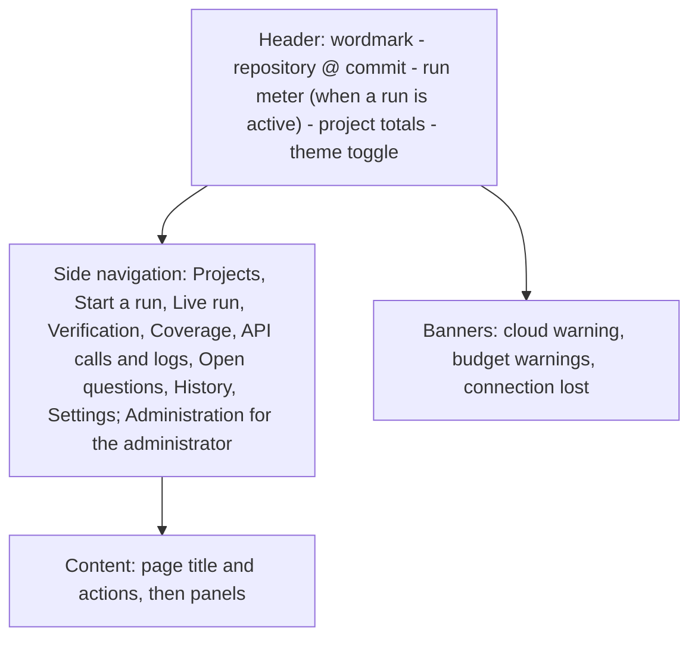

# Design system

|                      |                                                                                                                                                                                                                                                                                                                                                                  |
| -------------------- | ---------------------------------------------------------------------------------------------------------------------------------------------------------------------------------------------------------------------------------------------------------------------------------------------------------------------------------------------------------------- |
| **Status**           | Accepted, v1 (2026-10-11): design board approved by BlackLigth (blacklight0101) at G-02 with no changes (DEC-56); hosted-application screens (section 14, artboards 7-13) approved as a G-02 amendment (DEC-70); artboards 1-6 revised and approved (DEC-71); the Plan setup artboard 14 approved (DEC-86)                                                       |
| **Decisions**        | DEC-44 (text wordmark, system fonts, deep teal accent, light and dark per OS, multi-page static report), DEC-45 (English only), DEC-46 (verbose, graphic live web UI), DEC-49 (project totals always visible), DEC-50 (API calls and logs), DEC-52 (Preact + Vite), DEC-55 (delete with confirmation); [ADR-012](adr/ADR-012-local-web-ui-and-github-sources.md) |
| **Source artefacts** | [design-system-brief.md](design-system-brief.md) (what was asked); the v1 design board, exported to [`docs/design/board/`](design/board/) (open the `.dc.html` files in the design canvas; never edited after export); [`docs/design/tokens.css`](design/tokens.css) (the token file)                                                                            |
| **Devices**          | desktop and laptop browsers, 1280 px and wider, mouse and keyboard (the web UI); the landing page, sign-in and the published report also on tablets and phones (360 px and wider)                                                                                                                                                                                |
| **Feeds**            | the web UI shell card, the component gallery card, each web UI page card (RF-1000..RF-1012), the report cards (RF-500..RF-506), the landing page (RF-1200), sign-in, settings and administration (RF-1100..RF-1109)                                                                                                                                              |
| **Ancestry**         | none                                                                                                                                                                                                                                                                                                                                                             |

Every page of the web UI and the report is built with the tokens, components and patterns here. A page that needs a
new component or token adds it to this document in the same branch. Hard-coded colours, sizes, fonts or user text
in a page fail verification.

## 1. Principles

1. **Show the work.** The live UI exists to make the agents visible (DEC-46): every agent, its current tool call,
   the files it read, the cards it found, the verdicts and the cost appear as they happen. Prefer showing a real
   event to summarising it.
2. **Cost is never out of sight.** The header carries the project's total tokens and cost on every page, and the
   run's meter against its cap while a run is active (DEC-49, RF-1003, RF-1010).
3. **Every claim is one click from its evidence.** Citations render as GitHub permalinks to the exact lines
   (RF-125); a verdict always shows its reason.
4. **State is visible and honest.** Every status has one badge with a glyph and a word; colour alone never carries
   meaning. Loud (solid) for states that need a person or a decision, calm (tint) for progress and done.
5. **Nothing hard-coded.** Colours, sizes, radius, fonts, z-index and motion come from tokens; components read
   semantic tokens, never raw values, so both themes work without overrides.
6. **Calm under load.** A run can emit many events a second; the UI batches updates (at most every 250 ms per
   panel), never moves content under the pointer, and can pause live updates without stopping the run.
7. **Works without JavaScript where it is a document.** The report is a static site; JavaScript only adds filters
   and the replay player (DEC-44).

## 2. Tokens

The token file is [`docs/design/tokens.css`](design/tokens.css); the build copies it to the web UI and report
assets unchanged. Custom properties carry the prefix `--rst-`. Themes are applied with `data-theme="light"` or
`data-theme="dark"` on the root element; with no attribute the UI follows the operating system
(`prefers-color-scheme`), and a toggle in the header overrides it per browser (kept in `localStorage`). Every text
and background pair below was measured on 2026-10-11 and passes WCAG 2.1 AA; the lowest pairs are listed in 2.1.

### 2.1 Colour

| Token                                                                | Light                                         | Dark                                          | Use                                                                              |
| -------------------------------------------------------------------- | --------------------------------------------- | --------------------------------------------- | -------------------------------------------------------------------------------- |
| `bg`                                                                 | `#F4F6F6`                                     | `#0D1413`                                     | page background                                                                  |
| `surface` / `surface-2` / `surface-raised`                           | `#FFFFFF` / `#EAEFEE` / `#FFFFFF`             | `#141D1C` / `#1B2625` / `#212E2D`             | cards and inputs / headers, wells, table heads / dialogs                         |
| `ink` / `ink-soft` / `ink-muted`                                     | `#13201F` / `#364644` / `#56645F`             | `#E5EDEC` / `#BAC8C6` / `#93A5A2`             | text                                                                             |
| `rule` / `rule-strong`                                               | `#D8DFDE` / `#7A8987`                         | `#2A3836` / `#66807C`                         | separators / control borders (at least 3:1)                                      |
| `brand` / `brand-hover` / `brand-ink` / `brand-tint`                 | `#0E6B6B` / `#0A5555` / `#FFFFFF` / `#DDEFEE` | `#45B8B0` / `#64CBC4` / `#04201E` / `#123533` | primary actions, active navigation, links / text on brand / selected navigation  |
| `ok-*` (`-ink`, `-bg`, `-solid`, `-solid-ink`)                       | `#1C6E37`, `#E2F2E7`, `#1C6E37`, `#FFFFFF`    | `#63CC88`, `#12301D`, `#3DAA62`, `#04140A`    | success, supported, done                                                         |
| `warn-*`                                                             | `#7A4A00`, `#FBEBD2`, `#E39A1F`, `#1F1500`    | `#F2BA5C`, `#36270B`, `#E39A1F`, `#1F1500`    | cap reached, retried, unverified, open questions                                 |
| `danger-*`                                                           | `#A8211A`, `#FBE4E2`, `#B42318`, `#FFFFFF`    | `#FF8E84`, `#3C1513`, `#EA5E55`, `#1C0403`    | rejected, failed, delete, stop                                                   |
| `info-*`                                                             | `#1B5799`, `#E2ECF8`, `#1B5799`, `#FFFFFF`    | `#84B9F2`, `#10253D`, `#5B9DE4`, `#04121F`    | running, in progress                                                             |
| `neutral-*`                                                          | `#45524F`, `#E8ECEB`, `#56645F`, `#FFFFFF`    | `#BAC8C6`, `#222E2D`, `#93A5A2`, `#0D1413`    | planned, proposed, interrupted                                                   |
| `role-reader` / `role-verifier` / `role-planner` / `role-summariser` | `#0E6B6B` / `#6A48B8` / `#B5520B` / `#1B5799` | `#45B8B0` / `#A98BF0` / `#F09A55` / `#84B9F2` | the agent role's dot, timeline lane and read bar; always next to the role's name |
| `focus`                                                              | `#1B5799`                                     | `#84B9F2`                                     | 2 px focus outline, 2 px offset                                                  |
| `scrim`                                                              | `rgba(10,20,19,.55)`                          | `rgba(0,0,0,.6)`                              | behind dialogs                                                                   |

Lowest measured pairs: light `rule-strong` on `surface-2` 3.14:1, `rule-strong` on `bg` 3.36:1 (control borders,
need 3:1), `role-planner` on `surface-2` 4.33:1 (graphic, needs 3:1), `ink-muted` on `brand-tint` 5.22:1; dark
`rule-strong` on `surface-2` 3.66:1, `ink-muted` on `brand-tint` 5.15:1. Every text pair is at least 4.5:1.

### 2.2 Type

| Token                              | Value                                                                             | Use                                                                 |
| ---------------------------------- | --------------------------------------------------------------------------------- | ------------------------------------------------------------------- |
| `sans`                             | `system-ui, -apple-system, "Segoe UI", "Noto Sans", "Helvetica Neue", sans-serif` | everything (DEC-44: system fonts, nothing downloaded)               |
| `mono`                             | `ui-monospace, "Cascadia Code", "SF Mono", Menlo, Consolas, monospace`            | paths, citations, card and run ids, SHAs, model names, events, logs |
| `fs-xs` .. `fs-3xl`                | 12, 13, 14, 16, 20, 24, 32 px                                                     | captions to page titles; body is `fs-md` 14 px                      |
| `fw-body` / `fw-label` / `fw-head` | 400 / 500 / 650                                                                   |                                                                     |
| `lh-body` / `lh-head`              | 1.45 / 1.2                                                                        |                                                                     |

All numbers use tabular figures (`font-variant-numeric: tabular-nums` on the root), so counters do not jitter while
they update. The wordmark text is the word "Rosetta" in the sans stack, weight 700, letter-spacing -0.02em (DEC-44);
the logo icon that sits beside it is in section 15, Brand (DEC-161).

### 2.3 Spacing

| Token            | Value                           |
| ---------------- | ------------------------------- |
| `sp-1` .. `sp-8` | 4, 8, 12, 16, 24, 32, 48, 64 px |

### 2.4 Radius

| Token                                                   | Value               |
| ------------------------------------------------------- | ------------------- |
| `radius-sm` / `radius-md` / `radius-lg` / `radius-pill` | 4 / 6 / 10 / 999 px |

### 2.5 Elevation

| Token                                          | Light                          | Dark                    | Use             |
| ---------------------------------------------- | ------------------------------ | ----------------------- | --------------- |
| `shadow-1` / `shadow-2`                        | soft 1-2 px / 12 px 32 px blur | stronger, same geometry | cards / dialogs |
| `z-menu` / `z-banner` / `z-dialog` / `z-toast` | 40 / 45 / 50 / 60              | same                    | stacking order  |

### 2.6 Motion

| Token                   | Value                        | Use                              |
| ----------------------- | ---------------------------- | -------------------------------- |
| `dur-fast` / `dur-base` | 120 / 200 ms                 | state transitions, panel updates |
| `ease`                  | `cubic-bezier(0.2, 0, 0, 1)` |                                  |

The only looping animation is the "live" dot on running states (1.4 s pulse). Reduced-motion preference sets every
duration to 0 and stops the pulse.

### 2.7 Density

One density: `control-h` 32 px, `row-h` 36 px, minimum hit size `touch` 44 px for the report on touch devices. The
web UI targets desktop only, so no second density is defined.

## 3. Layout

**Web UI** (desktop, 1280 px and wider):

| Width             | Navigation                           | Notes                                          |
| ----------------- | ------------------------------------ | ---------------------------------------------- |
| 1440 px and wider | side navigation, 200-240 px          | agent panels in up to 4 columns                |
| 1280-1439 px      | side navigation                      | agent panels in 3 columns                      |
| below 1280 px     | side navigation stacks above content | supported but not optimised; nothing is hidden |

**One side navigation on every signed-in page (P1-175).** The navigation always has the same groups in the same
order: the main pages (Projects, Settings and keys), the project group, and Administration for the administrator
only. The project group is never absent. Its heading names the project (`Project: owner/repo`), cut with an ellipsis
when long, with the full name as the hover title and in the text for screen readers. Inside a project the group links
that project's pages. On a page outside a project it keeps the last project opened in this browser session
(`sessionStorage`, cleared at sign-out) and links to it only after the server confirms the user can open it; with no
such project it shows the line "Open a project to see its pages" and no link. The current page carries
`aria-current="page"` in whichever group it is.

**Report** (static site, any width from 360 px): header with wordmark and the run's identity, tab navigation
(Dashboard, Areas, Cards, Open questions, Run replay, Cost), centred content up to 1180 px wide; summary cards
reflow from four columns to one.

**Long text wraps (P5-23).** The content column (`.rst-main`) sets `overflow-wrap: anywhere`, so unbroken text such as a
file path, an area name, a run id or a model name wraps inside the column and never scrolls the page sideways at 360 px;
the ghost button (`.rst-button--ghost`) wraps its label inside its box. Do not add a per-page fix for this.

## 4. Input and ergonomics

- Keyboard: logical tab order; Enter submits the start form; Esc closes dialogs and returns focus to the button that
  opened them; tables are navigable rows of links and buttons.
- Long operations: the run itself is the long operation; every page shows its state badge and elapsed time. Buttons
  that start work show a busy state and cannot be pressed twice.
  A long operation that the server carries on after the request (reading workbooks, RF-159) shows the processing
  progress pattern of section 14 and survives a reload.
- Connection loss: if the event stream drops, a banner says "Live updates paused - reconnecting", the page keeps its
  last state, and on reconnection missed events are replayed from `events.jsonl` (RF-1006).
- Pause updates: the live run page can freeze its panels for reading while the run continues; a counter shows how
  many events are waiting. It freezes the agent panels, the coverage map, the overview, the claims and the event log; the stage stepper,
  the run meter and the top-bar meter stay live. While paused the button reads Resume, Stop run stays usable and the
  page's one polite status says "Updates paused" once (the counter is not announced).

## 5. Component inventory

All components share: a CSS class per component (`rst-<component>`), a test id per part, the focus outline, sizes
from tokens, and English text (DEC-45).

| Component        | Variants                                                          | States                                                               | ARIA / keyboard                                                                                                                                                                                                                                                          | Notes                                                                                                                                                                                                                                                                            |
| ---------------- | ----------------------------------------------------------------- | -------------------------------------------------------------------- | ------------------------------------------------------------------------------------------------------------------------------------------------------------------------------------------------------------------------------------------------------------------------ | -------------------------------------------------------------------------------------------------------------------------------------------------------------------------------------------------------------------------------------------------------------------------------- |
| Header totals    | project only; project + run meter                                 | idle, live                                                           | totals are a labelled group; the run meter is `role="meter"`                                                                                                                                                                                                             | always on screen (RF-1010); Breakdown opens per run, stage, provider and model                                                                                                                                                                                                   |
| Button           | primary, secondary, ghost, link, danger, danger-outline           | default, hover, focus, active, disabled (with reason), busy          | native `button`; disabled ones keep a `title` with the reason                                                                                                                                                                                                            | Stop run and Delete are the only danger buttons; link is an action drawn as an underlined link (P3-62), for one that sits beside real links                                                                                                                                      |
| Field            | URL, text, number, textarea, select, radio, checkbox, file, files | default, focus, invalid, disabled                                    | label bound to input; `aria-describedby` for help and the error                                                                                                                                                                                                          | URL errors show the `RST` code and a plain sentence; the error is a live region (`role="alert"`) unless the page moves focus to the invalid control after a refusal, which reads the error through `aria-describedby`, so it is not said twice                                   |
| Limit slider     | number field with a slider on the same value                      | default, invalid, away from default (warning)                        | the slider is named `Slider, <min> to <max>` (no field label in it, so a label lookup finds the number field only); a typed value outside the range shows a hint before Save; `aria-describedby` reads the default and allowed range and any warning; arrow keys step it | numeric project settings only (P2-15); the slider is bounded by its DEC-117 range (the confirm threshold stops at the run cost cap); the template default is written under it, and a value away from it shows a warning that suggests keeping the default                        |
| Model choice     | select with Other model... (shows a text field); plain text       | loading, ready, no list (text field and note), invalid, disabled     | the select is labelled `<Role> model`; Other model... moves focus to the text field labelled `<Role> other model`; a model without a price reads `(no price)` in its option and the note under the select is read through `aria-describedby`                             | Default models page and Models per role in the project settings (DEC-156). The choice starts again when the provider changes                                                                                                                                                     |
| Status badge     | tint, solid                                                       | per section 6                                                        | glyph is `aria-hidden`, the word is the label                                                                                                                                                                                                                            | one component for every state list                                                                                                                                                                                                                                               |
| Pipeline stepper | -                                                                 | done, current (live), waiting                                        | ordered list; current step `aria-current="step"`                                                                                                                                                                                                                         | Snapshot, Scan, Understand, Verify, Report; a plan run shows Brief, Planner calls, Package, Checks (RF-1015)                                                                                                                                                                     |
| Stat card        | -                                                                 | -                                                                    | -                                                                                                                                                                                                                                                                        | label, big number, caption; numbers tabular                                                                                                                                                                                                                                      |
| Agent panel      | reader, verifier, planner, summariser                             | planned, running, done, failed and the other `AgentTaskState` values | `article` with the area as heading                                                                                                                                                                                                                                       | role dot, area (wraps at "/"), model, current tool call, turn, files read, tokens, cost, read bar, card chips; the role, the round of a Deepen ("Round 2") and the state sit on one line under the title (P3-62)                                                                 |
| Coverage map     | -                                                                 | no areas yet, area with no file read, area filling in                | a region with one labelled region per area; the read share is `role="meter"`; the tree is nested lists                                                                                                                                                                   | one block per reader area in plan order: area name, files read and share of the run's files read, a bar in the reader role colour, the files read as a tree of folders (folders first, by name); it fills in from successful `read_file` calls (RF-1005)                         |
| Timeline         | live, replay                                                      | -                                                                    | lanes are a list; each bar has a text alternative                                                                                                                                                                                                                        | one lane per agent, coloured by role; time axis                                                                                                                                                                                                                                  |
| Event stream     | live, replay                                                      | -                                                                    | `aria-live="polite"`, throttled                                                                                                                                                                                                                                          | time since the start of the run with a plus sign (`+16:27.5`), event type coloured by kind, one-line text; newest first; usage lines of one role in a row are one line in tokens and dollars; a verdict has the badge of the claims list and a reason that opens in full (P3-62) |
| Data table       | calls, runs, snapshots, cards, projects                           | default, highlighted (error), selected                               | real `table` with headers; at 360 px rows stack, each cell named by its column (`data-label`); at 1280 px the columns stay                                                                                                                                               | filter bar above; numeric columns right-aligned                                                                                                                                                                                                                                  |
| Cost meter       | run, role                                                         | under 80%, 80-95% (warn), 95%+ (danger)                              | `role="meter"` with value and label                                                                                                                                                                                                                                      | marker at the likely estimate                                                                                                                                                                                                                                                    |
| Callout          | warning, error, info                                              | -                                                                    | `role="alert"` for the cloud warning and errors                                                                                                                                                                                                                          | cloud warning includes the consent checkbox (RF-143)                                                                                                                                                                                                                             |
| Dialog           | confirm, destructive confirm                                      | open                                                                 | `role="dialog"`, `aria-modal`, focus trapped and restored                                                                                                                                                                                                                | destructive confirm names the target, space freed, and what is kept                                                                                                                                                                                                              |
| Card view        | FEAT, BR, ENT, INT, OQ                                            | -                                                                    | heading per card                                                                                                                                                                                                                                                         | id, title, area, confidence, summary, claims with status, verdict reason and permalink                                                                                                                                                                                           |
| Replay player    | -                                                                 | playing, paused                                                      | buttons with `aria-label`; speed select                                                                                                                                                                                                                                  | step back, play or pause, step forward, speed 1x/4x/16x                                                                                                                                                                                                                          |
| Log list         | -                                                                 | -                                                                    | list; level toggles are `aria-pressed` buttons                                                                                                                                                                                                                           | time, level, logger, message                                                                                                                                                                                                                                                     |

A component gallery page (development only: built only in development and served at `/dev/gallery`, DEC-126) renders every
component in every state and both themes; the end-to-end suite screenshots it. The production bundle has no
`/dev/gallery` route, so the address is not a literal 404 there: a visitor without a session is redirected to sign-in,
and a signed-in user gets the application shell, which draws its not-found page with status 200 (RF-1009).

## 6. Status badges

The state lists are canonical in [architecture](architecture.md) section 5; this table adds only their presentation.

| State                                               | Tone                                            | Weight | Glyph                 | Meaning for the user                                           |
| --------------------------------------------------- | ----------------------------------------------- | ------ | --------------------- | -------------------------------------------------------------- |
| Claim `Proposed`                                    | neutral                                         | tint   | open circle           | an agent made the claim; not checked yet                       |
| Claim `CitationInvalid`                             | danger                                          | tint   | broken link           | the cited file or lines do not exist                           |
| Claim `Supported`                                   | ok                                              | solid  | check                 | the verifier agrees with the evidence                          |
| Claim `Rejected`                                    | danger                                          | solid  | cross                 | the evidence does not support the claim; kept, with the reason |
| Claim `Unverified`                                  | warn                                            | tint   | question mark         | not checked because the run stopped; resume to check           |
| Agent `Planned`                                     | neutral                                         | tint   | dashed circle         | waiting to start                                               |
| Agent `Running`                                     | info                                            | solid  | live dot              | working now                                                    |
| Agent `Done`                                        | ok                                              | tint   | check                 | finished normally                                              |
| Agent `TurnLimitReached`                            | warn                                            | tint   | clock                 | stopped at the turn limit; cards so far are kept               |
| Agent `InvalidOutput`                               | danger                                          | tint   | brackets              | the model's answer held no valid card after its repairs        |
| Agent `Failed`                                      | danger                                          | solid  | exclamation           | stopped by an error                                            |
| Agent `StoppedByCap`                                | warn                                            | solid  | square                | stopped because the budget cap was reached                     |
| Run `Completed`                                     | ok                                              | solid  | check                 |                                                                |
| Run `CapReached`                                    | warn                                            | solid  | square                | raise the cap and resume to finish                             |
| Run `Failed`                                        | danger                                          | solid  | exclamation           | see the log and the error code                                 |
| Run `Interrupted`                                   | neutral                                         | solid  | pause bars            | stopped by the developer                                       |
| Question `Open` / `Answered`                        | warn tint / ok tint                             |        | question mark / check |                                                                |
| Question `Answer saved` (DEC-154)                   | info tint                                       |        | check                 | an answer is in answers.md and no run has read it yet          |
| Call `ok` / `retried` / `failed` / `refused-by-cap` | ok tint / warn tint / danger solid / warn solid |        | HTTP code or glyph    | provider call status (RF-408)                                  |

## 7. Patterns

- **Start a run**: URL field, Resolve shows repository, pinned commit, subpath, licence and whether the snapshot is
  cached; stage and areas (an area name wraps inside its card and keeps its full text in a title; only the project's own areas are listed and ticked, in a panel that scrolls (`max-block-size` 20rem) under a filter and the buttons Select all, Select none and Own code only; an area that holds only vendored or minified files is left out and named in one line after the list ("12 library areas left out: jQuery, Bootstrap, ... Show") that opens to the areas with their reason; choosing one asks once, in a notice that says what it adds, before Start); the summary bar (`position: sticky` at the bottom of the window): areas and files chosen, the likely cost, Re-estimate and Start, with the reason when Start is off (RF-1018); the estimate table (low, likely, high per role); the cloud warning with a consent
  checkbox when a role uses a cloud provider; Start is enabled only when the URL resolved and consent is given.
- **Destructive confirmation**: a dialog that names the target, the space it frees, what is kept (the snapshot, the
  project totals), and "This cannot be undone"; the danger button repeats the verb ("Delete run").
- **Disabled with a reason**: a control that cannot be used says why in its label or title ("Delete (in use)").
- **Errors**: the `RST-xxxx` code, what happened and what to do, next to the field or in an error callout
  ([conventions](conventions.md) section 6).
- **Empty states**: one sentence and the next action ("No runs yet. Start a run.").
- **Live numbers**: counters update in place without animation; the event stream inserts at the top and keeps the
  scroll position when the reader has scrolled down.
- **Illustrative data**: mock-ups use plausible example numbers; real figures always come from the run files.

## 8. Accessibility

Baseline WCAG 2.1 AA: contrast per section 2.1, control borders at least 3:1, a visible focus outline on everything
interactive, labels bound to inputs, status carried by glyph and word, dialogs trap and restore focus, live regions
throttled so screen readers are not flooded (at most one announcement per panel every 5 seconds, summaries rather
than every event), the page language is `en`, reduced motion honoured, no content lost at 200 % zoom at 1280 px.
Tested with axe in the Playwright suite on every page and the component gallery (RNF-010, DEC-52).

## 9. Iconography

Inline SVG only, drawn in the component code, 12-20 px, stroke 1.5-1.8 px, colour `currentColor`; no icon font and
no CDN. Icons next to a word are `aria-hidden`; an icon-only button has an `aria-label`. Set: check, cross, open
circle, dashed circle, live dot, broken link, question mark, clock, brackets, exclamation, square, pause bars, retry
arrow, warning triangle, play, step back, step forward.

## 10. Content style

English only (DEC-45). Sentence case for titles, labels and buttons. Buttons start with a verb ("Start run",
"Delete run"). Numbers with thousands separators; costs in USD with `$`, four decimals below $1 and two above
(DEC-54); tokens abbreviated with `k` and `M` only in compact places, exact in tables. Times in 24-hour format, local
time zone in the UI, UTC in files. Ids, paths and model names in the mono font, never translated or shortened in
the middle. Errors say what happened, what to do, and the code.

## 11. Terminal output (withdrawn)

Withdrawn 2026-10-11 with the command-line interface (DEC-59, RF-004); nothing in this section is built. Kept for reference: the CLI shared the vocabulary of the web UI (DEC-44): one compact line per event in colour (ANSI 16 colours mapped
to the tones: info blue, ok green, warn yellow, danger red), state words identical to section 6, the run meter on
one line that updates in place in a terminal; no spinners and no in-place updates when standard output is not a
terminal; `NO_COLOR` turns colour off (RF-004).

## 12. Naming and files

- Token prefix: `rst`; CSS classes `rst-<component>[__part][--variant]`; no inline styles except computed sizes and
  role colours bound to data.
- Components: PascalCase Preact components in `web/src/components/<Component>.tsx`, one per file, shared by the web UI
  and the report (ADR-012).
- Files: tokens `web/src/styles/tokens.css` (copied from `docs/design/tokens.css`), base styles
  `web/src/styles/base.css`, the gallery `web/src/gallery/`.
- Test ids `<component>-<part>`.

## 13. Verification

- Unit tests: the status-to-badge map covers every value of every state list in architecture section 5.
- The component gallery renders in both themes; Playwright screenshots it and runs axe.
- `web/src/styles/tokens.css` equals `docs/design/tokens.css` (a test compares them).
- The verifier greps components and pages for colour literals, pixel sizes outside tokens, inline styles other than
  the allowed ones, and font or icon CDN links.

## 14. Screens for the hosted application (added 2026-10-11)

DEC-59..DEC-69 add screens the v1 board does not show. They use only the tokens and components above where they
fit; a new component is added to section 5 in the same branch. The artboards are drawn and approved before their
cards are built (an amendment of G-02, recorded in `handoff.md`).

| Screen                | Requirements              | Notes                                                                                                                                                                                                                                                                                                                                                                                                                                                                                                                                                                                                  |
| --------------------- | ------------------------- | ------------------------------------------------------------------------------------------------------------------------------------------------------------------------------------------------------------------------------------------------------------------------------------------------------------------------------------------------------------------------------------------------------------------------------------------------------------------------------------------------------------------------------------------------------------------------------------------------------ |
| Landing page          | RF-1200, RF-1201          | product-quality marketing page: hero with the one-sentence promise, the pipeline as a graphic, a still of the live agent view, evidence cards with the verifier, cost control, security and privacy, technology, about the project, Sign in and Request access; works from 360 px and without JavaScript; light and dark                                                                                                                                                                                                                                                                               |
| Sign in               | RF-1100                   | user name, password and one generic error; a locked account shows the same message as a wrong password, so the page never reveals that an account exists; centred card on the landing background                                                                                                                                                                                                                                                                                                                                                                                                       |
| Change password       | RF-1103, RF-1102          | forced at first sign-in; rules shown before typing                                                                                                                                                                                                                                                                                                                                                                                                                                                                                                                                                     |
| Projects              | RF-010, RF-1105           | the user's projects with last run, totals, New project Added 2026-10-19 (P3-39, RF-128, RF-134, DEC-148): the New project form has two tabs, GitHub repository and Upload a zip; a project made from a zip is listed as `name (zip, 19 Oct 2026)`, or `name (zip, no source)` before a zip is stored, with the note "Code changed since the last run." when the source was replaced Added 2026-10-19 (P3-49, RF-150, RF-158, DEC-150): a third tab, Excel workbooks; a workbook project is listed as `name (Excel, 3 workbooks, 19 Oct 2026)`, or `name (Excel, no source)` before a batch is finished |
| Settings and keys     | RF-1104, RF-407           | per provider: last four characters, replace, delete, Test; which key a run will use                                                                                                                                                                                                                                                                                                                                                                                                                                                                                                                    |
| Administration: users | RF-1102, RF-1106, RF-1107 | table of accounts with role, state, last sign-in, month-to-date cost; create, disable, reset; caps form; server month meter with the 80% banner                                                                                                                                                                                                                                                                                                                                                                                                                                                        |
| Administration: audit | RF-1109                   | filterable table, last 30 days                                                                                                                                                                                                                                                                                                                                                                                                                                                                                                                                                                         |
| Plan setup            | RF-605, RF-608, RF-609    | interview in small groups, each question with a default, the reason and the recommended option; architecture styles with evidence card ids; stack per layer; "What I recorded" summary; added 2026-10-11, artboard 14 (`PlanSetup.dc.html`, steps principles, architecture and stack), approved as a G-02 amendment (DEC-86); while no stack layer is chosen, a note beside "Use the defaults for the rest" says that the package will name no technology, with a "Choose a stack" button to the Stack step (Q-59, `.rst-plan-actions__note`)                                                          |
| Run queue state       | RF-1108                   | a `Queued` badge with the position on the start page and the run list                                                                                                                                                                                                                                                                                                                                                                                                                                                                                                                                  |
| Retry notice          | RF-208, Q-43, RF-1002     | a `rst-callout--info` under the stepper of a run that retries the failed areas of another run: "Retry of run <key>" with the key linked to that run, and one line that it holds that run's cards and supported claims and reads N areas again. The stepper counts only those N areas ("Read 0 of 3 areas"). **Retry failed areas** on a run that ended `Completed` starts such a linked run                                                                                                                                                                                                            |
| Failed areas notice   | RF-208, RF-1002           | a `rst-callout--warn` under the head of the live run page when a run ended with areas that gave no usable card: "Completed with 2 areas failed" (or "2 areas failed"), each area with why, and a **Retry failed areas** button that starts a run of those areas; it is not shown for a stopped run. Next to the state of an ended run, in the history list, the Projects table and the top bar of the run page, a quiet note "2 areas failed" ("1 area failed") says the same; a code map tile is a gap exactly for an area that the notice lists                                                      |

**Status (2026-10-11):** drawn as artboards 7-13 of the design board (artboard 14, Plan setup, follows in DEC-86) (`docs/design/board/Landing.dc.html`,
`SignIn`, `ChangePassword`, `Projects`, `Settings`, `AdminUsers`, `AdminAudit`), with the Impeccable design
skill and Claude design. The landing structure ("Watch it work": a replay of a sample run as the first viewport)
was chosen by the owner from three dealt structures; its direction contract is in
`.impeccable/surfaces/`. Approved by the owner without changes as a G-02 amendment (DEC-70). The v1 artboards 1-6 were then revised after an Impeccable critique and approved as a further
amendment (DEC-71): they share the hosted header and navigation, keep badge glyphs everywhere and hold Start run
disabled until consent. The run queue state is
drawn on the Projects artboard (Queued badge, position and Cancel); the start page reuses the same notice.

Components these screens add to section 5:

| Component                       | Where                                                                                                                                      | Notes                                                                                                                                                                                                                                                                                                                                                                                                                                                                                                                                                                                                                                                                                                                                                                                                                                                                                                                                                                                                                                                                                                                                                                                                                                                                    |
| ------------------------------- | ------------------------------------------------------------------------------------------------------------------------------------------ | ------------------------------------------------------------------------------------------------------------------------------------------------------------------------------------------------------------------------------------------------------------------------------------------------------------------------------------------------------------------------------------------------------------------------------------------------------------------------------------------------------------------------------------------------------------------------------------------------------------------------------------------------------------------------------------------------------------------------------------------------------------------------------------------------------------------------------------------------------------------------------------------------------------------------------------------------------------------------------------------------------------------------------------------------------------------------------------------------------------------------------------------------------------------------------------------------------------------------------------------------------------------------ |
| Replay stage                    | landing first viewport                                                                                                                     | the live-run lanes, claim counts, event stream and cost meter of a sample run in one framed window; animates once per 10 s cycle, pauses on hover or focus, static under reduced motion; always labelled "Sample run"                                                                                                                                                                                                                                                                                                                                                                                                                                                                                                                                                                                                                                                                                                                                                                                                                                                                                                                                                                                                                                                    |
| Pipeline rail                   | landing "How it works"                                                                                                                     | an ordered list drawn as a line with one node per stage; reader and verifier nodes take their role colours; each stage names the file it leaves                                                                                                                                                                                                                                                                                                                                                                                                                                                                                                                                                                                                                                                                                                                                                                                                                                                                                                                                                                                                                                                                                                                          |
| Totals pill                     | every signed-in header                                                                                                                     | "Your total" for users, "Server, this month" against the cap for the administrator (RF-1010, RF-1106)                                                                                                                                                                                                                                                                                                                                                                                                                                                                                                                                                                                                                                                                                                                                                                                                                                                                                                                                                                                                                                                                                                                                                                    |
| Cap banner                      | administration pages                                                                                                                       | warning bar at 80% of the server's monthly cap (RF-1106)                                                                                                                                                                                                                                                                                                                                                                                                                                                                                                                                                                                                                                                                                                                                                                                                                                                                                                                                                                                                                                                                                                                                                                                                                 |
| Queue notice                    | projects                                                                                                                                   | info callout with the queue position and Cancel queued run (RF-1108)                                                                                                                                                                                                                                                                                                                                                                                                                                                                                                                                                                                                                                                                                                                                                                                                                                                                                                                                                                                                                                                                                                                                                                                                     |
| Callout tones                   | start run                                                                                                                                  | `rst-callout--warn` (cloud notice, cap warning) and `rst-callout--info` (queue notice, the server key note of P1-107) beside the default error tone; the cap meter is `role="meter"` with the high estimate as a marker (P1-34)                                                                                                                                                                                                                                                                                                                                                                                                                                                                                                                                                                                                                                                                                                                                                                                                                                                                                                                                                                                                                                          |
| Administration rows and filters | administration                                                                                                                             | the row actions of an account stay on one line at 1280 px (`rst-admin__actions`; at 360 px they wrap inside the stacked row), the accounts filter by name (`rst-admin__filter`), the audit filters are User, Action, Period and Outcome; the cap banner sits in the shell's banner slot on every page (P1-107)                                                                                                                                                                                                                                                                                                                                                                                                                                                                                                                                                                                                                                                                                                                                                                                                                                                                                                                                                           |
| Rule checklist                  | change password                                                                                                                            | each password rule with a pass or fail glyph and text, updated as the user types (RF-1103)                                                                                                                                                                                                                                                                                                                                                                                                                                                                                                                                                                                                                                                                                                                                                                                                                                                                                                                                                                                                                                                                                                                                                                               |
| Run journey                     | run page while running (P1-169, RF-1015, DEC-137)                                                                                          | an ordered list of five steps: map the code, read, check citations, explain, your questions. One step is current (`aria-current="step"`), the steps before it show a check, the ones after it wait; each step has a one-line detail ("5 of 11 areas", with ", 2 failed" when an area failed) and its state in words for screen readers, so colour is never alone. Stacks to one column at 360 px. The pipeline stepper (section 5) stays on the page of an ended run until the after-run mode (P1-170) replaces it                                                                                                                                                                                                                                                                                                                                                                                                                                                                                                                                                                                                                                                                                                                                                       |
| Journey strip                   | run page after an understand run, plan run page, Plan setup (RF-615, RF-1015, DEC-142, DEC-143)                                            | an ordered list of seven steps from code to package: scan, understand, questions, brief, estimate, plan, package. Each step says its state in a word and a glyph (Done, Current, Not yet, Locked, Failed, Out of date, With gaps), the reason it is locked or the code it failed with, and its cost; it is a link only when it has a page the user may open, so a locked step is never a link. The one step that holds the next action has `aria-current="step"` and the text "Current step", whatever its state. One next action sits under the list (Start a run, Resume this run, Answer questions, Set up the plan, Review the estimate, Try the plan again, Review the new estimate, Open the package) with the total cost so far. A plan that failed is not resumed: Try the plan again opens Plan setup for a new estimate. The package is Out of date when the brief or the source run changed after it was written. A saved brief finishes the questions step ("N questions left on their defaults") and the next action moves on; a plan run that ended RST-1806 shows the package With gaps ("Written with gaps") with links to its checks.md and its download, and is never Done. Auto-fit columns at 1280 px, one column at 360 px; styles under `rst-road` |
| Living code map                 | run page while running (RF-1016)                                                                                                           | the areas of the code as tiles in a 12-column grid (6 at 980 px, 2 at 360 px), each sized by its estimated tokens: 4 by 3, 3 by 2 or 2 by 1 cells. A tile has a name (the part after the last "/"; the `#1` that ends a part of a large area reads "part 1"; the full name in `title`, over the tile on hover and keyboard focus, and in the accessible name), a glyph and words for its state, the files read and one mark per card: waiting (dashed), being read (brand border, a moving highlight and a fill under it), read (brand tint), not covered (warning tint), library left out (hatched, dashed, not a button). A tile is a button that opens the All agents tab on that area; the list scrolls inside its panel after 36 rem. Reduced motion stops the highlight, the marks and the fill. Area names are text only                                                                                                                                                                                                                                                                                                                                                                                                                                          |
| Tabs                            | run page while running                                                                                                                     | the tab pattern: `role="tablist"` with one `role="tab"` per list, `aria-selected`, `aria-controls`, roving `tabindex`; Left and Right move to the neighbour and select it (wrapping), Home and End go to the ends; only the open panel draws its content. Counts sit beside the labels (Cards so far, All agents, Activity); a count that the data cannot give exactly reads "1,000+"                                                                                                                                                                                                                                                                                                                                                                                                                                                                                                                                                                                                                                                                                                                                                                                                                                                                                    |
| Upload a zip form               | Projects (New project, second tab); Start run (source card of an upload project)                                                           | a Field of kind file (`accept=".zip,application/zip"`) under one line with the size limit and the Windows and macOS steps to make a zip; the file is checked before sending (name ends in `.zip`, not empty, not above the limit, first bytes `PK`) and a refusal shows next to the field with the reason and what to do; a Project name field (editable, from the file name); Upload zip is disabled with its reason until the file passes; after a failure the project has no source and the button reads Upload again; the summary is an info callout with files kept, size and entries left out, and a Start a run link. File and project names are drawn as text and wrap anywhere                                                                                                                                                                                                                                                                                                                                                                                                                                                                                                                                                                                  |
| Upload progress                 | Upload a zip form; Excel workbooks form (one bar for the file going out, `aria-valuetext` "File 2 of 3: 40% sent")                         | `role="progressbar"` named "Upload progress" with `aria-valuenow` as a percentage, drawn with the cap-meter bar (`rst-cap-meter`); shown only while the archive is being sent, and the form is disabled meanwhile                                                                                                                                                                                                                                                                                                                                                                                                                                                                                                                                                                                                                                                                                                                                                                                                                                                                                                                                                                                                                                                        |
| Processing progress             | Excel workbooks form after Finish (RF-159); Upload a zip form once the archive is accepted and it holds workbooks (the server answers 202) | The steps in order (Reading workbooks, Rendering sheets, Mapping dependencies, Saving) in an ordered list, the one at work marked `aria-current="step"` and `data-state="current"` (done ones carry a check, waiting ones the soft ink); under it one line "Workbook 2 of 3, sheet 4 of 9. 1,200 cells read. 0:12 elapsed." and a Cancel button (secondary) in both forms. The page asks the server every second; the line updates in place. A visually hidden `role="status"` `aria-live="polite"` paragraph names the step and changes only when the step changes, so a screen reader is not interrupted every second and the counts and the clock are never announced. A reloaded page, or the start page of the project, opens on the same panel in both forms. A Cancel that arrives after the work ended shows the summary instead (DEC-188), and one whose request fails (network, 5xx) keeps reading the state and shows how the batch really ended. The summary, or the refusal with its code, message and next step and Upload again, replaces the panel; Cancel, when it stopped the work, ends with a refusal-style note that nothing was published. Reached with the keyboard in the tab order (Cancel is the only control), with no motion.                |
| Excel workbooks form            | Projects (New project, third tab)                                                                                                          | a Field of kind files (`accept=".xlsx,.xlsm"`, several files) under one line with the accepted types, the file count and the total size limit; the files are checked before sending (type, with the save-as message for `.xls` and `.xlsb`; not empty; no repeated name, case ignored; count; total) and a refusal names each file, the reason and what to do; the chosen files are listed with their sizes and where each one is (Waiting, Sending n%, Sent, Failed, Not sent); a Project name field (editable, from the first file name); Upload workbooks is disabled with its reason until the files pass; after a failure the project has no source and the button reads Upload again, which goes on in the same batch from the failed file; the summary is an info callout with each workbook's sheets, cells, formulas and macro modules, the items left out with their reasons, and a Start a run link. File names are drawn as text inside `bdi` and wrap anywhere                                                                                                                                                                                                                                                                                              |
| Spend panel                     | run page while running (RF-1003)                                                                                                           | the cost so far, the cap, a `role="meter"` bar for the share of the cap (warning from 80%), labelled as cost, or as tokens when the cost is zero and tokens are used, the tokens against their cap, a button drawn as a link to the per-role table and the estimate (All agents tab) and the link to the API calls and logs page, in one link style                                                                                                                                                                                                                                                                                                                                                                                                                                                                                                                                                                                                                                                                                                                                                                                                                                                                                                                      |
| Working now                     | run page while running                                                                                                                     | up to three agents in plain words ("Reading Catalog/Create.aspx.cs, lines 1-80", "Wrote a card: ...", "12 claims checked, all cite real lines") with a role-coloured avatar; the citation check keeps one of the three places while claims are being checked                                                                                                                                                                                                                                                                                                                                                                                                                                                                                                                                                                                                                                                                                                                                                                                                                                                                                                                                                                                                             |

## 15. Brand (DEC-161, P1-181)

The logo is the owner's raster package: a blue and cyan open book, code on the left page and a diagram on the right.
The files are in `web/public/assets/brand/`, which the build serves under `/assets/brand/`, the one public path of
the server (a file at the root, such as `/favicon.ico`, would need a session). Nothing is loaded from another host.

| Where                                    | What                                                                                                                                                                                                     | Alt text                                                               | Minimum size                 |
| ---------------------------------------- | -------------------------------------------------------------------------------------------------------------------------------------------------------------------------------------------------------- | ---------------------------------------------------------------------- | ---------------------------- |
| Landing page, top of the page            | light colour scheme: the full logo (`rosetta-full-320w.png`, `-640w.png`, `-960w.png` in a `srcset`, shown at 160 px); dark: the icon (128 px, 2x 256 px) with "Rosetta" as live text in the text colour | "Rosetta" on the image; the live text is `aria-hidden` (no repeat)     | full logo 160 px; icon 96 px |
| Landing page header, sign-in, app header | the icon at 32 px (`rosetta-icon-32.png`, 2x `rosetta-icon-64.png`) before the wordmark text, in both themes                                                                                             | empty (decorative): the name is written next to it                     | 24 px                        |
| Browser tab and home screen              | `favicon.ico` (16, 32, 48), `rosetta-icon-32.png`, `apple-touch-icon.png` (256 px), `android-chrome-192x192.png` and `-512x512.png` through `site.webmanifest`                                           | not applicable                                                         | 16 px                        |
| HTML report and published sample         | the icon at 28 px in the masthead beside the wordmark text, and as the favicon; both are inline PNG data addresses because a report folder holds text files only                                         | empty (decorative)                                                     | 24 px                        |
| README.md                                | the icon at 128 px above the title; it is transparent and reads on the GitHub light and dark themes                                                                                                      | "Rosetta: an open book, code on the left page, a diagram on the right" | 96 px                        |

**Dark-background rule.** The wordmark inside the full PNG logo is dark navy and unreadable on a dark background. The
full logo appears only on a light background. On a dark background show the icon and write "Rosetta" as live text in
the theme's text colour (`--rst-ink`). A page that cannot run a script (the landing page, the report) chooses with
`prefers-color-scheme`; the app uses the icon and the live wordmark in both themes.

**Rules.** Always set `width` and `height` so the page does not shift while the image loads. Use the file closest to
twice the displayed size. Never use the originals, the 1280 px and 1920 px logos, or a stretched image; none of them
is in the repository. An image whose name is already written next to it has an empty `alt`; an image alone has its
name as `alt`.
