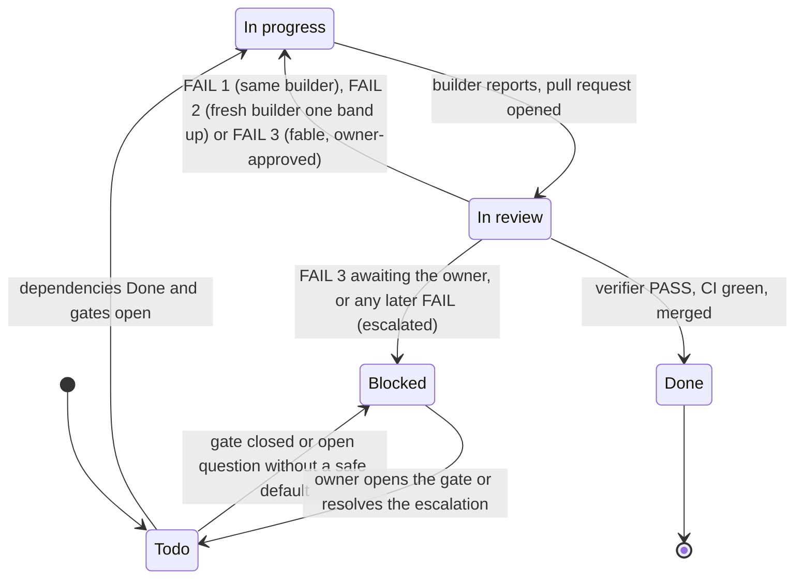

# Orchestration protocol - how Rosetta is built

This document is the operating manual for the **orchestrator** (the main Claude session that coordinates the
build), the **builders** (subagents that implement one task card each) and the **verifiers** (subagents that check
every finished card before it is merged). The cards are in [tasks.md](tasks.md). The agent definitions are in
`.claude/agents/`.

Nothing here changes the design. The RFC, the spec, the ADRs, the architecture and the roadmap remain the
sources of truth; the cards only slice them into deliverable units. Card counts (per phase and per difficulty band)
live only in the header of [tasks.md](tasks.md); this document does not repeat them.

## 1. Build settings

Every rule below refers to these settings by name, so a stack change is made here once.

| Setting | Value |
|---|---|
| Install | `npm ci` (Node.js from `.nvmrc`, DEC-27); agents run `npm ci --ignore-scripts` so no git hooks land in the `.git/hooks` folder the worktrees share (environments-and-delivery.md section 5) |
| Build command | `npm run build` (`tsc` for the server, Vite for `web/`; zero errors) |
| Verify command | `npm run verify`: typecheck, lint with zero warnings, format check, dependency-cruiser, knip, tests with coverage, in that order (ADR-011, environments-and-delivery.md section 6) |
| Test-first | on (DEC-39, ADR-010): a `test:` commit with failing tests before the `feat:`/`fix:` commit that makes them pass, then optional `refactor:` |
| Test levels | Unit (no disk, network, clock or randomness), Integration (exactly one real boundary: a temporary folder, a disposable PostgreSQL, the server through `fastify.inject`, or recordings through the fake provider), E2E (Playwright against a running server with the fake provider) |
| Level marker | the Vitest project, given by the folder: `tests/unit/`, `tests/integration/`, `tests/e2e/` (conventions.md section 7); test names start with the requirement id |
| Test pyramid | 60 / 30 / 10 (unit / integration / E2E) by test count per release, 10 points tolerance; a guideline that warns (DEC-30); a run counting zero tests fails |
| Pyramid report | `npm run test:levels` (`scripts/test-levels.mjs`, delivered by P1-01) prints `Unit n / Integration n / E2E n` and the shares |
| Mutation check | on: the verifier replaces the body of one implementing function in a disposable worktree and confirms a test fails |
| E2E tool | `@playwright/test` with `@axe-core/playwright`; harness delivered by P1-13 |
| Card size | agent working time before verification: S at most about 1 hour, M about 2-3 hours, L about 4-6 hours (DEC-102) |
| Page walk | on for cards that deliver or change a page; `node scripts/page-shots.mjs <path>` (delivered by P1-13) captures each viewport and colour scheme with the console errors, and the preview entry `rosetta-web` in `.claude/launch.json` (delivered by P1-12) serves interactive checks; viewports 1280x800 (web UI) and 360x780 (landing, sign-in, report), light and dark (design-system.md sections 3 and 13) |
| Design principles | SOLID and KISS (no abstraction, package or generic mechanism the card does not ask for) |
| Branch name | `task/<id>-<kebab-title>` in lower case, for example `task/p1-09-sign-in-and-sessions` (conventions.md section 9) |
| Commit message | Conventional Commits, `type(scope): subject`, a `Refs:` footer with the card, RF, ADR and DEC ids, and the attribution line given by the session instructions |
| Issue and pull request | one GitHub issue per card (title `<id> <title>`, milestone of the phase, labels `difficulty:<n>` and `builder:<model>`); one pull request per card from `.github/pull_request_template.md`, closing its issue (DEC-35) |
| Merge | by the orchestrator, squash only, under the merge rules of section 3.1 (DEC-96); pull requests labelled `needs-owner` are merged only by the owner |
| Agents in flight | one at a time, builders and verifiers together, under the usage throttle of section 8.1 (DEC-115) |
| Serialized resources | `db/migrations/`; `src/presentation/composition-root.ts` and `src/presentation/main.ts`; `package.json` and `package-lock.json`; `.github/workflows/`; `web/src/app/routes.ts`; `tests/integration/access-matrix.test.ts` |
| Requirement comment | `// RF-nnn` (or `RNF-nnn`) on the line above each implementing class or function |

## 2. Roles

The difficulty of a card (1-10) selects its builder (DEC-32, DEC-115) and its verifier (DEC-41, DEC-115).

| Role | Agent | Model | Responsibility | May edit |
|---|---|---|---|---|
| Orchestrator | `orchestrator`, run as the main session (`claude --agent orchestrator`) or the session itself following this file; never spawned as a subagent, because subagents cannot spawn builders | Opus 5.5 (DEC-100) | reads this file, `tasks.md` and `handoff.md`; picks ready cards; opens the issue; spawns one builder per card; opens the pull request; spawns the verifier; posts the verdict; merges under section 3.1; stops at gates and escalations | the Status line of each card, new follow-up cards (section 9), `handoff.md`, the project notes `CLAUDE.md` names, issues, pull requests and their labels, squash merges into `main` under section 3.1 |
| Builder, difficulty 1-5 | `builder-haiku` | Haiku | trivial or routine, fully specified work with a pattern to copy: text and documentation edits, prompt wording, small configuration, scaffolding, wiring, fakes, runbooks | files inside the card's scope |
| Builder, difficulty 6-8 | `builder-sonnet` | Sonnet | well-specified work that follows an existing pattern but spans several files: pages on an existing shell, adapters behind an existing port, multi-step flows | files inside the card's scope |
| Builder, difficulty 9-10 | `builder-opus` | Opus 5.5 | substantial or cross-cutting work that needs judgement, and the riskiest work: shared infrastructure, the scan pipeline, the agent loop, authentication, sessions, secrets, the egress and budget guards, untrusted archives, the final security review | files inside the card's scope |
| Builder, escalation only | `builder-fable` | Fable | a third attempt at a card, only after the owner approves it (section 3, FAIL 3); no card starts here | files inside the card's scope |
| Verifier, difficulty 1-8 | `verifier` | Sonnet | independent check against the card, the spec, the ADRs and `CLAUDE.md`; runs every gate itself; returns PASS or FAIL with findings; never edits the branch | nothing in the branch (a disposable detached worktree for the mutation check) |
| Verifier, difficulty 9-10 | `verifier-opus` | Opus 5.5 | the same procedure with the security review always on; also verifies a card escalated to an opus builder by FAIL 2 | the same |
| Verifier, escalation only | `verifier-fable` | Fable | the same procedure, only for the work of `builder-fable` (owner-approved FAIL 3) | the same |
| Product owner | BlackLigth (blacklight0101) | - | answers open questions, opens human gates, merges `needs-owner` pull requests, reviews escalations and any merged pull request after the fact, does what needs access Claude does not have | anything |

**Difficulty rule of thumb.** A card is 10 (the top of the opus band) when a mistake would leak a credential or a user's code, let one user see
another's data, let a run pass a cap, or let a hostile repository or archive reach the host; in Rosetta that is
authentication and sessions, provider keys, the egress and budget guards, snapshot extraction and the final security
review. A card is 9 when it needs design judgement across several collaborators and has no pattern to copy. A card
is 6-8 when it spans several files and collaborators but a working pattern exists to copy; 1-5 when it is a pure
text or configuration edit or routine work with a pattern to copy. When in doubt between two bands, take the higher
one.

When models change, keep the criteria and change only the `model:` lines in `.claude/agents/`.

## 3. Card life cycle



Status values (the only text the orchestrator writes on a card): `Todo`, `In progress`, `In review`, `Done`,
`Blocked (<reason>)`. Because `main` changes only through pull requests, the live states `In progress` and
`In review` are shown on GitHub as the issue labels `status:in-progress` and `status:in-review`. Task branches never
edit `tasks.md` or `handoff.md`: three cards in flight would conflict on every merge. After merges, the orchestrator
writes the `Done` Status lines, the `handoff.md` lines, `Blocked (...)` lines, gate releases and follow-up cards in one
`docs/build-status` pull request (section 3.1 rule 4), batched at most every few merges and always before a session
ends; until it merges, the merged pull request and the closed issue are the record. The reason is a gate (`Blocked (G-01)`), an open question (`Blocked (Q-nn)`), an escalation
(`Blocked (escalated YYYY-MM-DD - see handoff.md)`), a pull request waiting for the owner
(`Blocked (needs-owner - see #<pr>)`) or a withdrawal (`Blocked (withdrawn YYYY-MM-DD - see <card id>)`). When only
part of a card waits, the rest runs: `Todo; <part> Blocked (G-nn)`.

1. **Select.** A card is ready when its Status is `Todo`, every id in *Depends on* is `Done` (merged into `main`)
   and every gate it names is `Open` in the Gates table of `handoff.md`. Ready cards run in parallel within the
   limits of section 8. When a gate opens, the orchestrator sets the cards it held from `Blocked (G-nn)` back to
   `Todo`.
2. **Open the issue** if the card has none yet, create the branch from the current `main`, label the issue
   `status:in-progress`.
3. **Brief the builder** with the card verbatim, its *Reads* list, section 1, the builder rules (section 4) and the
   report format (section 6). One card per builder, one builder per card, each in its own worktree.
4. **The builder reports** and pushes its branch. The orchestrator does not judge the report. It opens the pull
   request from the template (card, requirement, ADR and DEC ids, difficulty and builder, `Closes #<issue>`), labels the
   issue `status:in-review` and spawns the verifier for the card's difficulty with the card, the report and the branch.
5. **The verifier returns** PASS or FAIL (section 5). The orchestrator posts the verdict block on the pull request
   as a comment, unchanged.
   - PASS: merge under section 3.1, then record the card as `Done`, its `handoff.md` line and every MINOR finding as
     a follow-up card (section 9) in the next `docs/build-status` pull request. Checks only the owner can make are
     listed by the verifier as "owner check pending"; they do not block the merge, and the orchestrator copies them to
     the owner's agenda in `handoff.md` (DEC-111).
   - FAIL 1: send the findings back to the **same** builder (context intact) for a second round.
   - FAIL 2: re-run the card once with a fresh builder one band up (haiku to sonnet, sonnet to opus; an opus card
     stays on opus; never down). The verifier moves up with the builder (`verifier-opus` after a promotion to opus).
     The card's difficulty line is not edited; the pull request notes the promotion (DEC-115).
   - FAIL 3: may go to a fresh `builder-fable` with `verifier-fable`, but only after the owner approves it in chat.
     Until then set `Blocked (escalated ...)` and leave the pull request open.
   - Any later FAIL: set `Blocked (escalated ...)`, leave the pull request open and unmerged, and write the case in
     `handoff.md` for BlackLigth (blacklight0101). An escalated card stops its dependency chain.
6. **Gates** (section 7) are never opened by the orchestrator.
7. **Session end.** `handoff.md` holds the state, the next ready cards, the pull requests waiting for the owner and
   every escalation; the project notes named in `CLAUDE.md` are updated; the local `main` equals `origin/main` and is
   clean.

### 3.1 Merge rules (DEC-96)

The owner delegated the merge of task-card pull requests to the orchestrator so the build does not wait on them.
The orchestrator merges a pull request only when **all** of these hold, and checks each one again right before the
merge:

1. CI is green on every required check (Windows and Linux; image and Compose jobs once they exist).
2. The verifier's verdict is PASS with no BLOCKING or MAJOR finding, and it is posted on the pull request.
3. The branch is up to date with `main`. When `main` moved, the orchestrator rebases the branch onto `main`
   (`git rebase origin/main` in the card's worktree), pushes with `--force-with-lease` to the **task branch only**,
   waits for CI again, and asks the same verifier to confirm the verdict when the rebase touched files of the card.
4. The pull request does not change `docs/spec/`, `docs/adr/`, `docs/decision-log.md`, `docs/rfc/` or `CLAUDE.md`.
   A pull request that does gets the label `needs-owner`, the card is set `Blocked (needs-owner - see #<pr>)`, and
   only the owner merges it. Documentation pull requests outside a card (`docs/<topic>`) are `needs-owner`, except a
   `docs/build-status` pull request that changes only Status lines, follow-up cards and the totals of `tasks.md` and
   lines of `handoff.md`; it needs no verifier and is merged once CI is green.
5. The merge is `gh pr merge <pr> --squash --delete-branch` with the pull request title as the squash title, and the
   command's exit code is 0. Never an admin override, never a bypass of the `main` ruleset, never a push to `main`.

After each merge the orchestrator fast-forwards its local `main` (`git pull --ff-only`) and confirms the card's
issue is closed. Releases, tags and gates stay with the owner.

**P1-01 exception.** CI does not exist until P1-01 delivers it, so rule 1 cannot hold for that card: the orchestrator
merges P1-01 when the verifier's PASS includes `npm ci`, `npm run verify` and the CI workflow's steps run locally on
Windows, and the workflow's first run on the pull request is green on both runners; if that first run cannot start
(for example the ruleset requires checks that do not exist yet), the pull request is `needs-owner`.

## 4. Builder rules (included verbatim in every builder brief)

- Read `CLAUDE.md` first, then the card, then every document in *Reads*.
- Implement exactly the card's *Delivers*. If something in the card is impossible or contradicts a document, stop and
  report the contradiction instead of choosing silently.
- Follow the hard rules of `CLAUDE.md`. The ones builders break most often are:
  - every model call goes through the `LlmProvider` port wrapped by the egress and budget guards; no provider SDK
    outside `src/infrastructure/providers/` (ADR-003, ADR-006, ADR-007);
  - every query and every workspace path is scoped by the signed-in actor; another user's id answers 404 (RF-1105);
  - SQL is parameterised and lives only in `src/infrastructure/db/`; a schema change is a new numbered migration
    (ADR-016);
  - repository and model text is rendered as text, never HTML (RF-507);
  - no `Date.now()`, `new Date()`, `Math.random()` or `randomUUID()` outside `src/infrastructure/`; use `Clock` and
    `IdGenerator`;
  - no secret in code, tests, recordings, logs or output; nothing from the owner's employer (RNF-003, DEC-03);
  - no real provider call in automated tests (ADR-008);
  - no runtime package outside the baseline of environments-and-delivery.md section 7 without an ADR.
- **Test-first**: for each Given/When/Then scenario write the failing test named after its requirement id, run it
  red, commit it (`test:`), write the simplest code that makes it green (`feat:`/`fix:`), refactor. Put each test
  under the folder of its level. Paste the pyramid report line in the report.
- **SOLID and KISS**: one responsibility per module; extend through ports; fakes pass the same contract test as the
  real adapter; small ports; constructor injection. Add no abstraction, base class, generic mechanism or package the
  card does not ask for.
- Every new behaviour cites its requirement id at the implementing type (section 1). Every structural change updates
  `docs/architecture.md` in the same branch; every schema or file-format change updates `docs/data-model.md`.
- Run `npm run verify` before reporting and paste its last lines. Tests run without external systems (fakes,
  recordings, a disposable PostgreSQL).
- Do not touch `docs/spec`, `docs/rfc`, `docs/adr` or `docs/decision-log.md` unless the card says so; such a change
  makes the pull request `needs-owner` (section 3.1).
- Commit on your branch only. Never merge and never push to `main`.
- Report in the format of section 6. Be exact about what was not done.

## 5. Verifier checklist and verdict

The verifier receives the card, the builder report and the branch name. It works in the branch's worktree without
changing it; its only writes are in a disposable detached worktree for the mutation check, removed afterwards. Its
full procedure is in `.claude/agents/verifier.md` (difficulty 1-8), `.claude/agents/verifier-opus.md`
(difficulty 9-10) and `.claude/agents/verifier-fable.md` (fable escalation only). In short: scope, gates (`npm ci`, `npm run verify` run by itself), scenario coverage and TDD order,
mutation check, the card's *Done when* exactly as written, page walk for page cards, ADR conformance, the hard-rule
greps of section 5.1, engineering standards, SOLID and KISS, security, docs, report honesty.

### 5.1 Hard-rule greps

| Pattern | Allowed where | Rule |
|---|---|---|
| `dangerouslySetInnerHTML`, `innerHTML`, `outerHTML` | nowhere | repository and model text is rendered as text (RF-507) |
| `eval(`, `new Function` | nowhere | model output is never executed (ADR-013) |
| `child_process`, `shell: true` | nowhere in `src/` | Rosetta runs no shell commands |
| `rejectUnauthorized` | nowhere | TLS is never disabled |
| `Date.now(`, `new Date(` | `src/infrastructure/` and `tests/support/` only | time only through the `Clock` port |
| `Math.random(`, `randomUUID(`, `randomBytes(` | `src/infrastructure/` and `tests/support/` only | ids and tokens only through ports |
| `from 'openai'`, `from '@anthropic-ai/sdk'` | `src/infrastructure/providers/` only | provider SDKs only in adapters (ADR-003) |
| `from 'pg'` | `src/infrastructure/db/` only | SQL only in the database adapters (ADR-016) |
| `from 'tar'`, `from 'ignore'` | `src/infrastructure/github/`, `src/infrastructure/files/` | ADR-019 |
| `` query(` `` with `${` | nowhere | parameterised SQL only (ADR-016) |
| `${{` inside a workflow `run:` | nowhere | pass values through `env:` (shell injection) |
| `sk-`, `ghp_`, `api_key`, `Passwor[d]=` literals | `tests/` fixtures and `tests/support/` marked fake; the detection patterns in `src/infrastructure/guards/secret-masker.ts` | no secret in the repository (RNF-003) |
| `console.` | `src/presentation/` only | logging through the `Logger` port |

### 5.2 Verdict format

The block in `.claude/agents/verifier.md` section Output, unchanged. Any BLOCKING or MAJOR finding is a FAIL. A PASS
may carry MINOR findings; the orchestrator files them as follow-up cards.

## 6. Builder report format

The block in `.claude/agents/builder-*.md` section Report format, unchanged: task, branch and difficulty; done; not
done or deviations; scenarios to tests; TDD order; verify output; pyramid; docs updated; open questions.

## 7. Human gates

Gates are opened only by a person. Their state (`Closed`, `Provisional`, `Open`) is recorded in the Gates table of
`handoff.md` with the date and who opened it. The criteria below are the only definition of each gate, with the
same ids and names as `handoff.md` (DEC-99). The orchestrator never opens a gate.

| Gate | Held by | Opens when | Blocks |
|---|---|---|---|
| G-01 Documentation set accepted | BlackLigth (blacklight0101) | the owner has reviewed the whole documentation set, RFC-001 and the requirements are set to Accepted, every open question is answered or its default accepted (DEC-33; no provisional opening) | P1-01 and, through dependencies, every other card |
| G-02 Design board approved | BlackLigth (blacklight0101) | the design board is approved and folded into `docs/design-system.md` (open since 2026-10-11, DEC-56, amended by DEC-70, DEC-71, DEC-86) | P1-12, P1-14, P1-15, P1-34, P1-35, P1-36, P1-37, P1-38, P1-39, P1-40, P1-41, P1-42, P3-08 (page cards; the gate is open, so they are not held) |
| G-03 Public GitHub repository ready | BlackLigth (blacklight0101) | `blacklight0101/Rosetta` exists, `main` is pushed and protected by the ruleset of environments-and-delivery.md section 5 | P1-01 (issues and pull requests need the remote) |
| G-04 Provider access ready | BlackLigth (blacklight0101) | Ollama runs on the owner's machine with the models folder of DEC-53, and an OpenAI key is in the owner's `.env`; the reader model (Q-04) comes from the spike of P1-47 | only the live-check parts of P1-25, P1-26 and P1-47; the rest of those cards runs (`Todo; ... Blocked (G-04)`) |
| G-05 Milestone hand-in approved | BlackLigth (blacklight0101) | the owner has checked the hosted URL, the teacher account, the sample report, the slides and the video, and submits the hand-in (RF-803) by 2026-10-26 | the P1 exit |
| G-06 Hosted deployment ready | BlackLigth (blacklight0101) | the image of `main` deployed by its `sha-<short>` tag (DEC-104); `/healthz` green; smoke test passed; the teacher account signs in on the hosted URL (RF-1304, RF-1107); by 2026-10-24 | P1-54 |
| G-07 Host account and secrets ready | BlackLigth (blacklight0101) | the host ADR of P1-48 is merged, the owner has created the host account and stored every secret of environments-and-delivery.md section 4 in the host's store (DEC-104) | P1-55 |

## 8. Parallelism and ordering

- Phases run in order (P1, P2, P3), but cards inside a phase run in parallel whenever their dependencies allow. A
  card of a later phase may start early only when every card it depends on is `Done` and the owner said so in
  `handoff.md`.
- Two cards run at the same time only when their *Delivers* paths are disjoint and they share no serialized resource
  (section 1). Migration numbers are fixed per card in `docs/data-model.md` section 7 and tasks.md; the orchestrator
  never reassigns them.
- Keep at most the configured number of agents in flight (one at a time, DEC-115). One card has one verifier at a time.
- When the owner asks to pause (usage limits), stop the running agents; their worktrees keep the work. On resume,
  continue the same agent (SendMessage) rather than starting the card again.
- Use Agent-tool subagents (one per builder or verifier, each builder in its own worktree). A Workflow script runs
  the build only when the user has opted in for that session (said "ultracode", asked for a workflow or multi-agent
  orchestration, or ultracode is on); otherwise offer it with a rough cost and wait for a yes.
- When the session's working directory is not this repository, the agent types in `.claude/agents/` are not loaded;
  launch a general-purpose subagent with the card's model and tell it to read and follow the agent file.

### 8.1 Usage throttle (DEC-115, replaces DEC-100)

The build must never stop because the Claude usage ran out. The orchestrator runs **one agent at a time**, and it
reads the plan usage before every launch and after every finish, in this order of preference: the session's usage
tool, a scheduled check that reads it, or asking the owner (DEC-111); `/usage` works in a terminal session. The
band of the 5-hour window decides what may start:

| 5-hour window used | What may start |
|---|---|
| below 50% | any one agent (builder, verifier or fix round) |
| 50% to 70% | only verifiers and fix rounds; no new card starts |
| 70% to 85% | only the orchestrator's own cheap work: merges, rebases, status pull requests; no agent |
| 85% or more | stop until the reset; record the hold and the reset time in `handoff.md` and schedule a wake-up just after it |

Further limits:

- Round 2 and later verifiers probe only the changed code and the earlier findings.
- Round-1 verifiers cap adversarial probes (the mutation check and extra attacks) at about 30.
- Above 70% of the weekly window: at most one agent per hour.
- A running agent is not killed when a band is crossed; the next launch waits for the right band. After the reset the
  orchestrator resumes a paused agent (SendMessage, not a fresh start).
- When the usage cannot be read, keep to the 50 to 70% rules until it can.

## 9. Follow-up and fix cards

- A follow-up card takes the next free `P<phase>-nn` of the phase that owns the affected work, is appended at the
  end of that phase's section in `tasks.md`, starts its title with `Follow-up:` and names the originating card in its
  Refs. Its difficulty follows the rule of thumb of section 2; a follow-up of a card that failed twice is rated one band above the original.
- A MINOR verifier finding becomes a follow-up card. A finding that is pure wording (a message, a doc sentence) may
  instead be fixed by the orchestrator on the branch before the merge, with the matching test updated and the
  verifier asked to confirm.
- A defect found after merge (a failing check, a bug report, an `RST` code in the log) becomes a follow-up card whose
  first step is a **failing test that reproduces the defect**; the verifier checks that it fails before the fix and
  passes after it.
- Follow-up cards never edit `docs/spec`. When a defect reveals a wrong requirement, the card is escalated to
  BlackLigth (blacklight0101).
- A follow-up that needs a schema change takes the next free migration number of the release block
  (`0001..0099`, data-model.md section 7).
- Every new follow-up card opens its issue and updates the totals in the `tasks.md` header in the same commit, on
  the originating card's branch or in a `docs/build-status` pull request (section 3.1 rule 4).

## 10. Escalation and stop conditions

Stop dispatching and write the reason in `handoff.md` when:
- a gate is needed;
- a card is escalated (section 3);
- a builder reports a contradiction between documents;
- the verifier finds a hard-rule violation that the builder claims is required (a design question, not a build
  question);
- CI fails on `main`;
- an environment, credential or person that Claude cannot reach is needed.

Do not read success or failure from a grep of command output; use the exit code. A running preview can lock the
build output and make a correct branch look broken (stop the preview first).

## 11. Keeping counts in sync

The `tasks.md` header is the only canonical place for card counts per phase and per difficulty band. `handoff.md`
and this document link to it; if either repeats a number, it is re-checked against the header whenever a card is
added, withdrawn or re-rated. The header can be checked with:

```bash
grep -c '^### P' docs/orchestration/tasks.md
grep -cE '^- \*\*Difficulty\*\*: (1|2|3|4|5) ' docs/orchestration/tasks.md
grep -cE '^- \*\*Difficulty\*\*: (6|7|8) ' docs/orchestration/tasks.md
grep -cE '^- \*\*Difficulty\*\*: (9|10) ' docs/orchestration/tasks.md
```

The docs consistency tests of P1-51 run the same counts in `npm run verify`.
