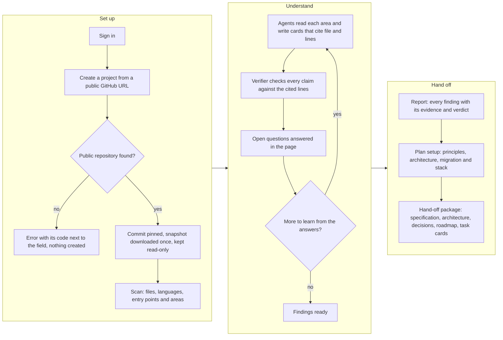
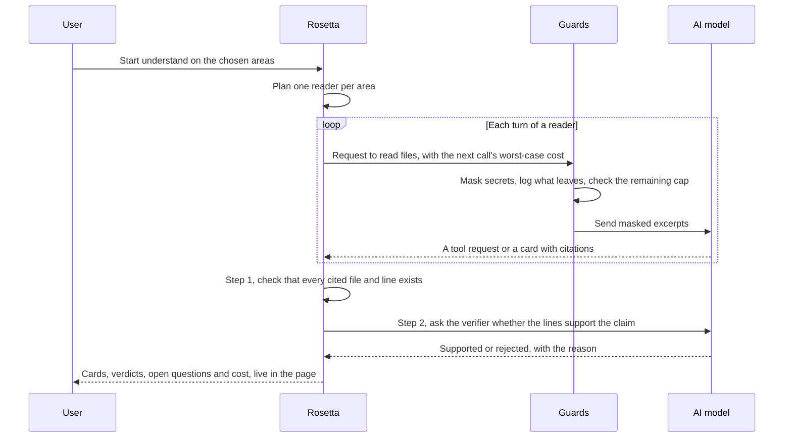
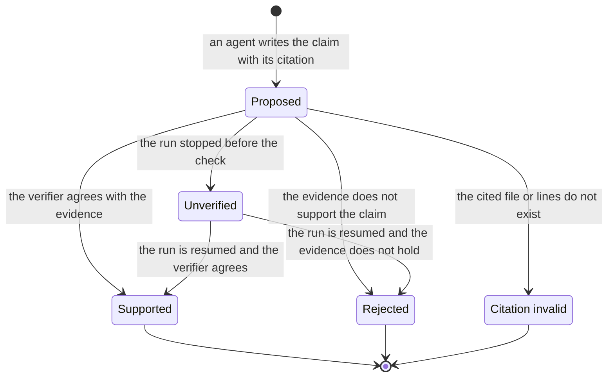
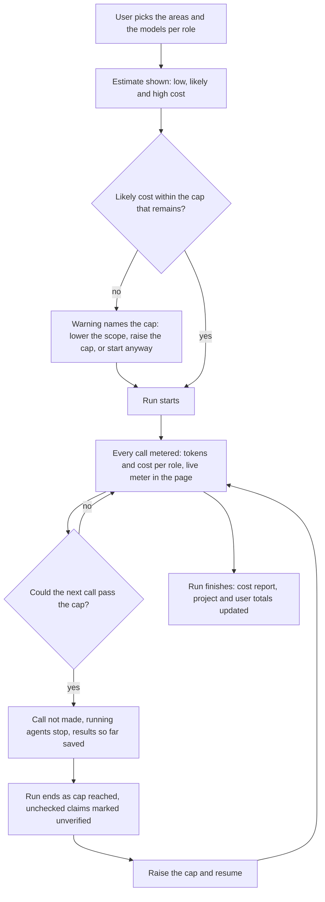
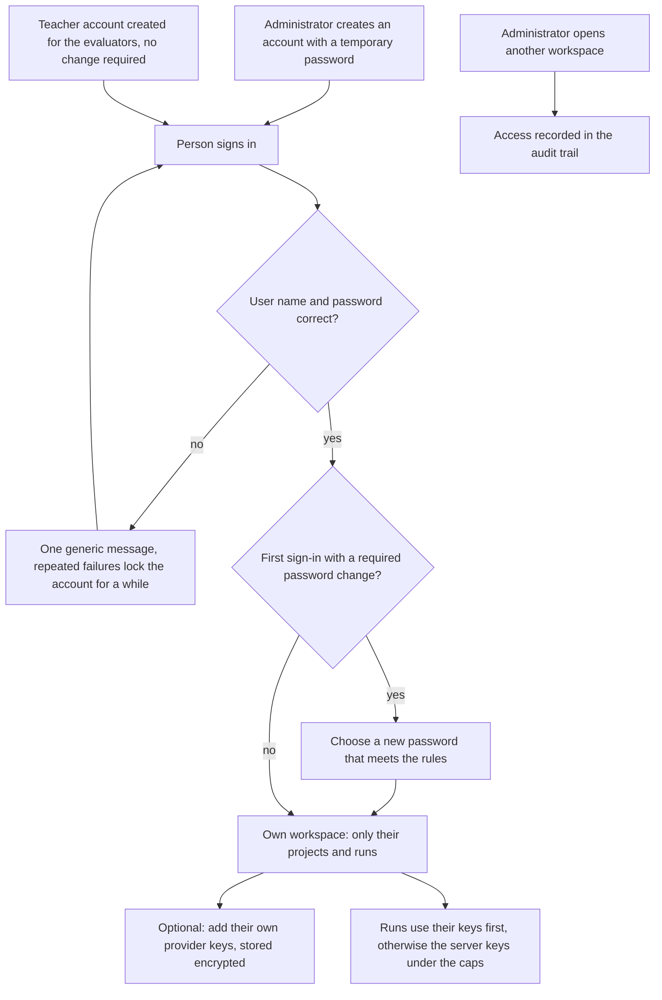
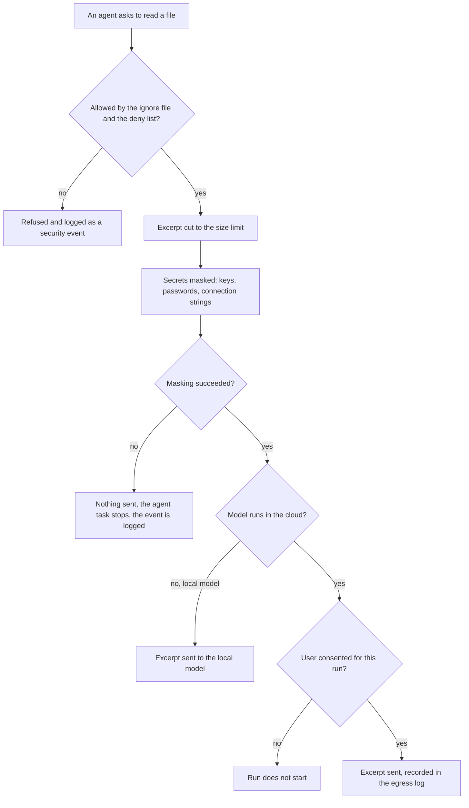
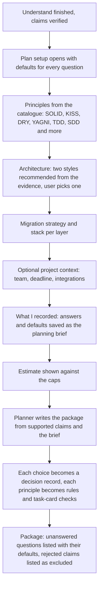
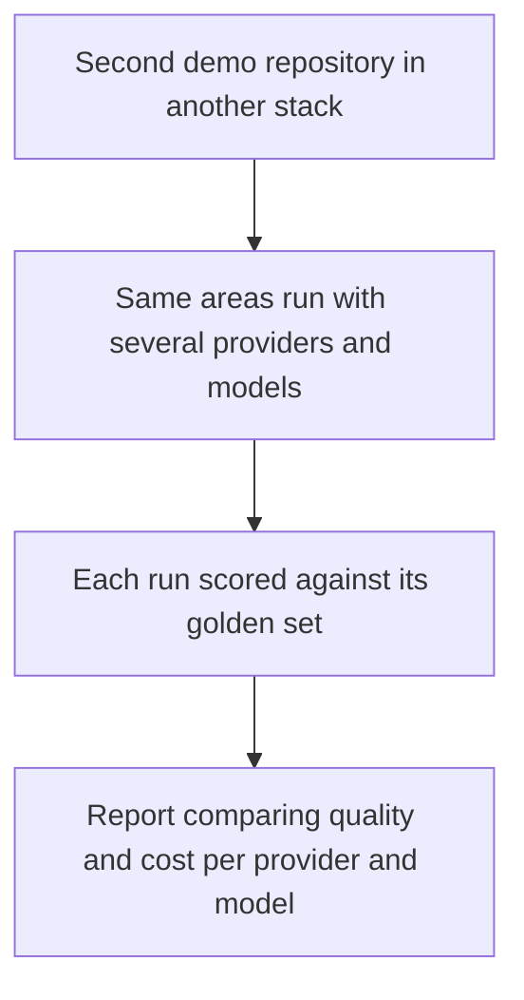

# Process flows (stakeholder view)

Status: 2026-10-11

| | |
|---|---|
| **Audience** | the teachers evaluating the master's final project first, then prospective customers; plain words, no internal codes (DEC-93) |
| **Source** | derived from [RFC-001](rfc/RFC-001-rosetta.md) and the [requirements](spec/requirements.md); when a flow changes, change the RFC or the spec first and this page in the same branch |
| **Published** | the same diagrams as a private shareable page and as `docs/rosetta-flows.pdf` (A4: a cover page and one landscape page per diagram), regenerated whenever a flow changes (DEC-95); page: https://claude.ai/artifact/1LY8Fx8ZFjxSQXvtRFDoDj (private); last regenerated 2026-10-11 (after the build-plan review) |

## About this page

These diagrams show what Rosetta does, in the order it happens, without implementation detail. Each diagram
has a caption that says the one thing a reader must take away and cites the requirement ids behind the steps.

Rules for editing:

- One flow per business process; a flow that no longer fits on one landscape A4 page is split in two.
- Plain words a stakeholder uses; no class names, table names or internal codes in the boxes.
- `flowchart TB` for long chains, because a long left-to-right chain prints too small on A4; left-to-right only
  for short loops of five or six boxes.
- `sequenceDiagram` for interactions between people and systems over time; `stateDiagram-v2` for the life cycle of
  a record.
- Every caption is a sentence starting with a capital letter, under its diagram, citing its RF ids.
- Flows of a later release go under a "Later releases" heading as third-level headings that name the release.
- Update the Status line when the flows are checked against the spec, and regenerate the PDF and the shareable
  page in the same change.

## 1. From a GitHub URL to a hand-off package

Every finding in the report and every requirement in the package points back to the exact lines of code it comes
from, so a person can check any statement in minutes. Sources RF-010, RF-100..RF-106, RF-120..RF-122,
RF-200..RF-204, RF-240, RF-241, RF-300, RF-301, RF-500..RF-502, RF-602, RF-604, RF-605, RF-1007, RF-1100.

## 2. Understanding an area and checking every claim

Agents can only read, never change, the code, and nothing reaches a model without passing the guards first.
Sources RF-140..RF-147, RF-200..RF-205, RF-300, RF-301, RF-420..RF-422, RF-1002..RF-1004.

## 3. The life of a claim

A rejected claim is never deleted: it stays in the report with the verifier's reason, and only supported claims
feed the hand-off package. A claim whose citation holds is shown as "waiting for judgement" only while the
judgement step is queued or running, then with its verdict; a claim the run left unjudged says so (RF-1014). Sources RF-300..RF-304, RF-006, RF-604.

## 4. Cost control from estimate to cap

The estimate only warns; the cap itself is never exceeded: the worst case of each call is reserved and checked
before it is made, and every cent is kept in the
project's cost ledger even after runs are deleted. Sources RF-006, RF-420..RF-428, RF-1003, RF-1010, RF-1106.

## 5. Accounts and the teacher account

Nobody signs themselves up and nobody sees another person's work; the administrator's access to a workspace is
always audited. Sources RF-1100..RF-1107, RF-1109.

## 6. What leaves the machine

Every guard fails closed: when in doubt, nothing is sent, and every excerpt that does leave is logged.
Sources RF-140..RF-147, RF-143.

## 7. From the planning brief to the hand-off package

The package follows the choices the user made, not the model's guesses: anything left unanswered is listed with
its default instead of being invented. Sources RF-601..RF-613.

## Later releases

### 8. Comparing providers on a second target (Release 2)

Release 2 measures which model gives the best findings for the money on more than one stack; its requirements are
reserved, not yet written. Sources Q-05.
