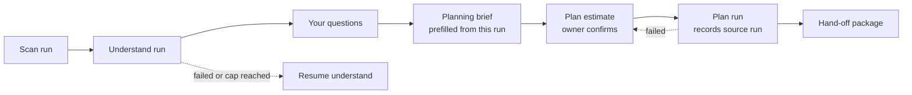

# RFC-002: Plan as the next step of a run - from understand to the hand-off package in one guided flow

|               |                                                                                                                                                                                                                                                 |
| ------------- | ----------------------------------------------------------------------------------------------------------------------------------------------------------------------------------------------------------------------------------------------- |
| **Status**    | Accepted 2026-10-18 by BlackLigth (blacklight0101), recommended option and every proposed default (DEC-142, DEC-143)                                                                                                                            |
| **Date**      | 2026-10-18                                                                                                                                                                                                                                      |
| **Author**    | Claude Code (Claude Opus 5.5), drafted for BlackLigth (blacklight0101)                                                                                                                                                                          |
| **Reviewers** | BlackLigth (blacklight0101), product owner; decides and merges                                                                                                                                                                                  |
| **Related**   | [RFC-001](RFC-001-rosetta.md) - [Requirements](../spec/requirements.md) RF-604, RF-605, RF-613, RF-1015, RF-1017 - [ADR-007](../adr/ADR-007-cost-control.md) - [ADR-018](../adr/ADR-018-planning-brief-and-principle-catalogue.md) - issue #560 |

This document proposes a change to how a user moves from an understand run to the hand-off package. It contains no
code; contracts are described as field lists and diagrams. The draft requirement text in section 8 is ready to paste
into `docs/spec/requirements.md` once the owner accepts it; this RFC does not edit the spec itself.

## 1. Context and problem

On 2026-10-18 the owner ran understand on the WebForms folder of eShopModernizing with Ollama `gemma4:e4b`, then
opened Plan setup and started `plan`. The understand run completed; the plan run failed with `RST-1803` because the
planner's first answer stopped at its 4096-token output limit in the middle of the JSON. That truncation is fixed
separately by card P3-27 (#559) and is out of scope here.

The owner's second observation is the subject of this RFC: "They seem to be disconnected from each other." Today:

- Understand and plan live on separate pages. The run page's "after the run" mode (RF-1015, RF-1017) ends at the open
  questions; it does not point to Plan setup.
- `StartRun` does not offer the `plan` stage. Plan setup starts it after showing the plan estimate (P3-08, P3-11).
- `BuildPlan` and `EstimatePlan` read the project's newest understand run that ended `Completed`, not the run the user
  was looking at. With several runs on different areas the user cannot tell which run the package comes from.
- Nothing shows the whole path (scan, understand, questions, brief, estimate, plan, package) as one journey, so a
  failure in one stage leaves the user unsure what to do next.

## 2. Goals and non-goals

**Goals**

1. After an understand run ends, the run page offers "Next: set up the plan" as the main action, and Plan setup opens
   for that run, with the brief prefilled from that run's evidence (RF-608, RF-609).
2. The user sees one journey from start to package, with each stage's state, cost and next action.
3. The package names the understand run it was written from, and the plan uses that run, not "the newest".
4. The plan estimate and the owner's confirmation before the paid `planner` calls stay exactly as RF-613 and ADR-007
   require.
5. A failure in either stage leaves the other stage's results intact and offers one clear next action.

**Non-goals**

- Fixing the planner's output limit (P3-27, #559).
- Starting `plan` without the user's confirmation, or estimating it before the brief exists.
- Changing what the package contains (RF-601, RF-620..RF-638) or the re-read loop (RFC-003).
- Merging understand and plan into one run record, one cap or one resume (see option C).

## 3. Options

| Option                                   | What changes                                                                                                                                                                                                                                                     | For                                                                                                                                          | Against                                                                                                                                                                                                                                          |
| ---------------------------------------- | ---------------------------------------------------------------------------------------------------------------------------------------------------------------------------------------------------------------------------------------------------------------- | -------------------------------------------------------------------------------------------------------------------------------------------- | ------------------------------------------------------------------------------------------------------------------------------------------------------------------------------------------------------------------------------------------------ |
| A. Link the pages                        | The run page's "Your turn" panel gets "Next: set up the plan"; Plan setup opens with that run selected and the brief prefilled. Nothing else.                                                                                                                    | Smallest change; one card; no new state.                                                                                                     | The journey is still implicit; a plan run is still a separate page with no link back; the user still has to guess what follows a failure.                                                                                                        |
| B. Guided flow, one run record per stage | A. plus a journey strip shared by the run page, Plan setup and the plan run page: scan, understand, questions, brief, estimate, plan, package. Each stage keeps its own run record, state, cap, cost and resume. The plan run records its source understand run. | Matches the owner's request; keeps every existing guarantee (caps, resume, estimates); failures stay local to a stage; builds on A in steps. | More UI than A; the journey must be derived from several run records and the brief.                                                                                                                                                              |
| C. One combined run                      | A single run record whose stages are understand, questions, plan; one cap, one resume, one end state.                                                                                                                                                            | Simplest to explain ("one run, one package").                                                                                                | Breaks the confirmation before the paid plan stage, or forces the run to pause for days while questions are answered; one cap mixes two estimates; resume (RF-006) and the state machine change; a plan failure would mark the whole run failed. |

## 4. Recommendation

Option B, delivered in two steps: first A (the link and the prefilled brief, plus the source run in the plan
manifest), then the journey strip. Each stage stays its own run record, so ADR-007, RF-006 and RF-613 need no change.

Questions are optional: the brief can be saved with unanswered questions, which take their defaults (DEC-80).

**Journey state (derived, not stored)** - for one understand run:

- source run: id, end state, Supported claim count, open and answered questions;
- brief: saved or not, saved time, whether it changed after the newest package (RF-605 "out of date");
- plan runs from this source: newest id, end state, error code, cost;
- package: present or not, the plan run that wrote it;
- next action: one of Resume understand, Answer questions, Set up the plan, Review estimate, Write the package, Try
  the plan again, Open the package.

**Plan run manifest** gains one field: `sourceRunId`, the understand run the plan was written from. `EstimatePlan` and
`BuildPlan` read that run instead of the newest `Completed` one; a missing or unusable source is refused with the
existing `RST-1802`.

## 5. Cost and caps

- Understand keeps its own estimate and confirmation on the start page (RF-425, RF-1001). The start page says that
  the plan is estimated later, after the brief, and is confirmed separately.
- The plan estimate needs the brief (`EstimatePlan` measures the brief and answers), so it is shown on the estimate
  step, against the same caps the guard checks, and "Write the package" stays the owner's explicit confirmation.
  Nothing starts `plan` by itself, not even with all defaults accepted.
- Each run has its own cap and its own ledger rows; the journey shows the cost of each stage and their total.
- A changed brief, or a new source run, needs a new estimate before the next plan run.

## 6. Failure handling

| Situation                                                                      | Behaviour                                                                                                                                                                                        |
| ------------------------------------------------------------------------------ | ------------------------------------------------------------------------------------------------------------------------------------------------------------------------------------------------ |
| Understand ends `Failed`, `CapReached` or `Interrupted`                        | Next action is Resume (RF-006). The plan steps are shown but locked, with the reason; plan from a stopped run is an open question (Q-B below).                                                   |
| Understand completes with no `Supported` claim                                 | Plan is locked with `RST-1802` in plain words and the suggestion of RF-264 (a new scan or more areas).                                                                                           |
| Plan refused before it starts (`RST-1801`, `RST-2302`, `RST-1601`, `RST-1515`) | Stays on the estimate step with the code, the message and the next step; nothing is charged.                                                                                                     |
| Plan ends `Failed` (for example `RST-1803`) or `CapReached`                    | The understand run, its cards and the brief are untouched. The journey shows the plan step failed with its code and cost, and offers "Try the plan again", which goes back to the estimate step. |
| A package exists and the brief or source run changes                           | The package step is marked out of date (RF-605) and the next action is a new estimate.                                                                                                           |

A plan run is not resumable in R1; trying again is a new plan run with its own estimate. Earlier packages and failed
plan runs stay listed with their cost.

## 7. Impact

- Web UI: the "Your turn" panel (RF-1017), Plan setup (RF-605), the plan run page, a shared journey strip component
  documented in `docs/design-system.md`.
- Application: `EstimatePlan` and `BuildPlan` take the source run; the plan manifest records it (RNF-004).
- No new table: the journey is derived from the run index, manifests and the saved brief.
- Documents the owner would update on acceptance: requirements (section 8), `docs/architecture.md` (`StartRun`,
  `EstimatePlan`, `BuildPlan` rows), `docs/data-model.md` (manifest field), a new DEC in `docs/decision-log.md`, and
  card P3-28 (#560).

## 8. Draft requirement text

**New: RF-614 Plan as the next step of a run** - R1 - Must - Source owner request 2026-10-18 - ADR-007, ADR-018
As a developer I want the plan to follow the understand run I just read so that I reach the hand-off package without
looking for another page.

- Given an understand run that ended `Completed` with at least one `Supported` claim, when its page is in "after the run" mode, then the "Your turn" panel offers "Set up the plan" as its main action, after "Answer questions" when questions are open.
- Given I press "Set up the plan", when Plan setup opens, then it names the source run (date, areas, Supported claims) and prefills the brief from that run's evidence (RF-608, RF-609) or shows my saved brief.
- Given a saved brief, when I continue, then the page shows the plan estimate against my caps (RF-613) and starts `plan` only when I press "Write the package".
- Given a plan run, when its manifest is read, then it records the source understand run, and the estimate and the package use that run's cards and answers only.
  Verification: end-to-end test with the fake provider from a completed run to a package; integration test that the source run, not the newest run, feeds `plan`.

**New: RF-615 Journey from code to package** - R1 - Should - Source owner request 2026-10-18 - ADR-012
As a developer I want to see every step from scan to package with its state and cost so that I always know where I
am and what to do next.

- Given an understand run, when its page, its Plan setup or its plan run page opens, then a journey strip shows scan, understand, questions, brief, estimate, plan and package, each with its state (done, current, locked with a reason, failed with its code, out of date) and its cost, and one next action.
- Given the plan run failed, when the journey is shown, then the understand run, its cards and the brief are unchanged, and the next action is "Try the plan again", which returns to the estimate step.
- Given the understand run stopped (`Failed`, `CapReached`, `Interrupted`), when the journey is shown, then the plan steps are locked with the reason and the next action is Resume (RF-006).
  Verification: component tests of each step state; end-to-end test of the failure paths with the fake provider.

**Changed** (proposed wording in brackets):

- RF-604 first scenario: "Given a run with verified cards ... when I start `plan`" becomes "[Given the source understand run chosen in RF-614] with verified cards ...".
- RF-605 first scenario: "Given a project with a finished `understand` run, when I open Plan setup" becomes "[Given a finished understand run, when I open Plan setup from it or from the project], then [the page names the source run and] the questions appear ...".
- RF-1015 "while running" journey gains the plan steps by reference to RF-615; RF-1017 adds "Set up the plan" to the next actions.
- RF-613 is unchanged; RF-614 and RF-615 refer to it.

## 9. Open questions for the owner

| Id  | Question                                                                           | Proposed default                                                                                          |
| --- | ---------------------------------------------------------------------------------- | --------------------------------------------------------------------------------------------------------- |
| Q-A | Option B in two steps, or option A only for R1?                                    | B in two steps: A first (P3-28), the journey strip as a follow-up card.                                   |
| Q-B | May `plan` run on an understand run that ended `CapReached` with Supported claims? | No in R1: Resume first; keeps RST-1802 as today.                                                          |
| Q-C | Is the brief one per project (today) or one per source run?                        | One per project, as today; the journey marks the package out of date when the source run changes.         |
| Q-D | Should Plan setup still be reachable from the project page without a run?          | Yes, and it picks the newest completed run, named on the page so the choice is visible.                   |
| Q-E | Should the start page show an indicative plan cost before the brief exists?        | No: it states that the plan is estimated and confirmed later; an early figure would be a guess (RNF-012). |
| Q-F | Should a failed plan run be resumable like RF-006?                                 | No in R1: "Try the plan again" starts a new plan run after a new estimate.                                |

Note 2026-10-23: the owner answered Q-61 (DEC-166) and amended Q-B: `plan` may run on a `CapReached` understand run with at least one `Supported` claim; Resume is still offered.
