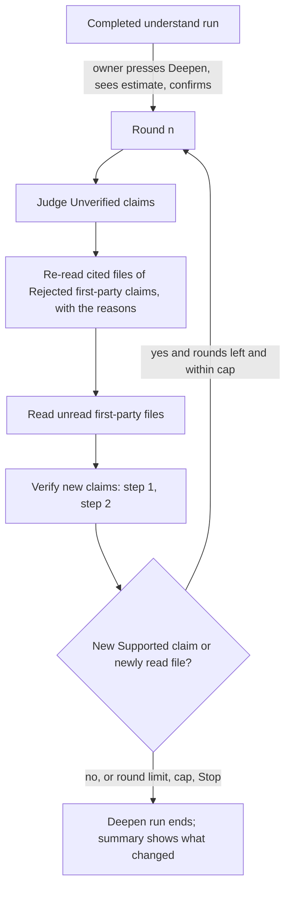

# RFC-003: Re-read loop - going back over claims that did not pass and code that was not read

|               |                                                                                                                                                                                                                                                                                                |
| ------------- | ---------------------------------------------------------------------------------------------------------------------------------------------------------------------------------------------------------------------------------------------------------------------------------------------- |
| **Status**    | Accepted 2026-10-18 by BlackLigth (blacklight0101), recommended option and every proposed default (DEC-144, DEC-145)                                                                                                                                                                           |
| **Date**      | 2026-10-18                                                                                                                                                                                                                                                                                     |
| **Author**    | Claude Code (Claude Opus 5.5), drafted for BlackLigth (blacklight0101)                                                                                                                                                                                                                         |
| **Reviewers** | BlackLigth (blacklight0101), product owner; decides and merges                                                                                                                                                                                                                                 |
| **Related**   | [RFC-001](RFC-001-rosetta.md) - [Requirements](../spec/requirements.md) RF-006, RF-203, RF-230, RF-301..RF-304, RF-425 - [ADR-005](../adr/ADR-005-evidence-cards-and-two-step-verifier.md) - [ADR-007](../adr/ADR-007-cost-control.md) - [RFC-002](RFC-002-plan-as-a-run-step.md) - issue #561 |

This document proposes a bounded loop that improves a completed understand run. It contains no code; contracts are
described as field lists and diagrams. The draft requirement text in section 8 is ready to paste into
`docs/spec/requirements.md` once the owner accepts it; this RFC does not edit the spec itself.

## 1. Problem

The owner asked: "Is there a loop we can implement there that will re-read and get that information after, so the
system is fully understood?" Their run of 2026-10-18 (Ollama `gemma4:e4b`, eShopModernizing, WebForms folder):

| Measure                    | Value                                                              |
| -------------------------- | ------------------------------------------------------------------ |
| Run end state              | `Completed`                                                        |
| Claims judged (step 2)     | 118: 68 `Supported` (58%), 50 `Rejected` (42%)                     |
| Claims not judged          | some left `Unverified`                                             |
| Files read                 | 47 of 79                                                           |
| Area tokens read (RF-230)  | about 12%; much of the unread part is vendored Scripts and Content |
| Rejected claim on vendored | at least one, citing the third-party `Scripts/index.d.ts`          |

What exists today does not help after a completed run: Resume (RF-006, P2-01) reopens only a run that ended
`CapReached`, `Failed` or `Interrupted`, and reprocesses only its unfinished tasks and `Unverified` claims. A
`Rejected` claim is final (RFC-001 section 4.4), and a file never read stays unread. The 12% figure also mixes
first-party and vendored code, so it neither tells the user how much of their own code was read nor where to look.

## 2. Three different cases

| Case         | What it means                                                                                                                             | What helps                                                                                                                                                                                                                                   |
| ------------ | ----------------------------------------------------------------------------------------------------------------------------------------- | -------------------------------------------------------------------------------------------------------------------------------------------------------------------------------------------------------------------------------------------- |
| `Rejected`   | The verifier read the cited lines and found they do not support the claim. The claim is wrong, or its citation points to the wrong place. | Never re-judge the same claim. Either drop it from use (it already is: only `Supported` feeds `plan`), or send a reader back to the cited file with the verifier's reason to find the right fact, written as a new claim with new citations. |
| `Unverified` | Nobody judged the claim (a cap or a failure stopped verification, RF-304).                                                                | Judge it. This is a verifier-only step, cheap, and needs no reader.                                                                                                                                                                          |
| Coverage gap | A first-party file was never read, so no claim exists about it.                                                                           | A reader pass over the unread first-party files, ranked by size and by how many cards' neighbours point to them.                                                                                                                             |

A rejected claim whose citations are all in third-party or generated code (as the `Scripts/index.d.ts` one) is not
re-read: it is marked out of scope with that reason, because the scanner already leaves such code out (RF-1018).

## 3. Options

| Option                                | What it does                                                                                                                                                                                                                                                                | For                                                                                                           | Against                                                                                                                                                           |
| ------------------------------------- | --------------------------------------------------------------------------------------------------------------------------------------------------------------------------------------------------------------------------------------------------------------------------- | ------------------------------------------------------------------------------------------------------------- | ----------------------------------------------------------------------------------------------------------------------------------------------------------------- |
| A. Extend Resume to completed runs    | Resume also judges `Unverified` claims of a `Completed` run.                                                                                                                                                                                                                | Smallest; reuses P2-01.                                                                                       | Only covers one of the three cases; nothing for `Rejected` or unread files.                                                                                       |
| B. Deepen pass, owner-triggered       | From a completed run, "Deepen" starts a new understand run linked to it. Each round: judge `Unverified`; re-read the files cited by `Rejected` first-party claims with the rejection reasons; read the unread first-party files. New claims go through both verifier steps. | Covers all three cases; the owner sees the estimate and confirms; the original run stays as it was (RNF-004). | A new run mode; the reader prompt gains the rejection reasons; more UI.                                                                                           |
| C. Automatic loop at the end of a run | B, but rounds start by themselves after understand until a stop rule fires.                                                                                                                                                                                                 | No extra click.                                                                                               | Spends money the owner did not confirm for this step; hides the first result; harder to compare runs and providers; conflicts with ADR-007's estimate-first rule. |
| D. Coverage pass only                 | B without the re-read of rejected claims.                                                                                                                                                                                                                                   | Simplest reader change.                                                                                       | Leaves the 50 rejected facts unresolved, which is what the owner noticed first.                                                                                   |

## 4. Recommendation

Option B, owner-triggered, with these strict bounds:

- **Rounds:** at most 3 per Deepen (configurable 1..5). A round is: judge `Unverified`, then re-read, then read gaps,
  then verify every new claim (steps 1 and 2).
- **Estimate first:** before Deepen starts, the page shows a low, likely and high estimate for the first round and the
  maximum for all rounds, against every cap the guard checks (RF-425). The owner confirms once for the rounds shown.
- **Cap:** the Deepen run has its own token and cost cap, default the project's run cap; every call goes through the
  budget guard; a cap ends the run `CapReached`, resumable with RF-006.
- **Stop rules:** a round that adds no new `Supported` claim and no newly read first-party file ends the loop; so does
  the round limit, the cap, or the owner pressing Stop.
- **One retry per fact:** a rejected claim is re-read at most once per Deepen; its replacement, if rejected too, is
  not re-read again in that Deepen.
- **Scope:** first-party files only; third-party and generated code stays out unless the owner adds those areas.

**Deepen run (an understand run with a mode)**, fields added to its manifest:

- `mode`: `deepen`; `parentRunId`: the completed run it improves;
- `maxRounds`, `roundsDone`, `stopReason` (`noProgress`, `roundLimit`, `capReached`, `stopped`);
- per round: claim ids judged, claim ids re-read with their rejection reason, files read, new claim ids and their
  statuses, tokens and cost.

**Claim** gains one optional field: `replaces`, the id of the rejected claim a re-read answers. The rejected claim
stays as it is, `Rejected` with its reason (RF-302); new cards and claims take ids after the parent's (RF-203).

The Deepen run starts from a copy of the parent's cards, claim statuses and coverage, so it is a complete understand
run on its own: the report and `plan` read it like any other, and with RFC-002 it becomes the source run of the plan.

## 5. How ADR-005 is kept

- Every new or replacing claim cites file and lines and passes step 1 and step 2; nothing is accepted without
  evidence, and a re-read never changes a verdict.
- The verifier still sees only the claim and the cited lines with a small margin. It is not shown the earlier
  rejection, so it cannot be argued into agreeing; only the reader sees the reason.
- `Rejected` and `CitationInvalid` claims are kept and shown (RF-302). The summary lists "supported after a re-read"
  separately, so a reader can check those with more care.
- Only `Supported` claims feed `plan`, as today.

## 6. Measuring "understood" honestly

Rosetta never claims "fully understood" and never reports 100% by claim. The run summary and the overview show:

| Measure                 | Definition                                                                                   |
| ----------------------- | -------------------------------------------------------------------------------------------- |
| First-party coverage    | tokens of first-party files read / tokens of all first-party files in the chosen areas       |
| Files not read          | first-party files never read, listed with their size                                         |
| Supported share         | `Supported` / claims judged (`Supported` + `Rejected`), with the count of each               |
| Not judged              | `Unverified` count                                                                           |
| Rejected and unresolved | rejected first-party claims with no supported replacement                                    |
| Third-party left out    | files and tokens left out as third-party or generated, shown apart, never in the denominator |

Each measure is shown before and after a Deepen. When first-party coverage is at least 80% and no claim is
`Unverified`, the page may say "well covered"; it never says "complete". The verifier's own accuracy is still the
calibration of RF-305.

## 7. Impact

- Application: a `deepen` mode for `RunUnderstand` and `EstimateRun`; a reader prompt variant that receives the
  rejection reasons in a data block (ADR-013 rules apply); a first-party filter on coverage.
- Web UI: "Deepen" on the "after the run" page (RF-1017) with its estimate, round progress in "while running" mode,
  the before and after measures.
- Documents the owner would update on acceptance: requirements (section 8), a note in ADR-005 and RFC-001 section 4.4
  (claim lineage), `docs/architecture.md`, `docs/data-model.md` (manifest and claim fields), a new DEC, card P2-41
  (#561).

## 8. Draft requirement text

**New: RF-209 Deepen a completed run** - R1 - Should - Source owner request 2026-10-18 - ADR-005, ADR-007
As a developer I want to send Rosetta back over what it did not confirm so that more of my application is understood,
with evidence, at a cost I approved.

- Given an understand run that ended `Completed`, when I press Deepen, then the page shows the estimate for one round and the maximum for all rounds against my caps, and starts nothing until I confirm.
- Given a confirmed Deepen, when it runs, then a new understand run linked to the completed one starts from its cards, judges the `Unverified` claims, re-reads the files cited by `Rejected` first-party claims with the verifier's reasons, reads first-party files never read, and verifies every new claim with both steps.
- Given a rejected claim whose citations are all in third-party or generated code, when a round is planned, then it is not re-read and the summary lists it as out of scope with that reason.
- Given a round that adds no new `Supported` claim and reads no new first-party file, when it ends, then the Deepen run ends with the stop reason "no progress"; it also ends at the round limit (default 3), at a cap (`CapReached`, resumable with RF-006) or when I press Stop.
- Given a re-read that produces a claim for a rejected one, when results are written, then the new claim records the id it replaces, the rejected claim stays `Rejected` with its reason, and a replacement that is rejected again is not re-read in the same Deepen.
  Verification: integration tests with recorded responses for each stop reason; unit tests of the round planner and the stop rule.

**New: RF-231 Honest understanding measures** - R1 - Must - Source owner request 2026-10-18 - ADR-005
As a developer I want to know how much of my own code was read and confirmed so that I trust the result for what it
is and never more.

- Given an ended understand run, when its summary and overview are shown, then they state first-party coverage by tokens, the first-party files not read, the Supported share with its counts, the `Unverified` count, and the rejected claims without a supported replacement; third-party and generated code is shown apart and is not part of any percentage.
- Given a Deepen run, when it ends, then each measure is shown before and after, with "supported after a re-read" listed apart.
- Given any measure, when it is worded, then the page never says "complete" or "fully understood"; it may say "well covered" only at 80% first-party coverage or more with no `Unverified` claim.
  Verification: unit tests of the measures; snapshot test of the summary.

**Changed:**

- RF-230: "the run summary shows the percentage of area tokens read" becomes "[the percentage of first-party tokens read, with third-party and generated code shown apart (RF-231)]".
- RF-302: add "a claim that replaces a rejected one records the id it replaces; the rejected claim is kept".
- RF-006: unchanged; it applies to a Deepen run that stopped.
- RF-1017: the next actions after a completed run include Deepen with its estimate.

## 9. Open questions for the owner

| Id  | Question                                                                           | Proposed default                                                                              |
| --- | ---------------------------------------------------------------------------------- | --------------------------------------------------------------------------------------------- |
| Q-G | Owner-triggered only, or also an optional automatic round at the end of a run?     | Owner-triggered only in R1; automatic stays off (ADR-007: estimate and confirm first).        |
| Q-H | Maximum rounds per Deepen?                                                         | 3, configurable 1..5.                                                                         |
| Q-I | Should re-read claims be judged by a different verifier model than the first pass? | Same verifier role and model; the summary lists "supported after a re-read" apart.            |
| Q-J | Is the coverage pass part of Deepen, or a separate "Read the rest" action?         | Part of Deepen, ranked by file size, within the cap; the owner can untick it on the estimate. |
| Q-K | What first-party coverage may the page call "well covered"?                        | 80% of first-party tokens with no `Unverified` claim.                                         |
| Q-L | Should a Deepen of a Deepen be allowed?                                            | Yes; each is a new linked run, and the one-retry-per-fact rule applies per Deepen.            |
