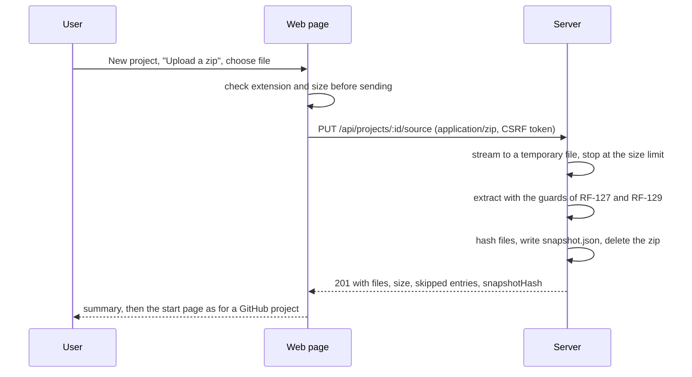

# RFC-004: A zip file as a second source for a project

|               |                                                                                                                                                                                                                                                                                                                                                                    |
| ------------- | ------------------------------------------------------------------------------------------------------------------------------------------------------------------------------------------------------------------------------------------------------------------------------------------------------------------------------------------------------------------ |
| **Status**    | Accepted 2026-10-19 by BlackLigth (blacklight0101): zip upload only, local and hosted, stronger cloud confirmation, built before the hand-in (DEC-148); limits and open questions answered (DEC-149)                                                                                                                                                               |
| **Date**      | 2026-10-19                                                                                                                                                                                                                                                                                                                                                         |
| **Author**    | Claude Code (Claude Opus 5.5), drafted for BlackLigth (blacklight0101)                                                                                                                                                                                                                                                                                             |
| **Reviewers** | BlackLigth (blacklight0101), product owner; decides and merges                                                                                                                                                                                                                                                                                                     |
| **Related**   | [RFC-001](RFC-001-rosetta.md) section 2 (non-goal changed) - [Requirements](../spec/requirements.md) RF-010, RF-120..RF-127, RF-128..RF-134, RF-140..RF-147, RF-1001 - [ADR-012](../adr/ADR-012-local-web-ui-and-github-sources.md) - [ADR-019](../adr/ADR-019-tarball-extraction-and-ignore-matching.md) - [ADR-022](../adr/ADR-022-zip-extraction-with-yauzl.md) |

This document proposes how a user analyses a project that is on their own computer instead of on GitHub. It contains
no code. The requirement text in section 8 is pasted into `docs/spec/requirements.md` by the same pull request.

## 1. Problem

The owner asked (2026-10-19): "where we input the github repo for analysis I want to have the option as well to be
able to select a local folder with a project I have in my pc". Today every project is a public GitHub repository
(DEC-48, ADR-012), and RFC-001 lists "local folders or private repositories as input" as a non-goal of release 1.

Rosetta runs in a container, locally under Docker Compose and later on a host (ADR-014). Neither the container nor a
web page can read an arbitrary folder on the user's disk by path; the code has to be sent to the server.

## 2. Options

| Option                          | How                                                                                                                    | Local | Hosted | Effort |
| ------------------------------- | ---------------------------------------------------------------------------------------------------------------------- | ----- | ------ | ------ |
| A. Folder picker in the browser | the browser reads a chosen folder, filters it, previews it and uploads one archive                                     | yes   | yes    | medium |
| **B. Zip upload (chosen)**      | the user zips the project folder (Windows: Send to > Compressed folder) and uploads the `.zip` on the new-project form | yes   | yes    | low    |
| C. Mounted folder               | Compose mounts a folder read-only; the server lists its subfolders                                                     | yes   | no     | low    |

The owner chose B (DEC-148). It reuses the guarded extraction that GitHub archives already pass through, needs no
browser-specific code, and works the same locally and hosted. A and C stay possible later on top of the same source
model (section 4.1).

## 3. Goals and non-goals

Goals: a project can be created from a `.zip`; every stage (scan, understand, verify, deepen, report, plan, package)
works on it exactly as on a GitHub snapshot; the same safety limits apply; private code gets a stronger confirmation
before any excerpt goes to a cloud provider.

Non-goals: reading git history; private GitHub repositories (still refused, RF-120); syncing a folder; uploading
anything other than a `.zip` (no `.tar.gz`, no `.rar`, no `.7z`); a folder picker (option A) in this change.

## 4. Design

### 4.1 Two kinds of source

A project's source becomes one of two kinds:

| Field         | `github` (today)                    | `upload` (new)                                                               |
| ------------- | ----------------------------------- | ---------------------------------------------------------------------------- |
| Shown as      | `https://github.com/<owner>/<repo>` | the zip file name without `.zip`, for example `OrderDesk`                    |
| Identity      | commit SHA                          | `snapshotHash` (`sha256:` of the sorted path and file hash pairs, as today)  |
| Snapshot key  | `<owner>__<repo>@<sha>`             | `upload__<project id>@<first 16 hex of snapshotHash>`                        |
| Ref, subpath  | from the URL                        | none; the whole archive is the project                                       |
| Licence       | SPDX id from GitHub                 | `unknown`                                                                    |
| Citation link | the GitHub permalink (RF-125)       | Rosetta's own evidence page for the file and lines (P3-02); no external link |

`snapshot.json` (data-model.md section 3.3) gains `kind` and, for an upload, `fileName` and `uploadedAt`; the GitHub
fields are absent for an upload. Old snapshots without `kind` read as `github`. The `projects` row gains `source_kind`
(`github` default) and keeps `source_url` empty for an upload. The scan and every later stage receive the same
`Snapshot` (a read-only `rootDir` and its record) and never look at the kind, except the citation link and the report
header.

### 4.2 Upload flow

- The project is created first (name from the file name, editable), then its source is uploaded; an upload that
  fails leaves a project with no source, which the page shows with "Upload again".
- The body is streamed, never buffered; the request stops at the archive size limit with an error and the temporary
  file is deleted.
- If every entry sits under one top-level folder (the usual result of zipping a folder), that folder is removed from
  the paths, so citations read `src/Orders.cs`, not `OrderDesk/src/Orders.cs`.
- Uploading again replaces the source: a new snapshot with a new hash; earlier runs keep pointing at their own
  snapshot, which is kept while a run refers to it. The project page says when the code changed since the last run.

### 4.3 Extraction guards (same bar as GitHub archives)

Zip reading uses `yauzl` (the reading companion of `yazl`, which the zip export already uses), version 3.4.0 (MIT, one dependency `pend`, released 2026-06-07, so older than the two weeks of DEC-125); a new runtime dependency needs its own ADR, so it is recorded in ADR-022. The guards of RF-127 apply, plus the ones only a zip needs:

- The upload limit `ROSETTA_UPLOAD_MAX_MB` (500 locally, 100 on the hosted deployment, DEC-149) on the archive, and a
  free-space check before the upload starts (at least twice the limit free on the data folder).
- Entry count and total uncompressed size limits (defaults 100,000 and 500 MB, as RF-127), checked against the
  central directory before extraction and again while writing, so a lying header cannot pass.
- A compression ratio limit per entry (default 200 : 1) against zip bombs.
- Paths: no absolute path, drive letter, `..` segment, backslash-separated traversal or NUL; names Windows cannot write
  are skipped and counted, as RF-122 does.
- Symbolic links (Unix mode bits in the external attributes) are skipped and counted; directories are created only
  from file paths.
- Encrypted entries and unsupported compression methods stop the upload with an error code; nothing partial remains.
- The deny list (RF-147) and `.rosettaignore` (RF-140) apply to the extracted tree exactly as to a GitHub snapshot, and
  `.git/`, `node_modules/`, `bin/` and `obj/` folders are left out at extraction and counted.

_Note, 2026-10-19, DEC-151: the per-entry ratio limit applies only to entries above 4 MiB uncompressed, with an archive-wide check of 200 : 1 when the total is above 64 MiB; `__MACOSX/` folders are also left out and counted. The text above is kept as accepted; the current rules are in RF-129._

### 4.4 Privacy

A zip is usually private code. When any role of a run on an `upload` project uses a non-local provider, the start page
shows a second, separate confirmation in plain words ("Excerpts of your own code from OrderDesk will be sent to
OpenAI"), with the list of providers and a link to switch roles to Ollama; the API refuses a start without it. Secret
masking (RF-141) and the egress record (RF-142) apply unchanged. Hosted, an upload is stored only in its owner's
workspace, counts toward their storage, and is deleted with the project (RF-010); an audit row records the upload
(name, size, hash, never content).

### 4.5 What changes in the user interface

- New project form: two tabs, "GitHub repository" (today's field) and "Upload a zip" (file field, the limits in one
  line, and the hint for making a zip on Windows and macOS).
- Projects list and project header: the source shown as `OrderDesk (zip, 19 Oct 2026)` instead of a GitHub link.
- Report, package and evidence pages: citations link to Rosetta's evidence page; the header names the zip and its
  hash instead of the repository and commit.

## 5. Error codes

New codes in the RST-19xx range (sources): archive not a zip, archive too large, too many entries, entry ratio too
high, unsafe entry path, encrypted or unsupported entry, empty archive after the deny list. Each has a description in
the catalogue and a message on the page.

## 6. Testing

- Unit: path normalisation and the top-level folder rule; the source-kind union; citation links per kind.
- Integration: fixture zips (normal, one top-level folder, oversize, many entries, a ratio bomb, a lying size header,
  `../` and absolute paths, a drive letter, a symlink entry, an encrypted entry, a device name, `node_modules`) through
  the real extractor; the upload endpoint with the size limit, CSRF and ownership checks.
- End to end: create a project from a zip of the eShop WebForms folder, scan, understand with the fake provider, open
  the report; citations open evidence pages and no link points to GitHub.

## 7. Impact and plan

Cards (section 9 of `tasks.md`): P3-36 source model, P3-37 zip extraction, P3-38 upload endpoint and storage, P3-39
web pages, P3-40 citations and report for uploads, P3-41 privacy confirmation, P3-42 end-to-end journey. Order:
P3-36, then P3-37 and P3-39 in parallel, then P3-38, then P3-40 and P3-41 in parallel, then P3-42. Hand-in is
2026-10-26; the card sizes fit the week at two to three builders.

Documents touched: RFC-001 non-goal annotated, `CLAUDE.md` (the source rule), ADR-012 dated note, new ADR-022 (`yauzl`), `data-model.md` (snapshot record and
`projects.source_kind`), `architecture.md` (source port), `conventions.md` (error codes), the runbook (making a zip).

## 8. Requirement text

The text of RF-128..RF-134 is in `docs/spec/requirements.md` section 5.2.

## 9. Open questions (answered 2026-10-19, DEC-149)

| Id   | Question                                                                | Answer                                                                                                               |
| ---- | ----------------------------------------------------------------------- | -------------------------------------------------------------------------------------------------------------------- |
| Q-29 | Archive size limit for an upload on the host, where storage costs money | 100 MB hosted (Railway Hobby volumes stop at 5 GB), 500 MB locally; refused when free space is under twice the limit |
| Q-30 | Keep the uploaded zip itself after extraction                           | no: the zip is deleted once extracted                                                                                |
| Q-31 | Offer the folder picker (option A) later                                | not in release 1; the source model allows it                                                                         |
