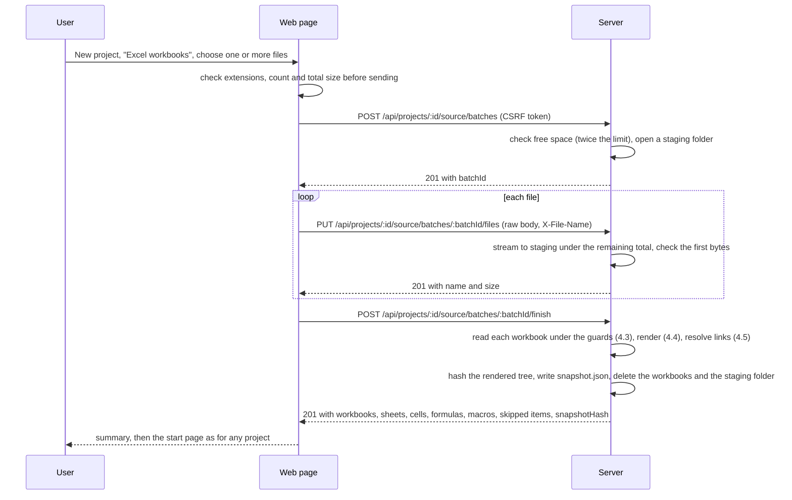

# RFC-005: Excel workbooks as a third source for a project

|               |                                                                                                                                                                                                                                                                                                                                                                                                                                                                    |
| ------------- | ------------------------------------------------------------------------------------------------------------------------------------------------------------------------------------------------------------------------------------------------------------------------------------------------------------------------------------------------------------------------------------------------------------------------------------------------------------------ |
| **Status**    | Proposed 2026-10-19. Scope chosen by BlackLigth (blacklight0101): one or more workbooks on a third tab, every readable cell value, VBA macros in the first version, built before the hand-in (DEC-150). The design and the defaults of Q-32..Q-42 wait for the owner's review and merge                                                                                                                                                                            |
| **Date**      | 2026-10-19                                                                                                                                                                                                                                                                                                                                                                                                                                                         |
| **Author**    | Claude Code (Claude Opus 5.5), drafted for BlackLigth (blacklight0101)                                                                                                                                                                                                                                                                                                                                                                                             |
| **Reviewers** | BlackLigth (blacklight0101), product owner; decides and merges                                                                                                                                                                                                                                                                                                                                                                                                     |
| **Related**   | [RFC-004](RFC-004-zip-upload-source.md) - [RFC-003](RFC-003-re-read-loop.md) - [Requirements](../spec/requirements.md) RF-104, RF-112, RF-120, RF-128..RF-134, RF-140..RF-147, RF-150..RF-158, RF-1001 - [ADR-004](../adr/ADR-004-universal-scan-and-language-packs.md) - [ADR-012](../adr/ADR-012-local-web-ui-and-github-sources.md) - [ADR-022](../adr/ADR-022-zip-extraction-with-yauzl.md) - [ADR-023](../adr/ADR-023-workbook-reading-with-saxes-and-cfb.md) |

This document proposes how a user analyses one or more Excel workbooks that people use as a system. It contains no
code. The requirement text in section 8 is pasted into `docs/spec/requirements.md` by the same pull request.

## 1. Problem

The owner asked (2026-10-19): "aside from the zip file and the github repository to be able to load one or more excel
files that users sometimes use as complex systems and they ask us to turn those into systems". Today a project comes
from a public GitHub repository (DEC-48) or an uploaded zip (DEC-148, RFC-004). A workbook is neither code nor text:
the scan ignores `.xls` and `.xlsx` as binary files (`src/infrastructure/scan/universal/default-ignores.ts`), so a
workbook inside a zip is never read, and the agents, the verifier and the citations all work on text lines.

A workbook used as a system holds its logic in places a text reader does not see: formulas in cells, references
between sheets and between workbooks, defined names, tables, data validation lists, conditional rules, VBA macros, and
the data itself (price lists, rates, thresholds) that the formulas use.

## 2. Options

| Option                                         | How                                                                                                                                                      | Stages changed                                           | Effort |
| ---------------------------------------------- | -------------------------------------------------------------------------------------------------------------------------------------------------------- | -------------------------------------------------------- | ------ |
| **A. Render to a text snapshot (chosen)**      | at upload, each workbook is rendered into read-only text files (formulas, values, rules, macros, a dependency map); every later stage reads them as code | intake only, plus prompt guidance                        | medium |
| B. A workbook model with new agent tools       | keep a structured model of cells; agents get tools such as `read_range` and `trace_precedents`; citations become `Sheet!A1:B9`                           | scan, agent tools, verifier, citations, report, evidence | high   |
| C. Ask the user to export each sheet to CSV    | the user saves sheets as CSV and zips them                                                                                                               | none                                                     | none   |
| D. Read formulas and structure only, no values | as A, without the cell values                                                                                                                            | intake only                                              | lower  |

A is chosen. B gives exact cell citations but changes the citation format of ADR-005 and every stage after the scan,
which does not fit the week before the hand-in. C loses every formula, name, rule and macro, which is where the
system's logic is. D is cheaper, but the owner chose every readable value (DEC-150): rates and lookup tables are part
of the rules. A keeps one evidence model: a citation `path:a-b` points at lines of the rendered text, and every line
carries the cell addresses it describes, so a reader can go from the citation to the cells.

## 3. Goals and non-goals

Goals: a project can be created from one or more `.xlsx` or `.xlsm` files; links between the uploaded workbooks are
resolved; every stage (scan, understand, verify, deepen, report, plan, package) works on the rendered snapshot
unchanged; formulas, values, names, tables, rules and VBA macros are readable by the agents; the plan describes how to
rebuild the workbook as an application; the same safety bar as a zip applies; workbooks found inside an uploaded zip
are rendered the same way.

Non-goals: evaluating or recalculating any formula (cached values are read from the file); running a macro; fetching
an external link or a data connection; drawing charts or pivot tables (they are listed, Q-35); analysing Power Query
code (listed, Q-34); legacy `.xls` and binary `.xlsb` files (refused with a message to save as `.xlsx`); `.csv` files;
password-protected (encrypted) workbooks; workbooks inside a GitHub repository (Q-42); writing to a workbook.

## 4. Design

### 4.1 Three kinds of source

The source union of RFC-004 section 4.1 gains a third kind:

| Field         | `github`                            | `upload`                                              | `workbook` (new)                                                                                  |
| ------------- | ----------------------------------- | ----------------------------------------------------- | ------------------------------------------------------------------------------------------------- |
| Shown as      | `https://github.com/<owner>/<repo>` | `OrderDesk (zip, 19 Oct 2026)`                        | the project name with the count and date, for example `Pricing (Excel, 3 workbooks, 19 Oct 2026)` |
| Identity      | commit SHA                          | `snapshotHash` of the extracted tree                  | `snapshotHash` of the rendered tree (section 4.4)                                                 |
| Snapshot key  | `<owner>__<repo>@<sha>`             | `upload__<project id>@<first 16 hex of snapshotHash>` | `workbook__<project id>@<first 16 hex of snapshotHash>`                                           |
| Ref, subpath  | from the URL                        | none                                                  | none                                                                                              |
| Licence       | SPDX id from GitHub                 | `unknown`                                             | `unknown`                                                                                         |
| Citation link | the GitHub permalink (RF-125)       | Rosetta's evidence page (RF-131)                      | Rosetta's evidence page, with the workbook, sheet and cells of the cited lines (RF-156)           |

`snapshot.json` (data-model.md section 3.3) for a workbook source holds `kind: "workbook"`, `uploadedAt`,
`rendererVersion`, the usual `fileCount`, `totalBytes` and `snapshotHash`, and `workbooks`: one entry per file with
the file name as sent, its folder in the tree, its size and SHA-256, and its counts (sheets, non-empty cells,
formulas, macro modules, macros skipped). An `upload` record gains the same `workbooks` list when the zip held any. The
`projects.source_kind` check gains `workbook` (a new migration). The scan and every later stage receive the same
`Snapshot` and look at the kind only for the citation link, the report header, the privacy wording and the prompt
guidance (section 4.7).

Because the identity is the hash of the rendered tree, a new renderer version can give a new hash for the same files;
`rendererVersion` says why, and the run manifest records both (RF-126).

### 4.2 Upload flow

The browser sends one file per request into an open batch, then asks the server to finish the batch. This was chosen
over one multipart request because it reuses the streamed raw-body route of P3-38 as it is (no multipart parser, so no
new dependency and no ADR for one), each file is checked under its own stream as it arrives, a failed file can be sent
again alone, and the page can show progress per file. Its cost is a staging folder the server must clean up.



- The project is created first (name from the first file name without its extension, editable), as for a zip.
- One batch per project at a time; a second one is refused with RST-1919 (upload in progress). A batch not finished
  within 30 minutes, and any staging folder left at start-up, is deleted.
- The size limit `ROSETTA_UPLOAD_MAX_MB` (DEC-149) applies to the total of the batch, not to each file; the count
  limit is `ROSETTA_WORKBOOK_MAX_FILES` (Q-32). Two files with the same name (case ignored) are refused (RST-1928).
- Finishing renders every workbook or none: one refused workbook refuses the batch with its code and the file name,
  and nothing is published.
- Uploading again replaces the whole source: a new batch, a new snapshot of all the workbooks of that batch. Earlier
  runs keep their own snapshot, as RF-128 says for a zip.
- The workbooks themselves are deleted once rendered (Q-37), as the zip is (DEC-149).
- The zip route `PUT /api/projects/:id/source` is unchanged. After extraction, each `.xlsx` or `.xlsm` inside the zip
  is rendered in place (section 4.4) under the same guards; one that cannot be rendered is left out and listed with
  its reason, and the rest of the zip is analysed (Q-41).

### 4.3 Reading a workbook safely

An `.xlsx` or `.xlsm` file is a zip package of XML parts (Office Open XML). The bar is RF-127 and RF-129, plus what a
spreadsheet needs:

- **Format by content, not only by name.** A file must end in `.xlsx` or `.xlsm` and start with the zip signature. A
  file that starts with the compound-file signature (`D0 CF 11 E0`) is opened with `cfb` only to tell the cases apart:
  an `EncryptionInfo` stream means a password-protected workbook (RST-1922, "Remove the password in Excel and upload
  again"); a `Workbook` or `Book` stream means a legacy `.xls` (RST-1921). A package with `xl/workbook.bin` is an
  `.xlsb` (RST-1921). The message for both is "Open the file in Excel and save it as .xlsx (or .xlsm if it has
  macros)".
- **The package is a zip,** so the zip guards of RF-129 apply as they are (entry count, total and ratio limits, unsafe
  paths, encrypted entries, methods), through `yauzl` (ADR-022) and the shared module `entry-guards.ts`. No part is
  written to disk: parts are streamed from the package into the parser.
- **XML without a document type.** Every part is parsed with `saxes` (ADR-023), which does not fetch external
  entities. A part with a `<!DOCTYPE` or an entity declaration is refused (RST-1923), so neither an external entity
  (XXE) nor an expanding entity (billion laughs) can be used. Element nesting deeper than 64 is refused the same way.
- **Limits** (Q-32): workbooks per project (`ROSETTA_WORKBOOK_MAX_FILES`, default 20, RST-1924); sheets per workbook
  (`ROSETTA_WORKBOOK_MAX_SHEETS`, default 200, RST-1925); non-empty cells per project (`ROSETTA_WORKBOOK_MAX_CELLS`,
  default 2,000,000, RST-1926); a shared-string table larger than the cell limit, or one XML part above 200 MB once
  inflated, is refused with RST-1926 too. Each limit is counted while streaming, so a part that lies about its size
  is stopped where it passes the limit.
- **Nothing is fetched or run.** External links and data connections are listed by name and type, never opened
  (Q-34). Macros are read as text and never run. No formula is evaluated: the value shown is the one cached in the file.
- **A damaged package** (a missing `xl/workbook.xml`, a sheet the relationships name but the package lacks, XML that
  is not well formed) is refused with RST-1927 and the part name.
- **Read-only.** The rendered tree is a snapshot like any other (RF-005): published under `<data>/sources/`, made
  read-only, never written again.

### 4.4 The rendered snapshot

Each workbook becomes a folder named after its file (`Pricing.xlsx/`). A sheet name or a workbook name is made safe as
a path segment: characters outside `A-Z a-z 0-9 . _ -` become `_`, runs of `_` collapse, the segment is cut to 64
characters, a Windows device name gets a `_` prefix, and a clash gets `~2`, `~3`. The mapping from each safe segment to
the real name is the first table of `workbook.md`, so a reader always sees the real name.

```text
Pricing.xlsx/
  workbook.md            sheets (real name, folder, visible/hidden/very hidden, used range, counts),
                         defined names with their targets, tables with their ranges and columns,
                         external links, data connections, pivot tables and charts (listed only)
  Summary/
    formulas.md          one line per formula cell, grouped in contiguous regions
    values.md            every non-empty cell, one line per row, addresses on every line
    validation.md        data validation (dropdown lists and rules) and conditional formatting rules
    notes.md             cell comments and notes, with their addresses
  Rates_2026/            the sheet "Rates 2026"
    ...
  macros/
    Module1.bas          VBA source of each module (section 4.6)
    ThisWorkbook.cls
dependencies.md          the formula dependency map of the whole project (section 4.5)
```

`formulas.md` (one line per formula, the address first):

```text
## Region B2:B40 (39 formulas)
B12 = IF(C12>1000, C12*0.95, C12)    [cached: 950]
B13 = IF(C13>1000, C13*0.95, C13)    [cached: 1200]
## Region D2:D4001 (shared formula, 4000 cells)
D2:D4001 = B2*'Rates 2026'!$C$4    [written for D2; cached D2: 110.5]
## Array formulas
F2:F9 {= TRANSPOSE('Rates 2026'!A2:H2)}    [array]
```

A shared formula (Excel's own fill-down form) is one line for its whole range, written for its first cell (Q-36).
Array and spilled formulas are one line for their range, marked. A formula that names another workbook is shown with
the workbook's file name, not the internal link index.

`values.md` (one line per row; long rows continue on a next line that repeats the row prefix, so no line passes
2,000 characters, the RF-146 cut):

```text
R1 | A1 "Region" | B1 "Units" | C1 "Price" | D1 "Total"
R2 | A2 "North" | B2 4 | C2 1250 | D2 5000 (f)
R3 | A3 "South" | B3 TRUE | C3 2026-03-01 | D3 #N/A (f)
```

Text is quoted with JSON escaping (a `|` or a line break cannot break the line), numbers are written as stored,
dates are written as ISO dates when the cell's number format is a date format, errors as Excel writes them, and
`(f)` marks a cached formula result. Hidden rows and columns are rendered and marked in the sheet header. Merged
ranges are listed in the header.

`validation.md` lists each validation range with its type, list source or rule, and each conditional rule with its
range and formula. `notes.md` lists each comment with its cell address and text, without author names (Q-39).
Document properties that name people (creator, last modified by) are not rendered (Q-39).

Every rendered line starts with the cells it describes, so the lines of a citation `Pricing.xlsx/Summary/formulas.md:12-13`
map to cells B12 and B13 of sheet Summary of `Pricing.xlsx`. The files are Markdown and plain text, so the universal
scan lists them, groups them by folder into areas (RF-104: a workbook, and each sheet within the token budget), and the
read, grep, mask and egress paths apply without change.

### 4.5 Formula references and the dependency map

A tokenizer of Rosetta's own reads each formula and extracts its references: `A1`, `$A$1`, ranges `A1:B9`, whole
columns `A:A` and rows `1:1`, `Sheet!A1`, `'My sheet'!A1`, three-dimensional `Sheet1:Sheet3!A1`, external
`[Book.xlsx]Sheet!A1` and the stored form `[1]Sheet!A1`, structured table references (`Table1[Price]`,
`Table1[[#This Row],[Price]]`) and defined names. String literals, function names and operators are skipped. It
never evaluates a formula. `INDIRECT`, `OFFSET` and similar functions make a reference that only a calculation could
resolve; those cells are listed as dynamic references, not guessed.

A reference to another workbook is resolved by file name, case ignored, against the workbooks of the same project;
the folder part of the stored path is dropped (it often holds a user name and means nothing on the server, Q-38).
A reference that names no uploaded workbook is listed as unresolved.

`dependencies.md` at the root of the tree holds:

| Section                | Content                                                                                       |
| ---------------------- | --------------------------------------------------------------------------------------------- |
| Workbooks              | each workbook and the workbooks it reads from, with the number of formulas per edge           |
| Sheets                 | each sheet-to-sheet edge (inside and across workbooks), with the number of formulas           |
| Input cells            | cells with no formula that formulas read, grouped into ranges, per sheet: the system's inputs |
| Output cells           | formula cells no other formula reads, grouped into ranges, per sheet: the system's results    |
| Defined names          | each name, its target and the sheets that use it                                              |
| Unresolved and dynamic | references to workbooks not uploaded, and `INDIRECT`/`OFFSET` cells, with their addresses     |

Every line names its sheet and cells, so a claim about the flow of the system can cite it.

### 4.6 VBA macros

In an `.xlsm`, the part `xl/vbaProject.bin` is a compound file. It is opened with `cfb` (ADR-023); the `VBA/dir`
stream is decompressed with the MS-OVBA algorithm (section 2.4.1 of the specification) and parsed for the module
names, kinds and source offsets; each module stream is decompressed from its offset. Both are implemented in
Rosetta, small and covered by tests built from the specification's examples. Standard modules are written as
`macros/<Module>.bas`, class, sheet and workbook modules as `macros/<Module>.cls`; a user form's code is written as a
`.cls` and its controls are listed in `workbook.md`, not drawn. The code page of the project is honoured when the text
is decoded.

A project locked for viewing is skipped and named in `workbook.md` and in the upload summary ("The macros of
Pricing.xlsm are locked. Unlock them in Excel and upload again", Q-40). A module whose source is missing (only
compiled code is present) is named as such. Macros are never run, and the analysis treats their text as data like any
code (RF-145).

### 4.7 Spreadsheet-aware understand and plan

No new stage, card kind or tool. The reader and planner prompts gain a versioned guidance file each
(`prompts/reader/workbook.v1.md`, `prompts/planner/workbook.v1.md`), added to the prompt when the run's source is a
workbook project, or an upload whose snapshot lists rendered workbooks. The agent code only chooses the file; all
spreadsheet reading stays in the intake adapter, so the universal scan and the agents keep no stack-specific logic
(ADR-004). The guidance says:

- areas are workbooks and sheets; read `workbook.md` and `dependencies.md` first;
- sheets and tables are entities (`ENT`), with columns as fields;
- formulas are business rules (`BR`), written in plain words ("orders above 1,000 get 5% off") and citing the
  formula lines;
- macros and cross-sheet flows are workflows (`FLOW`); input cells, dropdowns and output cells are the system's
  interface (`SCRN` for an input sheet, `INT` for an external link or connection);
- values are evidence of the data, not rules to repeat: a lookup table is described, not copied.

The planner guidance asks for a plan that rebuilds the workbook as an application: the input sheets become forms, the
lookup tables become reference data, the formulas become tested business rules, the macros become services, and the
outputs become reports. Tables too large to read whole are read in parts through the normal tools and the RFC-003
re-read loop, so cost stays under the run's caps (Q-33).

### 4.8 Privacy

A workbook is private data as well as logic: cell values may be prices, salaries or customer names. The second
confirmation of RF-132 applies to a workbook project and says so plainly: "Cell values, formulas and macros from
Pricing will be sent to OpenAI". Secret masking (RF-141) applies to every rendered line before egress and the egress
record (RF-142) names the rendered paths and lines. Hosted, the rendered snapshot is stored only in its owner's
workspace, counted in their storage and deleted with the project; an audit row records each workbook (name, size,
hash, never content), as RF-133. Comment authors and document properties that name people are not rendered (Q-39);
connection strings are not rendered (Q-34).

### 4.9 What changes in the user interface

- New project form: a third tab "Excel workbooks", beside "GitHub repository" and "Upload a zip": a file field that
  takes several `.xlsx` and `.xlsm` files, the limits in one line, a list of the chosen files with their sizes, a size,
  count and type check before sending, progress per file, then the summary (workbooks, sheets, cells, formulas, macro
  modules, items skipped with their reasons) or "Upload again" on failure.
- Projects list and header: `Pricing (Excel, 3 workbooks, 19 Oct 2026)`.
- Run page, evidence pages, report and package: a citation to a rendered file shows the workbook, sheet and cells
  beside the path and lines, and links to Rosetta's evidence page; the header names the workbooks and the snapshot
  hash.

## 5. Error codes

New codes after the zip ones (RST-1909..RST-1920); the cards add them to `src/domain/errors/codes.ts` and the
catalogue in `docs/conventions.md`. The second confirmation keeps RST-1521 (P3-41).

| Code     | Meaning                                                                    | Message on the page (next step)                                                  |
| -------- | -------------------------------------------------------------------------- | -------------------------------------------------------------------------------- |
| RST-1921 | legacy workbook format (`.xls`, `.xlsb`)                                   | Open the file in Excel and save it as .xlsx (or .xlsm if it has macros)          |
| RST-1922 | password-protected (encrypted) workbook                                    | Remove the password in Excel and upload again                                    |
| RST-1923 | XML part with a document type or entity declaration, or nested too deep    | The file holds content Rosetta does not read; save it again from Excel           |
| RST-1924 | too many workbooks in one project                                          | Upload at most N workbooks, or split them into projects                          |
| RST-1925 | too many sheets in one workbook                                            | The workbook has more than N sheets; remove unused sheets and upload again       |
| RST-1926 | too many non-empty cells, shared strings or XML bytes                      | The workbooks hold more than N cells; remove data that is not part of the system |
| RST-1927 | workbook not readable (damaged package, missing part, XML not well formed) | The file is damaged; open it in Excel, save it again and upload again            |
| RST-1928 | two workbooks with the same name in one upload                             | Two files are named X; rename one and upload again                               |

## 6. Testing

- Every test workbook is built in the test from first-party content (a small package written with `yazl` from XML
  strings in the test, and a `vbaProject.bin` built with `cfb` from a compressed module); no real user workbook and
  no binary file is committed, and nothing comes from the owner's employer (DEC-03).
- Unit: safe segment names and their mapping; the formula tokenizer on every reference form; MS-OVBA decompression on
  the specification's examples; value rendering (strings, numbers, dates, errors, booleans, long rows); the source
  kind union; citation labels per kind.
- Integration: the reader on hostile packages (a DOCTYPE, an entity, deep nesting, a lying part size, too many sheets,
  cells or shared strings, an encrypted file, an `.xls`, an `.xlsb`, a missing part); rendering of a two-workbook
  project with a cross-workbook reference, a shared formula, an array formula, a table, a defined name, a validation
  list, a hidden sheet and a macro module; a locked VBA project; the batch endpoint with the total limit, the count
  limit, duplicate names, an expired batch, CSRF and ownership; a zip that holds a workbook.
- End to end: create a project from two built workbooks, scan, understand with the fake provider and recorded
  responses, open the report; every citation opens an evidence page that names the sheet and cells, and no link leaves
  Rosetta.

## 7. Impact and plan

Cards (`tasks.md`): P3-43 source kind `workbook`, P3-44 workbook package reader with guards, P3-45 VBA extraction,
P3-46 rendering to the text snapshot, P3-47 formula references and the dependency map, P3-48 batch upload endpoint
and storage (and workbooks inside a zip), P3-49 the "Excel workbooks" tab, P3-50 spreadsheet-aware understand and plan
guidance, P3-51 citations, headers and privacy wording, P3-52 the end-to-end journey.

Order: a thin usable slice first, P3-43, then P3-44 and P3-49 in parallel, then P3-46, then P3-48; after it P3-45,
P3-47, P3-50 and P3-51 in parallel (P3-45 may start once P3-44 merges); P3-52 last. The hand-in is 2026-10-26; the sizes
fit the week at two to three builders.

Documents touched: `CLAUDE.md` (the source rule), ADR-012 dated note, new ADR-023, `data-model.md` (snapshot record,
`projects.source_kind`), `architecture.md` (workbook reader behind the source port), `conventions.md` (error codes),
`environments-and-delivery.md` (three settings and the package baseline), the runbook (saving as `.xlsx`).

## 8. Requirement text

The text of RF-150..RF-158 is in `docs/spec/requirements.md` section 5.2. RF-159 stays free.

## 9. Open questions (defaults apply until the owner answers)

| Id   | Question                                                                  | Default                                                                                                                                                         |
| ---- | ------------------------------------------------------------------------- | --------------------------------------------------------------------------------------------------------------------------------------------------------------- |
| Q-32 | Limits of a workbook project                                              | total as DEC-149 (100 MB hosted, 500 MB locally, `ROSETTA_UPLOAD_MAX_MB`); at most 20 workbooks, 200 sheets per workbook, 2,000,000 non-empty cells per project |
| Q-33 | Very large sheets                                                         | every value is rendered; the model reads what it needs through the tools and the RFC-003 re-read loop, so cost stays under the caps                             |
| Q-34 | Power Query and data connections                                          | listed with name and source type, not analysed; connection strings are not rendered                                                                             |
| Q-35 | Charts and pivot tables                                                   | listed with name, source range and fields; not drawn                                                                                                            |
| Q-36 | A shared (filled-down) formula over many cells                            | one line for its range, written for its first cell                                                                                                              |
| Q-37 | Keep the uploaded workbooks after rendering                               | no: deleted once rendered, as the zip (DEC-149); a newer renderer needs a new upload                                                                            |
| Q-38 | The folder part of an external link's path                                | dropped; only the file name is rendered and used to resolve the link                                                                                            |
| Q-39 | People's names in a workbook (comment authors, document properties)       | not rendered; comment text is rendered with its cell address                                                                                                    |
| Q-40 | A VBA project locked for viewing                                          | skipped and named, with "unlock it in Excel and upload again"; the rest of the workbook is rendered                                                             |
| Q-41 | A workbook inside a zip that cannot be rendered (format, password, limit) | left out and listed with its reason; the rest of the zip is analysed                                                                                            |
| Q-42 | Workbooks inside a GitHub repository                                      | not rendered in this change; they stay ignored as binary files (RF-100)                                                                                         |
